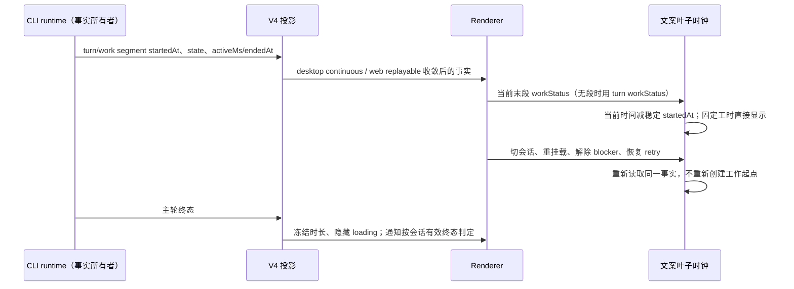
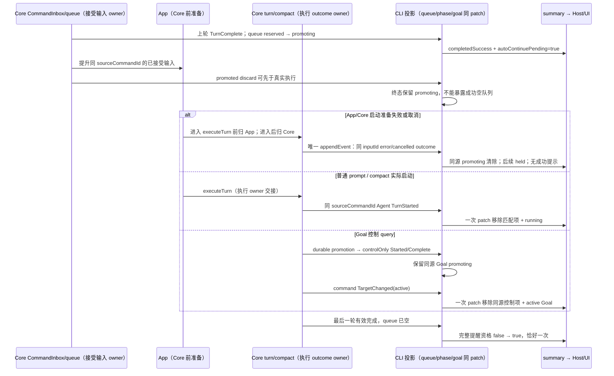
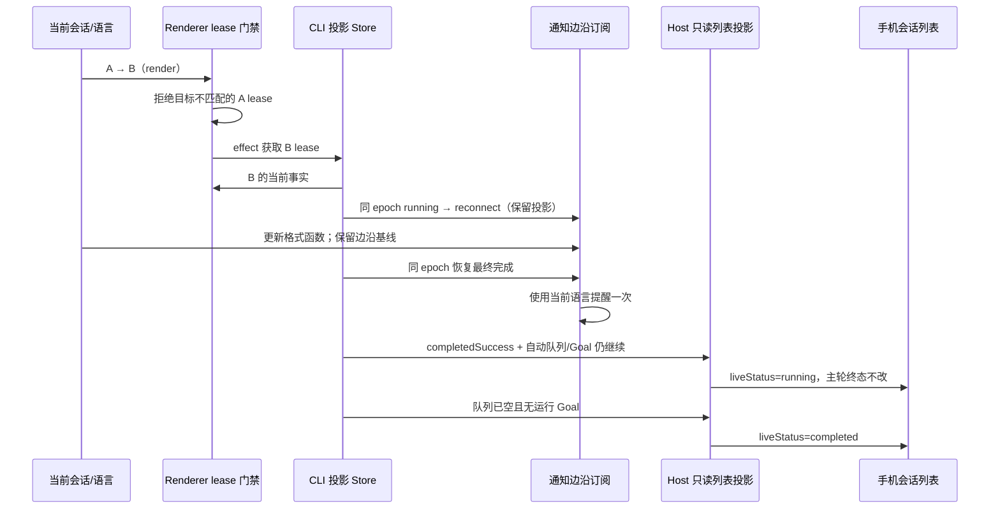
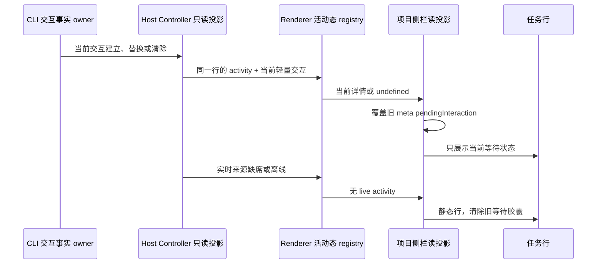
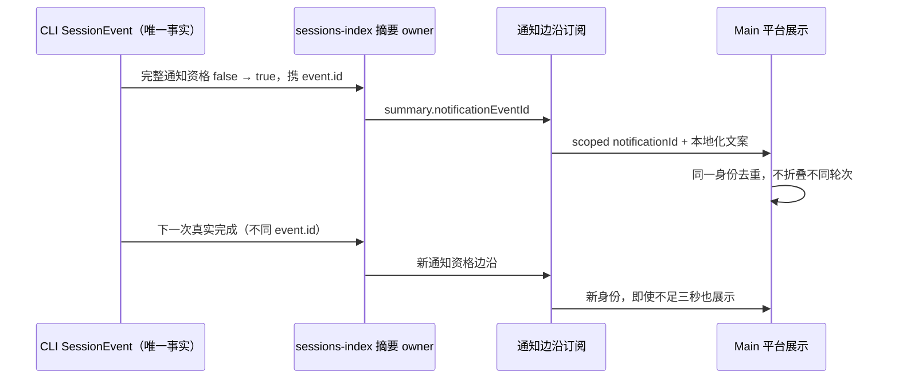
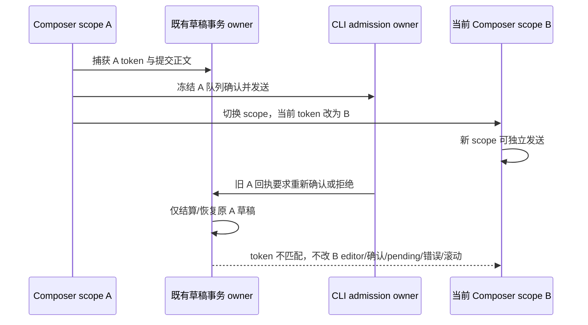
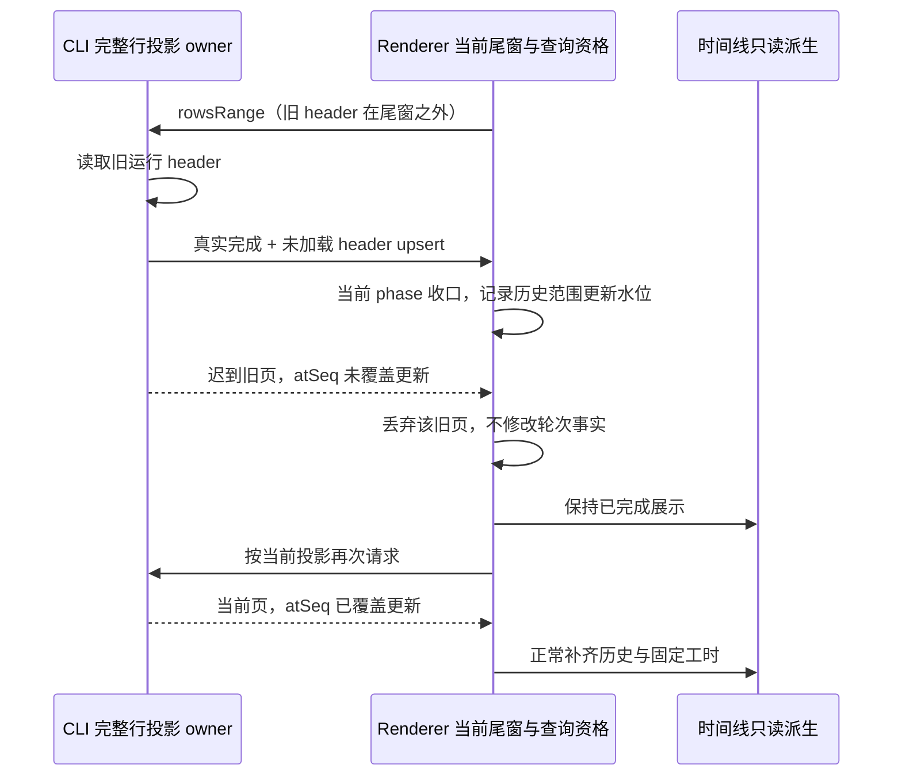
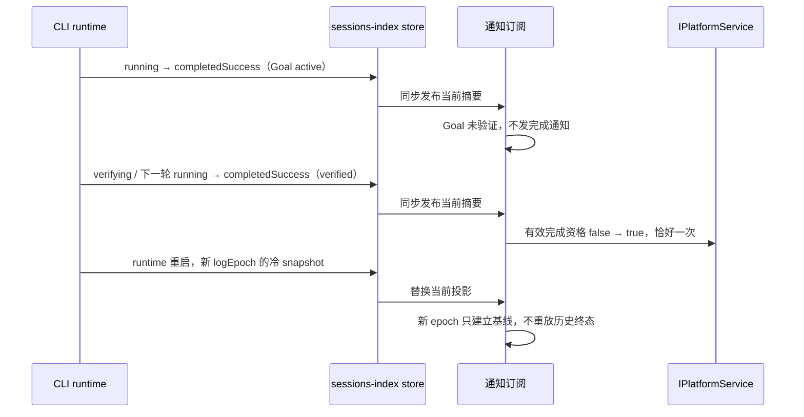

# 会话工作时长与完成提示连续性

## 问题与范围

2026-11-06：两个运行中会话切换后，底部“工作中”秒数从零重新计时。源码确认 `ChatLoading` 在挂载时使用 `performance.now()`，调用方没有传入已有工时；浮动 Composer 只收到派生时的 `durationMs`，没有稳定时钟锚点，因此缺少新投影时秒数停住。用户另报告完成提示后进入会话仍在运行，通知链路须同时检查中断、自动续跑和迟到异步发送。

本次沿用既有 CLI、Host、队列 admission、owner/lease、会话存在性和持久化入口。恢复已约定的计时与通知语义，并补齐已接受输入启动前缺失的终态事实；只修复有证据的相邻状态问题。

## 所有者与事件顺序

- 工作起点和终态唯一所有者是 CLI。Renderer 只维护刷新文案的时钟，不能缓存第二份按会话累计工时。
- 底部 loading、折叠工作摘要和浮动 Composer 使用同一个当前工作段事实。没有段的初始空轮回退主轮事实；不存在可靠时间事实时省略耗时，不伪造零秒起点。
- `activeMs`、`endedAt` 优先，固定事实不继续增长。远端起点领先本机时负差钳制为零。
- 秒级更新局限于文案叶子，不为计时重新派生整个 Timeline；组件 props 改变后当次渲染读取新锚点，不能短暂展示上一会话的时间。
- 窗口恢复可见、获得焦点时立即追平当前时间；后台 interval 节流不影响累计时间。
- permission/AskUserQuestion、compact/verifier、API retry 的可见分支沿用现有规则；隐藏后恢复不改变工作起点。
- 新主轮或新的 guided 工作段使用新事实起点；完成/中断后只显示冻结工时。
- desktop continuous 与 web replayable 继续使用原交付协议，恢复直接消费 V4 时间事实；身份隔离和路由不变。

## 验收场景

| ID    | 前置与操作                                                     | 断言                                                 |
| ----- | -------------------------------------------------------------- | ---------------------------------------------------- |
| WSC01 | A/B 均运行，A 已有工时，切 B 再切 A                            | 各自工时继续增长，首帧不归零、不串用另一会话时长     |
| WSC02 | 运行中卸载重挂载、blocker 隐藏后恢复、retry 文案切回 loading   | 使用同一稳定起点                                     |
| WSC03 | 运行中持续无投影，切换浮动 Composer，模拟窗口唤醒              | 底部、工作摘要与浮动文案继续按时钟增长，唤醒立即追平 |
| WSC04 | 新轮/guide 段；完成、中断、固定 activeMs/endedAt；远端时钟领先 | 新事实才更换起点；固定时长冻结；负差为零             |

计时场景采用真实 React 组件浏览器回放，合成 V4 事实与受控时钟；只写项目工作树内的 profile、缓存和证据。该证据不等同于真实模型、Electron 双 Host 或手机重连全链路验收。

## 自动队列的通知资格

源码已确认：`TurnComplete` 先发布主轮终态，`finishActiveTurn` 随后释放忙锁，V4 bridge 再自动提升下一条已接受输入。因此短暂的 `completedSuccess` 是队列执行边界，不能作为整项工作的完成提醒。

- `SessionSummary.autoContinuePending?: boolean` 由 CLI sessions-index projection 从当前 snapshot 的 `queue.autoDrain && queue.items.length > 0` 派生；包含 queued/reserved/promoting。没有自动消费的 held queue 不抑制已结束工作的通知。旧快照缺字段按 false 解释。
- UI 通知与 Host 未读信号对 `autoContinuePending=true` 的成功态不提醒；错误仍按既有失败契约处理。该字段仅限制提示，不改 phase、terminal/ready event、admission 或队列所有者。
- 前后状态的提醒资格均用完整 summary 比较；最终队列清空，即使 phase 仍为 completedSuccess，也能触发一次有效完成边沿。
- `startPromptTurn` 返回的是 Core admission，不等待 TurnStarted。若 `TurnSteerDiscarded(promoted)` 或 `SessionInputPromoted` 先于新 Agent TurnStarted，CLI 投影在终态下保留 promoting queue row，直到同 sourceCommandId 的 Agent TurnStarted；普通删除/失败丢弃仍立即清除，非终态的 durable promotion 仍按原契约移除。Agent TurnStarted 以一次原子投影推进运行态并移除匹配项，不能出现“成功态 + 空自动队列”的虚假完成窗口。接受队列与 admission owner 不变。
- 普通 prompt 和 queued compact 都发同源 Agent TurnStarted（compact 为 model-only）；Goal 先持久化控制 query，再发 controlOnly TurnStarted/Complete，最后设置 active Goal。controlOnly 不代表执行开始，不清除 promoting 项；TargetChanged(command, active) 原子发布 Goal 资格并只清与已见控制轮 sourceCommandId 准确匹配的 sendGoalCommand promoting 项，无续跑也不留下幽灵队列。同源 Agent TurnStarted 仍可收口普通启动；没有第二份 promotion 状态或任意后台工作的通知抑制。
- 明确的 pre-start TurnError(inputId) 只清同 sourceCommandId 的 promoting 项，不能误删 queued/reserved 或其它已接受 future input。失败前的拒绝/取消按既有 reservation 回滚或明确 discard 事实收敛。
- 已接受输入不能因启动准备失败仅日志退场。Core 普通轮在主执行 try 前失败/取消时，由尚未移交的同一生命周期 owner 发布既有 TurnError/TurnComplete(cancelled,inputId)；compact/rewind 交接后的启动持久化和执行由各自原有 outcome owner 一次结算，父轮不得重复发布。
- queued compact 在 App 的 prepare boundary、附件或命令展开阶段失败时尚未进入 Core；App 仅对携带已接受 queueItemId 的输入，通过 runtime 唯一 appendEvent 路径发布同源准备失败/取消事实。调用 executeTurn 后归 Core，不复制 outcome。未接受的直接输入准备拒绝仍沿原 ACK/调用拒绝语义处理。取消终态与错误终态都准确清除同源 promoting，后续输入保留 held。
- Core 函数调用并不等于主体已开跑：executeTurn/admitPrompt 的调度期间，已 abort、真实 queue 移除或 consumeCancelPending 都归现有调度取消回调。该回调可等待同源 outcome 持久化后才拒绝 completion；同一 command 的移除与 dequeue 取消互斥、重复 abort 幂等。进入 executeTurnCommand 后只归主体，不观察日志或另存旁路开始状态。admitPrompt 保留并释放原 reservation，未接受的直接调用取消不新增终态。
- Core 取消的 Goal 暂停沿既有持久状态接口处理，先发布唯一取消终态再更新暂停，以免暂停持久化拒绝吞掉已接受输入的终态。App 的失败判定按传入 signal 的真实取消状态；没有同源已接受 input 资格时不制造执行结果。
- 初次订阅和 CLI logEpoch 换代后的冷数据仅用作基线，不能重播完成提醒。
- Host 已应用的 `indexLogEpoch` 与摘要共同构成同一基线；subscribe ACK 只更新订阅归属，不提前覆盖已应用的 epoch。新 epoch 的 snapshot 静默替换摘要并补齐缺失索引行，不发 terminal/ready 或未读；同 epoch 的恢复 snapshot 保留真实完成边沿补投。
- 已应用同 epoch 水位之后迟到的 online/recovery snapshot 必须丢弃；recovery 仍确认该完整帧已交付，以免恢复 flight 卡住。任何迟到 snapshot 不得倒退摘要或水位。

WSC08：自动队列交接时不通知；最后一轮清空后通知；held queue 不抑制；失败不吞；cold 缺字段兼容。需要 projection 和通知的定向运行证据，完整 Electron 队列路径仍单独记录验收边界。

## 思考耗时

已确认相同挂载计时问题影响展开的 Reasoning：流式时按组件挂载时间计时，CLI `closeReasoningRow` 仅更新完成态而没有补已有协议字段 `durationMs`，因此切换会话后完成耗时也可能偏短。

- 流式 Reasoning 使用已有 `row.createdAt`（reasoning_start 事件时间）作为稳定起点；既有完成 `durationMs` 优先。
- CLI 在 reasoning 关闭时以 closing event 的时间减 `row.createdAt` 写入 `durationMs` 并钳制负差，完成后冻结。禁止以 Renderer 当前时钟推导历史完成耗时。
- 冷 transcript 合成沿用持久 `ReasoningPart.time.start/end` 作为 start/end 事件时间，事件全序仍由 sequenceNumber 裁决。缺少结束时间时沿用已有 interval 下界契约取 start，固定耗时为零，不使用合成 seq 时钟或当前时钟估算历史。
- WSC09：reasoning 展开、切会话/卸载、关闭再展开、live→complete 与冷重建；流式沿用起点，完成读取固定事实，末次 UI 挂载不能决定最终时长。
- WSC10：Host 旧运行/Goal 中间完成摘要之后 runtime 重启；新 epoch 冷成功不制造终态事件或未读，同 epoch 恢复最终完成仍恰好补投一次。

## 第二轮前端复查（2026-11-06）

- WSC11：同一 Host/workspace 内切换正式会话时，React render 先于替换 lease 的 passive effect。旧 lease 不能向新会话的 Composer、停止按钮、交互区或回调 ref 提供运行状态；未取得目标投影时沿用连接门禁。租约同时校验来源 layer、目标 sessionId 和草稿失效代。正式 lease 不携带草稿代，返回草稿时不能借用上一正式会话；预热转正且实际 sessionId 相同时仍可复用已有 lease。
- WSC12：通知文案语言变化只影响格式化，不重建 sessions-index subscription 或丢弃已观察的通知边沿。同 epoch 的 reconnect 保留投影时，语言切换后仍可补发实际完成，使用最新语言且恰好一次；endpoint、workspace、启用开关和 epoch 换代继续沿既有冷基线规则。
- WSC13：手机远控会话列表的 displayStatus 使用完整 SessionSummary 派生。completedSuccess 但自动消费队列尚有输入，或 Goal 为 active/verifying 时显示运行中，不能将主轮中间终态显示成会话已完成。held queue、Goal paused/notSatisfied/verified、普通完成与后台-only 的既有展示语义保留。只修正 Host controller 的只读展示投影，不改 CLI phase、任务持久镜像、admission 或公开协议字段。

这轮只修复可重放的前端状态错误；缺少真实 producer 事件链的乱序假设单独记录，不据此添加兜底或第二份会话事实。

### 第二轮验证记录

本轮新增修复回归 26/26、额外索引入口审计 3/3；原通知套件另作兼容复验 9/9。所有环境、缓存与证据仍限定在当前项目工作树，不读取真实用户数据。

| 验证                     | 结果与证据                                                                                                                                                                                                                                                                                                                                                                                                                                                                               |
| ------------------------ | ---------------------------------------------------------------------------------------------------------------------------------------------------------------------------------------------------------------------------------------------------------------------------------------------------------------------------------------------------------------------------------------------------------------------------------------------------------------------------------------- |
| WSC11 会话租约目标门禁   | `scripts/ci/session-pane-projection-owner.test.mjs` 6/6 通过，证据 `.run-logs/project-only-validation/source-tests-nn33DI/results.json` 与 `logs/source-tests.log`；修复前同 6 例为 2 通过/4 失败，证据 `source-tests-SkzIzR`。挂真实 React hook，并回放从真实 SessionPane AST 提取的 lease 读取与 binding 写入表达式；覆盖正式会话切换首帧、返回草稿、预热转正、layer/草稿代隔离以及旧 store 迟到更新。未挂完整 SessionPane/Composer。                                                  |
| WSC12 通知语言与订阅基线 | `scripts/ci/session-notification-subscription-audit.test.mjs` 新增 3/3 通过，证据 `.run-logs/project-only-validation/notification-subscription-audit-3yOWQ6/logs/regression.log`；修复前 2 通过/1 失败，证据 `notification-subscription-audit-zPAcYT`。真实 hook 配合内存 sessions-index 与平台端口，覆盖同 epoch 重连、live 切语言、重连保留投影时切语言；完成使用最新文案，重复终态不重复提醒。原 9 项通知兼容复验通过，证据 `session-work-notifications-wpjnRH/logs/regression.log`。 |
| WSC13 手机列表工作状态   | `scripts/ci/session-list-live-status.test.mjs` 17/17 通过，证据 `.run-logs/project-only-validation/source-tests-2dHBqn/results.json` 与 `logs/source-tests.log`；修复前 9 通过/8 失败，证据 `source-tests-8GWAjy`。执行 Host runtime → Controller → 真实手机 payload 函数，验证 Goal/自动消费队列的中间成功态与既有展示资格，端口为内存；未挂 MobileApp 或 Electron。                                                                                                                    |
| 索引入口乱序审计         | 真实 publisher/encoder/assembler/decoder/store 的 3 个回放通过，证据 `.run-logs/project-only-validation/session-index-ingress-audit-VLBZ5t/results.json` 与 `logs/audit.log`。迟到 initial/recovery 在到达 store 前被既有 ordinal 规则拒绝；新 epoch 低 seq 可替换旧 epoch，旧 subscription 的迟到帧被忽略。未确认新增快照倒退原因，未据此新增生产 guard。                                                                                                                               |
| 本轮最终静态检查         | 根 typecheck、根 lint 与 changed architecture 均 exit 0，证据 `.run-logs/project-only-validation/verify-gates-oKeXdk/results.json`；最终定向格式、全仓 fmt:check 与 diff --check 的实际结果和日志见 `.run-logs/project-only-validation/frontend-status-final-format-AWTYck/results.json`。CLI 此轮未改，首轮独立 Lint 与黄金测试的既有失败按原记录保留。                                                                                                                                 |

第二轮记录是实际源码路径与内存 ports 的定向验证，保持 partial；未运行完整 Desktop/Mobile E2E、真实系统通知、真实模型或远端 attachment，不作完整壳层验收、候选人工转正或 CI 准入。首轮 WSC01-10 的历史结果仍按下表与原证据记录，不因本轮新增回归而扩大覆盖。

## 验证记录

2026-11-06，所有夹具的 HOME、profile、数据、缓存和日志均绑定当前工作树，未使用真实用户数据。

| 验证                      | 结果与证据                                                                                                                                                                                                                                                                                                                                                                                                                                                 |
| ------------------------- | ---------------------------------------------------------------------------------------------------------------------------------------------------------------------------------------------------------------------------------------------------------------------------------------------------------------------------------------------------------------------------------------------------------------------------------------------------------- |
| 工作时长浏览器回放        | 8 个桌面/手机尺寸、中英文、主题参数组合通过；`scripts/ci/session-work-duration-browser.test.mjs`，证据 `.run-logs/project-only-validation/session-work-duration-browser-Ld8zT1/results.json` 与同目录 8 张截图。已查看桌面中文截图；截图为未加载产品 CSS 的简化功能 fixture                                                                                                                                                                                |
| 通知 hook                 | 9/9 通过；`scripts/ci/session-work-notifications.test.mjs`，证据 `.run-logs/project-only-validation/session-work-notifications-pHimfz/logs/regression.log`；原始源码同例 7/9 失败                                                                                                                                                                                                                                                                          |
| 思考 UI                   | 6/6 通过；`scripts/ci/session-reasoning-duration.test.mjs`，证据 `.run-logs/project-only-validation/session-reasoning-duration-rH5EqK/logs/regression.log`；原始源码同例 5/6 失败                                                                                                                                                                                                                                                                          |
| CLI 投影与 Host           | 38/38 通过；`scripts/ci/session-work-status-projection.test.mjs`，证据 `.run-logs/project-only-validation/source-tests-MOxpIT/results.json` 与 `logs/source-tests.log`。覆盖 summary/schema、队列交接与同源终态、Goal 控制轮、思考 live/cold 投影和 Host epoch/水位/未读边沿                                                                                                                                                                               |
| Core/App 启动前结算       | 最终 57/57 通过；`scripts/ci/session-work-prestart.test.mjs`，证据 `.run-logs/project-only-validation/session-work-prestart-o5XXzm/results.json` 与 `logs/regression.log`。实际执行 Core 主体、App 准备与交接，以及公开 executeTurn/admitPrompt、真实命令队列的 enqueue/drain；断言取消的三个调度入口、reservation 释放、终态 append 屏障和进入主体后不重复结算                                                                                            |
| 启动前结算阶段性红绿      | 初版 29 例为 9 通过/20 失败；补执行主体后扩展为 48 例，新增调度边界使其 33 通过/15 失败；补调度所有者并扩展到最终 57 例后全部通过。这是同一工作树各阶段的回放，未执行原始 HEAD 的完整 57 例，不把阶段性失败数量当作最终套件的 HEAD 对照                                                                                                                                                                                                                    |
| 既有 CLI 黄金回归         | 385/386 通过，exit 1；`scripts/ci/session-work-status-golden.mjs`，证据 `.run-logs/project-only-validation/session-work-status-golden-0Hm9YW/results.json` 与 `vitest-report.json`。唯一失败为 `product-projection.test.ts:4049` 的“配置读取重试保留错误类别”旧 expectation：期望 request_verification_config_network，实际 fault.network.unreachable。该 expectation 未改，相关 normalizer 与 HEAD 源码一致；未执行完整 HEAD 黄金回放，不将此结果记为全绿 |
| CLI 类型与源码 noEmit     | CLI typecheck exit 0，证据 `.run-logs/project-only-validation/verify-cli-types-CUulzL/results.json`；Core 与 bootstrap 源码 noEmit 均 exit 0，证据 `.run-logs/project-only-validation/session-work-status-types-R4tobV/results.json`                                                                                                                                                                                                                       |
| CLI Lint 与 HEAD 诊断对照 | CLI 全包 lint exit 1，89 errors/76 warnings，证据 `.run-logs/project-only-validation/verify-gates-EFw1os/logs/cli-lint.log`。13 个改动 CLI TypeScript 文件的诊断规则与严重级别均与 HEAD 相同，证据 `.run-logs/project-only-validation/wsc-cli-lint-comparison-jmMYaM/results.json`；这不代表 CLI 全包 lint 通过                                                                                                                                            |
| 根工作区与架构检查        | root typecheck、root lint、changed architecture 与 CLI registry 检查均 exit 0，证据 `.run-logs/project-only-validation/verify-gates-EFw1os/results.json`；类型与静态检查不计作 E2E 用例覆盖                                                                                                                                                                                                                                                                |
| 格式检查                  | 首次根 fmt:check 实际检查 8102 个文件，exit 1，仅本 spec 未格式；最终检查结果与证据：最终定向格式与全仓 fmt:check 的实际退出码、日志见 `.run-logs/project-only-validation/wsc-final-format-iTpQUI/results.json`                                                                                                                                                                                                                                            |

浏览器 fixture 使用真实计时 hook、`ChatLoading`/placeholder 叶子与 render-unit 派生事实，完整 `SessionPane`/`ConversationTurnGroup`/`ConversationComposer` 接线另经 AST 检查；未挂完整产品页面。通知 fixture 挂真实 hook 和内存 sessions-index；CLI/Host fixture 消费真实投影与注入端口；Core/App fixture 执行真实公开 admission、命令队列和执行主体，准备、存储与模型端口采用内存故障注入。38 项覆盖 Goal 正常控制轮交接与 reservation 回滚，57 项不代表 Goal 控制轮失败/取消全链验收；当前 Goal controlOnly producer 固定发布 Started + Complete(success)，准备/持久化拒绝经队列 reservation 回滚为 queued、外层关闭 autoDrain 后收敛为 held，失败输入保留重试。上述套件没有串接完整 CLI stdio 进程、Electron 或手机链路，也不启动真实模型。未执行打包 Electron 双会话导航、真实系统通知、真实 runtime 重启或手机远控重连全链路。覆盖保持 partial，该记录不代表全量设备验收、人工转正或 CI 准入。

本机 Node 为 24.18.0，仓库 `mise.toml` 指定 24.14.0，当前没有可用 mise；未下载替代运行时。未进行发行打包、提交或推送。

## 第三轮前端复查（2026-11-06）

WSC14：项目侧栏的实时等待状态只归当前 CLI 投影。旧 tasks-index `meta_json.pendingInteraction` 可能随只读项目树返回，但不能遮盖 Controller 已更新的交互详情或已清除的等待状态。Controller registry 与 fallback sessions-index adapter 在同一 UI 读投影中传递当前轻量交互；`applyProjectTaskActivities` 统一覆盖或清除旧字段，不在行组件各自补兜底，也不写回持久镜像。缺少实时摘要或来源离线时按既有 TSL23-A 规则显示静态行，无 spinner/attention；行集合、组织态和标题仍由 Host 持有。

Controller wire 的 `task.meta` 在现有元数据 schema 上显式接纳可选 `sessionPendingInteractionSummarySchema`，保留 Host 已派生的当前轻量详情并严格校验 kind/自动处理状态；缺席仍表示当前投影无交互。该扩展只属于 Controller 只读行，不放宽持久 tasks-index 元数据解析，不新增交互写者。回归须经过真实 Controller frame schema，不能只把未校验的内存对象传给 registry。

验证先执行带真实旧 SQLite 元数据的回放，再修改 UI 读投影；完整 Desktop/手机壳层验收单独记录。

WSC15：完成与失败通知的幂等键属于真实 CLI 通知资格边沿，不能仅按会话 ID 加三秒窗口去重。现有 sessions-index 摘要 owner 在完整通知资格由无效变为有效时保留触发的 `SessionEvent.id`，使用可选严格 `notificationEventId` 字段；后续标题或后台进度更新保留同一身份。Goal 最终验证和自动队列收口即使 phase 不变，也使用各自触发事实的 ID。冷种子缺少身份仍仅建立基线。UI 将 endpoint、workspace identity、index epoch、session 与该事件组合为可选平台 `notificationId`；Main 只按这个不透明幂等键去重，不持有会话运行事实。旧 CLI/payload 缺少身份时保留既有兼容去重，交互仍按 requestId。两个不同有效完成/失败边沿必须各展示一次；多个窗口的同一事件不重复展示。Main 仅保留最近 4096 个已展示终态身份，按 FIFO 淘汰；有效保留期间去重不因三秒到期失效，不作跨 Main 重启或无限历史去重承诺。

已经有效发送后，由 IPC 或操作系统延迟展示的通知不具有自动撤回契约；本轮仅验证该平台边界，不在 Main 新增业务状态或把历史有效发送称为新误报。

WSC16：同一个 Composer 实例切换会话时，提交回执、确认弹窗和本地 pending 必须绑定现有 `composerDraftScopeToken` 的生命周期。提交捕获的草稿事务负责原 scope 的成功收口或失败恢复；迟到 `confirmationRequired` 只能在提交 token 仍是当前 token 且正文没有被后续编辑替换时重开确认。A → B 或离开后再回 A 的旧回执不能读取当前 B/新 A 队列、弹出旧确认、清正文或阻塞新 scope 的发送。Root Draft 提升为正式会话沿用原 token，正常首发 ACK 仍能结算。旧 pending 的 finally 不能清除新 scope 的提交；仅使用现有草稿 owner/事务，不新增已接受队列或后台状态。

Pane 的发送错误横幅与成功滚动也消费同一 token 资格：原 A 失败只交回原提交事务，不向 B/新 A 写入错误；原 A 成功不能清除 B 的错误或滚动 B 的时间线。原 scope 仍为当前时，失败提示和立即发送后的滚动照常执行；Root Draft 提升仍属于同一生命周期。不能仅按 sessionId 比较，也不以延迟清理掩盖迟到回执。

WSC17：历史 `rowsRange` 查询与 live 行更新共用 CLI 权威投影，但回复可能晚于后续 online/recovery 帧。未加载行的 upsert/delta 沿协议不直接插入 Renderer 尾窗；已经在途的历史查询必须记录与自身历史范围有关的行更新水位。结果 `atSeq` 没覆盖这些更新时不能前插旧 header、Reasoning 或其他历史行；若结果已覆盖则正常接纳。无关尾部 append/文本增量不得让历史查询饥饿，不一律比较会话全局 seq。snapshot 整体替换即使 epoch、seq、首行游标均相同，也撤销原查询资格。普通补拉与导航全量补拉复用同一判定；查询资格属于现有 Store 的在途请求，不保存第二份业务行事实或改写 CLI 轮次状态。下次按当前投影重新查询仍可加载。

当前协议的合批 delta 只携带整帧 `fromSeq/toSeq`，不保留逐行更新的源事件 seq；`createdAtSeq` 是创建水位，不能当作更新水位。Store 因而使用命中行所在帧的 `toSeq` 作为可证明的覆盖上界。若查询夹在同帧的相关行更新与尾部更新之间，即使页内该行实际已更新，也不能证明覆盖整帧，保守丢弃并允许下一次鲜读正常加载；无相关历史行更新的纯尾部帧不影响资格。这个合批边界不通过复制业务行事实或新增协议绕过，也不承诺每个重叠页都无需重查。

两条 delivery profile 均使用同一查询资格规则，另覆盖隐藏行 delta/upsert、同游标整体恢复、无关尾部流式更新及已经覆盖新水位的页；完整 stdio、Electron 与手机恢复仍不是该内存端口回放的验收范围。

### 第三轮验证记录

本轮修复侧栏等待详情、通知事实去重、跨 scope 发送回执和历史补拉四类相邻状态问题。受影响新旧源码夹具合跑 164/164，证据 `.run-logs/project-only-validation/source-tests-G5XyDc/results.json` 与 `logs/source-tests.log`。所有 HOME、数据、缓存与证据限定在当前工作树。

| 验证                      | 结果与证据                                                                                                                                                                                                                                                                                                                                                                                                                                                                 |
| ------------------------- | -------------------------------------------------------------------------------------------------------------------------------------------------------------------------------------------------------------------------------------------------------------------------------------------------------------------------------------------------------------------------------------------------------------------------------------------------------------------------- |
| WSC14 侧栏当前交互与 wire | 最终 15/15（`source-tests-pg6oVC`）。初版 13 例修复前 1 通过/12 失败（`source-tests-q0JIH2`）；在已修 UI 上补真实 Controller 校验后，schema 修复前 11 通过/4 失败（`source-tests-hmHR6z`），不能称为完整 HEAD 对照。执行 SQLite 内存读取 → project reader → Host runtime → Controller frame schema → registry → 共享项目投影 → TaskRowContent SSR，并复验 fallback。覆盖当前 Ask/permission 替换、缺席/离线清旧等待、自动处理状态保留/替换与非法 kind 拒绝。               |
| WSC15 真实通知资格身份    | CLI gateway/wire 6/6（`source-tests-Ele8iS`），可信修复前 1 通过/5 失败（`source-tests-3qLqPa`）。真实 React hook → Desktop platform → preload AST → Main dispatch 18/18（`notification-platform-audit-S9wBET`），native/IPC 为内存端口。平台阶段性红为 7 通过/11 失败（`notification-platform-audit-x7oU7e`），当时部分身份代码已修改，不是 HEAD 全套对照。包括不同事件不足三秒各展示、同一身份超过三秒去重、FIFO 边界与有效发送后平台滞后。                              |
| WSC16 草稿与 Pane 副作用  | 最终 22/22（`source-tests-0FdNuN`）。初版 6 例 1 通过/5 失败（`source-tests-J8RSCK`）；旧确认/关闭回调阶段 12 通过/2 失败（`source-tests-mlk6EI`）；补真实 Pane 错误 state/reset effect 与滚动副作用后、Pane 尾部修复前 17 通过/5 失败（`source-tests-ST8Ih3`）。固定 React fiber 执行实际 Composer/Pane AST、既有草稿事务及真实 CLI held 判定；Root 转正的生产 token 继承另经源码确认，未挂完整 Composer/Lexical/Pane 树。                                                |
| WSC17 历史查询资格        | 最终 30/30（`history-query-final-checks-TjfnlX/results.json`，子日志 `children/source-tests-tcaw7p/logs/source-tests.log`）；初版 26 例修复前 12 通过/14 失败（`source-tests-1Y6Rnd`）。真实 publisher ingest/subscribeReserved/commit/reserveFlush/getRowsRange → wire schema → Store → render units，两种 profile 各 15 例。批帧中间页的 2 项初始失败（`source-tests-7ShaUh`）是逐事件水位缺失的边界审计，已按上述安全上界契约改为保守拒绝与鲜读恢复，不列为新生产缺陷。 |
| 受影响旧回归              | 旧行共享 `conversationProjectionStore.rowSharing.test.ts` 26/26（`third-status-legacy-store-lL88ia/results.json`），独立 Vitest 配置、缓存与环境在沙箱；既有 Recent 21/21（`source-tests-JoYyaX`）。原通知 9 项、语言订阅 3 项、投影/Host 38 项、租约 6 项与手机列表 17 项纳入上述 164 项合跑。                                                                                                                                                                            |
| CLI 类型与 Lint           | CLI typecheck exit 0（`verify-cli-types-YA6nmr`）。三个本轮 CLI 文件定向 Lint 与 HEAD 对照：projection/publisher exit 0，gateway 的 1 error（max-lines）与 5 warnings（no-useless-spread）与 HEAD 一致，证据 `notification-identity-lint-eug4nG`。首轮 CLI 全包 Lint 89 errors/76 warnings 及黄金回归 385/386 的既有失败按原记录保留。                                                                                                                                     |
| 最终根检查                | 根 typecheck、根 lint、changed architecture 均 exit 0（`third-status-gates-oSbqOk/results.json`）。初次根 typecheck 真实发现 Controller meta schema 缺交互字段（`third-status-gates-oMsA4U`），已修正并纳入 wire 回归。最终定向格式、全仓 fmt:check、git diff --check 的退出码与具体日志路径统一见 `.run-logs/project-only-validation/third-status-final-format-results.json`。                                                                                            |

初次合跑 `source-tests-OrQrbe` 111 通过/1 文件装载失败（112 个 Node 测试计数）是缺少 UI 路径别名，正确指定 `packages/ui/tsconfig.json` 后最终合跑完整 164 项；未把装载失败误判成业务回归。嵌套格式检查 `history-query-final-316wSm` 曾因 Node 写入白名单拒绝根目录 formatter 临时配置而失败，改用受控父 formatter 路径后通过；所有临时配置仍位于本工作树。

第三轮保持 partial：未运行完整 Electron、多窗口原生通知、手机远控 attachment、真实模型或远端恢复 E2E。架构检查的通过也不证明 legacy unmanaged 模块的运行时语义。源码尚未提交、推送、打包或修改版本。

## 完成通知消费者（既有规则）

源码确认普通成功轮收口与 Goal 自动续跑属于不同事件：`TurnComplete(success)` 先发布 `completedSuccess`，随后同一次已接受提交进入 Goal verifier 或下一轮 `running`。通知不能把这个中间边界称为任务已完成。Renderer 的系统通知资格与 Host 已有未读资格保持一致：仅 `error` 提示失败；`completedSuccess` 在无 Goal 或 Goal 为 `verified` 时提示完成；`completedInterrupted` 是用户停止或新输入打断，不提示成功完成。后台工作存在与否沿用既有通知契约，不凭它一律取消主轮完成提醒。

- 通知 hook 在现有 sessions-index subscription 回调内同步消费 store 当前状态；不将摘要复制到 React state 后再由迟到 effect 发送。CLI 仍是事实所有者，hook 只保留通知边沿基线。
- 首次 snapshot、workspace/endpoint 切换、无有效投影后的重新连接和新 `logEpoch` 均只建立基线。相同 epoch 的恢复帧仍可补发已观察运行会话的真实完成边沿。
- 比较前后摘要的完整通知资格，包括 Goal 状态；`completedSuccess(active)` → `completedSuccess(verified)` 必须能发最终通知，标题或摘要重复更新不重复发。
- 离线或错误后失去投影时清除通知基线，旧订阅卸载后不得发送；桌面 continuous 与手机 replayable 均消费各自已收敛的同一 store 契约。

| ID    | 前置与操作                                                                                            | 断言                                                                                 |
| ----- | ----------------------------------------------------------------------------------------------------- | ------------------------------------------------------------------------------------ |
| WSC05 | 停止/立即发送中断；普通成功/失败；后台工作仍存在                                                      | 中断无成功提示；普通有效完成/失败恰好一次；后台-only 契约保持                        |
| WSC06 | Goal active/verifying/notSatisfied/paused → 续跑 → verified；验证状态变化但 phase 仍 completedSuccess | 中间轮无完成提示；最终 verified 边沿恰好一次                                         |
| WSC07 | 终态与 running 在 React 提交前连续到达；runtime epoch 换代；失去投影后重连；旧订阅卸载                | 通知同步读取当前投影；新 epoch/冷基线不回放；旧订阅无发送；同 epoch 恢复完成边沿保留 |

通知回归用真实 React hook、现有摘要编排与内存 sessions-index 端口回放，所有缓存、环境目录和测试产物限定在当前工作树；不启动真实 Host/CLI，不访问用户数据或外部通知服务。
