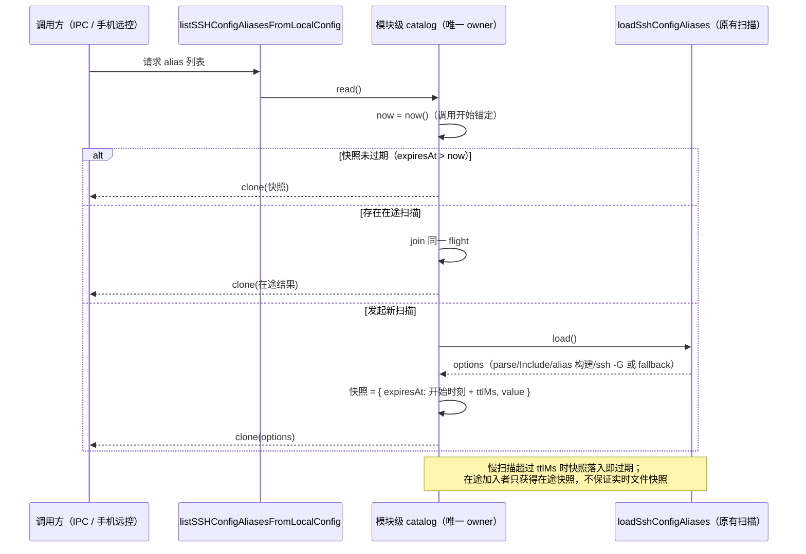

# SSH config alias 列表的在途合并（TTL 快照 + 单飞）

## 范围与基线

继续 `packages/services/src` 只读扫描后的修复轮；保留既有未提交改动，不修改 automation / session / model-provider 相关文件，不提交、不推送、不打包，不启动应用或真实 Agent，不调用模型 API，不使用真实用户数据。

freshness 与 `architecture:check --changed` 由父代理执行（main 与 origin/main 同步，0/0/0）。Node 使用当前 PATH 的 v24.18.0（`mise.toml` 要求 24.14.0，不下载/切换），pnpm 一律 `corepack pnpm`。回归只经 `scripts/ci/source-test-runner.mjs`（`node:test` + 项目沙箱），不使用 Vitest、不启动真实 ssh、不读取真实 HOME/`.ssh`/`.zcodium`。

本轮只改 `packages/services/src/system/sshConfigAlias.ts` 的缓存簿记，并新增同域纯 DI helper、spec、回归与 CI wrapper；`parseConfigBlocks` / Include 展开 / alias 构建 / `resolveSshExecutablePath` / `runSshConfigQuery` / `parseSshGOutput` 逐字不变。

## 已确认问题

`listSSHConfigAliasesFromLocalConfig` 原来只有一个 30s TTL 的模块级结果缓存（`aliasCache`）。TTL 只能在**一次扫描完成后**阻挡顺序重复；并发首调全部 miss 缓存，各自完整重扫并重复 spawn `ssh -G` 子进程（alias 上限 200、并发 3、单个 1.5s 超时）。两个并发调用还会互相覆盖 `aliasCache`（结果等价，纯浪费）。

调用方全部汇入 main 进程单实例，模块状态共享，且各层都没有去重：

- `packages/desktop/src/main/desktopRuntimeEnv.ts` 的 `listSSHConfigAliases`（薄透传）；
- `packages/desktop/src/main/desktopMainIpcRemote.ts` 的 `PlatformChannels.ListSSHConfigAliases` IPC handler；
- `packages/desktop/src/main/webRemoteControl/index.ts` 手机远控同名 case；
- Renderer 触发点 `packages/ui/src/hooks/useRemoteConnectionForm.ts`（dialog 打开且 kind 为 ssh 且未加载过时 invoke；hook 内的 loaded/cancelled 守卫防不住已发出的 IPC）。

确定性复现（都落在同一次在途扫描窗口内）：两个桌面窗口同时打开 SSH 远程连接对话框；桌面对话框加载中手机远控同时请求；单窗口打开后首调未返回即关闭再打开。N 个并发调用 = N 次全量配置解析 + N×aliasCount 个 `ssh -G` spawn。

## 设计与不变量

- 唯一所有者：模块级 catalog（TTL 快照 + 单飞）仍是 alias 列表唯一的缓存与合并点；不新增第二个缓存、队列或后台任务。catalog 是纯 DI：`load`（完整扫描 loader）、`now`（时钟源）、`ttlMs`、`clone`（返回前拷贝），自身不做 IO、不直连时钟。
- 默认装配不变：`listSSHConfigAliasesFromLocalConfig()` 公开签名与调用方不变；生产装配为 `load = loadSshConfigAliases`、`now = Date.now`、`ttlMs = CACHE_TTL_MS`、`clone = cloneAliasOptions`。
- TTL 锚定在**调用开始**：`read()` 入口捕获 `now`；写入快照时 `expiresAt = 调用开始时刻 + ttlMs`（**不是**完成时刻）；过期比较严格 `expiresAt > now`。单次慢扫描超过 TTL 时，快照落入时已过期，下一次 `read()` 重新扫描——不把 TTL 改成按完成时间续期。
- 单飞：TTL miss 且存在在途扫描时，后来者 join 同一 flight，不发起第二次扫描；TTL 过期**不取消**在途扫描，加入者获得该次在途快照的独立副本。因此慢扫描（> TTL）期间加入者拿到的是在途快照，**不保证实时文件快照**，spec 如实声明该边界。
- 返回隔离：leader 与每个 joiner 都经过 `clone`，返回的数组与 option 对象相互独立，调用方修改返回值不得污染缓存（`cloneAliasOptions = options.map((option) => ({ ...option }))` 完整保留）。
- 拒绝语义：loader 拒绝时 flight 内所有等待方收到同一拒绝，`finally` 清除 flight，**不吞异常**、不缓存拒绝，下一次 `read()` 重新扫描。
- 空结果保留原语义：无 `~/.ssh/config` 与无 alias 两条空数组路径仍由 loader 返回 `[]` 并按同一 TTL 缓存。
- 无新增 timer / cancel / dispose / fallback：无 ssh 时的 fallback 由原 loader 逐字保留（本轮不验证真实 `ssh -G` 成功路径，也不把假 loader 称作真实 ssh 验证）。

## 验收

回归经 `scripts/ci/ssh-config-alias-single-flight.test.mjs`（`runSourceTests` + 项目沙箱，纯内存 + 沙箱 HOME，不写真实目录、不起真实 ssh）执行，至少覆盖：

1. 并发 scan 调用 2→1：两个并发 `read()` 只调用一次 loader，结果相等；
2. 请求加入中途：loader 被闸门控制在途时发起第二个 `read()`，仍只一次 loader，双方获得同一快照的独立副本；
3. TTL 边界：`expiresAt` 之前命中缓存，`expiresAt` 当刻及之后重新扫描（严格 `expiresAt > now`）；
4. 完成后缓存：连续两次 `read()` 第二次不调 loader；
5. 起始时间锚定：慢扫描（耗时 > ttlMs）完成时快照已过期，下一次 `read()` 必须重新扫描；
6. 拒绝重试：loader 第一次拒绝 → `read()` 原样拒绝且 flight 清除，第二次 `read()` 重新调用 loader；并发两方共享同一拒绝；
7. 空结果缓存：loader 返回 `[]` 时按 TTL 缓存，返回数组相互独立；
8. 拷贝隔离：修改返回值不影响缓存与后续返回；
9. 生产装配保持（不起真实 ssh）：导出函数经真实 parse + 无 ssh 的 fallback 分支返回 alias，调用间改配置仍返回旧快照（证明缓存接线），修改返回值不污染缓存。

## 复现与验证结果

- 红灯（旧缓存逻辑等价抽取版，未加单飞；沙箱 `.run-logs/project-only-validation/source-tests-bV0IwM`，results.json exitCode 1）：10 项中 7 过 3 败——TTL/缓存/空结果/拒绝/拷贝隔离 6 项与生产装配 1 项通过，3 项单飞全部以 `2 !== 1` 失败（并发/加入中途 loader 被调用 2 次而非 1 次）。证明抽取忠实复现旧缓存语义、新回归能检出缺失的合并。红灯运行的是等价抽取的 catalog，不是原函数；原函数仅在沙箱内的生产装配用例中被执行（该用例在红灯与绿灯下均通过，证明行为保持）。
- 绿灯（加入 in-flight 后，沙箱 `source-tests-YPTc84`）与生产改线后的终态绿灯（沙箱 `source-tests-gkdPcV`，results.json exitCode 0）：均 **10/10 通过**，wrapper 以确切计数 10 断言。
- 定向验证：`oxfmt --check` 4 个文件全部通过；`oxlint` 4 个文件 0 警告 0 错误。
- 唯一生产文件为 `packages/services/src/system/sshConfigAlias.ts`（708 → 704 行，净减 4 行，新增 20 行 / 删除 24 行；`max-lines` 既有 legacy 例外不新增、不扩大；`parseConfigBlocks` / Include 展开 / alias 构建 / `resolveSshExecutablePath` / `runSshConfigQuery` / `parseSshGOutput` / `mapWithConcurrency` 逐字未动）；新增 `packages/services/src/system/sshConfigAliasCatalog.ts`（70 行）、`packages/services/test/sshConfigAliasCatalog.test.ts`（298 行）、`scripts/ci/ssh-config-alias-single-flight.test.mjs`（12 行）与本 spec。
- 未验证边界：未测真实 SSH 端到端耗时或进程数，未执行真实 `ssh -G` 成功路径、真实多窗口/手机 GUI 级并发。主代理已完成 typecheck / lint / 变更架构门禁与 69 项功能回归、16 项守卫；4 条 Lint 警告和全仓格式的旧文件失败保留。历史两次未隔离调试的 tsx 缓存写入范围不能完全证实，失败尝试不算绿灯；现行回归全走沙箱。证据、原始/当前保证与边界见[统一验证记录](../../.run-logs/project-only-validation/performance-continuation-4AdfBY/final-verification.md)。
- 依赖扫描发现新 catalog 的两个内部 interface 没有外部引用，已取消不必要的类型导出；factory 及公开列表函数签名、运行时代码与 10 项回归不变。不修改 Knip ignore，也不删除已执行的测试来消除静态误报。
