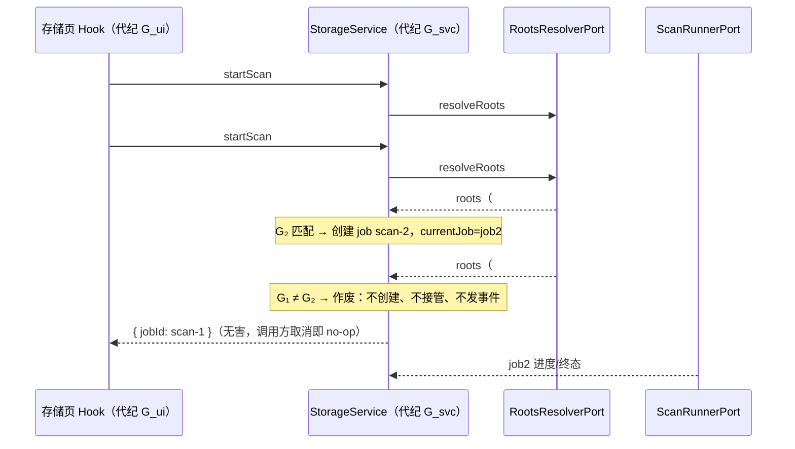
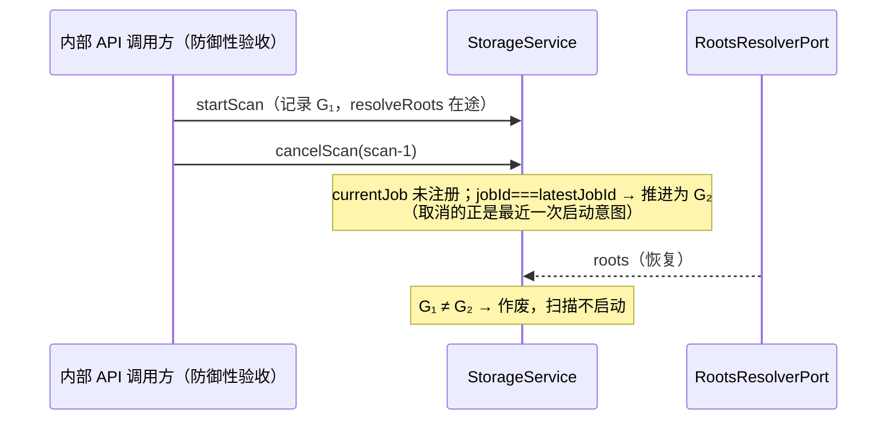

# 存储扫描启动代纪：在途启动意图的作废边界

## 范围与基线

继续 `packages/services/src/storage`（managed 模块，owner: desktop-settings）的性能/竞态重扫；保留既有未提交改动，不修改 session / git / zcode-agent / bots / model-provider 相关文件，不提交、不推送、不打包，不启动应用或真实 Agent，不使用真实用户数据。

freshness 与 `corepack pnpm architecture:check --changed` 由父代理执行（0 违规）。已读取 `storage` 模块受控上下文（`architecture:context storage`）与 `docs/specs/storage-scan-lifecycle.md`、`packages/ui/src/resource-manager/storage/useStorageUsage.ts`、`packages/desktop/src/main/resourceManagerStorage.ts` 实际契约与调用方。本轮只改 app 层一个方法族，不改变任何对外接口、状态所有者或跨模块依赖。

## 已确认代码路径

`createStorageService.startScan`（`packages/services/src/storage/app/storageService.ts`）：

```ts
async startScan() {
  cancelCurrentJob();
  const jobId = `scan-${++jobCounter}`;
  latestJobId = jobId;
  const roots = await deps.roots.resolveRoots(); // 异步端口，await 窗口
  const job = createScanJob({ ... });
  currentJob = job; // 无代纪检查：过期意图也会接管
  ...
}
```

`resolveRoots` 是注入的异步端口（桌面侧遍历数据根定位）。await 期间服务状态可被其他命令改变，而恢复后的旧代码不校验「本次启动是否仍是最新意图」，直接创建 job 并接管 `currentJob`。两类可复现竞态：

1. **乱序接管**：两次 `startScan` 在途（UI 双击 rescan、或 effect 重入），第二次启动时第一次尚未注册（`cancelCurrentJob` 取消不到它），第一次恢复后反而覆盖 `currentJob`。先启动的旧 job 永不被取消，与新 job 并发跑完两份全量扫描；`done` 清理条件 `currentJob?.jobId === jobId` 也永不成立，旧 job 尾包照发。
2. **取消后启动**：`cancelScan(jobId)` 到达时 job 尚未注册，命中 `currentJob?.jobId !== jobId` 早退成为 no-op；随后旧 job 无视取消启动并跑完，`latestSnapshot` 还会按 `jobId === latestJobId` 入库这次已取消的扫描结果。

同一窗口也出现在 `clean()` / `dispose()` 与在途启动交错时：清理删文件与旧扫描并发、销毁后仍启动新扫描。

## 设计与不变量

- 唯一所有者不变：`createStorageService` 仍是扫描 job、最近快照与 `latestJobId` 的唯一生产者；不新增缓存、队列、后台任务或第二条状态路径。修复只增加一个单调递增的代纪计数器。
- 代纪语义：`cancelCurrentJob()`（被 `startScan` / `cancelScan` 当前 job / `clean` / `dispose` 调用）与 `cancelScan` 取消「最近一次启动意图」时推进代纪；`startScan` 在 await 前占位代纪，恢复后不匹配即只返回 `{ jobId }`，不创建 job、不注册、不发事件、不写 `latestSnapshot`。
- 代纪**不**复用 `latestJobId`：`latestJobId` 同时是快照入库过滤器，必须让被取消 job 的终态快照继续入库（既有注释明确的「取消态快照」语义，`docs/specs/storage-scan-lifecycle.md` 的验收依赖）。代纪只约束 await 窗口，不影响已注册 job 的过滤行为。
- 接口形状不变：作废的 `startScan` 仍返回自己的 `jobId`；调用方（UI hook 的代纪检查、desktop ipc 接线）对该 jobId 的后续 `cancelScan` 因 `currentJob` 不匹配而无害 no-op。`StorageManagementApi` 契约原文「开始一次扫描；若已有进行中的 job 会先取消它」由此在竞态下也成立。
- owner/lease：服务持有扫描 job（owner）；`jobId` 是调用方持有的 lease；桌面 main 另有一份 `latestJobId` 记账用于窗口关闭取消（`resourceManagerStorage.ts`，不在本轮范围）。代纪作废不改变 lease 的发放与回收协议。
- workspaceIdentity：本服务由 desktop main 单实例持有（资源管理器窗口专用，不经 host RPC 注册），不参与 `workspaceIdentity` 隔离与跨 Host 路由；数据根解析走 `RootsResolverPort`，代纪按服务实例局部计数，无跨实例共享状态。
- desktop/mobile：存储页只在桌面资源管理器窗口存在，经 `ipcMain` + preload bridge 同步调用；手机远控与 Web 不暴露该命令面，不涉及 `desktop-continuous` 与 `web-remote-replayable` 两条链路。进度快照经 `onScanProgress` 单播给订阅窗口，语义不变。

## 事件顺序





## 验收方案

先添加回归（node:test + `node:assert/strict`，纯内存端口 mock：可 gate 的 `RootsResolverPort`、手动收尾的 `ScanRunnerPort`、空操作 `FsCleanerPort`，不写文件系统、不启动 Worker、不使用真实数据）：

- 旧实现：乱序接管用例实测 2 次 `runner.run`（双份全量扫描）；取消后启动、dispose 后启动、clean 后启动用例各实测 1 次 `runner.run`——回归必须因此失败。
- 修复后：四种作废路径中，被作废意图触达 `runner.run` 均为 0 次；唯一存活的扫描是最新一次启动（进度事件只含最新 jobId）。
- 行为不变：单次正常启动照常扫描并入库终态快照；`cancelScan` 取消当前 job 后终态快照仍为 `cancelled` 且可被 `getSnapshot` 读回（既有「取消态快照」语义）；对未知/陈旧 jobId 的 `cancelScan` 为 no-op，不打断当前 job。

回归经 `scripts/ci/source-test-runner.mjs`（`runSourceTests` + `createProjectTestSandbox`）由 PATH Node 24.18.0 在项目内隔离沙箱执行；沙箱把 HOME/TEMP/APPDATA 等全部重定向到 `.run-logs/project-only-validation/<label>-*` 并以 `--permission --allow-fs-write=<sandbox>` 限制写入，本测试不产生任何写入。随后执行 `corepack pnpm architecture:check --changed`。全量 typecheck / lint / 格式检查由父代理统一执行。

## 复现与修复结果

- 旧实现新增回归 **4 失败 / 3 通过**（内层 7 项）：乱序接管实测 `runner.run` 2 次（`2 !== 1`，两份全量扫描并发）；取消后启动、dispose 后启动、clean 后启动各实测 1 次（`1 !== 0`）。失败均来自作废路径断言，3 项行为保持断言在旧实现下即通过，证明行为未变。
- 修复后回归 **7/7 通过**，wrapper 以确切计数 7 断言：四种作废路径中，被作废意图触达 `runner.run` 均为 0 次，唯一存活的扫描是最新一次启动（进度事件只含最新 jobId，整个乱序启动场景触达 1 次）；守卫例证明未知/陈旧 jobId 的取消不误杀在途启动；正常路径终态快照、取消态快照入库与未知取消 no-op 均保持。
- 操作计数：双击 rescan 场景的扫描 job 由 **2 → 1**（消除永不被取消的旧全量扫描）；取消/dispose/clean 击中在途启动时由 **1 → 0**。这里只计 job 创建与触达次数，不测量真实磁盘耗时。
- clean failure 既有行为：`clean` 入口（任何 await 之前）即 `cancelCurrentJob()`，无论随后成功或失败都已取消当前扫描；代纪作废随之生效，失败不会复活在途启动。UI 侧 `useStorageUsage.clean` 也仅在成功且页面代纪仍有效时重启扫描（`packages/ui/src/resource-manager/storage/useStorageUsage.ts`），两侧一致。
- stale start 与 UI 代际一致性：作废的 `startScan` 仍 resolve `{ jobId }` 且无任何事件；UI 对迟到/失效回应执行 `cancelScan(jobId)`，服务端 `currentJob` 不匹配且 `jobId !== latestJobId`（更新意图已占位），为无害 no-op，不会打断新扫描。
- 架构复检 `corepack pnpm architecture:check --changed`：violations / baseline / new = **0 / 0 / 0**。
- 唯一生产文件为 `packages/services/src/storage/app/storageService.ts`，**新增 26 行 / 删除 2 行**；另新增本 spec、`packages/services/test/storageScanStartGeneration.test.ts` 与 `scripts/ci/storage-scan-start-generation.test.mjs`。无状态所有者、跨模块依赖、公共接口或持久化变更。
- 已接受但本轮未覆盖的边界（不声称验证）：clean 进行期间的全新 `startScan`、dispose 之后的全新 `startScan`、以及 desktop main 在 jobId 返回前关闭窗口（`packages/desktop/src/main/resourceManagerStorage.ts` 的 `latestJobId` 记账竞态，属父代理 desktop 范围，本轮不触碰）。
- Node 偏差披露：本轮实际执行路径为 PATH 上的 `C:\\Program Files\\nodejs\\node.exe`（**v24.18.0**），与 `mise.toml` 固定的 24.14.0 存在偏差；历史 spec 中记载的项目内 24.14.0 工具链路径不作为当前事实。全量 typecheck / lint / 格式检查由父代理统一执行。

可重跑命令（仓库根目录，PATH Node v24.18.0）：

```powershell
node --test scripts/ci/storage-scan-start-generation.test.mjs
corepack pnpm architecture:check --changed
```
