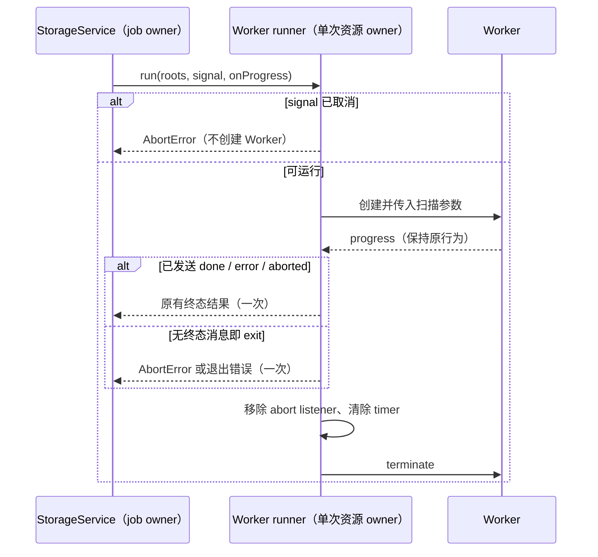

# 存储扫描 Worker 的取消预算与退出收敛

## 范围与所有者

- StorageService 继续拥有扫描 job；desktop 的 createStorageScanWorkerRunner 只拥有单次 Worker、abort 监听器和原有 500ms grace timer。
- 沿用 ScanRunnerPort：成功只由 done 消息确认，取消以 AbortError 拒绝；不改变目录遍历、结果、进度节流、清理权限、协议格式或 UI 交互。
- 已取消的请求在创建 Worker 前拒绝，不消耗线程启动及 workerData 克隆开销。
- Worker 在尚未收到终态消息时退出，无论退出码为 0 还是非零，都必须拒绝，不能遗留永久 pending 的扫描。退出时若请求已取消，归类为 AbortError；否则保留包含退出码的技术错误。
- finish 是唯一收敛路径：只结算一次、移除 abort 监听器、清除 grace timer、终止 Worker；done/error/aborted 已收敛后的 exit 不覆盖结果。
- 不新增 owner/cache/timeout，不修改远程会话及 desktop-continuous / web-remote-replayable 链路，无数据迁移。

## 事件顺序

## 验收与安全边界

- 10 项使用 node:test 可控 Worker/EventEmitter；另有 2 项真实 Worker 内存 data URL 冒烟，验证无 done 的零码退出与正常 progress/done。Worker 不导入业务 IO，不扫描真实文件，不联网。通过项目 source-test-runner 隔离 home/temp/data/cache。
- 覆盖预取消 0 次创建、无完成消息的零/非零退出、progress/done 保真、终态后迟到事件、协议错误与原生错误、abort 确认、取消后的退出、原有 grace timeout。断言结算、terminate 次数与 abort listener 清理。
- 回归先在旧实现运行：10 项中 6 通过、4 失败（预取消仍创建线程、零码退出 pending、取消退出的零码 pending / 非零码错误分类）。修复后先通过这 10 项，再加入 2 项真实 Worker 冒烟；`node --test scripts/ci/storage-worker-settlement.test.mjs` 最终实际执行 12 项全部通过。新增 2 项未在旧实现重跑，不推断其旧实现测试计数。最初构造器 mock 原型错误已修正，不将该测试夹具错误计为产品问题。
- 实际环境 Node 24.18.0，仓库 mise 规定 24.14.0；未切换或下载运行时。此验证不是 Electron 安装版真机扫描。

## 本轮最终联合验证

- 与 [服务启动代际](storage-scan-start-generation.md)、[UI 指令前缀窗口](performance-rescan-ui-directive-prefix-scan.md) 联合复跑：Worker 12 项、服务 7 项、UI 15 项，实际源用例 **34/34** 通过（不把外层 3 条 wrapper 重复计数）。
- 项目隔离与源测试入口守卫 7 项、fork 边界审计 9 项，共 **16/16** 通过；仅针对已审查的测试入口，不代表整仓所有测试均已执行。
- 最终 `corepack pnpm typecheck`、`corepack pnpm lint`、`corepack pnpm architecture:check --changed`、`corepack pnpm fmt:check` 与 `git diff --check` 均退出 0。架构 violations / baseline / new 为 0 / 0 / 0；Lint 为 0 错误、2 条既有 `no-useless-spread` 警告，位于 [RPC 文件](../../packages/rpc/src/ipc.ts#L309-L310)，本轮未改。
- UI 一度触发 400 行代码门禁，已通过将不准确的 `isStrictPrefixAt` 改名为 `isNamePrefixAt` 并采用标准格式排版消除；未放宽规则、未改匹配逻辑。改名后重跑以上 34 项回归和全部质量门禁通过。
- 本轮仅修改 3 个生产文件，新增 3 份 spec、3 份测试、3 个 CI wrapper；原有未提交工作保持不动。未运行浏览器/安装版桌面/手机 E2E，也未进行真实用户长会话或真实磁盘的端到端性能测量；未提交、推送、打包、下载或安装。
