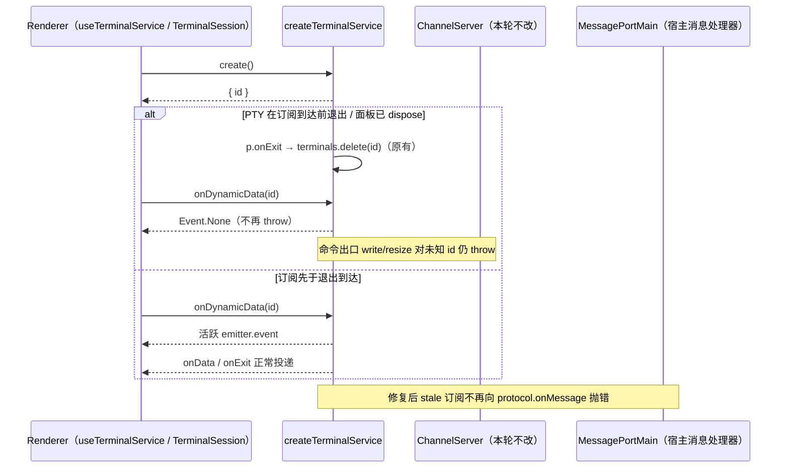

# Terminal 动态事件订阅的生命周期出口（stale id 返回 Event.None）

## 范围与基线

继续 `packages/services/src` 只读扫描后的修复轮；保留既有未提交改动，不修改 automation / session / model-provider 相关文件，不提交、不推送、不打包，不启动应用或真实 Agent，不调用模型 API，不使用真实用户数据。

freshness 与 `architecture:check --changed` 由父代理执行（main 与 origin/main 同步，0 违规）。Node 使用项目内固定工具链 `.run-logs/project-only-validation/main-toolchain-6g2BTX/node-v24.14.0-win-x64/node.exe`；回归只经 `scripts/ci/terminal-dynamic-event-lifecycle.test.mjs`（项目沙箱 + Vitest，`--configLoader runner` 避免把 Vite 配置缓存写进 `node_modules`），不启动真实 shell、不读取真实 HOME/`.zcodium`、不起真实 PTY。

本轮只改 `packages/services/src/terminal/terminalService.ts` 的两个动态事件方法（`onDynamicData` / `onDynamicExit`）及其 import；不改 RPC / `ChannelServer` / source 协议、不改 PTY create/kill 状态、不改 owner/lease、不改任何对外接口签名、不改既有 `packages/services/test/terminalShutdown.test.ts`（该文件断言 `write` 在退出后抛 `Terminal not found`，是受保护的既有语义）。

## 已确认问题

`createTerminalService` 的两个动态事件订阅出口直接复用命令出口的同一道门：

- `getTerminal(id)`（`packages/services/src/terminal/terminalService.ts:341-345`）对未知 id `throw new Error("Terminal not found: " + id)`；
- `onDynamicData(id)` / `onDynamicExit(id)`（同文件 `:437-443`）直接 `return getTerminal(id).xxxEmitter.event`，没有 stale 防护。

而 id 变成"未知"有两条生产路径，都发生在 `create()` resolve 之后、renderer 订阅到达之前：

1. `p.onExit`（同文件 `:406-411`）：`exitEmitter.fire` 后 `dataEmitter.dispose()` / `exitEmitter.dispose()` / `terminals.delete(id)`；
2. `cleanupTerminal`（同文件 `:347-357`，`dispose({ id })` 路径）同样 `terminals.delete(id)`。

UI 的订阅时序是「先 `create()`，再在 `.then` 里订阅」（`packages/ui/src/hooks/useTerminalService.ts:47,53`；`packages/ui/src/terminal/TerminalSession.tsx:588,594` 与 `:923,929`）。shell 立即退出（用户执行 `exit`、profile 报错后退出、ConPTY 启动即失败）或面板快速开关导致的 dispose，都会让订阅落在已回收的 id 上。

**这不是"命令调用传错 id"的可恢复错误，而是订阅竞态。** 抛出后的传播链已经实测：

`ProxyChannel.fromService.listen` 直接 `target.call(handler, arg)`（`packages/rpc/src/proxy-channel.ts:62-83`）→ `ChannelServer.dispatch` 的 `EventListen` 分支 `catch` 后 `finish(record)` 并 **rethrow**（`packages/rpc/src/channelServer.ts:166-182`）→ `onRawMessage` → `dispatch` 全链路无 `try/catch` → 异常逃逸进 `protocol.onMessage` 处理器。桌面宿主该 protocol 是 `MessagePortMain` 适配（`packages/desktop/src/host/electronPort.ts:11`），即 Electron 主进程 `message` 监听器内的未捕获异常。

同一仓库里已有正确处理同一竞态的先例：`packages/services/src/fileWatcher/fileWatcherService.ts:142-151` 明确注释「stale watcher id 是可恢复状态，不能 throw 到 RPC 事件订阅链路导致 host 进程退出」，并返回 `Event.None`。terminal 缺同一防护，属于不一致，不是设计选择。

## 设计与不变量

- **唯一所有者不变**：`createTerminalService` 仍是终端实例与订阅的唯一所有者；不新增缓存、队列、后台任务或第二条状态路径。`terminals` Map 的写入点（`create` / `cleanupTerminal` / `p.onExit` / `disposeAll`）逐字不变。
- **命令出口与订阅出口分离**：`write` / `resize` / `dispose` 对未知 id **继续抛** `Terminal not found`（调用方传错 id 是真实错误，且 `packages/services/test/terminalShutdown.test.ts:132-134` 已固定该语义）；只有 `onDynamicData` / `onDynamicExit` 对未知/已回收 id 改为返回 `Event.None`——订阅一个已经不存在的生命周期，语义是"没有事件"，不是错误。
- **不误订阅**：返回 `Event.None` 是全新空事件，不与任何活跃终端的 emitter 关联；活跃终端（含同一 service 实例上的其他 id）的 `onData` / `onExit` 投递逐字不变。
- **不改 RPC**：不动 `packages/rpc` 任何文件。`ChannelServer.dispatch` 对 `EventListen` 的 `catch → finish → rethrow` 形状保持原样；本轮只保证 terminal 服务自身不再向该路径抛错。RPC 层"任意工厂抛错不应逃逸"是另一项设计，不在本轮范围。
- **日志**：stale 订阅不打 `warn`（订阅竞态是正常生命周期噪音；`fileWatcher` 同场景只在真正异常的 stale 订阅上记 warn，本轮保持 quiet，不为每次 shell 退出产生日志）。

## 验收

回归入口 `scripts/ci/terminal-dynamic-event-lifecycle.test.mjs`，fake PTY + mock（`node:fs` / `node:os` / `node-pty` / `terminalProfile` 全部合成），不起真实 shell、不写真实目录。至少覆盖：

1. 活跃终端：`onData` / `onExit` 继续收到事件；同一实例上第二个终端的订阅互不串扰；
2. 未知 id：两个动态事件都不 throw，订阅后回调不被调用；
3. PTY 自然退出后订阅：两个动态事件都不 throw，回调不被调用；
4. `dispose({ id })` 后订阅：两个动态事件都不 throw；
5. `disposeAll()` 后订阅：两个动态事件都不 throw；
6. 不误订阅：A 退出后订阅 A 的 stale 事件，B 的数据只进 B 的回调；
7. 命令语义保持：`write` / `resize` 对未知 id 仍 reject `Terminal not found`；退出后 `write` 仍 reject；
8. 真实 RPC 回环（`ChannelServer` + `ChannelClient` + `ProxyChannel.fromService` 包真实 terminal service）：PTY 退出后经 RPC 订阅 `onDynamicData`，**不得有异常逃逸 server 侧 protocol 消息处理器**，且订阅不触发。

红灯必须来自第 2–6、8 项（旧实现抛 `Terminal not found` 并逃逸）；绿灯后全部通过，且第 1、7 项在旧实现下即通过（证明活跃路径与命令语义未被削弱）。

## 复现与修复结果

**红灯（未改实现，直接跑新回归）**：`node --test scripts/ci/terminal-dynamic-event-lifecycle.test.mjs` 退出码 1；Vitest 明细 `Test Files 1 failed (1)`、`Tests 6 failed | 2 passed (8)`，日志中 `Terminal not found` 出现 13 次。失败项正是第 2–6 与第 8 项；第 1 项（活跃投递）与第 7 项（命令语义）在旧实现下即通过，与预期一致。

第 8 项的 RPC 回环用**真实** `ChannelServer` + `ChannelClient` + `ProxyChannel.fromService` 包**真实** terminal service（fake PTY），实测 server 侧 protocol 消息处理器收到 `Error: Terminal not found: 0`——即确认异常确实逃逸出协议边界，而不是只做了任意工厂抛错的推断。

**绿灯（最小修复后）**：

- 新回归 `scripts/ci/terminal-dynamic-event-lifecycle.test.mjs`：退出码 0，wrapper 诊断 `8 tests executed`；
- 与既有 `packages/services/test/terminalShutdown.test.ts` 同跑：`Test Files 2 passed (2)`、`Tests 14 passed (14)`（既有 6 项不受影响，未修改该文件）；
- `pnpm architecture:check --changed`：violations / baseline / new = **0 / 0 / 0**；
- `oxlint`（terminalService.ts + 新测试 + 新 CI wrapper）：**0 warnings / 0 errors**；
- `oxfmt --check`（上述 3 个文件 + 本 spec）：全部通过；
- `tsc -b packages/rpc packages/shared packages/provider packages/provider-node packages/services`：仅有 4 条 `TS5033`（项目沙箱禁止写 `packages/services/dist/` 与 `tsconfig.tsbuildinfo`），**0 条真实类型错误**。

## 改动清单

- 生产：`packages/services/src/terminal/terminalService.ts`——第 5 行 import 增加 `Event` 值导入（原为 `type Event`）；`onDynamicData` / `onDynamicExit`（`:437-457`）改为 `terminals.get(id)` 直读，命中返回原 emitter.event，未命中返回 `Event.None`，并附中文 bug 原因与修复依据注释。
- 测试：新增 `packages/services/test/terminalDynamicEventLifecycle.test.ts`（8 项，fake PTY + mock，含真实 RPC 回环）。
- 回归入口：新增 `scripts/ci/terminal-dynamic-event-lifecycle.test.mjs`（项目沙箱 + 固定 Node 24.14.0 + Vitest `--configLoader runner`，避免把 Vite 配置缓存写进各包 node_modules）。
- 文档：本 spec。

未改动：`packages/rpc` 任何文件、`packages/services/test/terminalShutdown.test.ts`、PTY create/kill 状态、owner/lease、任何对外接口签名。

## 未验证限制

- 未启动真实 Electron / 真实 shell / 真实 PTY；PTY 行为全部由 fake PTY 驱动，"shell 立即退出"是构造出来的时序，不是真机观察。
- 未在桌面主进程验证 `MessagePortMain` 监听器内未捕获异常的最终后果（是否 crash 取决于 app 级 `process.on("uncaughtException")` 配置）；本轮只证明异常逃逸到该边界，且修复后不再逃逸。
- 全量 `pnpm typecheck` 未在沙箱内跑完：`tsc -b` 需要写 dist 与 tsbuildinfo，被项目沙箱的 `--allow-fs-write` 拒绝（15 条 `TS5033`）；沙箱外跑出的 11 条真实错误全部位于 `packages/server/src/remote/docker-backend-exec-lifecycle.test.ts` 与 `packages/ui/src/hooks/useSettingsSync.test.ts`，均非本轮改动文件。根门禁由父代理执行。
