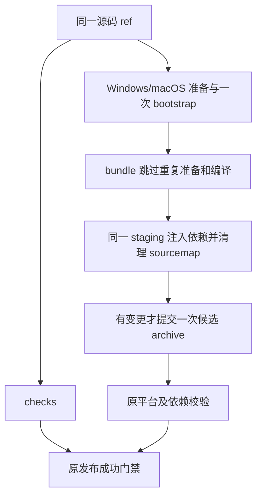

# 上游远控稳定性与出包效率吸收（2026-10-18）

## 范围与来源

本轮按用户确认的产品优先级，仅吸收直接上游 `axiom-desu/ZCodium` 的两类改动：

- 手机远控大消息编码阻塞修复，来源 PR #73（`03a85ff30809`）。默认分片预算用真实空信封加精确 base64 长度计算；保留自定义计量、最终帧实测、CRC、身份和序号边界。
- 出包效率优化，来源 `7e21a755a42c`。适配本 fork 的 workflow 并行调度及 app.asar 单次最终化。

以 merge 记录截至 `7e21a755a42c` 的已审阅上游历史，树内容仅接入上述实现和本轮手机布局修复；其间 Rust runtime/TUI 相关历史不代表源码或功能已启用。保留本 fork 的版本身份、`.zcodium` 数据、自有更新源、Windows exe/macOS dmg、既有触发规则和唯一 desktop workflow。不增加 Linux 安装包、远端运行资源 producer、远端 artifact 下载或新工作流。

终端入口不在此范围；Rust 引擎继续暂缓。本轮不推送、不触发 GitHub 构建，不在本机生成安装包或替换已安装应用。

## 所有者、顺序与失败语义

- 手机 RPC encoder 仍是纯函数，不引入缓存或第二份消息事实；传输所有权、Host attachment、ack/replay 和快照恢复遵守既有手机 spec。
- workflow 是调度唯一所有者。checks 与平台打包读取同一 ref 并行执行；发布仍等待 checks 和必需平台构建成功。
- 每个平台只执行一次 workspace bootstrap，bundle 显式跳过重复 prepare/build。本 fork 没有上游的远端 producer，不移植依赖它的 Server skip 分支。
- app.asar 的同一个 staging 事务先注入缺失依赖，再清理 sourcemap，最终只提交一个候选 archive；无变更不重写。保留原 native sidecar 替换、平台 unpack 和资源校验；失败清 staging，向上报告错误。
- 手机 Shell 只拥有视口与滚动布局，不改变任何业务状态所有者，详见 `web-remote-control-mobile.md`。

## 验收

1. 默认 900 KB 消息编码调用次数从旧实现的 23 次降到单帧探测加最终片数；默认与完整计量逐帧相同，自定义外壳开销仍生效。
2. workflow 回归验证并行关系、原发布门禁、平台边界、一次 bootstrap 和 bundle skip 参数。
3. 真实小型 asar fixture 验证一次 extract/pack、新注入 map 清理、零变更零 pack、native unpack 和失败保护；测试不生成桌面安装包。
4. 带生产 CSS 的手机入口经真实 LAN 与 Channel RPC 验证长列表/会话触摸滚动、正文、视口、配对、冷恢复、增量和重连；同时回归桌面 continuous 与手机 replayable 契约。
5. 使用仓库固定 Node 24.14.0，运行 typecheck、lint、格式和架构检查；记录环境限制，不以脚本/模拟移动视口通过替代实体手机或安装包验收。

## 本轮验证记录

- Node 24.14.0 下，`corepack pnpm typecheck`、`corepack pnpm lint` 通过，Lint 为 0 error / 0 warning；`corepack pnpm architecture:check --changed` 的基线与新增违规均为 0。
- 远控兼容矩阵 13 个文件、171 项通过，另有 Host Controller 自动归档 2 项、CLI 手机历史消息 3 项通过。最终 RPC transport 定向回归 33 项通过；900 KB 重复编码用例先在旧实现观察到 23 次编码，再验证修复后的上限为单帧探测加最终分片数。
- 出包定向测试共 13 项通过，覆盖单次 extract/pack、无变更保留字节、依赖注入、native unpack、固定 vendor 哈希及失败保护；未生成桌面安装包。
- 完整 `scripts/ci/*.test.mjs` 回归共 521 项：487 通过、25 失败、9 跳过，耗时约 12 分 52 秒。失败涉及路径大小写/分隔符、Windows 文件占用与清理、历史 UI 接线及模型选择/MCP 迁移等检查，不将全仓结果写为通过。
- 修改前 `ac6613d25980` 的源码快照在同一已安装依赖下复跑 provider 配置、session-workspace 单测与 E2E，共 97 项：83 通过、14 失败。旧版同样复现临时路径 `TEMP/Temp` 大小写断言、A20/A12/A13/A16/A18 的 `EBUSY`、A6/A6b 目录回收断言，以及 6 项 Windows/POSIX 路径或 warn 断言。相关 CLI/provider 包及三个测试文件与旧基线源码一致。对照复用了本机 `node_modules`（包含 workspace 链接），不是独立安装；其余全仓失败未逐项执行旧版对照。
- 带真实 CSS、真实 LAN 和 Channel RPC 的手机浏览器回归通过：161 条任务、71 条历史消息、连续长文本、触摸滚动、320px 窄屏、横屏、视图滚动隔离、发送与断线恢复。桌面窗口同步浏览器回归通过。
- 旧布局在真实 CSS 下复现 main 高度 9049px 且 overflow 为 visible，超出 844px 视口；同页视图复用也曾复现首页继承会话 scrollTop=3905。对应回归在修复后通过。验证使用 Windows Chrome 手机视口与 CDP 触摸事件，尚未覆盖实体手机、Safari 或新安装包。
- 本轮 16 个修改/新增文件的格式检查及 `git diff --check` 通过；全仓 `corepack pnpm fmt:check` 仍报告 2881 个未修改文件不符合格式，未批量改写无关文件。
