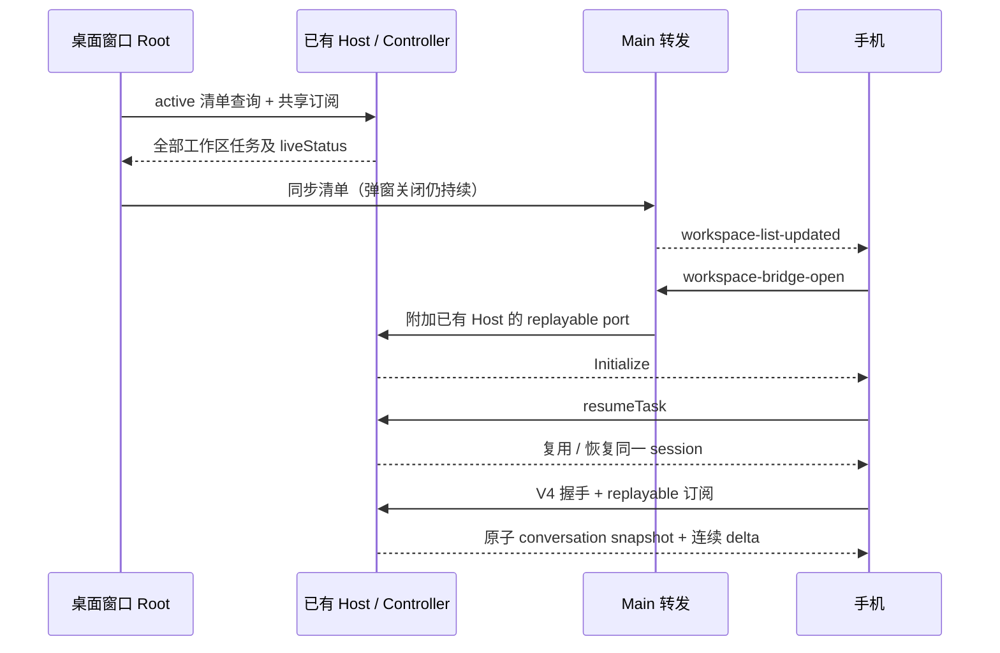
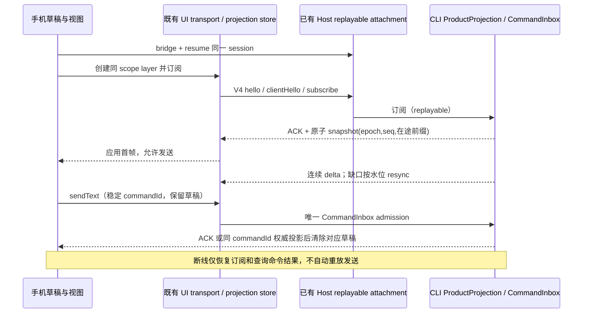
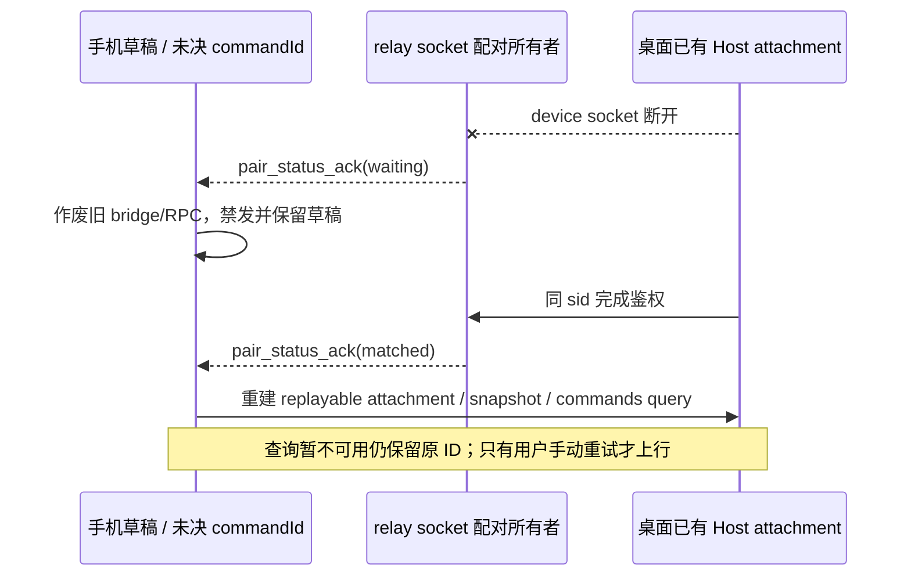
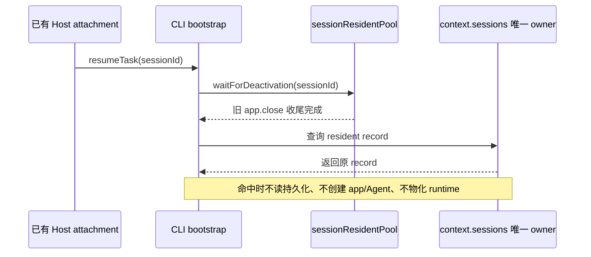
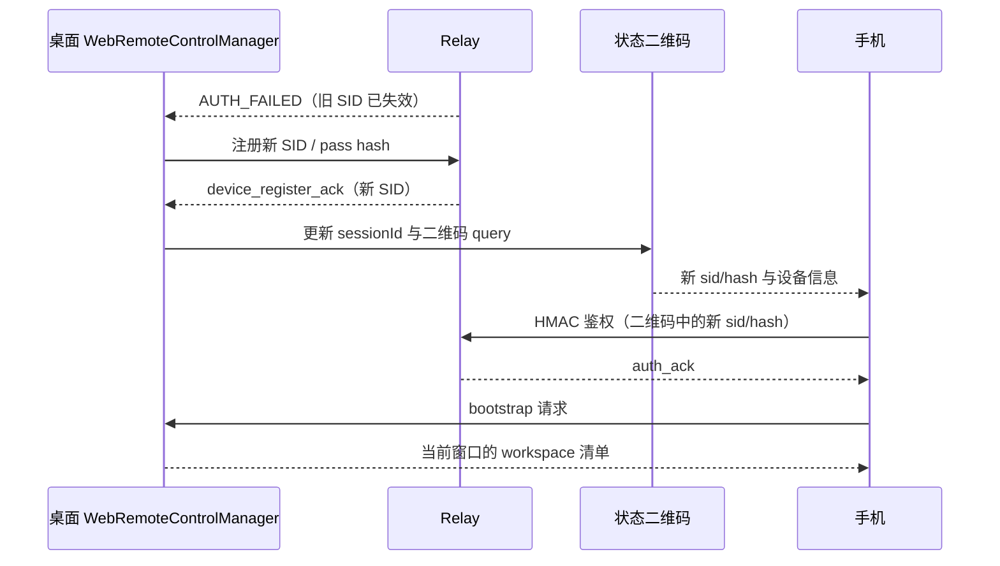
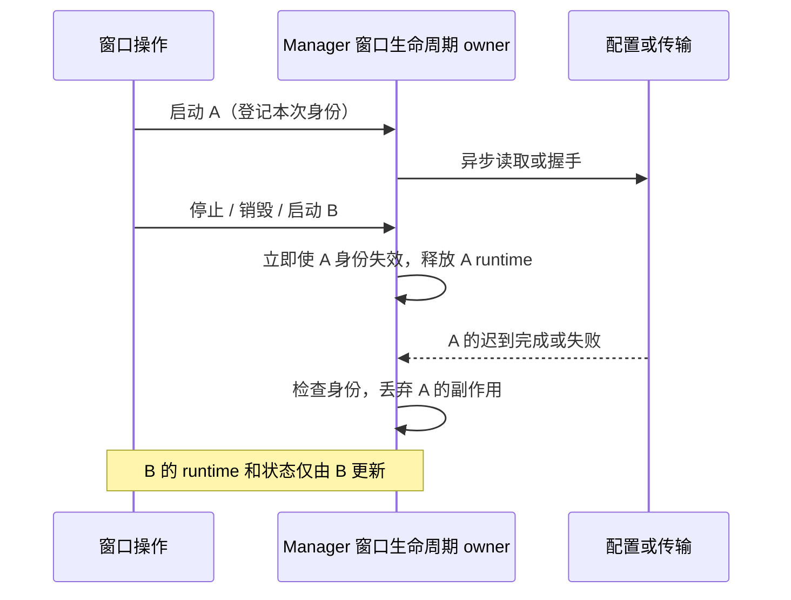

# 手机远程控制

## 所有者与连接路径

- 手机配对客户端拥有 WebSocket、鉴权状态、RPC 序号/分片缓冲与 bridge 代际；桌面 Main 拥有窗口级远控运行时及当前 bridge；Host 持有会话和服务状态。
- 手机选中任务后先确认 bridge，再通过既有 UI SessionDataLayer 订阅 `web-remote-replayable` V4 conversation 的原子快照与增量。手机发出的 RPC 经 Main 透明转发到当前窗口已有 Host；Main 不代理业务服务，也不创建 Agent、Host 或会话。
- 桌面 Main 只接受当前 `bridgeSessionId` 的帧。一个 bridge attachment 的 Host scope 包含 remote session、workspace path 与 identity；手机侧 bridge 复用也必须匹配 workspace key 和 remote session id。
- 手机收到 `workspace-bridge-ready` 时，descriptor 的 `kind` 与 `remoteSessionId` 必须匹配请求目标：远端目标要求 `kind: "remote"` 且 session id 相等；本地项目与对话工作区接受 `kind: "local" | "conversation"` 且 session id 缺席。scope 不匹配按握手失败处理，不能标记 bridge 已就绪。
- `workspace-bridge-ready` 只表示 Main 已创建对应 bridge；Host attachment 的服务可用性以该 Host 通过 attachment port 发出的 `Initialize` 为准。Main 必须监听 Host attachment port 关闭，并为当前 bridge 转发 `bridge-degraded`；手机收到匹配的通知后使 bridge generation 失效并 dispose `ChannelClient`，令等待 `Initialize` 的 Promise RPC reject，旧 generation 不得再发送 RPC。
- 同一 remote session 的 RPC 出站与入站分别维护连续序号、ack 和重传缓冲。接收方只在完整装配和校验后交付；手机连接或 bridge 代际失效时，旧 RPC 与事件回调必须失效，恢复后重开 bridge、重订阅并重读快照。
- 远端 session 路由属于创建它的窗口 Host。Main 按窗口选择 Host，Host 再验证 remote scope；连接状态不能替代窗口归属校验。

## 事件顺序

```text
手机任务视图
  → ensure(workspaceKey, remoteSessionId)
  → workspace-bridge-open(bridgeSessionId, generation)
  → Main 当前窗口 Host attachment(remote scope)
  → workspace-bridge-ready（Main bridge 已创建）
  → Host Initialize（服务可用）
  → V4 hello / clientHello → replayable 订阅 → 原子快照 + 连续增量
```

远端重连可以保留同一 workspace identity/key，但会产生新的 `remoteSessionId`。桌面推送的 workspace 清单更新后，手机必须使旧桥失效，并为新 session 重开桥；旧 Host attachment、迟到 Initialize 和旧事件不得被新任务视图采用。

## 失败语义与边界

- bridge open、Host attach 或握手失败时，不把旧桥标成新 scope 已就绪；Host 拒绝 attachment 或关闭 port 时 Main 必须发出当前 bridge 的 `bridge-degraded`，不能让手机静默等待 `Initialize`。手机失效该代际、dispose `ChannelClient` 并拒绝挂起的 Promise RPC，调用方显示错误并可重新尝试。
- RPC gap 或装配超时会使当前 bridge 代际失效；手机重开 bridge、重建订阅并读取权威快照，旧代际的 RPC 与事件回调不得继续生效。
- 鉴权拒绝、配对过期或设备被踢是终态；普通网络关闭允许退避重连。
- 普通网络关闭后的退避等待仍显示连接中；online 或前台恢复事件应取消该等待并立即重连。只有存在退避定时器且旧 socket 已关闭时才允许加速；已有 OPEN/CONNECTING socket、等待桌面配对或鉴权终态不得新建连接。客户端仍是唯一重连所有者，连续恢复事件最多创建一个 socket，不自动重放业务命令。
- 手机页面只连接当前二维码对应的桌面窗口；remote session 缺失、未连接、identity 不匹配或不属于该窗口时拒绝 Host attachment。
- 本协议复用当前桌面窗口 Host 与 `web-remote-replayable` 通道；不引入第二 Host、手机专用 Agent、独立业务队列或对 `~/.zcode` 数据的迁移。

## 验收场景

1. 同一 workspace key 的 remote session 从 `remote-A` 换为 `remote-B` 后，手机发出新的 bridge open，旧桥上的迟到响应不能进入新 RPC client。
2. workspace key 或手机 socket 变化时，旧代际事件订阅与 RPC 均失效；新桥完成 Initialize 后重新订阅并读取快照。
3. 旧 `bridgeSessionId` 的消息、ack、分片和重传帧不进入当前 Host；当前会话的双向序号和 ack 独立推进。
4. remote Host attachment 携带完整 scope，跨窗口或失效 session 不得连接到本地 Host 服务。
5. 请求 `remote-A` 却收到 `remote-B` 的 ready descriptor 时，手机拒绝该 bridge；本地项目与对话目标接受 `kind: "local" | "conversation"` 且没有 `remoteSessionId` 的 descriptor。
6. Host attachment port 在 `Initialize` 前关闭时，Main 发出匹配当前 bridge 的 `bridge-degraded`；手机使代际失效并拒绝挂起的 Promise RPC，不保留等待中的 service client。
7. 网络关闭进入退避后，online/前台恢复立即创建一个新 socket 并取消旧定时器；连续事件和随后推进旧退避时间不得重复建连。没有恢复事件时仍按原退避重试，鉴权终态不恢复。浏览器验证 online 事件能在退避定时器触发前恢复配对、bootstrap 和任务订阅。

## 任务清单与历史读取修复

- 当前窗口 Root 是手机清单同步的唯一 UI 编排者，二维码弹窗只控制配对。远控运行期间即使关闭弹窗、切换工作区或打开设置，仍同步窗口内全部工作区。Hook 只保存最近收到的完整远控状态 snapshot，`running` 与 `sessionId` 从该 snapshot 派生。
- 任务清单复用 Host Controller 的 `active` 查询及共享订阅，包含未归档的置顶任务；运行状态来自 Controller `liveStatus`，不使用持久化任务的历史状态猜测。手机协议暂把 `waiting` 显示为运行中。
- 同步保留 workspace identity 与 remote session；Controller 仍拥有跨 source 路由和状态，Main 只转发清单。并发更新串行发送，读取期间发生更新须在当前读取结束后补读，停止运行或 scope 换代后丢弃迟到结果。
- 窗口最后一个 workspace 关闭时，Hook 仍向 Main 发送 `workspaces: []` 和 `tasks: []`，清空该窗口的手机清单。空清单 IPC scope 使用当前远控状态 snapshot 自带的 `workspacePath` / `workspaceIdentity`；不缓存最后一个 workspace scope。Main 按 `windowId` 路由这些更新，schema 仍要求 `workspacePath` 非空。
- 手机进入任务：bridge ready → Host Initialize → `resumeTask`（复用已有 session）→ V4 握手与 replayable 订阅。历史恢复不能依赖 session 已常驻，恢复不得另建 task、Host 或 Agent。旧 `readSessionMessages` 接口继续服务历史读取消费者，不再承担手机实时会话快照。
- `IZCodeTaskService.resumeTask` 增补可选 `remoteSessionId`，本地调用保持现有缺省；remote session 同时用于 bridge 与请求关联，仍由当前 scoped facade 执行。恢复调用本身不选择 delivery 语义，后续订阅固定使用 replayable；`sendTaskPrompt` 保留现有 `clientMode`。
- `resumeTask` 的 `session/resume` 若命中旧 Claude 导入历史恢复，及成功恢复后发现导入正文缺失而回填时，后续 `session/create` 都必须沿用同一 `remoteSessionId`；不能因转入导入修复 helper 而退回 path/identity-only target。
- replayable 订阅也保留 `remoteSessionId`，从手机 RPC 贯穿 task facade 与 Agent 服务；不能在恢复后的订阅中把 remote session 从 target 覆盖掉。
- CLI `session/messages` 必须用既有 `mapMessageWithParts` 输出协议消息（`messageId/sessionId/partId`）；不能直接返回含 `id/sessionID/messageID` 的存储对象。先按存储消息 ID 应用 after/limit 和活动分支投影，再映射协议对象。
- 手机清单更新不重启同 scope 会话；只有 workspace key、path、identity、remoteSessionId、taskId 或连接代际变化才释放订阅重建。重连总是重拉 bootstrap，恢复成功清除旧同步错误。



新增验收：最后一个 workspace 关闭后，Main 收到带当前远控状态 snapshot scope 的空 `workspaces` 与 `tasks`，且不依赖已关闭 workspace 或独立的最后 scope 缓存；非空用户/助手消息及工具 part 通过消息 schema；afterMessageId 与 limit 保真；冷历史恢复后可读、已有运行任务不重建；legacy Claude session 缺失和恢复快照缺失两条导入修复路径的 `session/create` 都保留传入的 `remoteSessionId`；恢复后的订阅使用 replayable，`sendTaskPrompt` 仍保留 client mode；置顶与其他 workspace 的运行任务可见；清单状态更新不打断流；浏览器中进入任务、收增量、发消息、断线重连后恢复历史且无红字；Windows ESM 测试入口使用 file URL。

## 手机页面滚动与正文布局（2026-10-18）

### 产品规则、所有者与边界

- 手机首页和会话页使用明确的动态视口布局：Shell 拥有视口尺寸，main 是唯一纵向滚动区域，标题、连接提示和输入栏参与正常 flex 布局。输入栏不能覆盖消息；长列表、长会话都能通过触摸滑动浏览。
- `mobile-root` 铺满动态视口并约束溢出；手机样式入口显式声明手机 TSX 的 Tailwind 扫描范围，不能依赖桌面 UI 恰好使用相同类名。共享桌面 `body/#root` 的滚动规则不改。
- 消息正文保留换行，连续路径、URL 和代码字符串在气泡内换行；气泡和输入框允许缩小，不能撑宽整个手机页面。手机输入使用 `text-mobile-input-safe`，避免 iOS 聚焦自动放大。
- 首页与不同会话各自重建滚动容器，从顶部开始；同一会话的增量、清单更新和重连不因视图重绘而清空滚动位置，不能把首页的偏移带进会话或反过来。
- 布局只派生当前连接和会话视图，不创建新的业务状态、Host、Agent、队列或持久化入口。手机继续由同一 Host 提供 `web-remote-replayable` 快照/增量；桌面 `desktop-continuous` 语义保持既有契约。

```text
已有 Host → replayable 快照 / 增量 → 既有 V4 projection store
                                       → Shell 动态视口
                                         ├ 标题 / 连接提示
                                         ├ main 唯一滚动区 → 列表 / 消息
                                         └ 输入栏（正常布局）→ V4 sendText
桌面 continuous → 原桌面布局及消费路径
```

### 验收场景

1. 使用真实生产 CSS 和手机入口，通过真实 LAN 配对与 Channel RPC，160 条以上任务首页可触摸滑动到末项，标题仍在视口内。
2. 长会话包含多行消息与连续长字符串：正文不丢换行，页面无横向溢出，可触摸滑动到末条消息；输入栏、发送按钮仍在视口内且不遮住正文。
3. 窄屏与横屏、缩小可用高度后，main 重新分配空间且仍可滚动，输入字体不少于 16px；同一页面在已滚动的会话和首页之间切换时，新的视图从顶部开始。
4. 保留原配对拒绝、重复页面互踢、冷恢复、增量、发送及断线重连用例；断线恢复后读取权威历史，无浏览器未捕获错误。
5. 浏览器验收必须编译真实 CSS；仅移除 CSS 的 esbuild fixture 不能证明视觉和滚动通过。可按环境变量将测试截图保存为审查证据，固定时长只用于测试手势采样，不用于产品同步。
6. 手机远控布局烟测中的消息 fixture 必须符合 CLI `session/messages` 使用的 `zcodeSessionMessagesResultSchema`；用户/助手消息信息和每个 part 的 identity 字段均完整。CI 对生成的整组历史执行 schema 校验，不能只满足当前 UI 文本投影所读取的字段。

## 生成中切入与发送确认（复核修复）

- 复核确认：legacy 消息读取只包含已落盘正文，新订阅不回放订阅前的 chunk；等到读取期间没有事件才显示快照会在持续输出时饥饿。手机会话改为复用现有 JS runtime 的 V4 conversation projection，不启用 Rust 引擎。
- CLI ProductProjection 是正文、在途文本、队列和序列的唯一事实所有者；手机复用 UI 的 `createAgentConversationTransport` 与 `SessionDataLayer`，通过新增公开入口 `@zcode/ui/conversation-client` 访问。手机不再拼接 legacy 历史与无水位 chunk，也不新增第二个投影 store。
- attachment 继续由已有 Host 创建，连接模式由 Host 固定为 `web-remote-replayable`；桌面保持 `desktop-continuous`。remoteSessionId 与 workspaceIdentity 从目标贯穿 transport，bridge generation 失效后销毁旧 layer，拒绝旧回调。
- 原子快照带 `logEpoch/seq` 且包含已生成前缀；ACK 前帧由既有 activation barrier 暂存，store 登记 subscriptionId 后激活；只应用连续 delta，缺口复用既有 resync。不能靠等待输出停止、延时或无限重读恢复。
- 发送走现有 V4 `sendText`/CommandInbox admission，commandId 同一提交保持不变。连接与首帧未就绪时禁用发送，保留可编辑草稿；一次只上行一个待确认提交。草稿在确定接收或同 commandId 权威输入/队列出现后才清除，且不能清除用户后来编辑的新草稿。
- ACK 丢失时不自动重发；重连后用既有 commands/query 与权威 projection 对账，未知结果仍保留草稿和原 commandId，用户重试复用该 ID，避免接受成功但响应丢失时重复执行。明确拒绝保留草稿并显示原因。手机不维护已接受业务队列。
- `fault.command.queryUnavailable` 仅表示查询暂不可用，不是命令拒绝。手机保留同一未决提交、草稿与 commandId，使用 registry 的查询结果处理入口；提示说明发送结果待确认，不能显示确定未发送。之后用户手动重试同一正文仍使用原 ID，由 CommandInbox 裁决 duplicate/accepted，不自动重放。
- 运行中输入若由 CLI 接收进队列，页面从同一权威 snapshot 显示“排队中”与输入文本；执行后由权威用户消息替换，不能在清除草稿后让已接收输入无处可见。
- V4 首帧只含有界尾窗；更早历史通过既有 store `loadOlder` 和 rowsRange 读取。手机提供“加载更早消息”，不把尾窗之前的历史误当作不存在，也不为首屏一次加载全部正文。读取历史只受连接、首帧与当前分页请求约束，不因发送确认在途而禁用；读取失败沿用 store 的可重试语义。
- 页面区分“正在同步会话”和已加载的空会话；同 scope 断线期间保留已显示内容，换任务不得泄露旧内容或将旧发送结果写入新任务。
- 草稿、未决提交及命令结果查询绑定完整 workspace key、taskId、path、identity 和 remoteSessionId。目标改变不借新 transport 查询或重发旧提交；成功 ACK 即使在首页到达也按原草稿版本清理，返回会话不能再次提交已确认的旧草稿。
- 切换任务不覆盖另一完整目标的草稿或未决提交；在 B 编辑/发送后返回 A，仍显示 A 的草稿，并在查询未知时保留 A 的原 commandId。每个目标只上行一个待确认请求，目标之间只保存客户端草稿与对账线索，不复制已接受输入队列。remoteSessionId 换代视为新目标，不能把旧目标线索交给新 transport。
- 同一提交出现权威输入投影后，即使 ACK 尚未返回也可结束其确认门禁；之后旧 ACK/查询只能清理自己拥有的门禁，不能使更新提交提前可重发。确认期间编辑的新草稿按版本保留。



新增验收：持续输出且初始快照慢于 chunk 时仍及时显示完整前缀；ACK 前 notification 和后续 delta 不丢不重；生成中切入/重连均不必等终态；断线期间禁发且草稿保留；首次快照不能吞掉刚发送输入；接受成功但 ACK 丢失后恢复仅出现一次输入；旧 scope 的迟到帧/发送结果不能影响新任务。浏览器必须验证完整生产多入口产物，测试消息通过真实 schema，明确记录 Chromium/WebKit 与实体手机的覆盖边界。

CLI CommandInbox 的独立回归须验证同 commandId 并发重试只执行一次、同 session 的不同输入按 settle 顺序 admission，以及 live input 对账返回确定结果。该测试执行真实 inbox，revision/持久查询 port 使用测试实现，不替代 runtime 的真实队列与数据库验收。手动 desktop workflow 的远控检查阶段执行该测试与 V4 stream 回归，不能只在本机一次性运行。

### 发送对账与 relay 离线修复验收

- 浏览器用 LAN socket 注入 relay 的 waiting/matched 控制帧，验收手机立即结束旧 bridge 上的发送等待、禁发、保留草稿，并在 matched 后重开 attachment、查询后沿用原 commandId 手动重试；真实 relay 的 device 断开/恢复通知由独立 loopback WebSocket 用例验证。浏览器 fixture 的命令查询必须校验 workspacePath 和 sessionId，不能把错误目标当作命中。
- 旧 bridge 被释放而结束发送时，错误横幅使用「连接已中断，请连接后重试」，不能向手机用户暴露内部英文异常或实现名称；原草稿仍保留。

- 浏览器故障注入：原 commandId 已被 fixture 接受，发送响应丢失，快照暂时没有原输入锚点，查询返回 queryUnavailable。页面保留草稿与原 ID，显示待确认；用户重试后仍是同 ID，fixture 返回 duplicate，唯一接收计数不增加。此计数不代表真实模型执行。
- 自托管 relay 在桌面 socket 断开时向手机发送 waiting；手机立即作废旧 bridge/RPC 并禁发，保留草稿与未决提交。同 sid 桌面重新鉴权后 relay 推送 matched，手机重新建立已有 Host attachment、刷新清单并按原 ID 对账，不补投离线请求。
- 手机收到 waiting 时释放 RPC 装配器的周期清扫 timer；同一 socket 收到 matched 后必须恢复唯一 sweep timer，再由既有 UI 生命周期重建 bridge。否则新 bridge 收到不完整 rpc-frame 后，静默链路不会触发 `buffer-timeout` 降级与重同步。
- INTERNAL + 4001 与协议重连语义一致，显示可恢复状态；AUTH_FAILED/KICKED/WRONG_PARAM 和没有 INTERNAL 原因的已知终止关闭码仍显示终态。
- 桌面 desktop-continuous 与手机 web-remote-replayable 共用原事实所有者，修改不新建业务队列、Host 或 Agent；两种交付模式的既有回归都必须执行。
- 手动 desktop workflow 的远控门禁包含 relay 设备连接生命周期回归，验证旧 socket 延迟关闭不会吞掉新 socket 的正常断线重连。



## 既有验证记录

- 使用 `mise.toml` 指定的 Node 24.14.0。`corepack pnpm typecheck`、`corepack pnpm lint`、`corepack pnpm architecture:check --changed` 通过，架构新增及基线违规均为 0。
- 11 个 Vitest 文件共 110 项通过：手机目录、共享 RPC transport、桌面 service pipe/LAN transport、清单投影与目标复用、桌面 conversation projection。
- `node --test scripts/ci/mobile-session-messages.test.mjs` 共 3 项通过；干净工作区先执行 `node apps/zcode-cli/packages/dynamic-workflow/scripts/generate-libs.mjs` 准备 CLI 源码读取所需的类型库。
- `node --import tsx --test packages/desktop/src/host/windowHostControllerAutoArchive.test.ts` 的本地/远端 Controller 时序回归共 2 项通过。
- `node scripts/ci/web-remote-control-mobile-smoke.mjs` 与 `node scripts/ci/web-remote-control-window-sync-smoke.mjs` 通过。浏览器使用已有 Chromium，必要时设置测试已有的 `ZCODE_TEST_CHROMIUM_EXECUTABLE`；前者用真实手机入口、LAN 端点与 Channel RPC，服务由 fixture 提供；后者用真实窗口同步 hook 和 Controller fixture。未验证用户实体手机与当前安装包。

## 复核证据（2026-10-18）

- 对上一轮提交 `e41b1043` 的真实 lifecycle/reducer 做负例对照：连续八次历史读取期间均到达 chunk，代码启动第九次读取时仍显示 0 条消息且等待快照；只有停止更新并完成安静读取后才显示 1 条。该对照确认持续输出时的空白问题尚未被上一轮布局修复解决。
- 手机目录五个 Vitest 文件共 56 项通过；包含 remote V4 真实 Channel RPC 的 hello、clientHello、订阅和事件路由，完整 path、identity、remoteSessionId 均保真。lifecycle 回归覆盖首帧屏障、连续增量、桥换代、迟到帧以及带旧正文的恢复失败。
- 新增 CLI V4 gateway 回归直接执行生产 ProductProjection、序列日志和 replayable 投递，验证进入前正文、在线增量、断线漏段及恢复后的连续性。输入为合成 runtime facts，不连接真实模型或数据库。
- 新增真实 CommandInbox 的三项回归全部通过：同 commandId 在途重试等待 settle 后得到 duplicate、同 session 不同输入串行 admission、live input 的 query 得到确定 ACK。另有既有 input-intent 四项回归通过；均不代表真实数据库或 runtime 队列已执行验收。
- 浏览器会话 fixture 使用生产 V4 gateway 与 connection scope；历史和 admission/命令结果为合成业务输入。浏览器验证不能替代真实 CommandInbox、数据库、外部 relay、实体手机或安装包验收；各层按其实际执行边界分别报告。
- 完整生产 Vite 双入口构建及手机 smoke 退出码为 0。Windows Chrome 手机视口经真实 LAN/Channel RPC 验证：161 条任务触摸滑动、71 条规范历史与 60-row 尾窗分页、连续长文本、320px 窄屏与横屏、首帧等待期间增量、发送门禁、延迟 ACK 时编辑新草稿、返回首页后确认与重进、ACK 丢失后的权威快照唯一输入、断线禁发/保留草稿/恢复，页面无未捕获异常。发送接收方为 fixture，不能把其一次接收计数等同于真实模型执行次数。
- Windows Playwright WebKit 验证布局、窄屏/横屏、真实 socket 终止后的恢复。复核进一步排除了“旧正文仍可见”的假阳性：在断线期间追加新正文，恢复后必须显示该正文且发送重新可用，才记录成功与截图。WebKit 未使用 CDP 触摸手势，也不是实体 iPhone/Safari。
- 最终 `corepack pnpm typecheck`、`corepack pnpm lint`、`corepack pnpm architecture:check --changed` 通过；Lint 0 error / 0 warning，架构基线与新增违规均为 0。修改文件的格式检查及 `git diff --check` 通过。
- 本轮未推送、触发 GitHub workflow、生成安装包或更新已安装应用。workspace freshness 的 GitHub fetch 因网络连接失败未完成，不将本轮记录视为已重新确认上游最新状态。

### CLI 常驻会话 resume 复用验收

- 手机 resume 经既有 Host attachment 调用 CLI 的 `resumeTask`。CLI 必须先等待同 session 的 deactivation 收尾，再检查唯一 owner `context.sessions`；命中时返回原 resident record，不重新创建 app/Agent、读取持久化记录或物化第二份 runtime。只有等待结束后仍无 resident record，才进入持久化冷恢复。
- bootstrap 回归直接调用生产 `activateSessionForResume`，用真实 resident map entry 与可控 deactivation gate 验证等待后仍复用同一 record，并确认冷恢复边界未被触发。该测试只覆盖 bootstrap 的 resident 分支，不替代手机 RPC、Host attachment 或实体 Agent 的端到端验收。
- 手动 desktop workflow 的 bootstrap `node:test` 阶段同时执行该回归，避免常驻 session 复用仅在本机验证。



### 桌面多窗口 relay SID 隔离验收

- 同一桌面进程内，每个活动窗口的远控 runtime 必须使用独立 device SID。启动新窗口时若持久 SID 已被其他窗口的活动 runtime 持有，应走现有注册流程生成新 SID；不能用 relay 的单 device socket 互踢行为代替窗口隔离。
- 手机通过各自二维码配对后，bootstrap 必须由对应窗口 runtime 响应，返回该窗口的 workspace 清单与初始视图；停止其中一个窗口只注销自己的 SID，另一个窗口的配对和 bootstrap 继续可用。
- 回归直接执行生产 `WebRemoteControlManager` 与 `createRelayDeviceTransport`，通过本机 loopback WebSocket 端点验证注册、HMAC 鉴权、data 转发及注销。该端点实现 relay wire/单 SID 单 device binding 行为；relay 服务本身的鉴权与 registry 语义由 `packages/relay` 测试覆盖。Electron IPC/窗口对象不参与此测试。
- 该验收覆盖同进程活动窗口间的 SID 冲突处理，不表示 manager 为每个窗口增加独立的持久凭据存储或跨进程恢复所有窗口配对。

### Relay 重新注册后的二维码会话一致性

- Relay 拒绝失效的持久 SID 后，桌面 transport 清理旧配对并重新注册。收到新注册确认时，manager 必须用新 SID 与对应 pass hash 重建二维码；状态中的 `sessionId` 与 `qrUrl` 必须属于同一注册，且保留原有 `mid`、`name`、`app_version` 等 query 字段。不能让 status 已切到新 SID、二维码仍指向旧 SID。
- Loopback 回归从生产 manager 启动窗口并取得初始二维码，删除旧 relay pair、关闭 device socket 触发 `AUTH_FAILED` 与自动重新注册。新 SID ready 后检查 status/qrcode 的 sid 和 hash，使用二维码自身的 sid/hash 完成手机 HMAC 鉴权并请求 bootstrap，确认仍路由到该窗口。



### 窗口生命周期的迟到启动隔离

- manager 是每个窗口远控生命周期的唯一所有者。启动、刷新配对、停止和窗口销毁按调用顺序决定当前意图；停止或销毁必须立即使之前等待配置、凭据或传输握手的启动失效。旧启动恢复后不得注册新的 runtime、发布可扫码状态或写入启动恢复上下文。
- 同窗口后续启动替换先前启动；旧握手成功或失败不能删除新 runtime，也不能把旧状态广播给窗口。迟到调用返回当前窗口状态，不自动重试。不同窗口仍并行启动，不共享生命周期锁；不新增业务队列或手机 Agent。
- 回归使用受控配置读取和真实 loopback relay 握手：在配置读取中停止后释放读取，窗口保持 idle 且 relay 不注册；在握手中停止后释放握手，最后事件仍是 idle；同窗口旧启动等待、新启动成功后释放旧启动，新配对和 bootstrap 不受影响。


