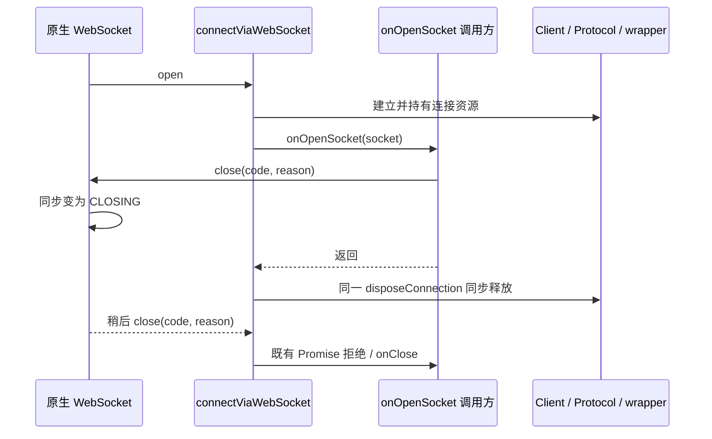

# WebSocket open 回调关闭时的连接生命周期

## 问题与规则

`connectViaWebSocket` 在 `onOpenSocket` 返回后只检查 Promise 的 `settled`。浏览器标准 `WebSocket.close()` 同步把状态改成 `CLOSING`，而 `close` 通知稍后才到；回调主动关闭后旧实现仍把不可用的服务代理作为连接成功返回。这与既有「ready 前关闭拒绝连接」规则不一致。

adapter 继续唯一拥有本次 `ChannelClient`、`SocketProtocol` 和 socket，复用现有 `disposeConnection`/`onClose` 终结入口：

- `onOpenSocket` 正常返回后只有 socket 仍为 `OPEN` 才能 resolve 服务。
- 若回调已启动关闭，同步释放本地 RPC、分片缓存和包装监听；连接 Promise 保持未成功状态，由既有原生 close/error 通知按原字段拒绝。
- 回调抛错仍拒绝同一异常并释放资源。正常回调仍返回原服务代理；对外 close 通知前资源已释放，重复原生通知不重复拥有资源。
- 不新增等待器、计时器、重试、状态缓存、wire 或服务接口。此边界是公开 adapter 回调；当前 Web bootstrap 不传该回调，不声明其普遍存在此触发条件。
- 不改变 Host/lease、workspaceIdentity、CommandInbox 或 Desktop continuous / mobile replayable 的业务恢复语义。

## 验收边界

使用真实 loopback WebSocket server 与 Node 24.14.0 标准 WebSocket。旧实现须复现回调关闭后错误 resolve，修复后检查连接拒绝、关闭字段、释放次数和回调顺序；同组验证回调异常和正常连接。测试服务端只建立本机受控连接，不读写业务目录；所有 runner 缓存/日志/temp 绑定项目隔离树。测试不等于真实浏览器 UI、Electron 或实体手机 E2E。
