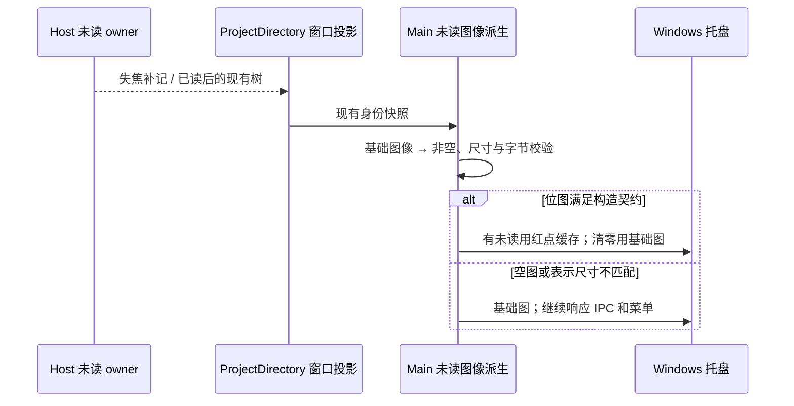
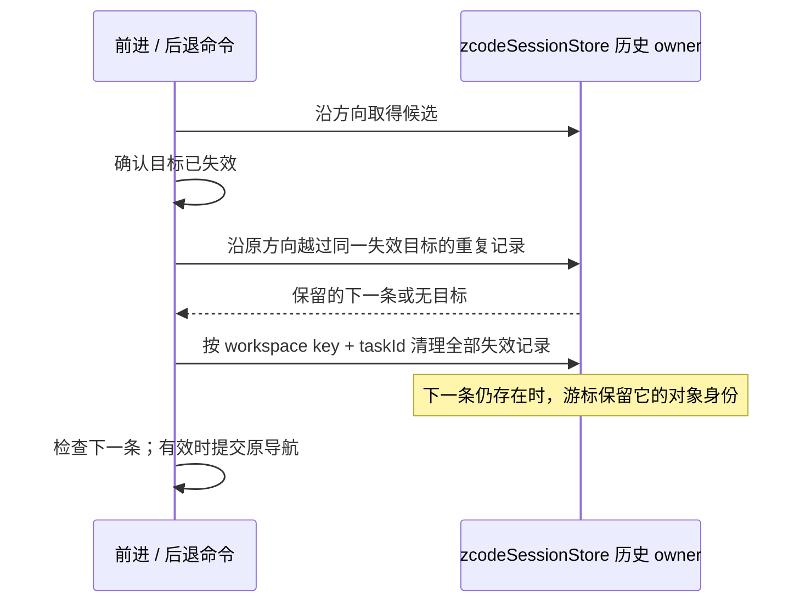
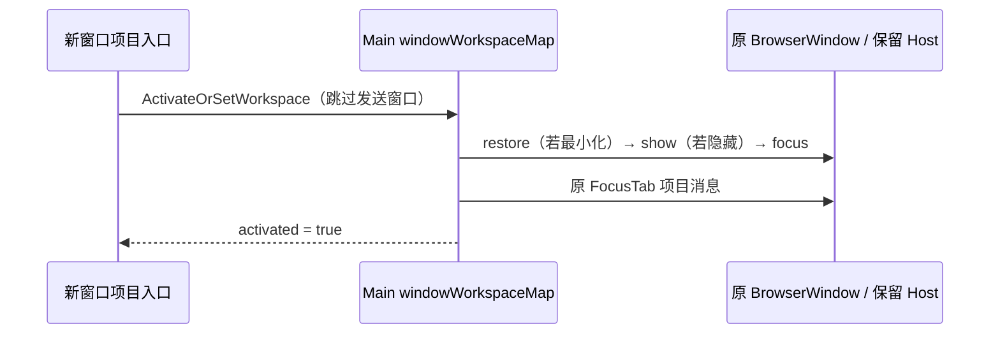
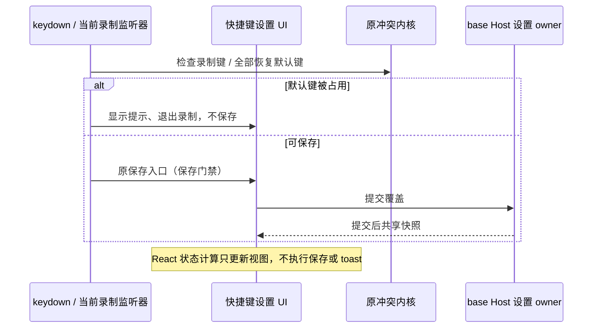
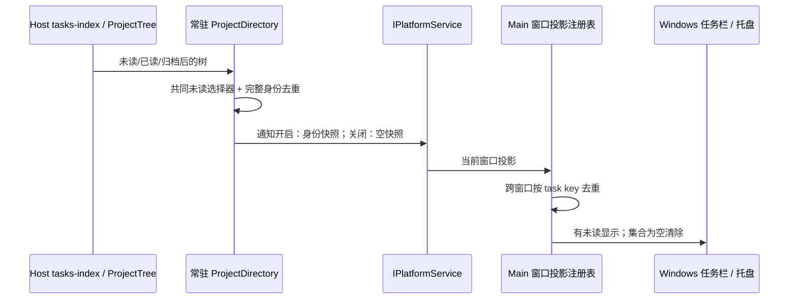
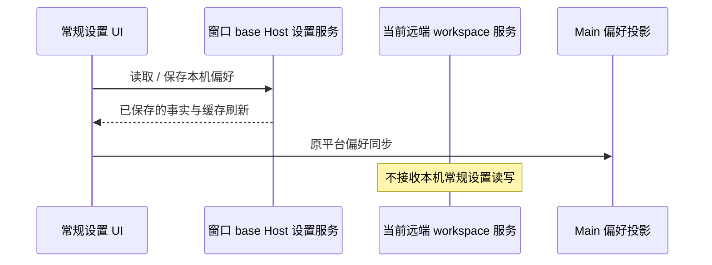
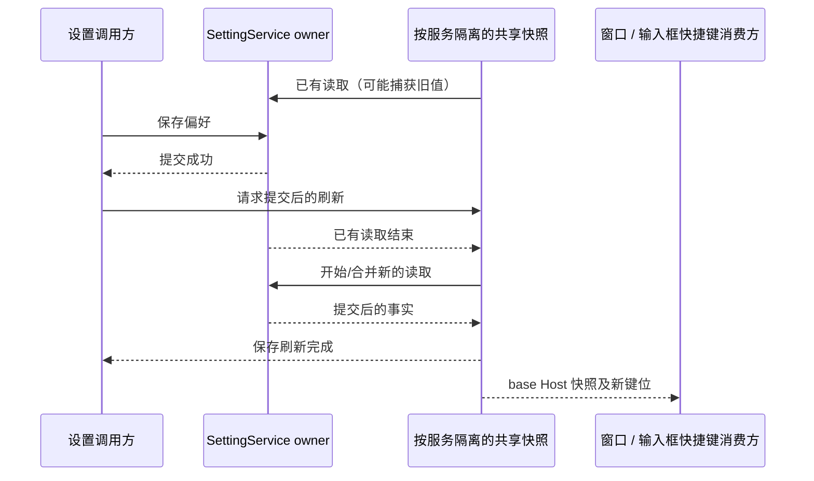
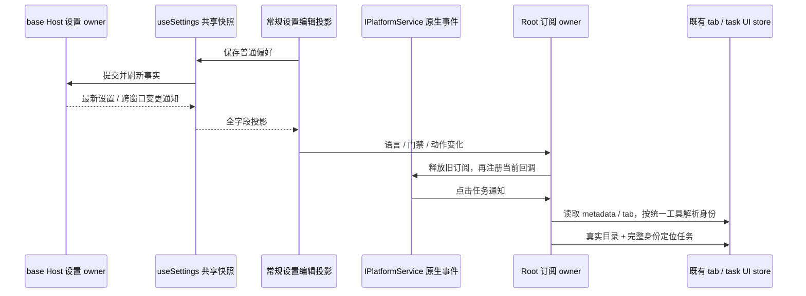
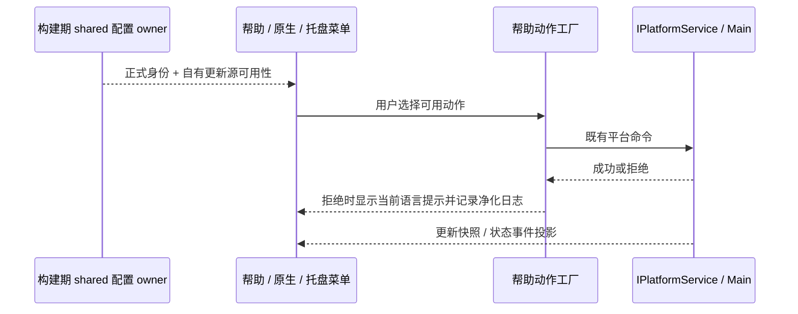

# 桌面界面回归修复（2026-11-03）

## Windows 托盘空图回归（2026-11-12）

- 原生压缩重点 E2E 的手机启动会使桌面失焦；前台完成任务补记未读后，Main 在 `trayImage` 的 `createFromBitmap` 抛出 `invalid buffer size`，Electron 默认原生错误框阻塞 Main，导致手机 bootstrap、桌面 IPC 和 teardown 一起超时。
- 已确认的测试资源缺口是隔离应用只复制 `out`，没有复制开发态图标。隔离 Main 的 `../../build/icon.ico` 指向当前 run 的 `build/icon.ico`，缺失路径由 NativeImage 返回空图。真实 Electron 44.7.0 在 150% 显示缩放下验证：仓库 ICO 缩至 32×32 后为 4096 字节，可以重建；缺失 ICO 为 0×0、0 字节，按 32×32 重建复现相同错误。不能把默认 scaleFactor 单独写成根因。
- Main 只派生托盘图像：空图保持基础图像；非空图在混合前校验实际尺寸与 `width × height × 4` 字节数，再按同一 scaleFactor 重建。表示尺寸不匹配也保持基础图像，不缓存无效红点图像。有效资源继续使用已发布 ICO、现有红点和缓存，未读数量、菜单、tooltip 与清零语义保持。
- E2E 按当前运行平台复制开发态需要的图标到同一个 run 的 `build`：Windows 为 `icon.ico`、`icon_windows.png`，macOS 为 `icon.png`。复制使用独立文件，与 `out` 一起固定在当前工作树；缺失资源拒绝准备，链接或重解析点越界拒绝复制。不加入 Linux 图标、安装包或远端资源。
- Host 仍唯一持有 `unreadAt` 与 compare-and-clear，ProjectDirectory 仍唯一发送窗口投影，Main 按现有身份去重。图像校验不修改 desktop continuous / mobile replayable 的事件、admission 或恢复 owner，也不通过延长超时绕过原生异常。

| ID      | 操作                                                            | 断言                                                                                                                                                         |
| ------- | --------------------------------------------------------------- | ------------------------------------------------------------------------------------------------------------------------------------------------------------ |
| WINUI22 | 有效、缺失和仅 2x 图像，未读 0→1→多条→0→1；隔离应用图标 staging | 有效 ICO 红点与缓存可用；空图或尺寸不匹配不构造无效位图；清零恢复基础图；平台图标按原字节独立复制，缺失/越界拒绝；桌面失焦后手机 bootstrap 和桌面 IPC 可继续 |

数字 probe 只证明 NativeImage 表示与字节契约，不代表安装包、全部 DPI 或 macOS 真机验收。真实产品回放与最终静态检查另记实际结果。

## 提交前验证入口修复（2026-11-04）

- Provider 播种、读取与默认草稿就绪的工程夹具跟随当前 `.zcodium` 数据根；不恢复 `.zcode` 写入或旧 Provider store。
- SSH 目录工程夹具使用公开 `SourceServerManagementSnapshot.directory.profiles` 结构，保持真实 Source 身份选择与缺失拒绝断言。只修正契约替身，不把工程测试写成真 SSH/完整 Electron 验收。
- GitHub Release 测试必须在浏览器准备完成后运行，浏览器缓存沿用当前 checkout 的 `.run-logs/project-only-validation/playwright-browsers`，通过 Playwright 当前安装的 executablePath 注入项目内浏览器路径。
- 每个 Release 测试文件使用 Node 默认子进程隔离，文件串行执行，避免浏览器夹具的环境租约、测试时钟和累计堆内存跨文件污染；原文件发现范围、断言与失败退出码保留，不用跳过测试消除失败。
- 事件顺序：Actions 准备依赖 → 在 checkout 内安装测试浏览器并注入路径 → 串行启动隔离测试文件 → 文件内夹具持有唯一环境租约并关闭 → 原退出码决定 Checks 结果。Windows/macOS 打包矩阵、正式产品身份和手动触发规则保持。

## 第七轮扫描规则（2026-11-04）

- 导航清理仍按 workspace key + taskId 一次移除全部失效记录。前进、后退须在清理前沿原方向
  找到不属于同一失效目标的下一条，并让 store 游标保留该条身份；不能继续消费已被批量移除的记录。
  无可用目标时不选择反方向任务；同 ID 的其它 workspace、自动化页和插件市场记录保留。
  前进相邻重复使用同一远端身份的不同路径别名，经过生产 pushNavEntry 入栈；完全相同的相邻
  原始记录会被去重，不将手写无效历史作为唯一触发证据。后退的重复记录可被其它访问记录隔开。
- 导航锁定、远端断线及未读清理失败只记录静态技术事件和模型切换 stage，不记录目录、taskId
  或原始服务错误。导航、未读 CAS、回滚和 stale 标记顺序沿用现有 owner。

| ID      | 操作                                                                                | 断言                                                                 |
| ------- | ----------------------------------------------------------------------------------- | -------------------------------------------------------------------- |
| WINUI20 | 前进/后退经过同一失效任务的重复记录，历史两侧有有效目标；无目标；同 ID 跨 workspace | 不跳过有效目标，不导航到反方向；游标指向已提交记录；保留其它身份历史 |
| WINUI21 | 导航重启门禁、远端断线或未读 CAS 拒绝                                               | 日志不包含任务 ID、目录或原始错误；原门禁及回滚行为保持              |

## 第六轮扫描规则（2026-11-04）

- 快捷键录制态 Backspace 恢复默认会重新引入整组默认键，必须逐个调用已有冲突内核预检。
  任一默认键被同作用域命令占用时，显示占用者提示且不删除覆盖、不写设置；释放占用后
  恢复全部默认键。平台物理等价及 composer 作用域隔离沿用既有规则，设置仍由 base Host 持有。
- Main 的 `focusWorkspaceInExistingWindow` 激活已登记项目时，先恢复最小化，再在隐藏时
  `show()`，随后聚焦并发送原 `FocusTab`。Windows 关闭到托盘保留窗口及 Host，另一个窗口
  再打开该项目必须显示原窗口。发送方 skip、已销毁窗口清理、未匹配回落及窗口身份映射不变。
  不创建第二个 Host，不改 desktop continuous / mobile replayable 链路或业务事实。
- 录制 hook 的 React 状态 updater 必须是纯计算。Backspace 冲突提示与恢复、录制成功后的
  保存/清空录制态在原 keydown 事件处理器中执行，不能放进可能在渲染或严格模式重跑的 updater。
  使用该监听器所属的 recording 快照，继续复用设置区唯一保存入口和保存门禁，不增加异步队列或定时器。

| ID      | 操作                                                                             | 断言                                                                                                       |
| ------- | -------------------------------------------------------------------------------- | ---------------------------------------------------------------------------------------------------------- |
| WINUI17 | 改绑命令中心后占用其第二默认键，再录制 Backspace；释放占用后重试                 | 冲突提示当前占用者，不落盘；释放后恢复两组键；Windows Ctrl 等价与 macOS 独立 Ctrl、composer 作用域规则保持 |
| WINUI18 | Windows 项目窗口关闭到托盘，另一窗口打开同一项目；可见、最小化、失效及发送方窗口 | 原窗口先恢复/显示后聚焦及切换标签；已可见不重复 show；跳过发送方并清理失效登记；未匹配继续回落             |
| WINUI19 | 严格模式下录制、抢绑、Backspace 冲突及释放后的恢复                               | 没有 render-phase React 错误；一次成功动作只保存一次；取消/噪声/无效键和冲突显示不保存                     |

实际红绿证据见文末第六轮验证。原生窗口替身不代表完整 Electron/Windows Shell 验收。

## 已确认的问题与边界

- `DesktopTopOverlay` 同时保留两组 Logo/侧栏开关、后退和前进按钮，Windows/macOS 均重复。仅保留已有 no-drag 交互容器中的一组；侧栏开关、导航、新建与更新行为不变。
- `SettingsPage` 的导航与内容分支脱节，个性化、项目、归档管理有现成组件却未装配，恢复这些公开入口。个性化始终使用本机 base settingService，Web 只显示本地编辑提示；项目/归档复用常驻 ProjectDirectory owner，不另建目录或改写组织事实。
- 按 `official-3.17.1-integration.md` 的 Source 设置页收口，设备管理的唯一入口是 `SourceServerSettingsSection`。隐藏无实现的旧 `remoteDevices` 菜单，历史导航意图映射到 `sourceServers`；Web 回落到可见常规页。
- 独立 `dataSync` 设置页未装配，不向用户展示空菜单；保留现有上下文中的显式同步能力。历史 dataSync 偏好/意图回落到常规页。不得为恢复空页重新引入官方云依赖。
- Root 从旧会话缓存（含 fallback 未读 map）发送系统角标，ProjectDirectory 又从权威树发送，形成两个写者，旧投影可覆盖已读结果及通知关闭后的 0。删除 Root 的角标同步路径；ProjectDirectory 作为窗口唯一发送者，读取已有 `selectProjectRows(..., {kind: "unread"})` 集合。
- 投影使用现有 `WindowUnreadSnapshot`，task key 包含 Host、canonical workspace identity、taskId。Main 继续按身份去重各窗口，系统任务/后台任务仍按共同选择器处理；关闭任务通知发送空快照，应用内未读状态不变。Web 不发送本机系统角标。

Host 继续唯一持有 `unreadAt` 与 compare-and-clear；本次不修改 CLI/Host admission、owner/lease、传输、数据库或移动端已读流程。桌面 continuous / 手机 replayable 合同保持。

## 验收场景

| ID      | 设置 / 操作                                                                   | 断言                                                                 |
| ------- | ----------------------------------------------------------------------------- | -------------------------------------------------------------------- |
| WINUI01 | Windows/macOS，侧栏开/关，点击开关与前进/后退                                 | 每个入口唯一；一次点击只调用一次动作；no-drag 命中不变               |
| WINUI02 | 设置点击个性化、项目、归档                                                    | 真实组件出现；个性化保存/取消使用本机服务；管理空集合有明确空态      |
| WINUI03 | 所有菜单及旧 remoteDevices/dataSync 意图；桌面与 Web                          | 不出现空菜单；远程设备旧意图到唯一 Source 页，Web/禁用项回落到可见页 |
| WINUI04 | 权威树未读、清除、归档/已删项目、同 ID 不同 Host/identity、开关通知、隐藏侧栏 | 系统投影与可见未读集合一致；清零不反弹；完整身份不误合并；Web 不发送 |
| WINUI05 | Windows 1280px / Web 390px，中英文、深浅主题                                  | 入口可见、可点，无页面横向溢出                                       |

## 实际验证（2026-11-03）

- `scripts/ci/windows-ui-regressions-browser.test.mjs` 实跑通过（外层 1/1），覆盖 WINUI01–05：Windows/macOS 工具条唯一与单次点击、桌面个性化保存/取消且不写当前远端服务、项目/归档管理空态、隐藏旧菜单及历史意图回落、通知开关和清零、相同数量更换任务身份、隐藏侧栏、已归档/已删项目不计数、Web 不发送本机系统角标，以及中英文、深浅主题和 390px 窄屏。重复工具条在修复前实际检出后退按钮 2 个（期望 1 个）。
- Main 角标 helper 与本仓审计守卫合计 15/15 通过（4 项角标、11 项审计）。没有修改 Main 的原生角标实现。
- 按 `mise.toml` 固定 Node 24.14.0 执行根 typecheck，通过；根 Lint 为 0 errors / 157 warnings，警告为既有欠账；changed 架构 violations / baseline / new 均为 0。根 `fmt:check` 与 `git diff --check` 通过；格式门禁仍按固定 blob 核验并保留 1609 个继承文件，没有全仓重排。
- 最终浏览器证据为 `.run-logs/project-only-validation/windows-ui-qXbVzw/` 下 8 张截图；所有 profile、cache、temp、日志及下载工具链均在项目内，使用本地服务夹具并阻断外网。测试不读写真实用户 `.zcodium`。

组件浏览器验收不等同于完整 Electron/Windows Shell、实体手机、真实 Host 持久化、真远端或发行验收。本次没有复验安装版任务栏/托盘，也未提交、推送、打包、安装或触发工作流。

## 第二轮扫描：本机设置与导航

- 常规设置属于窗口 base Host：读取、更新、引导偏好和 `useSettings` 缓存都显式使用 `useBaseWorkspaceServices`，不能跟随当前远端 workspace 的 `ServiceProvider`。常规子组件、独立快捷键设置页及侧栏底部的缩放快捷键标签也绑定 base 设置，避免其内部 hook 误读写远端快捷键。终端枚举、本机设置及 Main 偏好同步保持同一设备。Web base Host 仍是配对桌面，不把它改为浏览器本机服务；按 scope 管理的 MCP/技能/插件继续沿用各自原有合同。自动归档已在常规设置装配，不新增第二个入口。
- 前进遇到失效历史任务时，先取得下一条，再移除失效条目，保持下一条的游标；不得因数组收缩跳过有效任务。清理按 `workspaceIdentity?.trim() || workspacePath` + taskId 定位，同 ID 的其它工作区历史保留。旧 taskId-only 调用保持原契约，当前导航/删除入口传完整目标。
- 后退/前进的模型重启门禁读取当前完整 workspace 身份；按钮订阅这个布尔结果，锁定变化即时反映，不依赖另一台同路径工作区的状态或历史栈变化。
- 顶部新建按钮折叠隐藏时整个容器 inert，不能通过 Tab/Enter 操作不可见入口；显示时恢复原键盘操作。保留既有动画、no-drag 命中与鼠标行为。

| ID      | 操作                                                                            | 断言                                                             |
| ------- | ------------------------------------------------------------------------------- | ---------------------------------------------------------------- |
| WINUI06 | 当前 context 为远端；打开常规、保存代理、切换自动归档和共享开关、清除快捷键绑定 | 初值来自 base；写入只到 base；context 读写为 0                   |
| WINUI07 | 前进经过一条/多条失效任务、末尾失效任务；同 ID 不同工作区；反向导航             | 有效后继不跳过；无后继不倒退；清理只影响目标身份；原后退行为保留 |
| WINUI08 | 同路径本地/远端模型锁不同，锁定后点击导航，再解除锁定                           | 门禁按当前身份；锁定不移动历史；按钮即时禁用/恢复                |
| WINUI09 | 侧栏显示/隐藏时 Tab/Enter 操作工具条                                            | 隐藏新建按钮不能获焦或触发；显示后键盘操作恢复                   |

### 第二轮实际验证（2026-11-03）

- 本机设置生产 callback 定向回归修复前 0/11、修复后 11/11；真实导航 callback、历史 helper 和重启门禁组合回归修复前 2/9、修复后 9/9。连同已有设置平台订阅、ProjectTree owner、草稿创建与审计守卫，最终定向及相邻回归合计 48/48，通过记录为 `.run-logs/project-only-validation/winui-state-final-owTnTC/logs/regression.log`。
- 浏览器 WINUI01–09 最终外层 1/1 通过，证据为 `.run-logs/project-only-validation/windows-ui-axdtIG/` 下 8 张截图。实际覆盖代理、自动归档、共享开关及快捷键清除只写 base，远端设置读写为 0；同路径本地状态不能解除远端导航锁，锁定/解锁即时刷新按钮；隐藏新建按钮不能获得焦点，显示后 Enter 恢复。此前顶部工具条、设置空页与角标集合断言也全部执行。
- 浏览器先检出隐藏按钮仍能获得焦点；常规子控件和侧栏底部快捷键分别暴露远端读取，补齐 context 后通过。追加独立快捷键清除场景时，旧页面实际将 `{ shortcutBindings: { zoomIn: [] } }` 写给远端；绑定 base 后该场景通过。最初等待未分配标签的失败因夹具远端 update 未更新快照而超时，随后先断言实际写入目标，准确检出了远端写入，不把超时当作生产时序依据。
- 最终生产变更按固定 Node 24.14.0 运行根 typecheck，通过；根 Lint 仍为 0 errors / 157 既有 warnings；changed 架构 violations / baseline / new 均为 0。架构 gate 不代表 legacy UI/session 已完成模块治理。
- 根 `fmt:check` 与 `git diff --check` 通过；格式 gate 核验并保留 1608 个继承文件，证据为 `.run-logs/project-only-validation/windows-release-QcNg4V/children/release-format-jLbMII/`，没有全仓重排。
- `scripts/ci/fixtures/windows-ui-regressions.tsx` 不在根 UI 工程的 include 中，另按 UI 编译选项与原工程引用执行 noEmit，通过，证据为 `.run-logs/project-only-validation/winui-browser-types-NQFD1I/`。首次临时配置的 Windows 反斜杠 glob 未收录 UI 声明文件，改为正斜杠、保留原 include 扩展名后通过；没有修改生产类型声明或放宽检查。

验证均使用项目内隔离夹具，不操作真实数据。完整 Electron/原生 Windows Shell、实体手机、真实远端及发行安装版仍未验收；未提交、推送、打包、安装或触发工作流。

## 第三轮扫描：快捷键消费与保存刷新

- 窗口快捷键表、工具提示和输入框命令均是控制端全局偏好。共享 `useEffectiveShortcutBindings` 必须通过 base Host 的 `useSettings` 快照读取，不能随当前远端任务 context 改变。独立设置页、应用菜单、全局按键、输入框按键与标签遵守同一配置；按键匹配和录制内核不变。
- 快捷键设置的绑定列表在展示与录制切换时，复用被编辑绑定的 React key；录制分支不能丢失列表身份。浏览器回归同时检查录制、保存期间没有缺失或重复 key 警告。
- 设置服务仍是持久化唯一 owner，`useSettings` 仍按服务隔离并持有共享快照。保存完成后的刷新必须读取提交之后的事实；若已有读取在途，先等该读取结束，再复用/启动其后的新读取，不用保存前已启动的读取作为保存回执。平台 `SettingsChanged` 也要求通知之后的读取，不能被在途旧读取吞掉。普通并发刷新继续单飞，多个已提交写入的刷新可合并为一次后续读取，不新增定时器、业务缓存或写入队列。CAS 失败后也刷新最新事实再报告冲突，读失败继续保留上次可用值及 error。

| ID      | 设置 / 操作                                                                                | 断言                                                                                 |
| ------- | ------------------------------------------------------------------------------------------ | ------------------------------------------------------------------------------------ |
| WINUI10 | 本机与远端同命令键位不同；在远端 context 按键、查看提示、切换本地/远端；从设置页改键再返回 | 只使用 base 键位；标签与按键一致；改键后旧键失效；不读取远端快捷键                   |
| WINUI11 | 保存前读取在途；保存成功或 CAS 冲突后释放旧读取；并发保存、独立服务、读取失败              | 保存回执等到新读取；快照包含最新提交；普通刷新继续单飞；跨服务隔离；失败保留旧可用值 |

### 第三轮实际验证（2026-11-03）

- 设置刷新首批 9 项红测为 4 通过 / 5 失败，准确检出 hook/helper 保存复用旧读取、并发提交与平台通知被旧读取吞掉；扩展后 11/11 通过，覆盖新读取期间再次提交、保存回执等待、CAS 冲突后刷新、普通单飞、服务隔离及读取失败保留旧可用值。连同运行偏好、平台订阅、本机设置、导航、ProjectTree owner、草稿创建和审计守卫，最终组合 64/64 通过，证据为 `.run-logs/project-only-validation/winui-third-regression-fNeasn/logs/stdout.log`。
- 快捷键浏览器红测明确检出：base 配置为 `Ctrl+Shift+y`，当前远端配置为 `Ctrl+Shift+u`，实际标签为 `Ctrl+Shift+U`，与本机预期不符。最初夹具使用大写单字符键，不符合现有解析契约，导致两次等待超时；夹具改为合法小写键后才形成上述红测，没有修改生产解析器。绑定 base 后，Windows/Web 全局按键及标签、切换工作区 context、从真实设置页录制改键并返回均通过，远端快捷键读写为 0。
- 首次 WINUI01–11 浏览器已通过，另实际捕获两次 `ShortcutBindingRow` 的缺失 key 警告（`.run-logs/project-only-validation/windows-ui-9pMIHM/profile/Default/chrome_debug.log`）。为录制分支补齐原绑定的 key，并将缺失/重复 key 警告纳入浏览器失败断言。
- 最终浏览器 WINUI01–11 外层 1/1 通过，证据为 `.run-logs/project-only-validation/windows-ui-WBQIDz/` 下 8 张截图；录制、改键和保存均无缺失/重复 key 警告。保存时挂起的旧读取释放后，保存回执等待第二次读取完成，界面保持新值；base 共读取 2 次，远端 0 次。前两轮工具条、设置空页/隐藏入口、通知投影、导航锁和隐藏焦点断言全部重跑。
- 最终生产源码的根 typecheck、Lint、changed 架构均 exit 0；Lint 为 0 errors / 157 既有 warnings，架构 violations / baseline / new 均为 0。证据分别为 `.run-logs/project-only-validation/windows-release-QcNg4V/children/release-typecheck-162XMX/`、`release-lint-f9otTJ/`、`release-architecture-75yr2I/`。浏览器 TSX 夹具另按 UI 编译选项、完整 include 与原工程引用执行 noEmit，通过（`.run-logs/project-only-validation/winui-browser-types-8lZxEW/`）。
- 根 `fmt:check` 与 `git diff --check` 通过；格式 gate 核验并保留 1608 个继承文件，没有全仓重排，证据为 `.run-logs/project-only-validation/windows-release-QcNg4V/children/release-format-m4lB3x/`。验证记录回写后另检查这两份文档的格式。

组件浏览器夹具限定项目内 profile/cache/temp，阻断外网，不操作真实用户数据。完整 Electron/原生 Windows Shell、实体手机、真实远端及安装版仍未验收；未提交、推送、打包、安装或触发工作流。

## 第四轮扫描：常规设置投影与原生事件

- 常规设置从已有 base Host 的 `useSettings` 快照同步全部字段，不再另起一次直接读取覆盖刚保存的表单。普通字段保存统一使用同一个 `updateSharedSettings` 入口，保存刷新和跨窗口变更通知均更新同一投影；表单本地状态只是编辑展示，不能另持已提交事实。数据目录迁移保留专用命令及成功后才更新路径的合同。
- 原生通知点击在任务列表缓存缺席时，先按 workspace key 匹配现有 tab 取得真实目录和完整身份；没有 tab 时复用 shared 的远端 identity 解析器。保留任务 metadata 的优先级和本地路径 fallback，不能把远端 identity 当作目录传给导航/任务选择。通知仍只负责导航，不写 Host 未读或 CLI 事实，不改变 taskId-only 原生协议。
- Root 原生事件订阅须使用当前语言、打开目录门禁和动作回调；相关值变化时先释放旧订阅，再注册当前处理器，同一事件只执行一次。稳定 Root 的打开目录适配回调，避免普通重渲染无故更换所有原生监听。事件技术日志不包含目录、任务 ID 或原始错误。

| ID      | 操作                                                                    | 断言                                                          |
| ------- | ----------------------------------------------------------------------- | ------------------------------------------------------------- |
| WINUI12 | 常规页初始旧读取迟到；保存自动归档；模拟其它窗口更新代理及自动归档      | 新值不被独立旧读取覆盖；通知后所有普通字段刷新；写入只到 base |
| WINUI13 | 活跃远端任务无列表缓存、metadata 存在、tab 缺席；本地任务和未知任务通知 | 目录和身份正确；metadata 优先；未知任务不导航；不直接更改未读 |
| WINUI14 | 不换 tab 切语言、门禁和动作；触发原生更新结果和打开目录事件；卸载       | 当前语言与回调生效；门禁即时生效；无重复订阅；卸载释放监听    |

### 第四轮实际验证（2026-11-03）

- 浏览器红测实际检出自动归档保存后被独立初始读取覆盖：释放迟到读取后开关为 `unchecked`，期望 `checked`，证据夹具为 `.run-logs/project-only-validation/windows-ui-UkbHT3/`。修复后保留保存值，模拟其它窗口的 `SettingsChanged` 能切换自动归档并刷新代理；普通保存不再直写服务后另持表单事实。
- Root 首批 10 项源码回归为 3 通过 / 7 失败，检出远端 identity 被当作目录、事件依赖遗漏及导航技术日志带任务 ID/目录，证据为 `.run-logs/project-only-validation/winui-fourth-root-tests-8MaZ5f/logs/stdout.log`。最终 13 项覆盖 Source/WSL/SSH 身份解析、tab 的原始目录和 opaque identity、metadata 优先级、本地 fallback、未知通知、当前语言/门禁/动作以及订阅释放。用例执行实际生产 callback，并按其依赖模拟 effect 重订阅；真实 React 交互另由浏览器验证。
- 定向及相邻回归最终 77/77 通过，证据为 `.run-logs/project-only-validation/winui-fourth-regression-IKhChY/logs/stdout.log`。已有本机设置用例加强为拒绝绕过 `updateSharedSettings` 直接保存，同时仍断言远端写入为 0；设置刷新、运行偏好、导航、ProjectTree owner、草稿创建和审计守卫均重跑。
- 最终真实组件浏览器 WINUI01–14 外层 1/1 通过，证据为 `.run-logs/project-only-validation/windows-ui-fFQCjo/` 下 8 张既有布局截图和浏览器日志。新增断言覆盖迟到读取、模拟跨窗口设置变更、无列表缓存的远端通知定位、中文更新结果提示、当前打开目录回调、门禁变化、单一订阅及卸载清理；前几轮工具条、空菜单、快捷键、导航锁、隐藏焦点和角标集合断言也全部执行。
- 最终根 typecheck、Lint、changed 架构均 exit 0，Lint 为 0 errors / 157 既有 warnings，架构 violations / baseline / new 均为 0。证据为 `.run-logs/project-only-validation/windows-release-QcNg4V/children/` 下 `release-typecheck-kINdJK/`、`release-lint-WiPjAd/`、`release-architecture-WXHjna/`。本轮首次 Lint 的第 158 条警告来自刚移除独立读取后剩下的 `AppSettings` 类型导入，已清理，不归入既有欠账。
- 浏览器夹具按 UI 编译选项、完整 include 与原工程引用执行独立 noEmit，最终通过（`.run-logs/project-only-validation/winui-browser-types-cJjkAW/`）。中间检查检出测试平台的重复 `onTaskNotificationClick` 字段；删除被适配器覆盖的旧 noop 后通过，没有放宽类型检查。
- 根 `fmt:check` 与 `git diff --check` 通过；格式 gate 保留 1608 个已核验的继承文件，没有全仓重排，证据为 `.run-logs/project-only-validation/windows-release-QcNg4V/children/release-format-ve65TS/`。验证记录回写后另检查文档格式。

所有验证与证据仍在项目内隔离目录，使用本地服务夹具并阻断外网，不操作真实用户数据。组件浏览器中原生事件由平台契约注入，未验收完整 Electron/Windows Shell、安装版、真实 SSH/WSL 或实体手机；通知仍沿用 taskId-only 协议。本轮未提交、推送、打包、安装或触发 Actions。

## 第五轮扫描：帮助菜单与不可用的更新入口

- 当前工作区和设置页使用 `WorkspaceHelpMenuButton`。旧 `WindowsCaptionMenuButton` 已无生产挂载点，其迟到快照候选不计为已复现的用户问题。
- 更新源仍由构建期 shared 常量拥有。正式产品身份且自有更新源非空时才展示帮助菜单、原生应用菜单和 Windows 托盘的更新入口，以及常规设置的接收预览版/自动下载安装选项；Preview 和空更新源时隐藏，不向官方源回退。设置保存仍由 SettingsPage 的 base Host 入口负责，原生 updater 的既有运行时门禁继续负责阻止不可用调用。
- 帮助菜单中的反馈、文档、社区、资源管理器、关于和更新动作统一通过已有帮助动作工厂调用 `IPlatformService`。原生调用失败须被观察，显示当前语言的通用失败提示；技术日志不传原始错误、URL 或用户数据。失败不改变菜单可用性，重试仍执行同一平台命令。导出日志继续使用既有导出进度/结果处理。
- 更新状态仍是 Main 的事实，`useDesktopUpdateMenu` 只投影已有初始快照与事件，不增加设置或更新状态写者。原有“先订阅，旧快照不得覆盖事件”规则继续验证。

| ID      | 操作                                                                                            | 断言                                                                       |
| ------- | ----------------------------------------------------------------------------------------------- | -------------------------------------------------------------------------- |
| WINUI15 | 正式版空更新源、Preview 有源、正式版有源；打开工作区/设置帮助菜单、原生菜单与托盘；查看常规设置 | 前两种隐藏更新及其偏好，第三种显示；其它功能可用；无外网请求               |
| WINUI16 | 帮助菜单平台动作拒绝，再重试；切中英文；更新初始读取迟于新事件                                  | 失败有本地化提示，无未处理拒绝、无敏感日志；重试成功；新状态不被旧快照覆盖 |

### 第五轮实际验证（2026-11-03）

- 浏览器首轮 0/2：正式版空更新源仍有 1 个检查更新菜单项，预期 0；有源场景打开文档被平台拒绝时，实际产生 `Unhandled rejection` 且没有失败提示。证据为 `.run-logs/project-only-validation/winui-fifth-help-browser-bPRH6N/`。新增常规设置断言再次形成红测：空源仍有接收预览版开关，预期 0（`winui-fifth-help-browser-absent-K93BZS/`）。没有使用真实原生操作或联网检查来构造拒绝。
- 可用性与动作首批 5 项回归失败；原生模板夹具最初遗漏开发工具 ID，补齐夹具后才确认 Windows 原生菜单、UI 与托盘都会在空源时暴露入口。最终执行正式版空串/空白、有源与 Preview 有源矩阵；运行实际生产模板和动作工厂，覆盖中英文、六类拒绝/重试、准确的平台命令以及不记录原始错误。
- 定向与相邻回归最终 89/89，通过证据为 `.run-logs/project-only-validation/winui-fifth-regression-TnAFPv/logs/stdout.log`。包含既有设置保存/刷新、原生通知、导航、ProjectTree、草稿和审计守卫，以及更新源归属与新增帮助动作场景。
- 最终组件浏览器 3/3，通过证据为 `.run-logs/project-only-validation/winui-fifth-browser-BulLeC/`。`children/winui-help-menu-DHFBKi/` 与 `winui-help-menu-AMgBTZ/` 分别验证空源/有源，覆盖 Windows/macOS/Web 工作区和设置帮助菜单、常规设置开关、中英文失败/重试及旧更新读取不覆盖新事件；各有两张失败提示截图。`children/windows-ui-S4NVHP/` 重跑 WINUI01–14，保留 8 张布局截图。未处理拒绝和外网请求均为 0。
- 根 typecheck、Lint、changed 架构与 fmt:check 均 exit 0，证据为 `.run-logs/project-only-validation/windows-release-QcNg4V/children/` 下 `release-typecheck-sLz4lz/`、`release-lint-keDHm7/`、`release-architecture-kYiCUy/`、`release-format-KYtkZr/`。Lint 0 errors / 157 既有 warnings，架构 violations / baseline / new 全部为 0。中间 Lint 的新增错误来自浏览器总夹具超过 400 行；将帮助平台契约拆为 `help-menu-probe.ts` 后归零，没有放宽规则。
- 浏览器夹具按 UI 完整 include、原项目引用及 noEmit 独立检查通过（`.run-logs/project-only-validation/winui-browser-types-PpuZLv/`）。格式 gate 继续保留 1608 个核验过的继承文件，差异空白检查通过；验证记录回写后另核验三份 spec 的格式。

所有数据、profile、临时文件与验证日志都在当前项目内。原生菜单/托盘验证使用生产模板及 Electron 契约替身，浏览器原生动作由 `IPlatformService` 注入；没有验收完整 Electron/Windows Shell、安装版、真实 SSH/WSL 或实体手机。未提交、推送、打包、安装或触发 Actions。

### 第六轮实际验证（2026-11-04）

- 生产函数回归修复前 4/7：第二默认键被占用仍落盘，Windows 关闭到托盘后项目激活仍不可见，隐藏且最小化路径漏 `show`。红测为 `.run-logs/project-only-validation/winui-sixth-focused-HLdOna/`。修复后原 7 项通过，保留首键冲突、物理等价、macOS 独立 Ctrl、composer 作用域、skip 发送方和失效窗口登记清理。
- 真实组件按键管线先通过抢绑命令中心第二键构造可达状态，再按 Backspace 恢复；旧实现产生第二次设置写入（预期不写），浏览器红测为 `winui-sixth-focused-browser-U6vqvR/`。冲突修复后又实际检出 `Render methods should be a pure function` 错误（`winui-sixth-focused-browser-GLwCJU/`）：录制 hook 在 React updater 中调用恢复/保存，toast 在渲染期间挂载。将副作用移到原 keydown 后，严格模式浏览器复测通过。
- 增加录制恢复、追加、替换的 updater 重放回归，确认副作用只执行一次；取消、长按、无可解析 code 的 IME、无效键、同命令重复和其它命令占用不保存。录制态的 IME 仍可按有效物理 code 录制，匹配侧噪声策略保持；首轮追加夹具误把该合法录制当作噪声，按既有合同校正，未改生产 IME 规则。
- 定向与相邻回归最终 **98/98**，日志为 `.run-logs/project-only-validation/winui-sixth-regression-Sxqdhf/logs/stdout.log`。组件浏览器最终 **4/4**，证据为 `winui-sixth-browser-IeOW8O/`：`children/winui-shortcut-restore-uhfL45/` 覆盖 Windows 中英文、macOS 主修饰键和 390px Web 中文的严格模式抢绑、冲突提示、原占用者快捷键继续生效、释放后恢复双默认、本机写入及无横向溢出，保留 8 张截图；其它三项重跑 WINUI01–16。未处理拒绝、React console error 和外网请求均为 0。
- 固定 Node 24.14.0 根 typecheck、Lint、changed 架构和 fmt:check 均 exit 0，证据为 `.run-logs/project-only-validation/windows-release-QcNg4V/children/` 下 `release-typecheck-9ANQCj/`、`release-lint-G0e6Mh/`、`release-architecture-DWHa2I/`、`release-format-a8Z5gn/`。Lint 为 0 errors / 157 既有 warnings，架构 violations / baseline / new 均为 0；改码前架构也通过。浏览器夹具独立 noEmit 为 `winui-browser-types-1hluT2/`，通过。格式核验保留 1608 个继承文件，差异空白检查通过。

验证仅使用项目内隔离数据、profile、cache、temp 和日志。WINUI18 执行生产关闭/激活函数与 BrowserWindow 契约替身；未验收完整 Electron/Windows Shell、真实安装版、SSH/WSL 或实体手机。新增浏览器证据保持 pending-review，不晋升 formal/CI。本轮未提交、推送、打包、安装或触发 Actions。

### 第七轮实际验证（2026-11-04）

- 新增生产 callback 回归修复前 **12/20**，8 项失败分别检出前进漏选重复记录后的有效目标、后退选回当前任务及无目标误选、五种导航/未读异常路径的敏感日志。红测为 `.run-logs/project-only-validation/winui-seventh-focused-68I5Ho/`；修复后 **20/20**，证据为 `winui-seventh-focused-U0MonO/`。历史清理仍使用原 helper 和 scoped identity，未改未读 CAS 或持久化 owner。
- 定向及相邻回归 **109/109**，最终证据为 `.run-logs/project-only-validation/winui-seventh-regression-2FyA7Z/logs/stdout.log`。复核后将前进相邻重复改为同一完整身份的路径别名，用生产 pushNavEntry 构造可达状态，并断言不会被原始记录去重。覆盖设置保存/刷新、快捷键、原生事件、项目树、草稿和审计守卫；不宣称全仓没有 bug。
- 最终真实组件浏览器 **1/1**，证据为 `.run-logs/project-only-validation/winui-seventh-browser-w9OXJ3/children/windows-ui-fNBaiV/`。WINUI20 在严格模式 Windows 英文、macOS 中文及 390px Web 中文分别通过前进、后退、两种无目标操作，重复历史经过真实入栈 API，断言真实 activeTaskId、历史成员和游标；保留 3 张导航截图及 8 张既有布局截图。WINUI01–14 一并重跑，未处理拒绝、缺失/重复 key 警告及外网请求均为 0。
- 固定 Node 24.14.0 根 typecheck、Lint 和 changed 架构均通过，证据依次为 `winui-seventh-typecheck-qzTJtf/`、`winui-seventh-lint-0XLMon/`、`winui-seventh-architecture-WTs2Vz/`；Lint **0 errors / 157 既有 warnings**，架构 violations / baseline / new 均为 0。浏览器夹具独立 noEmit 最终通过（`winui-browser-types-wZmF7g/`）；首次检出两处数组索引可能 undefined，增加有效游标校验后修复，没有放宽类型。
- Desktop `typecheck:e2e` 最终通过（`winui-seventh-e2e-types-Y66zqm/`）。首次嵌套 pnpm 误取环境中的 Node 24.22.1/pnpm，因其 upath 初始化异常未进入代码检查；在本轮隔离目录提供固定 Node/Corepack 的 pnpm shim 后重跑通过，没有安装或改写项目外工具链。
- 根 `fmt:check` 与 `git diff --check` 通过，格式证据为 `winui-seventh-format-5w4H4T/`，保留 1608 个核验过的继承文件。最终证据记录回写后另核验本轮源码、夹具和两份文档格式。

所有验证数据和证据都在当前工作树的隔离目录。组件浏览器直接播种合成 renderer 历史和 task cache，覆盖导航与按钮行为；没有验证真实 Host 数据迁移、远端连接、完整 Electron/Windows Shell、安装版或实体手机。新增证据保持 pending-review，不晋升 formal/CI；未提交、推送、打包、安装或触发 Actions。
