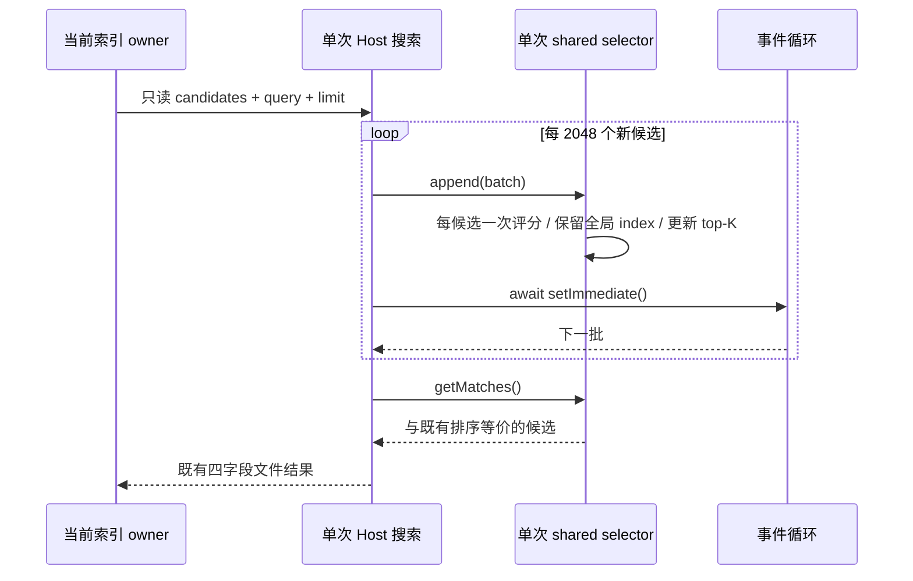

# 工作区文件搜索：分批单次打分

## 行为与边界

搜索结果、name/path/relativePath/type 字段、模糊评分、默认 files-first 顺序、同分原始索引顺序、limit 和 2048 项后的事件循环让出均保持现状。不修改索引扫描、workspaceIdentity 缓存键、远程协议、权限、UI 或 provider。仅处理当前 host 分批搜索对已入选 top-K 的重复打分。

已确认预算：40,000 个候选（夹具包含匹配与不匹配项）、limit=1000，现有 20 批将旧 top-K 重送评分函数，产生 59,000 次 lowercaseName 读取（每次评分一次读取），其中 19,000 次重复。目标为同一夹具恰好 40,000 次、每候选一次；不是墙钟耗时或 UI 帧率承诺。

## 单一 owner 与接口决策

- shared 的公开 `@zcode/shared/workspaceFileSearch` 仍是唯一评分和排名规则入口。新增同一入口的 per-call `createWorkspaceFileSearchCandidateSelector(query, options)`，提供 `append(batch)` 和 `getMatches()`；现有 `filterWorkspaceFileSearchCandidates` 复用该入口，不维护另一套规则。
- selector 只在一次搜索内持有派生分数、全局原始 index 与 top-K；不缓存跨请求结果、不建立持久化事实，不暴露分数或修改候选。调用者得到新数组，候选引用本身按既有只读索引约定保留。
- services 通过上述现有公开入口 append 新批次；每批仍 await setImmediate。索引 cache 的 workspaceIdentity owner、失效和替换边界不变；并发搜索各有独立 selector。
- query 为空时复用现有默认排序/limit，requireQuery 仍为空结果；本轮不扩为另一套默认排名优化。

公开契约示例（host 与单次 shared 过滤共享规则）：

```ts
const selector = createWorkspaceFileSearchCandidateSelector(query, { limit: 1000 });
selector.append(firstBatch);
selector.append(secondBatch);
const matches = selector.getMatches();
```



## 失败语义与迁移

没有新 IO、AbortSignal、重试、超时或持久化迁移。现有异步让出与函数拒绝传播保持现状。候选在搜索期间只读；索引失效由原 owner 替换，不在此处变成可变数据副本。已存在的 top-K splice 最坏元素移动成本不列为本轮解决项。

## 实际工作量

同一 40,000 候选、limit=1000 的实际 Host 回归：旧入口 59,000 次评分（红灯 7/9），新入口 40,000 次、重复为 0（绿灯 9/9，失败和跳过均为 0）。消除 19,000 次重复工作，相对旧入口少 32.2%。最终 11 组联合回归再次执行本组全部 9 项；未测量墙钟延迟。

## 验收与真实证据

先使用实际 host 源码运行回归拿到预算红灯，再改唯一评分入口与 host 接入：

1. 40k/top-1000 评分预算由 59k 降为 40k，结果与独立全排序 oracle 完全相等。
2. 多 query/limit、跨批同分、默认 files-first、边界 limit 与旧批合并结果等价。
3. 并发搜索独立、不改输入、不增加返回字段，2048 批次仍让出事件循环。
4. selector 公开契约的 append、快照数组和 requireQuery 场景。
5. 固定 Node 24.14.0，HOME/cache/temp/log 全部在校验过的项目内 sandbox；无文件系统搜索实弹或 UI E2E 性能声明。

最终计数和日志在总复扫记录中补充。
