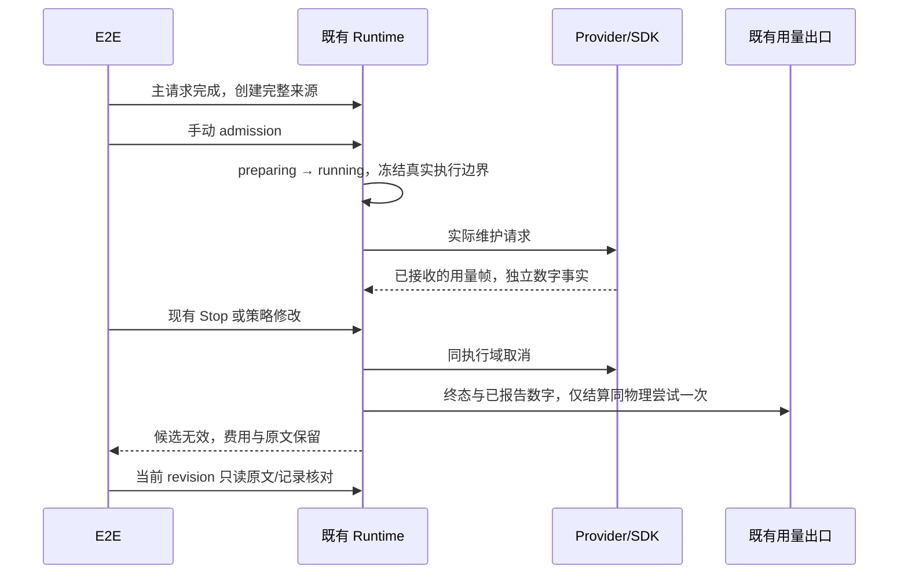
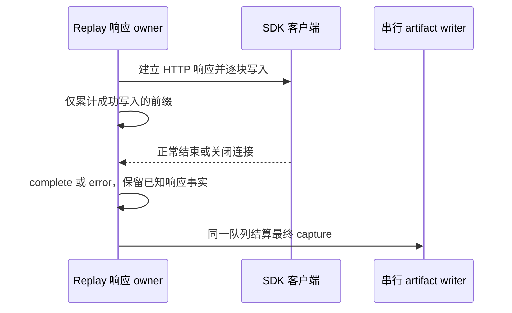

# 原生上下文压缩：影响范围与验收规划

2026-11-12。实施与验收交接。关联 [产品方案](../specs/native-context-compression.md)、[完整参数目录](../specs/native-context-compression-parameters.md)、[趋势与统计页面](../specs/native-context-compression-trends.md)。

用户已授权按方案开发与全面端到端测试。四页签、参数、默认捕获、协议与只读查询已有实现，下面按当前源码更新交接状态；实现存在不等于用例通过。三份方案已定义的页面、图片、参数、统计与模型规则按 [实施契约](../specs/native-context-compression-implementation.md) 执行；NCTX-01..60 的已定义 guard/effect 为 accepted，pending/manual-review suite 与 fixture 已创建，按实际执行到的断言登记 covered、partial 或 missing。参数路径、实际消费者和验证边界见 [90 字段实现映射](../specs/native-context-compression-parameter-mapping.md)，不放宽已接受的规则。

## 当前执行与证据分层

2026-11-12 收尾范围：按用户最新要求，最多两名子代理，后续只复测关键路径，不重新跑全部 32 场。第八轮[部分结果](../../.run-logs/project-only-validation/nctx-r8-partial-evidence-D8t7HP/round8-partial-evidence.md)与[逐场记录](../../.run-logs/project-only-validation/native-context-desktop-e2e-ZkX0pP/artifacts/test-results.ndjson)确认实际完成 25 场，21 pass / 4 fail；没有 summary 或可核实的退出收据，其余 7 场未执行。已确认的问题为在途 mode 场景的 Popover teardown 时序，以及手机进入聊天时的 `SessionDataLayer 已释放，不能再 acquire`；后两场手机设置与账本没有完成主断言。两项先用真实源码红绿回归，再用一轮共享环境重点验证。

第九轮重点选 13 场：空草稿、真实 Read 初始化、手动与自动摘要、stop/mode/parameters 三种在途中断、PNG 降采样与原图查看、桌面 3000 条账本、手机恢复/设置/账本、模型原图回取。手机入口变更后统一重新编译，并复用已下载驱动。[4UncAx 报告](../../.run-logs/project-only-validation/native-context-desktop-e2e-4UncAx/artifacts/summary.md)与退出收据确认实际执行 10 场，9 pass / 1 timeout / 0 skip，exit 1；前九项桌面场景通过，手机在读取 bootstrap 时失败，尚未进入共享 Root 与恢复主断言。Main 诊断读取超时，随后 WebDriver/teardown 也超时；手机设置、手机账本及原图工具三场未执行，其余 19 场未选，不算 skip。

随后实际进行了两次缩小范围的定位回放：[gvELa2 报告](../../.run-logs/project-only-validation/native-context-desktop-e2e-gvELa2/artifacts/summary.md)及退出收据为 **选 5 场、执行 3 场，2 pass / 1 timeout / 0 skip，选中未执行 2 场、另 27 场未选，exit 1**；Read/PNG 通过，手机初始准入失败，手机设置与模型原图工具未执行。[GOGcoE 报告](../../.run-logs/project-only-validation/native-context-desktop-e2e-GOGcoE/artifacts/summary.md)及退出收据为 **选 2 场、执行 2 场，1 pass / 1 timeout / 0 skip，选中未执行 0 场、另 30 场未选，exit 1**；Read 通过，手机仍在同一 bootstrap 准入等待 60000ms 失败。两次的 summary、逐场/case-local 结果与 completion 一致，之后 WebDriver/after-all/deleteSession 也超时；都没有到达共享 Root 或真实 Main 查看、reload、设置断言，不能将未选项计为 skip，也不能用前置通过补齐手机结果。

第九轮[源码指纹](../../.run-logs/project-only-validation/native-context-desktop-e2e-4UncAx/artifacts/build-source-evidence.json)为 renderer/Host/Main 的 `fresh-stable`，没有 CLI 编译指纹。后两次的[gvELa2 构建收据](../../.run-logs/project-only-validation/native-context-desktop-e2e-gvELa2/artifacts/build-source-evidence.json)与[GOGcoE 构建收据](../../.run-logs/project-only-validation/native-context-desktop-e2e-GOGcoE/artifacts/build-source-evidence.json)均为 `unverified-reused-build`、`sources={}`；5734 项已保存输出指纹与第九轮相同，仍缺独立源码到复用构建验证，不新增最新源码通过证据。[main-watch-S8WVRB](../../.run-logs/project-only-validation/native-context-main-watch-S8WVRB/events.jsonl)在 Inspector 就绪后只记录 4 次异常响应、16 次超时，没有返回 value 或暂停栈；异常响应不能算健康 heartbeat。上述两场定位未执行大账本仍失败只缩小复现前置，这些产物当时不能确认 Main 同步循环或 bootstrap 的具体阻断点；后续确认的原生异常另列，不预填产品结果或放宽 Main mobileTaskView 强断言。

后续 [s0tiym 报告](../../.run-logs/project-only-validation/native-context-desktop-e2e-s0tiym/artifacts/summary.md)、[2rd4y7 报告](../../.run-logs/project-only-validation/native-context-desktop-e2e-2rd4y7/artifacts/summary.md)、[PEXPbP 报告](../../.run-logs/project-only-validation/native-context-desktop-e2e-PEXPbP/artifacts/summary.md)分别核对为 **选 2 场、实际 2 场，1 pass / 1 timeout / 0 skip，选中未执行 0 场、另 30 场未选，exit 1**。Read 初始化通过，手机初始准入等待 60000ms 超时，尚未执行共享 Root、真实 Main 查看、reload、设置或手机账本主断言。summary、逐场/case-local 和退出收据均一致，逐轮链接见[验收覆盖表](native-context-compression-e2e-coverage.md)；三次构建状态仍是 `unverified-reused-build`，不增加最新源码产品通过。

保存的 [Eqzb9p 原生栈](../../.run-logs/project-only-validation/native-context-stack-Eqzb9p/stack.jsonl)确认 Main 主线程停留于 `DialogBoxIndirectParamW`；PEXPbP 最终工具 stdout 则确认 Electron `Uncaught Exception` 的 `invalid buffer size`，函数栈为 `trayImage → syncWindowsDesktopTrayUnread → syncApplicationUnreadBadge → handleWindowUnreadCountSync → IpcMainImpl`，规则与现场结论见 [WINUI22](../specs/windows-ui-regressions.md)。**最终错误文本及函数栈来自当时工具输出，未保存原始 UIA JSON**；PEXPbP 早期采样不是最终错误原文，Eqzb9p 本身只证明原生 DialogBox 阻塞。

[NativeImage probe](../../.run-logs/project-only-validation/nctx-nativeimage-probe-P4RzZm/nativeimage-results.json)使用真实 Electron 44.7.0、Windows 屏幕 scaleFactor 1.5，未创建 BrowserWindow：仓库 ICO 为 256×256，缩至 32×32 后有 1x 表示、4096 字节，默认与显式 1x 重建均成功；失败运行缺失的 staged 图标为 empty、0×0、0 字节，按 32×32 重建复现相同错误。synthetic 2x-only 的逻辑 32×32 图像取到 16384 字节，默认与显式 1x 均不能按固定 32×32 重建；不能把它计为真实 200% 屏幕或推断 125%/200% 实屏通过。当时 E2E staging 仅复制 `out`，没有复制隔离开发路径所需的 `build/icon.ico`。按 WINUI22 保留已发布 ICO、增加空图/实际尺寸/字节保护并补齐平台图标 staging；配对 Dialog 关闭屏障只是测试时序收口，不是此次原生异常的修复。修复后的重点产品结果另列，不重跑旧失败轮补原始 UIA，也不改写此前失败。

WINUI22 [源码冻结索引](../../.run-logs/project-only-validation/nctx-tray-image-final-evidence-75ELjv/children/windows-ui-tray-image-index-xNynkH/freeze-index.md)确认旧 HEAD **1/3、exit 1** → 工作树 **3/3、exit 0、0 skip**。真实源码和 NativeImage 回归保留有效 ICO 的红点/缓存及完整 `0→1→8→0→1` 未读序列；空图和仅 2x 输入从 `invalid-buffer-size` 改为基础图，零无效位图构造或缓存，未改变未读 owner。[图标 staging](../../.run-logs/project-only-validation/nctx-tray-staging-final-T4mNQM/logs/validation.log)为 **5/5、exit 0**。Tray/Menu 为受控端口、没有原生窗口；上述源码与准备阶段回归不登记为全部 DPI、安装包或手机产品通过。

托盘修复后的 [24LYLb 报告](../../.run-logs/project-only-validation/native-context-desktop-e2e-24LYLb/artifacts/summary.md)、[逐场记录](../../.run-logs/project-only-validation/native-context-desktop-e2e-24LYLb/artifacts/test-results.ndjson)、case-local 与退出收据一致：**选 8 场、实际 8 场，5 pass / 3 fail / 0 skip，选中未执行 0 场、另 24 场未选，exit 1**。Read、桌面常规设置四宽度/浅深主题/中英文、opaque PNG 降采样/原图预览、桌面 3000 条账本和模型原 PNG 回取通过。手机恢复在 `readTrendGeometry` 的页面序列化出现 `ReferenceError: __name is not defined`；后两手机场在复用 Page 的 `showMobileTaskHome` 等待 sidebar 30s 失败，设置与账本主断言未执行。[手机结构记录](../../.run-logs/project-only-validation/native-context-desktop-e2e-24LYLb/home/ZCodeProject/.zcode-e2e/conversation-session-native-context-compression/evidence/mobile/native-view-evidence.jsonl)已到达 `onboarding-ready` 与 `task-open`，后者 Main readable/connected/viewPresent/taskMatches/workspaceMatches 全为 true；不再是初始 bootstrap 阻断，也不能把这些阶段事实算作在途 reload/隐藏恢复整场通过。[运行日志](../../.run-logs/project-only-validation/native-context-desktop-e2e-24LYLb/logs/e2e.log)中 Main 读取和 teardown / `deleteSession` 均正常返回，未重现此前全链路挂起。

本轮[编译指纹](../../.run-logs/project-only-validation/native-context-desktop-e2e-24LYLb/artifacts/build-source-evidence.json)为 renderer/Host/Main 的 `fresh-stable`，3469 项源码、5744 项输出、`changedFiles=[]`。[同一运行日志](../../.run-logs/project-only-validation/native-context-desktop-e2e-24LYLb/logs/e2e.log)第 3310/3314/3318/3326 行记录 CLI dynamic-workflow-runtime/core/adapters/bootstrap 包的 build，后续为 `tsc`：本轮这些 CLI 包重新执行编译，但 collector 仍无 CLI 指纹，不能把三域编译验证泛化为 CLI 或后续复用已验证；独立复用核对另列。手机 helper 修复与产品复测由主代理集中执行，当前 `humanReviewed=false`、`promoted=false`。

[页面序列化正式 source 索引](../../.run-logs/project-only-validation/nctx-page-serialization-final-evidence-XiQ5RI/freeze-index.md)为 **7/7、0 fail/skip**；旧临时 probe 为 **3/7 通过、4/7 ReferenceError/module-name-unavailable**，不能说正式新脚本已经执行同一红例。真实 `tsx 4.21.0 keepNames` 编译覆盖审阅 68 个 suite 可达模块、34 个 Page evaluate/waitForFunction 调用点、29 个独立回调 payload；`readTrendGeometry`、`readParameterGeometry`、`readSettingsUi`、`readNativeContextLargeLedgerSvg` 的浏览器上下文数值断言成功，另三项控制回调亦通过。函数序列化到没有模块 `__name` 的独立 JSDOM realm，边界/getBBox/getTotalLength 为受控几何端口；只登记 source 序列化/数值，不计真实浏览器布局、SVG 或手机产品通过。

[关闭 helper source](../../.run-logs/project-only-validation/nctx-mobile-close-source-green-i8erCG/logs/validation.log)单次 **5/5、0 fail/skip、exit 0**，保留原桌面三场并新增手机两场。执行真实 `mobile.ts` 关闭函数 AST，受控 Page 的关闭按钮/Escape 完成后仍保留 DOM：helper 必须等 hidden 才返回，已关闭时没有额外动作或隐藏等待；不用 sleep 同步。关闭屏障源码通过不能替代后续手机 Home/任务导航与 Main 查看主断言。

[复用前证明](../../.run-logs/project-only-validation/nctx-build-reuse-proof-Bht9DK/reuse-proof.json) `status=matched`：3469 个 packages 源码和 5744 个 desktop/out 输出与 24LYLb receipt 匹配，无变化；1767 个 CLI 源码/3338 个 dist 输出只是当前 replay 的前快照。[运行中独立复核](../../.run-logs/project-only-validation/nctx-build-reuse-proof-0uIVhF/reuse-proof.json)再度 matched，实际 staged app 全部 5744 输出相等、无缺失/变化/额外文件，CLI 相对前快照也不变。后两项 CLI 数字只证明本次 replay 稳定，不补称原 collector 的 CLI 编译指纹完整，也不改写原 reporter 的 `unverified-reused-build`。

较早重点 [9zSF2H 报告](../../.run-logs/project-only-validation/native-context-desktop-e2e-9zSF2H/artifacts/summary.md)、[逐场记录](../../.run-logs/project-only-validation/native-context-desktop-e2e-9zSF2H/artifacts/test-results.ndjson)、[case-local](../../.run-logs/project-only-validation/native-context-desktop-e2e-9zSF2H/home/ZCodeProject/.zcode-e2e/conversation-session-native-context-compression/evidence/case-results.json)与[退出收据](../../.run-logs/project-only-validation/native-context-desktop-e2e-9zSF2H/completion.json)一致：**选 6 场、实际 6 场，4 pass / 2 fail / 0 skip，选中未执行 0 场、另 26 场未选，exit 1**。真实 Read、opaque PNG、桌面 3000 条账本与手机 3000 条账本通过；[手机账本数字](../../.run-logs/project-only-validation/native-context-desktop-e2e-9zSF2H/home/ZCodeProject/.zcode-e2e/conversation-session-native-context-compression/evidence/large-ledger-mobile.json)支持该场的分页/SVG/原始点详情，手机账本首次整场通过。手机恢复在布局前置的 `locator.tap` 被同 request 的另一个圆点覆盖，在途请求/reload/hide-show 未执行；手机设置已完成 390/320px、浅深/中英四种组合的布局/底栏/返回并生成 32 张 PNG，随后首次选择 `system` 的 Host 偏好与 Electron OS 解析值一致断言超时，尚未 reload。设置布局子集为 partial，整场仍 fail；失败现场不足以确认错 owner 或旧广播覆盖，不以 source 通过推定语言产品已修。[运行日志](../../.run-logs/project-only-validation/native-context-desktop-e2e-9zSF2H/logs/e2e.log)中的 Main 查询、清理和 `deleteSession` 正常返回。复用 24LYLb 编译与旧驱动的证明保持上节边界；当时计划的四场定向复测随后执行，最新结果见下节；本段保留 9zSF2H 的历史失败与归属。

## 最新重点结果

[JJskJz 报告](../../.run-logs/project-only-validation/native-context-desktop-e2e-JJskJz/artifacts/summary.md)、[逐场结果](../../.run-logs/project-only-validation/native-context-desktop-e2e-JJskJz/artifacts/test-results.ndjson)与[退出收据](../../.run-logs/project-only-validation/native-context-desktop-e2e-JJskJz/completion.json)一致：**所选/执行 4/4，4 pass / 0 fail / 0 skip，另 28 场未选，exit 0，146827ms**。Read/新任务默认 auto、PNG 发送缩图/原图预览、手机 320/390/736px 真实 touch 与在途 reload/hide-show、手机参数/主题/中英文/system selected 与 reloaded 均完成原断言。

| 重点轮次 | 所选/执行 | pass / fail / skip | 另未选 | exit |
| -------- | --------- | ------------------ | ------ | ---- |
| l1tS3u   | 4 / 4     | 2 / 2 / 0          | 28     | 1    |
| 0t3rov   | 6 / 6     | 5 / 1 / 0          | 26     | 1    |
| 5bDGL4   | 4 / 4     | 3 / 1 / 0          | 28     | 1    |
| JJskJz   | 4 / 4     | 4 / 0 / 0          | 28     | 0    |

l1tS3u 确认 OS 期望 `undefined` 来自 WDIO Main 回调绑定；测试改为独立读取 Electron OS，先选与系统不同的固定语言再选 system，完整默认配置/任务策略/revision/零新增请求断言保留。产品图表改用真实 pointer/touch 坐标映射原始请求，0t3rov 新编译的三宽触摸、在途恢复及两端 3000 账本通过；system selected 通过后在重载导航前置超时。5bDGL4 同编译的 system selected/reloaded 全通过，手机恢复末段 Home helper 仍超时。最终 helper 等待共享 Root 可见导航、真实 Back 和 sidebar 后，JJskJz 四场全部通过；产品语言/恢复断言保持。

[验收覆盖表的最新收口](native-context-compression-e2e-coverage.md#最新重点收口)保存各轮报告、source 红绿、保留触摸/账本数字和独立复用证明。pointer+页面序列化+键盘单次 20/20，最终类型守卫后仅 pointer 5/5；首页 helper 同五场旧 4/5→新 5/5，不累计或替代产品覆盖。0t3rov collector 仅 renderer/Host/Main fresh-stable（3469 源/5754 输出）；JJ 回放前中后及实际 staged app 独立 matched，CLI 1767 源/3338 输出只证明稳定，原 collector 的 CLI 构建指纹缺口保留。根 typecheck 前最后核对后不再将新 emit 的 out 当作产品复用证明。

成功 JJskJz 的隔离 HOME 已正常清理，case-local、阶段 JSON/PNG 不再称已归档；可引用 summary/逐场/退出及独立 proof。失败轮保留数字属于各自运行。完整 32 场最新结果仍为 R6 28 pass / 4 fail，不拼接重点轮为 32/32。macOS、实体手机、真模型质量、剩余异步故障组合以及人工 review/promotion/CI admission 尚未完成。

最新完整产品轮仍为第六轮 **32 场、28 pass / 4 fail / 0 skip**：[kU95iV 报告](../../.run-logs/project-only-validation/native-context-desktop-e2e-kU95iV/artifacts/summary.md)。第七轮 [FzMwnE 报告](../../.run-logs/project-only-validation/native-context-desktop-e2e-FzMwnE/artifacts/summary.md)与[逐场结果](../../.run-logs/project-only-validation/native-context-desktop-e2e-FzMwnE/artifacts/test-results.ndjson)确认 **interrupted：实际 10 场、9 pass / 1 timeout / 0 skip，其余 22 场未执行**。第 10 场手动维护 180001ms 超时后 WDIO 断链，相同卡顿在 R8 未复现，根因尚未确认；只给首 9 场补充产品证据，不把第六轮历史通过当作新编译产品的整轮通过。首至五轮结果、32 场 setup/action/assert、source 60 项子集和剩余高风险组合统一见[独立验收表](native-context-compression-e2e-coverage.md)。`covered` 只指实际产品通过的断言；source/SQLite、React/JSDOM、helper 回归及静态检查分别登记。

| 范围                     | 当前实现/消费者                                                                  | 已执行层级与剩余边界                                                                                                                                                                                                                                                                                                               |
| ------------------------ | -------------------------------------------------------------------------------- | ---------------------------------------------------------------------------------------------------------------------------------------------------------------------------------------------------------------------------------------------------------------------------------------------------------------------------------- |
| 90 项参数与完整配置      | shared descriptors/strict schema/推荐值；普通表单与 JSON 同 schema               | R6 与 R7 首 9 场中的表单/JSON、非法配置与草稿通过；不是所有值和全部参数组合的效果验收                                                                                                                                                                                                                                              |
| 两作用域、默认捕获与导出 | 当前 task owner 与 Local Host settings owner；ACK 后 readFresh；创建意图固化默认 | R6 与 R7 首 9 场中的完整保存/版本、新任务捕获、取消/导出通过；不改既有其它任务                                                                                                                                                                                                                                                     |
| 四页签、有效工具表与趋势 | 两入口、三图、只读记录/原文、工具保护表                                          | R6 桌面四宽/浅深/中英/键盘与返回、24LYLb 常规设置通过；JJskJz 手机 320/390/736px 触摸及参数底栏/浅深/中英/system selected/reloaded 通过；实体触摸/macOS pending                                                                                                                                                                    |
| 手动/自动维护与在途中断  | 唯一 Runtime admission/冻结范围/维护费用；既有 canonical Stop                    | R6 manual/auto happy path 与 Stop/关闭/参数保存三场通过；R7 manual 超时、后续未执行；R9 相应五场已通过，不能据此确认 R7 卡顿根因；A/B/C、故障和 Goal 是独立 source 子集                                                                                                                                                            |
| 工具 batch 与 FIFO       | 既有 scheduler/executor、CommandInbox、queue promotion                           | 新 Core 实际工具 batch 1/1 source 已通过；[Bootstrap continuous/replayable source 2/2](../../.run-logs/project-only-validation/nctx-bootstrap-tool-batch-final-evidence-2DCxEf/children/nctx-bootstrap-tool-batch-freeze-index-xgq4Uq/freeze-evidence-index.md)已冻结，严格类型/CLI lint/格式/架构通过；不是 Desktop UI 重复 click |
| 图片、原图与查询         | 原图先存、最终 provider 副本、完成响应 receipt、512KiB 分块                      | R6 PNG/alpha/重复 part、只读 hash、模型原字节、两种负向及新 turn、省略和 manual 恢复通过；R9 opaque PNG/只读原图通过，模型原图工具未执行；24LYLb opaque PNG/原图预览及模型原 PNG 回取通过；其它格式/全部工具路径/缓存边界 source-only                                                                                              |
| 分支与冷恢复             | canonical membership/独立 refs、完整输入 historyVersion、compact segment         | R6 stable old/latest fork、唯一冷重启及当前段空态通过；长文本编辑/rewind/事务故障见 source，不冒充桌面编辑                                                                                                                                                                                                                         |
| 3000 观察大账本          | 离线 SessionStore seed；独立 ContextBuilder/shell resumeExpected；有界 DESC 页   | R6 页 envelope 误比 seed 的失败保留，修后页函数 4/4 source；0t3rov 新编译桌面与手机 3000 账本均通过，loaded 2970/drawn 85/缓存段 4/事件 4；JJskJz 未选该场，不扩大到任意规模                                                                                                                                                       |
| 手机同 Host/CLI          | 配对 attachment、共享 Root/SessionDataLayer、Main 查看 owner                     | R6/R8/R9 与后续定位失败按各轮保留；JJskJz 真实三宽触摸、普通主请求在途 reload/hide-show、同 Host/CLI 完成观察及设置恢复全部通过；维护 accepted ACK 丢失/重复命令/旧 policy 冲突和生产远端拓扑仍需单独验证                                                                                                                          |
| 携图维护/Goal            | 真实 maintenance media→Model→usage→Goal→SQLite                                   | 原媒体 27/27 与完整组合 1/1 source；非视觉质量或完整产品 Goal 验收                                                                                                                                                                                                                                                                 |

共享 suite 计划每轮一套 Desktop/Local Host/CLI/Provider，手机只启动一次 Chromium，末尾一次真实 Electron 冷重启；R7 未到达手机和冷重启场；有产品源码改动统一重编译并复用驱动，不在每场清库、重启或边测边改。维护回放从实际 offered ranges 生成严格有界摘要，数字来自实际 SDK 消费的合成 usage；不调用真实模型 API 付费。所有数据/cache/HOME/TEMP/日志仅在当前工作树 sandbox，不接真实 .zcodium，不触发 Linux/Docker、打包、发布或人审 promotion。

新增 [Core 工具 batch 1/1 证据](../../.run-logs/project-only-validation/nctx-core-tool-batch-final-evidence-aHaiJd/fixtures/nctx-core-tool-batch-evidence-G02sbX/evidence.json)验证两个真正 running ToolParts、三次并发同 commandId 的唯一 durable preparing、未完成 batch/final hold 零维护、完整 assistant 后唯一费用/摘要、冻结 history 与 canonical 不变、终态重放和前台释放。它与旧 controller 7/7、Bootstrap ordinary FIFO 分开，不相加为新 unique 总数。[source 60 项索引](../../.run-logs/project-only-validation/nctx-final-source-evidence-audit-final-Ab3M7L/children/nctx-final-source-evidence-index-BTGRnv/source-evidence-index.md)只表示对应源码子集。

第七轮前最终门禁已经完结：[根 typecheck](../../.run-logs/project-only-validation/nctx-r7-root-typecheck-7sCo8o/logs/validation.log)、[根 lint](../../.run-logs/project-only-validation/nctx-r7-root-lint-i6VjNT/logs/validation.log)、[完整 E2E strict](../../.run-logs/project-only-validation/nctx-r7-full-e2e-types-huJcZ9/logs/validation.log)和[changed 架构](../../.run-logs/project-only-validation/nctx-r7-root-architecture-9zteU9/logs/validation.log)均 exit 0；根 lint 5827 文件、0/0。[完整 CLI 本配置 lint](../../.run-logs/project-only-validation/nctx-r7-full-cli-lint-EypQjw/logs/validation.log)仍 exit 1：1808 文件、75 warnings/88 errors。[R7 分类索引](../../.run-logs/project-only-validation/nctx-r7-cli-lint-classify-fixed-9Sxr3j/children/nctx-r7-cli-lint-evidence-zRO5hP/cli-lint-evidence.md)验证 88 个失败文件 SHA/计数与 R5 的实际 HEAD 分类一致（59 未改、29 本地改、新越界 0）；复用已有 HEAD lint，不再跑 88 文件。初次分类脚本正则语法错误另留证，不算 lint 或生产红例。该静态结果不预填第七轮产品通过。

第六轮前[根 typecheck](../../.run-logs/project-only-validation/nctx-r6-root-typecheck-9OG5Ol/logs/validation.log)、[完整 E2E noEmit](../../.run-logs/project-only-validation/nctx-r6-full-e2e-types-ZBuKB8/logs/validation.log)、[根 lint](../../.run-logs/project-only-validation/nctx-r6-root-lint-vwxxDv/logs/validation.log)均实际通过（根 lint 5824 文件、0/0）；后续检查与产品轮待实际结果。CLI 全入口 lint 的历史失败及 source 计数边界继续保留，不能用根通过替代。

## 最新交付静态检查

Node 24.14.0、工作树 sandbox 的最后实际门禁均通过：[根 typecheck](../../.run-logs/project-only-validation/nctx-delivery-root-typecheck-GOPAY9/logs/validation.log)、[根 lint](../../.run-logs/project-only-validation/nctx-delivery-root-lint-ecRqBr/logs/validation.log)（5836 文件、0 warnings/0 errors）、[changed architecture](../../.run-logs/project-only-validation/nctx-delivery-architecture-cexP7f/logs/validation.log)（violations/baseline/new 均 0）、[Desktop typecheck:e2e](../../.run-logs/project-only-validation/nctx-delivery-desktop-e2e-types-I3BErJ/logs/validation.log)、[10 目标格式](../../.run-logs/project-only-validation/nctx-delivery-target-format-xSg8rZ/logs/validation.log)，均 exit 0。[freshness 唯一网络重试](../../.run-logs/project-only-validation/nctx-delivery-freshness-retry-gOKldp/logs/validation.log)亦 exit 0，main 与 origin/main ahead/behind=0。

CLI 全量本配置 lint 的最新已执行结果仍为 R7 **75 warnings/88 errors，exit 1**，前段日志与分类保留：88 项 max-lines 在 HEAD 已存在、新越界 0，59 未改/29 本地改，warnings 未完整归因；根 lint 通过不替代 CLI 全量通过。验收文档格式/本地链接与 `git diff --check` 单独收尾，不重复启动产品、前端或已绿测试；未提交、推送、打包或发布。

## 历史静态检查与接线回归

以下是各自源码快照的历史结果，不表示最新产品或第七轮门禁。历史 CLI 失败、工具版本和未执行项不因后续某组通过而改写。

CLI 全入口 lint 本次对照使用准确 Node 24.14.0、根 oxlint 1.60.0 和未改变的入口/配置（94 条规则）。`HEAD 0a5dcc43e9e2058db4014de04b27ddea42026859` 的工作树内只读源码快照包含 1719 个源文件，全部进入 lint；该基线与本次工作树的 1797 个文件均为 76 warnings / 89 errors、exit 1。数量相同不代表诊断完全相同：本次 `repositories/sessions.ts` 新增 406 行的 max-lines，既有 `usage-observability.ts` 的 406 行 max-lines 消失；另有 26 个既有 max-lines 的数字变化，完整记录在 [CLI HEAD 对照](../../.run-logs/project-only-validation/native-context-cli-head-audit-qLNVn6/children/cli-lint-head-comparison-ey1yMe/results.json)。不能把本次全部错误归为旧基线，也不为 lint 通过放宽规则或修改无关旧文件。

同次显式 `--no-ignore` 检查 Runtime 压缩、原图、存储、图片适配和 bootstrap query 五个新增目录，70 个文件为 0 warnings / 0 errors、exit 0。初次全入口的第 77 条 warning 来自 `controller.ts` 的未使用 `error` 参数，改为 `_error` 后已消除；上述结果只证明记录中的源码快照，不证明产品 E2E 或最终整合检查通过。

2026-11-12 收口后的完整根 typecheck（含 Desktop E2E 与 remote Main）、根 lint 与 changed architecture 均实际退出 0，lint 为 5809 文件、0 warnings / 0 errors，架构 0 violations。真实 CLI 子树显式选择 `./apps/zcode-cli/packages/*` 与 `./apps/zcode-cli/tools/*`，34 个 workspace 类型检查通过。当次 CLI 全量 lint 为 1802 文件、76 warnings / 88 errors、exit 1；这是未通过检查，不能以根 lint 通过替代，也不能把全部诊断归为旧基线。

- [完整根 typecheck](../../.run-logs/project-only-validation/nctx-final-source-evidence-root-typecheck-3PZ2za/logs/validation.log)、[根 lint](../../.run-logs/project-only-validation/nctx-final-source-evidence-root-lint-q6mJRH/logs/validation.log)、[架构](../../.run-logs/project-only-validation/nctx-final-source-evidence-architecture-eVw6op/logs/validation.log)
- [真实 CLI 34 workspace typecheck](../../.run-logs/project-only-validation/nctx-final-cli-source-typecheck-sMS65g/logs/validation.log)、[当次 CLI 全量 lint 失败](../../.run-logs/project-only-validation/nctx-final-cli-full-lint-FPmSmC/logs/validation.log)

手机入口收口使用实际当前源码的回归：29 controller/ChannelRPC/registry 项通过（另 48 项为定向未选跳过）、8 Root callback 项通过、18 Intl TSX/React/JSDOM 项通过。导航准入前消费发起方租约，之后由目标槽控制完成；同桥旧槽、旧 Root effect、过时语言请求不能写入新代状态。系统语言沿同 Host 平台链读取，重挂保留 system 偏好，错误不回退到手机语言；同值广播各自清理自己的 payload 标记。详细范围分别见 [手机冻结证据](../../.run-logs/project-only-validation/native-mobile-shared-root-freeze-20261112.md)、[Intl 证据](../../.run-logs/project-only-validation/native-mobile-intl-owner-final-evidence-20261112.md)、[系统语言链](../../.run-logs/project-only-validation/native-mobile-system-locale-final-evidence-20261112.md)和 [Root 初始化租约](../../.run-logs/project-only-validation/native-context-root-initial-lease-evidence-20261112.md)。这些结果不代替手机产品 E2E 或远程拓扑验收。

第三轮首次启动 `native-context-desktop-e2e-az7Uil` 在 onPrepare 采集源码指纹时遇到已删除的 tracked 文件，0 条产品场景执行。报告器经真实项目内 Git 夹具复现 2 pass / 2 fail，修后 4/4 通过，只忽略 ENOENT，保留 tracked/untracked、构建期间删除检测和其它 IO 错误传播；[红证据](../../.run-logs/project-only-validation/nctx-e2e-source-deleted-red-vpXuDM/logs/validation.log)、[绿证据](../../.run-logs/project-only-validation/nctx-e2e-source-deleted-green-VpSiDv/logs/validation.log)。没有关闭源码证据或复用过时 build。随后 GvVZ0R 的真实 32 场已完结：18 pass / 14 fail / 0 skip；历史报告见独立验收表。

## Feature Summary

| 字段             | 内容                                                                                                                                              |
| ---------------- | ------------------------------------------------------------------------------------------------------------------------------------------------- |
| Developer intent | 把 billion-context 内核与补丁完整性保障融合进 ZCodium，补齐完整参数配置与图片请求副本/原图回取                                                    |
| Capability       | 当前会话原生压缩、原文原图回取、概览/趋势/记录、完整参数与未来默认                                                                                |
| Change layer     | presentation、draft-default、validation、commit-effect、persistence、recovery；不改模型候选来源                                                   |
| Operating mode   | implementation / accepted；R6 最新完整轮 28/32；JJskJz 最新重点 4/4；pending/manual-review 未晋升                                                 |
| Primary seeds    | ChatContextUsage、V4ComposerToolbar、ConversationRowView、GeneralSectionContent、Runtime provider request projection、compact、fork、SessionStore |
| Out of scope     | 独立代理/子任务、代理 HTTP 服务、整仓第三方 merge、跨任务长期记忆、新 Provider 编码层、全量原文解压、构建发布                                     |

## UI Surface Matrix

下表使用当前接线名称。任务修改通过 V4 command，读操作经所属 workspace attachment；未来默认仍由本机 Local Host 设置 owner 保存。对话时间线 marker 在本表保留为待核对 surface，现成的阶段显示在上下文入口与记录内，不能把状态字段当作该行已实现。

| 用户场景           | UI 入口                               | 共享实现                                             | 展示/草稿 owner              | 默认/继承来源                      | 校验/gating                                                  | 提交动作                                                                | 权威/落点                           | 模式边界                                         | 必须隔离                                          |
| ------------------ | ------------------------------------- | ---------------------------------------------------- | ---------------------------- | ---------------------------------- | ------------------------------------------------------------ | ----------------------------------------------------------------------- | ----------------------------------- | ------------------------------------------------ | ------------------------------------------------- |
| 新任务首次使用     | Composer 上下文入口                   | ChatContextUsage / V4ComposerToolbar                 | Composer 未提交配置          | 本机 General 默认 → 创建意图       | 创建前模型/目标环境可用性                                    | 创建意图携带压缩策略                                                    | 目标 CLI session 策略               | 手机复用所属 Host；远程固定到目标 CLI            | 其他任务、Provider 编码、长期记忆                 |
| 查看用量与当前策略 | 上下文 Popover                        | 现有 context usage + 新压缩展示模型                  | 只读 conversation projection | 当前任务策略                       | 用量缺席不能伪造 0%                                          | 无修改；打开面板                                                        | Runtime snapshot                    | 两种 delivery 均消费权威事实                     | 打开不触发模型或账号查询                          |
| 开关自动压缩       | Popover / 详情概览                    | NativeContextCompressionEntry + 同一 policy view     | 待提交 overlay               | 已持久 session policy              | owner、恢复状态、上下文版本                                  | contextCompression.setPolicy 完整 configuration + expectedPolicyVersion | CLI CommandInbox → SessionStore     | 远程离线禁用；ACK/query 恢复                     | 不终止工具、不清空 queue、不自动解压              |
| 手动增量压缩       | Popover 立即压缩                      | Composer 捕获模型 + SessionPane dispatchCommand      | 待提交 command               | 点击时 ModelSelection              | 合格范围、模型预算、维护锁                                   | contextCompression.compress；ACK 为 preparing 入队 receipt              | CLI FIFO → 模型维护 → 原子提交      | Desktop/mobile 相同 FIFO                         | 自动 compact、Goal、后续模型选择                  |
| 查看记录和原文     | 详情 Dialog                           | 新只读 query hook + 既有文本/引用组件                | Dialog 本地页签与分页        | sessionId + generation + recordRef | session/branch 可见范围、来源完整                            | list/read context records                                               | CLI SessionStore                    | 原文懒加载，恢复时重查版本                       | 不改变请求视图、不产生模型调用                    |
| 引用片段           | 原文详情 → Composer                   | 既有 conversation quote / draft insertion            | 未提交 Composer draft        | 用户选中的可见文本                 | 对应任务、草稿与目标 pane                                    | 草稿插入；下一次 send 才提交                                            | Renderer draft → 既有 send intent   | 同一语义，手机可触摸选择                         | 不直接解压或改写 canonical history                |
| 跟踪维护进展       | 上下文阶段 / 记录；对话 marker 待核对 | NativeContextCompressionEntry / NativeContextRecords | 只读投影                     | Runtime operation                  | execution/operation 身份与阶段                               | 点击只打开记录                                                          | CLI 维护状态、终态与用量            | 终态均可通过 snapshot 恢复                       | 不制造用户 bubble、子任务或错误 TaskComplete      |
| 修改未来默认       | 设置 → 常规 → 上下文                  | NativeContextDefaultsSetting / useSettings           | 表单草稿与回执               | Local Host General settings        | expectedNativeContextCompressionVersion CAS + readFresh 确认 | settingService.update 完整 configuration                                | 本机配置服务                        | 创建 intent 传值，不写远端 General               | 已存在任务、当前摘要与远端配置                    |
| 编辑任务参数       | 上下文详情 → 参数                     | 同一字段 schema / policy action hook                 | 参数组与未保存表单草稿       | 当前任务完整策略快照               | 版本、单位、保护、目标模型能力                               | 完整候选 + expectedPolicyVersion                                        | CLI admission → 原子 SessionStore   | 离线禁用提交；恢复查询真实版本                   | 其他任务、全局默认、已提交摘要                    |
| 编辑默认参数       | 常规 → 调整默认参数                   | 同一 schema / useSettings                            | 默认参数表单草稿             | Local Host 默认快照                | schema、配置引用与未来创建规则                               | 本机 settings 的完整候选                                                | 本机配置服务                        | 不调用当前远端任务 policy owner                  | 当前运行任务、远端 General                        |
| 原图与副本查看     | 压缩记录 → 图片记录                   | 既有媒体预览 + 当前会话 query                        | 记录选择/本地预览状态        | 当前分支稳定图片来源               | 原字节存在与会话范围                                         | 只读原图 query                                                          | CLI artifact 来源及记录             | 手机仍查询所属 Host attachment                   | 不自动提交图片或改写模型投影                      |
| 高级编辑/导入      | 参数 → 完整配置                       | 同一字段 schema 与第三方映射报告                     | 未保存 JSON 文本/字段报告    | 当前编辑目标完整草稿               | 未知/移除/固定/单位冲突/能力                                 | 校验加载草稿；保存沿用目标接口                                          | 无独立状态 owner                    | 相同 schema，禁止任意内部对象透传                | Provider 凭据、真实路径、代理宿主配置             |
| 查看趋势/事件联动  | Popover / 概览 → 趋势                 | 同一 Recharts primitives / 新只读 query hook         | 分段/范围/系列/选中点        | 当前可见分支冻结数字观察           | historyVersion、owner、测量可比性、分页版本                  | 只读 listContextObservations；operationId 查看记录                      | CLI Runtime → SessionStore 数字观察 | Desktop continuous 与 mobile replayable 分别恢复 | 参数/JSON 草稿、自动开关、模型请求、AppUsage 聚合 |

## Shared And Divergent Behavior

| Concern              | 共享                                              | 刻意不同                                             | 原因                                             |
| -------------------- | ------------------------------------------------- | ---------------------------------------------------- | ------------------------------------------------ |
| UI/component         | 用量入口、Popover/Dialog primitives、引用草稿链路 | General 开关与任务开关作用对象不同                   | 不把全局默认当作所有运行任务的实时事实           |
| Option source        | 复用现有 ModelSelection/Active Model 解析         | 默认自动取 execution，手动捕获点击；可选显式摘要模型 | 保留既有选择与目标环境解析，不增加 Provider 配置 |
| Default/inheritance  | 新任务创建时固化默认                              | 旧任务无字段为手动；fork 按边界继承                  | 避免打开历史触发意外维护或覆盖父策略             |
| Validation           | Runtime 预算、范围、owner、generation             | 原文只读查询不需要维护锁；修改需重新裁决             | UI 可读性与会话修改权限不能合并                  |
| Commit effect        | 单一 CLI admission / 幂等 / 持久化 owner          | 增量块提交与现有深度 compact 建边界不同              | 二者共用调度但不冒充相同数据操作                 |
| Persistence/recovery | CLI SessionStore + 权威 V4 投影                   | desktop-continuous 与 web-remote-replayable          | 保留各自 delivery，不把手机恢复模式套到桌面      |

## Feature Relationships

| Rank           | From                    | Semantic edge             | To                                                  | Condition                  | Why inspect it                                            | Evidence                                                            |
| -------------- | ----------------------- | ------------------------- | --------------------------------------------------- | -------------------------- | --------------------------------------------------------- | ------------------------------------------------------------------- |
| must-inspect   | 新增压缩                | projects-to               | Runtime Provider 请求投影                           | 每个主请求                 | 摘要、原文尾部、引用与 cache control 必须来自同一提交版本 | runtime-provider-request-messages.ts / provider-request-messages.ts |
| must-inspect   | 新增压缩                | shares-owner              | compact / microcompact                              | 请求前维护                 | 不重复处理同一内容，不无限维护，不错误终结当前工作        | turn-loop.ts / compact-active.ts                                    |
| must-inspect   | 新增压缩状态            | persists-to               | CLI SessionStore                                    | 提交、冷启动               | 候选不可提前成为 active 状态；来源、块和终态一致          | compact-persistence.ts / sqlite-session-store.ts                    |
| must-inspect   | fork/edit/rewind        | invalidates-or-clones     | 引用与覆盖范围                                      | 分支变化                   | 子会话隔离、准确边界、失效摘要和原文可见性                | session-fork.ts / steering.ts / session-history-hydrator.ts         |
| must-inspect   | UI 维护动作             | commits-to                | CLI CommandInbox                                    | 忙碌、重复、重连           | 复用唯一 FIFO、幂等和 command query                       | conversation-protocol-declaration.md / V4 commands                  |
| must-inspect   | 压缩原文读取            | preserves-trust           | 工具内容与历史事实                                  | model read/search          | 不从工具输出升级到系统指令；读范围固定当前会话            | kernel README CCR / runtime tool handlers                           |
| must-inspect   | 图片策略                | projects-to               | ImageProcessorPort / 标准多模态 ModelPort 投影      | 图片附件、工具内多图       | 单一处理器、原字节先保存、策略 hash、防重复转码           | attachment-media-resolver / image port / jimp-compression           |
| must-inspect   | 原图回取与 fork         | persists-to               | 现有 artifact 来源与分支所有权                      | 原图读、回退、冷恢复       | 部分旧路径存 prepared 副本，不能误标原图；子引用不可悬空  | attachment-artifacts / MCP normalization / fork                     |
| must-inspect   | 参数版本                | invalidates               | 未提交候选与图片副本缓存                            | 保存中、摘要在途           | admission 后提交前重校验；旧候选不可套用新参数            | CommandInbox / 新参数快照设计 / upstream image cache                |
| should-inspect | 可选摘要模型与提示词    | selects-via               | 现有目标 ModelSelection 与维护预算                  | 显式模型/多模态摘要        | 不隐式换 Provider；不改变主模型，维护用量归同一 execution | ModelPort / 当前模型选择契约                                        |
| should-inspect | 上下文入口              | shares-display            | Composer / context usage                            | 无用量、浅深主题、手机     | 现有入口会在 used<=0 时隐藏，新增开关需要保留入口         | contextUsage.tsx                                                    |
| should-inspect | 维护事件                | projects-to               | Conversation marker / usage                         | 自动及手动终态             | phase 区分主轮维护与独立维护                              | ConversationRowView.tsx / contextCompactionRuntime.ts               |
| should-inspect | 默认设置                | commits-to                | Local Host settings / create intent                 | 新任务、remote 创建        | 设置 owner 与目标会话策略分别明确                         | SettingsPage.tsx / settingsPageHelpers.tsx                          |
| conditional    | Provider cache key      | optimizes                 | 兼容的请求前缀                                      | Provider 明确支持          | key、模型、首见时间都不保证命中；保留真实工具 ID 隔离     | patched B6/B7 / kernel types.ts                                     |
| conditional    | 手机/SSH/WSL/Docker     | recovers-via              | 所在 CLI 与既有 attachment                          | 远程和恢复                 | 不在控制端建另一份压缩状态或 Agent                        | task realtime / owner lease contracts                               |
| invariant-only | 压缩                    | must-not-mutate           | 长期记忆、权限、项目/分组、task index、全局模型候选 | 所有路径                   | 这些是独立状态或功能，并非压缩的存储落点                  | session-management / domain map                                     |
| invariant-only | 上下文压缩              | must-remain-isolated-from | Provider gzip/Brotli                                | 所有请求                   | 语义压缩与字节编码分层，避免二次编码                      | model-provider-request-compression.md                               |
| evidence-only  | 现有 compact/fork tests | covered-by                | 原子提交与边界测试                                  | 实施验证                   | 测试只证明现有边界，不能声称新增 ACP 已通过               | core/adapters 中实际测试入口                                        |
| must-inspect   | 趋势输入与维护          | measures-via              | ModelUsageRecord / Runtime 请求检查点               | 每个请求尝试               | 当前水位包含 output，摘要维护 total 与压缩后 input 不同   | product-projection / model index / compact-active                   |
| must-inspect   | 趋势历史与未知用量      | persists-to               | SessionStore 数字观察 / 只读 query                  | 冷恢复、长任务、分页、分叉 | UsageStore 30 天保留与缺席归零不能补造长期曲线            | usage repository / 新趋势 spec                                      |
| should-inspect | 三张趋势图              | shares-component          | ChartContainer / Recharts / UI hooks                | 主题、窄屏、键盘           | 同一 range/selection，图例、断线和读屏语义一致            | ui/chart / AppUsageDailyModelTrendChart                             |

## State Owners And Commit Sinks

| State/fact                     | 草稿/展示 owner            | 权威 owner                                             | Commit command/service                        | Persistence/cache                                     | Evidence                                         |
| ------------------------------ | -------------------------- | ------------------------------------------------------ | --------------------------------------------- | ----------------------------------------------------- | ------------------------------------------------ |
| 新任务默认                     | General 表单               | Local Host 配置服务                                    | 既有 settings 更新接口新增字段                | 本机配置；创建 intent 捕获                            | SettingsPage 当前常规 owner                      |
| 当前任务策略                   | pending overlay / snapshot | CLI AgentRuntime                                       | contextCompression.setPolicy，经 CommandInbox | CLI SessionStore policy 与 command 幂等记录           | handlers/native-context.ts / controller.ts       |
| 有效块、refs、generation、来源 | 只读用量与记录投影         | CLI AgentRuntime                                       | 原生维护统一提交入口                          | CLI SessionStore；不进入 tasks-index.sqlite           | 现有 bundle 事务入口                             |
| 待提交候选                     | 不展示为已生效块           | 当前维护 operation                                     | 摘要步骤 + commit 前重校验                    | 未提交候选不作为持久 active 状态                      | maintenance.ts / candidates.ts                   |
| 原文                           | Dialog 页码/折叠状态       | CLI canonical message/part 或同一 store 管理的完整内容 | 只读分页 query                                | 来源 ref，避免整份 transcript 副本                    | SessionStore / hydrator                          |
| 引用草稿                       | Composer draft             | Renderer 未提交草稿 owner                              | 既有引用/发送链路                             | 既有草稿持久化                                        | conversation quote / composer                    |
| 操作和维护用量                 | operation projection       | CLI Runtime + 持久终态                                 | 同一维护提交                                  | 可恢复终态，非 UI 自造成功                            | compact timelines / protocol ACK                 |
| 缓存提示                       | context usage snapshot     | 实际 Provider 返回用量                                 | 既有 usage 归集                               | 现有统计                                              | contextUsage.tsx                                 |
| 参数快照与版本                 | 参数表单/JSON 编辑器       | AgentRuntime + SessionStore                            | 完整候选 / expectedPolicyVersion              | 原子 policy commit；创建/fork 捕获                    | shared schema / controller / store；E2E待执行    |
| 实际原图                       | 只读媒体预览               | CLI 会话 artifact owner                                | 转换前来源保存与稳定 part 绑定                | 会话来源；fork 按现有 blob 契约持有                   | 当前 attachment/MCP 分支源码                     |
| 发送副本                       | 记录尺寸/字节              | Runtime 策略缓存，ImageProcessorPort 只生成候选        | 原图 + 图片策略 + 处理器/能力版本             | 有 entries/bytes 边界；不替代原图来源                 | jimp adapter / 上游 cache 实现                   |
| 图片成功提供证明               | 只读省略依据               | CLI AgentRuntime + SessionStore                        | 相应模型请求成功完成并提交响应后记录          | 当前分支 / request / source part / 实际副本与模型能力 | image-receipts.ts / images.ts；E2E待执行         |
| 趋势数字观察与事件             | 只读页面/短尾投影          | CLI Runtime；复用 ModelUsageRecord 测量出口            | 同请求 identity 幂等补全；六 query 分页       | SessionStore 当前分支数字事实，known/unknown 保留     | attempts / observation schema / store；E2E待执行 |
| 趋势范围与选中点               | Dialog 本地展示状态        | UI 本地状态                                            | 无策略提交                                    | 页面级记忆；不保存账本                                | NativeContextTrends / UI draft store；E2E待执行  |

## Must-Preserve Invariants

| Invariant                                                | Surfaces/modes                       | Proof needed                                | Evidence                                  |
| -------------------------------------------------------- | ------------------------------------ | ------------------------------------------- | ----------------------------------------- |
| 只有原子提交成功后发布新请求视图                         | 自动、手动、崩溃重启                 | 事务故障前后原文/覆盖/终态一致              | bundle/fault fixture，待扩展              |
| 每条被隐藏内容都有有效摘要或完整读取来源                 | 普通、工具、层级合并                 | B10 的全文变化、失效块、拼接点覆盖回归      | patched check-views，用例需原生改写       |
| tool call/result 和同一消息拆分组不被拆坏                | 并行工具、reasoning、内置工具        | 实际 Provider request / tool pairing        | core helper + 原生 fixture                |
| 原文读取保留信任层级且只读当前可见分支                   | 搜索、读取、编辑、fork               | 越界/跨 session 请求被拒，结果进入工具内容  | schema/runtime/network evidence           |
| 稳定 fork 不复制未来父内容、queue 或在途候选             | latest/old fork、父仍运行            | 子 refs、时间、coverage 和原始内容          | commitForkBundle / stable boundary        |
| 关闭自动不是自动解压，点击查看不产生模型请求             | Popover、记录、重连                  | 请求数量、块版本与原文读取事实              | UI + runtime/network                      |
| 元数据不足不伪造 0%/省量/可恢复原文                      | fresh、冷恢复、错误                  | 缺字段与版本升级 fixtures                   | UI + store                                |
| Main/Host/Renderer 不另存内核业务状态                    | Desktop/Web/mobile                   | 协议路由和 persistence owner 检查           | managed 模块已登记；当前源码有限静态追踪  |
| workspaceIdentity 优先，remoteSessionId/owner 沿链路保留 | 本地/远程/手机                       | 等路径不同 identity、stale lease 隔离       | 既有 owner/identity 契约                  |
| 维护遵守所属执行的暂停、权限和预算裁决                   | 自动维护、手动维护、Goal             | 暂停/预算受限不另起摘要，用量计入所属预算   | runtime + budget + Provider evidence      |
| 原图先冻结，副本从原图生成；回取原图不再降采样           | 所有图片入口、多图、fork             | 原字节 hash、转换次数、真实请求 image bytes | artifact + processor + request evidence   |
| 参数有唯一版本，表单/JSON/继承与 Runtime 适配一致        | General、任务、手机、恢复            | 字段清单、无静默丢项、并发版本与候选失效    | schema + command + store                  |
| 图片占位属于原消息/part，不变成最新 user anchor          | 历史折叠、媒体回取、Responses        | canonical 顺序、最新请求与工具配对保持      | projection + provider request             |
| 字节/像素与 vision 用量分开，能力与硬预算不能被关闭      | 图片参数、显式摘要模型               | 字节 gate、不支持格式、无 vision fixture    | model caps + request + UI                 |
| 已提供后省略必须有完成证明，原图回取至少真的发送一次     | 失败、取消、重试、工具消息追加、回取 | 不以 HTTP/末条 wire/hash 推断；原图读取豁免 | request + commit + structured source      |
| 输入、窗口水位、缓存、维护、图片字节的计量不能混用       | 三图、概览、记录、恢复               | 同请求可比证明、known/unknown、字段来源     | runtime + usage + request + UI            |
| 切趋势/记录不丢失表单或未校验 JSON 草稿                  | 参数两作用域、Escape、返回           | 原文本保留、不隐式保存、范围保持            | UI/原型已实现；参数与趋势 E2E已写、待执行 |

## Codegraph Evidence

本环境无可用 codegraph 工具/索引。以下使用当前文件、import 和调用点做有限静态追踪；没有产出自动调用图或完整运行覆盖声明。新增模块的受控登记可在 `architecture-policy.yaml` 核对，表中的「已接入」只指源码调用存在。

| Seed                          | Query             | Direct callers/key path                                                                  | Depth | Interpretation                                                     |
| ----------------------------- | ----------------- | ---------------------------------------------------------------------------------------- | ----- | ------------------------------------------------------------------ |
| NativeContextCompressionEntry | 静态 imports/调用 | V4ComposerToolbar → NativeContextCompressionEntry → useNativeContextCompression          | 2     | 两入口与自动/手动动作已接入；真实交互E2E待执行                     |
| GeneralSectionContent         | 静态 imports/调用 | settingsPageHelpers → NativeContextDefaultsSetting → useNativeContextCompressionDefaults | 2     | 本机 Local Host 保存默认，readFresh 发布同一确认快照；E2E待执行    |
| commitNativeContext           | 源码/存储调用     | Runtime writeNativeState → SessionStore.commitNativeContext → native-context store       | 2     | ACP 状态由唯一会话库事务提交；故障与恢复仍需产品E2E                |
| commitAtomicConversationFork  | 源码/存储调用     | session-fork → native-context boundaries → commitForkBundle                              | 2     | 新状态已有边界复制接线；old/latest真实fork E2E待执行               |
| provider-request-messages     | 源码              | turn-model-step → nativeProjectionForRequest → prepareRuntimeProviderRequest             | 2     | 原生投影已沿最终Provider准备入口；同请求对照与配对E2E待执行        |
| ImageProcessorPort            | imports/调用      | native image-copies → ImageProcessorPort → Jimp native-context-compression               | 2     | 完整图片策略与硬预算已有port/adapter；不能用字节收益代替vision计量 |
| freezeOriginalImage           | 源码/调用         | attachment/media tools → original-image public boundary → 会话artifact                   | 2     | 原图先冻结接线已落；旧prepared-only来源不能补造为原图              |
| MCP 图片 normalize            | 源码/调用         | MCP content → raw binary artifact / model image prepare                                  | 2     | 部分已有原字节；UI display 与 model image 预算不可混用             |
| NativeContextObservation      | 源码/调用         | 主/维护attempt tracker → canonical model usage → SessionStore观察                        | 2     | 同请求估算/实际/known/unknown已分开；不能取当前水位充当inputAfter  |
| UsageStore queryTaskUsage     | 源码              | UsageStore aggregate → usage repository                                                  | 2     | 30 天保留、缺席归零、相邻输入增量不适合成为趋势事实                |
| ChartContainer / Recharts     | imports/调用      | NativeContextTrends → NativeContextTrendCharts → shared chart primitives                 | 2     | 三图共用窗口与selection，数据由任务query读取；真实渲染E2E待执行    |

## Graph Drift Candidates

| Candidate                                  | Live-code evidence                                          | Missing/stale graph relation                     | Proposed follow-up                                 |
| ------------------------------------------ | ----------------------------------------------------------- | ------------------------------------------------ | -------------------------------------------------- |
| 现有 context 文档仍描述官方额度区块        | 当前 contextUsage.tsx 只消费 snapshot，不查询账号/套餐      | 历史文档与本 fork 审计源码不一致                 | 以当前代码为准；另行校准旧文档，不恢复已剥离功能   |
| 功能图谱未单列上下文压缩和记录 surface     | native-context-ui/runtime/store/bootstrap已managed登记      | 自动codegraph索引在本环境不可用                  | 以当前源码和managed登记核对，不宣称自动图覆盖      |
| 对话维护 marker 与入口阶段显示需要区分     | 原生entry已消费phase；尚未在ConversationRowView确认新marker | 状态字段不等于对话时间线surface实现              | 单列待接入或待核对，不用已实现四页签代替该surface  |
| 图片可恢复与「收到的原图」不等价           | resolver 部分路径 persist(prepared.dataUrl)                 | 现有 provider-ready 不能直接解释为 original 保留 | 新能力先冻结原字节；旧副本如实标记，不认定既有 bug |
| 当前水位/compact total 与趋势 input 不等价 | 独立request observation / measurement状态已实现             | 旧水位与AppUsage聚合仍不是新趋势数据来源         | 保留同请求对照与unknown，不沿用上游累计账本算法    |

## Graph Delta

| Status         | Node/edge                                                            | Semantic reason                      | Evidence                                         | Action                                |
| -------------- | -------------------------------------------------------------------- | ------------------------------------ | ------------------------------------------------ | ------------------------------------- |
| managed / code | native-context-protocol / native-context-runtime                     | 新的会话内压缩与回查能力             | architecture-policy.yaml + public入口            | 已登记；消费者语义差异与产品E2E待收口 |
| managed / code | native-context-ui：上下文与记录surface                               | 用量入口与记录查询不同状态/提交语义  | entry / Dialog / record query                    | 已实现；E2E待执行                     |
| code           | 常规默认 → Local Host settings → V4 create config                    | 未来创建默认，不是当前 session 策略  | defaults hook / settingService / create handlers | 已实现；确认快照与创建捕获E2E待执行   |
| managed / code | native-context-runtime → native-context-store / bootstrap projection | 单一状态与原子提交                   | managed登记 / commitNativeContext / V4 seed      | 已接入；FIFO、事务与冷恢复E2E待执行   |
| managed / code | native-context-ui：任务参数 / 默认参数                               | 同表单不同保存 owner                 | useParameterDraft / shared schema                | 已实现；两作用域草稿与CAS E2E待执行   |
| managed / code | native-context-image / original-image → image query                  | 发送副本与原图来源分别有明确 owner   | port / adapter / chunked query                   | 已接入；平台与原字节证明E2E待执行     |
| managed / code | native-context-ui trends → numeric observations → readonly query     | 同一可见分支数字来源，多入口只读展示 | three charts / observations / service            | 已实现；图表与两delivery E2E待执行    |

以上状态来自受控模块登记和有限源码追踪，未生成自动功能图；`managed / code` 不等于 `covered`。对话marker 和没有本次产品 artifact 的组合继续保留待完成状态；已收口的 T2/T3、auto 图片重判与携图提炼按源码证据登记，不能替代它们的产品行为验收。

## 已固定的产品决定与剩余验证

| 已固定事项            | 当前产品规则                                               | 已有证据与剩余验证                                                              | Owner                 |
| --------------------- | ---------------------------------------------------------- | ------------------------------------------------------------------------------- | --------------------- |
| 主入口                | Popover→同一四页签 Dialog，两入口已接入                    | R6 桌面布局/键盘/返回通过；手机/Main 查看、实体触摸/macOS pending               | UI / E2E              |
| 旧任务无字段          | manual，不在冷打开套新默认                                 | L3 source 3/3；桌面旧数据冷恢复未执行                                           | Runtime / Store / E2E |
| 整块解压/长期固定原文 | 首版只读原文/原图＋引用未提交草稿                          | R6 原文引用、原图/UI与模型回取通过；不扩大产品范围                              | UI / Runtime / E2E    |
| 初始阈值              | 推荐 70%/50%/近期 4 轮，参数可改                           | R6 auto safe-point；A4 全保护/无收益 source 4/4；不是所有单位/参数组合产品覆盖  | Runtime / E2E         |
| 图片默认与可调范围    | 最长边 1600、质量 80、20% 字节收益等由 90 字段 schema 定义 | R6 PNG/alpha/改码/省略及负向通过；动画/缓存/全部输入路径 source-only            | Runtime / Image / E2E |
| 显式摘要模型          | 单一既有 ModelSelection，默认 follow-current               | A/B/C 冻结、小窗/不可解析/no fallback source；R6 相同模型维护不替代 UI 模型冻结 | Runtime / E2E         |

## Planning Handoff

| Item             | Destination                                      | Status                                                                      |
| ---------------- | ------------------------------------------------ | --------------------------------------------------------------------------- |
| Spec update      | 产品 spec、implementation / parameter-mapping    | 已接受并实施；各参数消费者与剩余边界分别登记                                |
| Case catalog     | 本文 NCTX-01..60 与独立验收表                    | 规则 accepted；不是 60 项完整 covered                                       |
| Coverage matrix  | 本文分层回填与主矩阵 NCTX 末段                   | R6 28/32；失败/blocked 和 source-only 子集明确                              |
| Decision backlog | 固定决定与独立验收剩余规则                       | 无待定产品语义；真实手机/故障/模型/平台组合待验                             |
| E2E handoff      | pending/manual-review suite / fixtures / helpers | 六轮完整历史保留；R7 interrupted，22 场未执行；人工 review/promotion 未完成 |

## Clarification Log

| Round    | Question                 | User answer                  | Boundary fixed                    | Follow-up needed                              |
| -------- | ------------------------ | ---------------------------- | --------------------------------- | --------------------------------------------- |
| 前轮     | 原生还是外挂子代理       | 要原生融合，先设计           | Runtime 内核，独立进程/子任务剪枝 | no                                            |
| 本轮     | 新任务默认如何启用       | 新任务默认自动压缩           | 新建 session 的默认策略为 auto    | no                                            |
| 本轮追加 | 各种参数能否调整         | 要完整可调                   | 90字段表单/JSON同schema已实现     | 参数消费者已接；效果/产品子集与剩余项分别登记 |
| 本轮追加 | 上游新增图片能否吸收     | 要调查并融合方案             | 原图/副本/参数适配已纳入实施      | PNG/原图回取R6通过；其它来源路径仍单列        |
| 本轮设计 | 页面、旧任务、解压与阈值 | 已授权按方案实施与全面E2E    | 已接受规则沿实施契约执行          | 语义差异与实际验证待收口                      |
| 本轮趋势 | 图表与趋势页面           | 必须有，排布合理，可用子代理 | 四页签/三图/记录返回已实现        | 桌面布局已过；手机/触摸/两delivery组合待验    |

## Domain Scope / High-Risk Cross-Products

| Domain                                 | Include?       | Why                                            | Primary sources                               |
| -------------------------------------- | -------------- | ---------------------------------------------- | --------------------------------------------- |
| Conversation/session                   | yes            | 压缩、工具配对、维护阶段、fork/edit/Goal/queue | conversation product protocol/state/case docs |
| Model/runtime config                   | yes            | 当前模型预算、手动固定选择、真实维护用量       | Model 创建契约 / compact decision worksheet   |
| Persistence/recovery                   | yes            | 原子提交、generation、原文、冷恢复             | SessionStore / session-management             |
| UI/mobile delivery                     | yes            | Popover/Dialog、空状态、两类实时链路           | DESIGN / context usage / realtime docs        |
| 长期记忆、项目/分组、Provider 字节压缩 | invariant-only | 保持隔离，不建立产品提交边                     | 当前对应 owner 契约                           |

高风险组合：关闭 × 摘要在途 × commit；fork × 跨边界压缩块；edit × 长文本尾部变化；深度 compact × 旧块；工具结果 × 并行配对 × 大输出引用；手动请求 × 后续换模型；重启 × ACK 丢失；手机 gap × policy 回执。各取代表场景，不生成全局笛卡尔积。

## Concept Map / Dimensions

| 概念/维度 | 值或等价类                                                                           | 原因/来源                           |
| --------- | ------------------------------------------------------------------------------------ | ----------------------------------- |
| policy    | auto / manual / legacy-absent                                                        | 默认与已存在 session 不同；产品建议 |
| phase     | idle / ordinary-running / summarizing / committing / deep-compact / recovery-pending | guard 与终态处理不同                |
| candidate | none / complete / uncovered / stale-generation                                       | B10 完整性和事务校验                |
| history   | append / edit / fork-contained / fork-straddled / rewind / deep-compact              | 引用和覆盖必须随分支变化            |
| content   | plain text / large tool / paired tools / media / durable context                     | 可折叠范围、信任、完整组            |
| model     | compatible / smaller-budget / unavailable / changed-after-admission                  | 预算及固定选择                      |
| surface   | compact Popover / overview-trends-records-parameters Dialog / General / model tool   | 只读与修改边界不同                  |
| delivery  | desktop-continuous / web-remote-replayable                                           | 同一 owner，不同恢复机制            |
| identity  | local / remote / same path different identity                                        | 隔离契约                            |
| evidence  | UI / request / runtime / store / protocol / restart                                  | 至少一个非 UI 证据层                |

## Candidate Combinations

NCTX-01..60 的 Expected guard/effect 已由用户授权实施，均为 accepted。此表只保存已接受的产品规则；实际 covered 子集、source-only、failing/blocked 与尚未执行项由本文分层回填及独立验收表登记，不重复维护过时的全项 missing，也不声称 60 项均已完整通过。

| Candidate ID | State / setup                                | Event / surface                     | Expected guard/effect                                                                  | 规则接受 |
| ------------ | -------------------------------------------- | ----------------------------------- | -------------------------------------------------------------------------------------- | -------- |
| NCTX-01      | 新任务、默认无覆盖                           | 创建任务                            | 持久策略为 auto；创建不立即生成摘要                                                    | accepted |
| NCTX-02      | 旧任务、无字段                               | 冷打开                              | 显示手动，已有 compact 契约不变                                                        | accepted |
| NCTX-03      | 空任务、usage 缺席                           | 打开入口                            | 入口可见，不伪造 0%；无范围时禁用立即压缩                                              | accepted |
| NCTX-04      | 压力达到阈值，有旧完整段                     | 下一请求安全点                      | 一次维护后原子提交，后续请求覆盖完整                                                   | accepted |
| NCTX-05      | 没有合格范围或收益                           | 自动检查/立即压缩                   | no-op；同版本不反复发摘要请求                                                          | accepted |
| NCTX-06      | 大工具结果完整持久                           | 完整工具 batch 后准备请求           | 引用可读，结构和配对完整，模型读取保留低信任层级                                       | accepted |
| NCTX-07      | 摘要在途                                     | 关闭自动/Stop                       | 未提交候选按安全点取消；已发生用量保留                                                 | accepted |
| NCTX-08      | 候选已准备                                   | 注入提交故障/重启                   | 旧视图保持有效，原文/覆盖没有半提交                                                    | accepted |
| NCTX-09      | 运行且 queue 非空                            | 点立即压缩/重复 click               | 同一 FIFO 和 commandId 结算，不打断工具、不复制意图                                    | accepted |
| NCTX-10      | 已提交压缩                                   | 查看记录/原文                       | 只读分页，没有模型请求或内核版本变化                                                   | accepted |
| NCTX-11      | 原文可见、Composer 有草稿                    | 引用片段                            | 仅追加引用到目标草稿，发送后才进模型请求                                               | accepted |
| NCTX-12      | 父仍运行，稳定 old fork                      | fork                                | 仅复制边界内状态，子 refs 本地化，父后续不流入                                         | accepted |
| NCTX-13      | 压缩块跨 fork 目标                           | fork                                | 所需前缀原文或合法范围完整可见，不引用未来内容                                         | accepted |
| NCTX-14      | 已压缩、较长早期文本                         | 第 200 字符以后编辑/回退            | 旧 pin/摘要失效，下一请求不漏历史                                                      | accepted |
| NCTX-15      | 当前存在增量块                               | /compact 或自动深度整理             | 新 compactBoundaryId，旧摘要不重复叠入，旧记录仍可查；当前历史段无主请求时不借用旧曲线 | accepted |
| NCTX-16      | 自动 A / 手动点击时 B，随后 C                | 实际维护执行                        | 自动 A；手动 B；新 C 不覆盖已接纳 B                                                    | accepted |
| NCTX-17      | 当前模型换小窗口/不可用                      | 下一请求                            | 新预算校验；不静默换 Provider，容量不足明确处理                                        | accepted |
| NCTX-18      | 手机断线、命令已接受                         | 重连/ACK query                      | 恢复真实 policy/operation，不重复摘要、不污染桌面 subscription                         | accepted |
| NCTX-19      | 同路径不同 identity/remoteSessionId          | 原文 query/操作                     | 只读正确会话，拒绝 stale owner/越界引用                                                | accepted |
| NCTX-20      | General 默认开关变化，已有任务 auto          | 保存设置/新建任务                   | 只影响之后创建的 intent；旧任务不突变                                                  | accepted |
| NCTX-21      | 正常、失败、未知用量                         | 320/390/1024px，中英、浅深主题      | 主要动作可访问，浮层互斥，数字不误导，键盘触摸可用                                     | accepted |
| NCTX-22      | Goal 暂停/预算受限，或维护已产生用量         | 自动检查/手动维护 admission         | 不绕过暂停或预算限制，实际维护用量归入所属 execution / Goal                            | accepted |
| NCTX-23      | 默认与当前任务参数不同                       | 两个参数入口分别编辑/保存           | 同 schema；分别写目标 owner，不触发模型或修改其他任务                                  | accepted |
| NCTX-24      | 表单与完整配置编辑同一草稿                   | 切组、校验、取消、恢复推荐值        | 全部字段互通；取消恢复已保存值；无隐式提交                                             | accepted |
| NCTX-25      | 摘要已请求、候选未提交                       | 更新参数、关闭自动、Stop            | 旧 policyVersion 候选失效，实际已发费用归原执行                                        | accepted |
| NCTX-26      | 同时由桌面/手机编辑旧版本                    | 保存完整候选/ACK 丢失/重连          | expectedPolicyVersion 拒绝冲突；幂等查询，恢复完整快照                                 | accepted |
| NCTX-27      | 非法单位、目标≥触发、移除/未知字段           | 普通表单或 JSON/第三方导入          | 同一严格校验；逐字段报告；不静默截值/丢项或接受内核对象                                | accepted |
| NCTX-28      | 原图通过附件/Read/Bash/MCP 到达              | 首次 prepare、来源失败、冷恢复      | 原图先冻结，副本不覆盖；存储失败遵守现有失败边界                                       | accepted |
| NCTX-29      | 同消息多图、工具内图片、Responses            | 缩放、折叠、查询图片记录            | 每图稳定 part/imageIndex；格式/角色/调用结果配对完整                                   | accepted |
| NCTX-30      | 原图已存、context_read_image 成功            | 下一请求发送读取结果                | 原字节可验证，不再次降采样，不创建 user 锚点                                           | accepted |
| NCTX-31      | 已有图片编码缓存                             | 改最长边/质量/PNG 策略/主题         | 策略变化从原图重新生成；主题不变码，旧 key 不返回旧策略副本                            | accepted |
| NCTX-32      | 小尺寸大字节/透明 PNG/动画或未知格式         | edge 与 edge-or-bytes 切换          | 与表单声明一致；透明策略有效；动画不丢帧，不夸大格式支持                               | accepted |
| NCTX-33      | 目标非 vision、硬限小、原图超限              | 选模型、关闭性能压缩、读原图        | 能力/硬预算保留；不可内联明确反馈，不能静默换 Provider/降原图                          | accepted |
| NCTX-34      | 较老图改为占位且真实用户请求较新             | 历史折叠/恢复请求投影               | 占位仍属原 part，最新真实用户 anchor 不被抢占                                          | accepted |
| NCTX-35      | 图片字节少 20%，vision 用量未知              | 记录与概览                          | 只展示字节/尺寸；不显示 20% token 节省或推算图片账单                                   | accepted |
| NCTX-36      | 含原图来源与已保存策略的父会话               | old fork/父回退/父删除/冷恢复       | 子只读边界内原图及策略；有独立持有关系，不读父未来或悬空                               | accepted |
| NCTX-37      | distill/crush 开启、指定摘要模型             | 图片摘要或模型不可解析              | 依赖/模态可用，当前 execution 记账，不新增 Provider/子代理                             | accepted |
| NCTX-38      | 图片缩放关闭、历史折叠开启或反之             | 下一请求与手动维护                  | 独立子策略按父 auto 和真实范围生效，既有容量处理保持                                   | accepted |
| NCTX-39      | 缓存 entries/bytes 达限或请求取消            | 连续图片任务                        | 副本有界，取消 promise 不驻留；原图来源不由缓存驱逐                                    | accepted |
| NCTX-40      | omitSeen 开启，首次请求失败/取消/重试        | 请求与完成提交                      | 只有成功完成且响应提交后才发布证明；后续仍携带未证明的图片                             | accepted |
| NCTX-41      | 同图位于不同消息，最新用户图后追加工具消息   | 下一安全请求                        | 按稳定 message/part 判断；最新真实用户上传和未完成轮受保护                             | accepted |
| NCTX-42      | 原图 hash 已被提供过，模型读取原图           | 请求投影                            | 结构化一次请求豁免，原字节实际发送，不立即再次折叠或缩小                               | accepted |
| NCTX-43      | 已省略图片，模型/编码策略改变或关闭 omitSeen | 保存与下一安全请求                  | 原证明不授权新表示；合格图片重建并重算预算，不展开文本摘要                             | accepted |
| NCTX-44      | 当前有图片证明，fork/回退/冷恢复             | 复制或恢复稳定边界                  | 不复制未来/在途证明；新分支来源映射正确，引用可读                                      | accepted |
| NCTX-45      | 已有压缩与数字样本                           | Popover/概览进入趋势                | 四页签和三图可达；查看不请求模型，默认参数入口不混入任务图                             | accepted |
| NCTX-46      | 主请求/维护请求/输出 token 不同              | 生成前后样本与实际点                | 同检查点同模型可比；窗口水位、维护 total 不当作 inputAfter                             | accepted |
| NCTX-47      | 对照缺席、负收益、部分实际用量缺失           | 趋势与详情                          | 请求位置保留，曲线断线；负值显示输入增加，未知不归零                                   | accepted |
| NCTX-48      | input/cached 的供应商口径不同或为零/非法     | 缓存次图                            | 归一化含缓存分母；未知/不可计算断线，不重复加或截为 100%                               | accepted |
| NCTX-49      | 多图、部分来源缺失、全省略、原图回取         | 图片次图/事件                       | 同 sourcePart 集合；最终发送/省略数量与字节对账，vision 不从字节换算                   | accepted |
| NCTX-50      | 多级摘要、合并块、重复终态/重试/连续手动维护 | 请求观察与事件记录                  | 请求/attempt/operation 去重；各次成本保留，组合记录定位到准确摘要与来源                | accepted |
| NCTX-51      | 维护失败/取消/策略作废、用量部分未知         | 维护统计与主图                      | 不发布成功下降；已发生 input/output 保留，未知数和模型明确                             | accepted |
| NCTX-52      | 实际换模型/预算/计数器/参数，Composer 仅点选 | 分段/历史参考线                     | 按实际样本分段和标记；历史阈值冻结，草稿不改历史                                       | accepted |
| NCTX-53      | 稳定 fork 与父后续并行                       | 子趋势/继承数据                     | 只边界内数字，标继承；父维护不算子成本，未来不流入                                     | accepted |
| NCTX-54      | 回退/编辑/深度 compact                       | 当前分支与旧事件                    | 丢弃未来不入当前曲线，旧世代不算当前有效段                                             | accepted |
| NCTX-55      | 手机断线/分页晚到/旧 owner/重连              | 查询与 snapshot                     | 最近完整状态可读；按版本替换并去重，不拼两个历史版本                                   | accepted |
| NCTX-56      | 320/390/736/1024px、中英、浅深主题           | 三图/页签/键盘/触摸                 | 次图单列；单位、图例、选择、关闭和记录入口无裁切且可达                                 | accepted |
| NCTX-57      | 范围缩放、隐藏系列、选中压缩点               | 图 → 记录 → 返回                    | 三图窗口与选中一致；详情联动，返回保留范围，无状态提交                                 | accepted |
| NCTX-58      | 超大历史与未知缺口、峰值、压缩事件           | 分页/聚合                           | 有界加载保留 min/max、事件与缺口，详情读原始点不扭曲统计                               | accepted |
| NCTX-59      | 未压缩但有样本 / 旧任务仅水位 / 新任务       | 首次趋势及首个手动维护              | 空曲线也保留维护成本；有效段可先更新，已知零与未知区分，不补主请求点                   | accepted |
| NCTX-60      | 未校验 JSON/表单两作用域均有草稿             | 切趋势/记录/关闭/Escape/导出/再打开 | 草稿分别保留；未加载 JSON 禁用导出，只保存才提交，取消才恢复                           | accepted |

## Pruning Decisions

| Decision ID | Pruned combinations                                    | Guard/invariant                   | Product reason                                        | Representative coverage       |
| ----------- | ------------------------------------------------------ | --------------------------------- | ----------------------------------------------------- | ----------------------------- |
| NCTX-P1     | 任意子代理/第二 Agent/HTTP proxy 路径                  | 用户已要求原生 Runtime            | 一个状态所有者，不维护外部 transcript                 | Runtime owner / process smoke |
| NCTX-P2     | 压缩读写 tasks-index 组织态                            | session-management 权威边界       | 索引不承载内容状态                                    | schema/owner 检查             |
| NCTX-P3     | 原文读取任意其他 session/path                          | 当前任务固定执行上下文            | 不扩大读取范围                                        | NCTX-19                       |
| NCTX-P4     | 对每个 Provider/平台/主题全排列                        | 相同 owner/协议为等价类           | 取支持/不支持、小窗口代表；Windows/macOS/手机各取路径 | NCTX-17/18/21                 |
| NCTX-P5     | 首版整块解压/长期 pin/全量恢复                         | 首版范围剪枝已固定                | 避免新增保护、预算和再压缩状态                        | 原文只读 + 引用 NCTX-10/11    |
| NCTX-P6     | 为达阈值强制剪掉近期或未覆盖原文                       | 必须完整覆盖与近期保护            | 阈值是目标，不是删历史授权                            | NCTX-04/05/08/14              |
| NCTX-P7     | removed imageCompression/stripImages/foldPoint 的移植  | 上游已撤销且原生角色/来源固定     | 不增加无效参数或重复折叠/作者误判路径                 | NCTX-27/30/34                 |
| NCTX-P8     | 任意 externalSummary Provider/自动 fallback 链         | 首版只选择已有单一 ModelSelection | 避免引入第二套 Provider 配置和未授权目标请求          | NCTX-33/37                    |
| NCTX-P9     | 用 AppUsage 日聚合/缓存面积/图片字节推算压缩或货币收益 | 测量来源与可比证明分开            | 不补造历史或把反事实估算冒充 API 事实                 | NCTX-46/47/48/49/59           |

## Accepted Cases / Matrix Backfill

| Case ID                | Setup / action                        | 已实际通过的产品断言                                                                                                                                                                               | 当前层级                                        |
| ---------------------- | ------------------------------------- | -------------------------------------------------------------------------------------------------------------------------------------------------------------------------------------------------- | ----------------------------------------------- |
| NCTX-01/03/06          | 空草稿与真实 Read 新建                | auto、未知空态、完成工具/主请求及冻结用量 [R6](../../.run-logs/project-only-validation/native-context-desktop-e2e-kU95iV/artifacts/summary.md)                                                     | covered 子集 / pending-review                   |
| NCTX-20/23/24/27/60    | 两作用域表单/JSON、保存、导出、新建   | 90 字段/严格校验、独立草稿、同 Host ACK+fresh、future 捕获 [R6](../../.run-logs/project-only-validation/native-context-desktop-e2e-kU95iV/artifacts/summary.md)                                    | covered 子集 / pending-review                   |
| NCTX-04/07/11/16/25    | manual/auto、真实在途中断             | offered refs、有效摘要、原文引用、后续请求/费用；Stop/关闭/参数作废 [R6](../../.run-logs/project-only-validation/native-context-desktop-e2e-kU95iV/artifacts/summary.md)                           | covered 子集；A/B/C/故障/Goal source-only       |
| NCTX-28/29/31/32/41    | opaque/alpha/同 bytes 多图            | 实际 wire、part/ref、image operation/观察、原图 hash 与 alpha [R6](../../.run-logs/project-only-validation/native-context-desktop-e2e-kU95iV/artifacts/summary.md)                                 | covered PNG 子集                                |
| NCTX-10/19/55          | 原图/记录页、跨任务与旧 revision      | 有界只读、hash、foreign ref/stale revision 拒绝、零请求 [R6](../../.run-logs/project-only-validation/native-context-desktop-e2e-kU95iV/artifacts/summary.md)                                       | covered 子集；跨 Host/迟到 owner 未验           |
| NCTX-46/47/48/45/56/57 | 真零/未知、三图交互与四宽             | cache 分母/断线、selection/series/记录返回、桌面键盘 [R6](../../.run-logs/project-only-validation/native-context-desktop-e2e-kU95iV/artifacts/summary.md)                                          | covered 子集；手机/全分段边界 pending           |
| NCTX-12/15/36/38/44/53 | 稳定 old/latest fork、冷恢复、compact | 前缀数字/refs、manual 副本、当前空段与旧曲线隔离 [R6](../../.run-logs/project-only-validation/native-context-desktop-e2e-kU95iV/artifacts/summary.md)                                              | covered 子集；编辑/rewind/并行/故障 source-only |
| NCTX-30/33/34/40/42/43 | 模型原图工具、省略往返/两负向         | 原 bytes 一次、成功证明/保护、manual/改码、无 fallback/receipt、新 turn 可用 [R6](../../.run-logs/project-only-validation/native-context-desktop-e2e-kU95iV/artifacts/summary.md)                  | covered 子集；首次取消/换模型组合 source-only   |
| NCTX-18/21/23/26/55/56 | 手机同一 Page / Main owner            | 真实任务/配置前置与 390/320px、浅深/中英布局/返回子集 [9zSF2H](../../.run-logs/project-only-validation/native-context-desktop-e2e-9zSF2H/artifacts/summary.md)；恢复 tap 与 system/OS 一致断言失败 | partial；恢复/reload/隐藏往返未通过             |
| NCTX-58                | 3000 观察 seed、resume、页/SVG        | 桌面与手机有界分页、真实 SVG 极值/未知缺口/事件与原始点详情 [9zSF2H](../../.run-logs/project-only-validation/native-context-desktop-e2e-9zSF2H/artifacts/summary.md)                               | covered 3000 观察子集 / pending-review          |

本表只回填实际通过的子规则，完整 NCTX-01..60 仍为 accepted，不能按标签整项完成。无字段旧任务、全保护 no-repeat、A/B/C、Goal/事务、真正工具 batch/FIFO、长文本编辑与跨 owner/native ACK 丢失按[独立 source/剩余边界](native-context-compression-e2e-coverage.md)登记。主矩阵只改 NCTX 末段，保留其它 Provider/会话记录；没有人审、promotion 或正式 CI admission。

## E2E Handoff Notes

2026-11-12 增补共享套件：NCTX-30/42 在四图冷恢复主请求之后、深度整理之前执行真实 `context_read_image` 两次主请求，ref 仅从最新用户的严格有界 JSON 提取，必须确实开放工具；原 PNG bytes/hash/尺寸、同 callId 的 ToolPart、旧 carrier 去重、restoredCount 与独立 usage 逐项对账。成功小原图不能代表 NCTX-33 非 vision/超硬限拒绝。

NCTX-58 使用工作树隔离的 3000 observation fixture（2970 main、15 maintenance、15 decision），在该新 session 未挂载 Runtime 前通过公开 SessionStore 一次初始化，随后经已有 Host `resumeTask` 登记。逐 purpose 查询直到 cursor=null，单页最多 200、版本一致、无重复；实际三图保留不在最新 200 点内的峰值、零值、未知缺口和事件，详情选择读取原始点。桌面与手机各验证，手机复用既有配对 context；fixture 不写 tasks-index，不伪造实时模型请求或真实模型质量。

NCTX-07/25 增补共享产品在途场景：三次独立维护分别在真实 SSE `message_start` 后等待，使用既有 Composer Stop、上下文自动开关、参数表单保存触发取消或策略失效。各场景通过两次普通主请求建立完整长来源，不伪造 Runtime state；Provider 固定输入费用在已发送帧中声明。终态必须保留原执行模型/策略版本和独立维护观察，旧有效块不被未完成候选覆盖，原文仍可读；停止显示 cancelled，策略变化显示 obsolete/policy-changed。仅在门仍存在时释放失败清理，不重启产品或用超时替代状态收敛。

NCTX-33 复用同一 Provider 加一个明确 `inputModalities=[text]` 的测试模型，真实 Composer 选择它并请求 `context_read_image`；另用最长边不超过 2000px、原 PNG bytes 超过 3.75MiB 的合成图片，先发送可用副本再请求原图。两种拒绝都发生在真实 ToolPart 完成后的最终请求投影，必须有明确不可内联反馈且没有第二次 Provider wire，不降原图、不切 Provider。只读分块回取仍核对原 bytes/hash；恢复原模型/完整策略，随后才执行深度整理。

参数布局增补 NCTX-21/23/57/60：当前任务与未来默认两作用域，在 1024/736/390/320px 用真实鼠标和 Tab/ShiftTab/Enter/Space 验证高级区、完整 JSON、末字段、加载/恢复/导出按钮及底栏；手机同一 browser context 继续验证。首轮前置失败的后续断言记录 blocked prerequisite，不当作独立产品故障或已覆盖。

- Provider fixture：维护摘要与普通主请求分开分类但使用同一实际 ModelSelection；包含不完整摘要、取消、容量不足、原文读取、tool pairing 与结构化参数原样验证。
- File-system fixture：只在项目工作树内的隔离测试目录初始化 .zcodium、HOME、TEMP/TMP 和来源内容；拒绝重解析点越界。不得直接运行使用系统 tmpdir 的现有 helper。
- Timing strategy：采用可控模型响应、工具 batch、提交故障和 ACK 丢失；不以超时等待制造业务同步。
- Desktop/mobile：分别验证 continuous 与 replayable 的实际 payload、command 结算和 snapshot；不能以桌面组件测试代替手机恢复链路。
- Migration：新增字段/表按现有 migration runner 加法演进，声明 touchedTables，验证原文和无关表保持；旧版本忽略新状态不能损坏正文。
- Promotion：规则已接受，suite已位于manual-review/pending且case/provider fixtures已创建；六轮artifact已保存，只有实际产品通过的子集登记covered；人工review/promotion/正式CI admission尚未完成，不触发打包或发布。
- 参数 fixture：由 native 字段清单枚举可调项与实际 adapter effect；核对上游参考的 75 条分类，另核对 kernel/图片扩展项。含字符/token 单位、旧 alias、未知/移除字段、并发 policy 版本、完整编辑与普通表单往返。
- 最新参考复核：dc041dd / kernel 0.0.195 已增至 75 条；补丁 0.6.4 独立图片字段另列映射，不将 blockOps 后续候选视为首版已支持。
- 图片 fixture：工作树内合成原图，验证输入/原图/副本 hash、多图稳定引用、转码取消、透明与动画、同尺寸重编码、原图回取绕过缩放；不得用真实用户附件或跨项目原图。Provider 请求与 artifact 是必要的非 UI 证据。
- 旧记录 fixture：只存 prepared 副本或原路径已变化时标明「仅有历史副本」，不通过读取真实文件补造原图。图片 byte/vision 计量分开断言。
- 趋势 fixture：按同一个真实请求身份绑定冻结估算与实际 input/cache；包含没有估算、cache 缺失/零分母、维护失败费用、原图回取字节上升、旧任务没有 ledger、不同模型预算和父/子来源。必要证据是 request/store/protocol，不能只有图表截图。
- 图表交互 fixture：三图同窗口/selection、事件定位与返回、未校验JSON与两作用域草稿、键盘/窄屏helpers已写。两种delivery、过期分页与真实模型回放由共享suite验证；R6超大历史页版本断言中止，修后source 4/4；真实峰值/事件/缺口/点详情仍R7 未执行，待产品复测，不能以普通分页代替。

## 本轮上游与本仓图片核对

GitHub API 初查补丁 main 为 f3df83e / 0.5.4，上游为 e3220ad / kernel 0.0.193；收尾刷新分别为 6dbd99d / 0.6.4 与 dc041dd / kernel 0.0.195。补丁 vendor 仍锁定 406193b。406193b 与 e3220ad 的 src/image-rescale.ts blob 均为 8fedd121a54614f92c5d09bc9ebb3c242908c53e，dc041dd 比较差异未改此文件，旧上游尺寸降采样并非本次新增。

补丁本次新增 B12–B18：成功转发后的图片省略、宿主编码器缩图、图像指导、独立配置键、bili Web UI 图片参数卡片、缺省增长 80k。已核对 image-retention/image-convention 源码与维护清单；原生方案吸收能力和同草稿保存方式，改用既有 Jimp/来源 port。发送证明、稳定用户身份、策略缓存 key、原图读取豁免均需原生适配。补丁称真实 Windows 缩图、浏览器保存和 DSH 重启展示仍待人工验证，不能用其离线用例通过代替本仓验收。

最新上游另新增 blockOps 默认关闭的摘要块停用/恢复/改写工具；记录为后续候选，当前参考条目共 75，原生首版不注入这些工具或接受无效开关。

当前上游已移除 compress.imageCompression、stripImages 系列与 compressAtFoldPoint/ ClearThinking 实验。本轮吸收发送副本/原图回取的设计与最终锚点回归原则，不复刻 DSH 文字分类器、同步文件 IO、proxy 数据库或 request accelerator。源码来源见产品方案 §12。

设计前基线已有 Jimp ^1.6.1 与 ImageProcessorPort，部分附件路径只保存prepared.dataUrl，Read/Bash返回副本，MCP部分路径保留原字节。当前原生实现已增加唯一original-image边界和完整图片策略port/adapter，历史prepared-only来源仍需如实区分；入口的真实安装、运行与可恢复性由产品E2E验证。先前freshness检查因origin fetch连接reset失败，不能声明本地已验证与远端最新同步；该设计调查阶段未fetch/merge或改依赖。随后实施按完整材料登记了固定acp-kernel依赖，见implementation及third-party/SPEC。

## 本轮趋势核对

两名子代理完成只读调查。bili 自带两张按请求联动图：input/cached 上下文轨迹与 cached/input 命中率；cached 面积不是压缩节省。其累计回本是覆盖请求乘以估算差值的反事实指标，摘要使用字符估算；原生首版不复刻货币回本。上游过滤未知样本、旧覆盖证明缺失仍延续计数、双 stats/ledger 合并均不直接移植；来源见 [趋势方案](../specs/native-context-compression-trends.md)。

设计前snapshot只有当前水位与累计用量，水位含输入/输出；compact整理后估算与维护Provider total也不等价于下次输入。当前已实现独立请求观察、known/unknown、SessionStore数字事实、六只读query及三张Recharts图；继续使用同请求可比证明，不把旧水位或AppUsage聚合当趋势历史。这是有限静态源码核对，不是自动codegraph或产品E2E通过证据。

## 前轮参数原型检查

较早的原型版本使用工作树内的隔离 Chrome 检查了上下文入口、记录/原文/引用草稿、任务与全局开关隔离、模拟压缩反馈、未知用量、离线、备选入口及 Escape；检查 1024/390/320px、浅深主题和弹窗边界。该证据发生在完整参数页与本轮新增图片控件之前，不能扩写为当前页面全部布局已通过。

前轮参数原型通过工作树内 JSDOM 模拟检查：90 个字段、任务表单/完整配置/保存、默认与当前任务隔离、取消恢复与 Escape 草稿、非法单位/目标/移除及不支持字段、JSON 只加载草稿、图片省略和原图保留下限、缩放与图像指导独立开关、质量/透明度/工具依赖、恢复整组、8000 字符指导及预览恢复数据小于 16 KiB。JavaScript 语法、参数映射与本地链接另行检查；这不是浏览器布局或产品 E2E 证据。模拟检查结果在 [.run-logs 内的记录](../../.run-logs/project-only-validation/nctx-parameters-preview-RQvAnr/children/dom-hUpDMa/logs/result.json)。

新参数页面的隔离浏览器检查尝试启动 Chrome/Edge，但当前执行环境的浏览器无法解析默认数据目录，并拒绝 DevTools；未进入页面。一次受 Node 写入白名单拒绝的启动已停止，随后以工作树内独立 TEMP/profile 的 driver 重新尝试仍受上述环境限制。未放宽目录边界或使用真实浏览器 profile；当时参数原型的 320/390/736/1024px、浅深主题和键盘实际渲染检查仍待完成；R6 产品布局另按真实 artifact 登记。测试专属浏览器进程数量已确认归零。

该轮 corepack pnpm typecheck 与 corepack pnpm lint 均实际执行并退出 0；lint 为 0 warnings / 0 errors。日志：[typecheck](../../.run-logs/project-only-validation/nctx-parameters-checks-YlKVYT/children/typecheck-7p5icR/logs/typecheck.txt)、[lint](../../.run-logs/project-only-validation/nctx-parameters-checks-YlKVYT/children/lint-Wkm8Ey/logs/lint.txt)。它们验证当时工作树的静态检查，不证明新 Runtime 功能已实现。

前述参数原型检查没有启动ZCodium/Agent、调用模型API、执行产品E2E、迁移或测量真实压缩质量；不能把该阶段静态通过扩写为当前实现通过。中英文与真实触摸设备仍需产品验收。较早.tmp原型目录的清理被自动审批以blocked by policy拒绝，已保留；该轮新检查目录和日志均在当前工作树内，未再尝试清理旧目录。上述NCTX用例不因此登记为covered。

## 本轮趋势原型检查

2026-11-11 重新执行当前参数检查，90 个字段及其保存、取消、依赖与完整编辑路径通过；包括 8000 字符指导时预览快照最大 9800 bytes。证据：[参数 DOM 结果](../../.run-logs/project-only-validation/nctx-trends-preview-6R78Oe/children/parameters-HyE6Ii/children/dom-oo5TRo/logs/result.json)。

新增趋势 DOM 检查通过 8 组交互：两种入口/四页签/左右键/Escape/焦点返回；图表点击、Tooltip、三图共同范围与选中；按具体操作绑定摘要/组合引用/原图记录并返回；未校验 JSON 与表单在任务/默认之间保留、导出禁用与明确恢复；连续手动维护独立成本/身份、失败用量及冻结主请求点；未知、真实零、缓存分母、隐藏系列、全图片省略；未压缩/旧任务的首次维护；实际模型与 compact 分段、父维护不计子成本。预览状态最大 9790 bytes，未超 16 KiB。证据：[趋势 DOM 结果](../../.run-logs/project-only-validation/nctx-trends-preview-6R78Oe/children/trends-gUu7i3/children/trend-dom-xGtVw6/logs/result.json)。

首轮趋势检查在「旧任务无主请求曲线 → 查看维护记录」失败，原因是记录高亮循环同时改写跳转按钮的 operation 标识。原型修为只高亮记录卡，补请求选择/空态跳转复核后通过；[首轮失败日志](../../.run-logs/project-only-validation/nctx-trends-preview-6R78Oe/children/trends-Vo44yP/logs/trends.txt) 保留，不记作产品 Runtime bug 或已完成 E2E。

本轮 corepack pnpm typecheck 与 corepack pnpm lint 实际执行退出 0，lint 为 0 warnings / 0 errors；[typecheck](../../.run-logs/project-only-validation/nctx-trends-preview-6R78Oe/children/typecheck-8UY11X/logs/typecheck.txt)、[lint](../../.run-logs/project-only-validation/nctx-trends-preview-6R78Oe/children/lint-OBOyvf/logs/lint.txt)。5 份设计文件通过格式检查；JavaScript 语法、75 条上游映射与本地链接通过单独检查。[最终格式与文档复核记录](../../.run-logs/project-only-validation/nctx-trends-preview-6R78Oe/logs/document-results.json)。

前述趋势原型检查使用模拟320/390/736/1024px容器宽度核对viewBox、单位轴、绘图区和窄屏刻度，只是几何与接线证据。该阶段沿用已确认的浏览器启动限制，没有重试Chrome/Edge，没有检查真实排布、主题、翻译或触摸设备。检查均在当前工作树隔离目录内进行，Node为24.18.0（mise要求24.14.0），网络下载关闭，未启动产品或请求模型。其当时尚未实现Runtime/协议/数据库迁移，也没有提交、推送或构建。现在相应源码与pending suite已落盘，但该原型结果不能作为NCTX-45..60当前产品实现的covered证据。

## 2026-11-12 维护与图片负例的回归契约

第三轮 `native-context-desktop-e2e-GvVZ0R` 已完整结束，32 场为 18 pass / 14 fail / 0 skip。以下修正来自实际失败日志，不降低 offered 范围、候选作废、费用、来源和后续新消息的断言；当时修后结果由后续产品轮登记；本段保留第三轮失败时的契约和证据，不改写旧artifact，最新状态见第六轮表。

- 维护 replay 的输入模板可以含 `currentTokens/targetTokens/ranges/outputs`，内部继续严格校验字段、范围、来源和数量。发给 Provider 消费链的最终合成工具 JSON 只含公开 `nativeContextCompressToolSchema` 的 `ranges`，不追加 `outputs`，不扩宽 shared schema。手动和自动场景分别保留真实一次维护请求、成功摘要、独立用量与后续主请求投影的对账。
- 手动入队 receipt 的 preparing 边界与首次 running 执行边界不同。中断场景在真实 SSE 门就绪后冻结 running 的 historyVersion、模型、策略、段和锚点，终态与该执行边界比较；不把上一主请求发送前的 history hash 当成已经落盘 assistant 的完整历史。offered range 可以跨多条消息，来源 ref 必须取包含本场 marker 的真实 canonical header，不能直接使用该范围的 startRef。中断前后通过各自当前 revision 读取同一原文 ref，核对完整 text、originalAvailable、页版本与记录来源身份；公开 source page 不含内容 hash，不补造此字段，候选块不得生效。
- 原生独立维护的可停止性由既有 canonical `snapshot.control` owner 投影；真实 Composer Stop 仍走原 stop 命令与同一取消域。不能用直接 RPC、新取消队列或延长等待替代用户可见入口。此前 Stop 缺失是待修产品接线，不能归为 selector 拼写问题。
- 维护流在 `message_start` 或后续真实用量帧中已明确报告的数字，不得因为收到 finish-step 前取消而丢失。SDK adapter 只在本地保留各次实际流的数字字段，终态沿既有 usage 出口交付；累计帧更新不能重复相加，完整 step 的用量替换其暂存增量，不与之重复记账。未知字段保持未知，真实零保持零，未报告 total 不补造 total。新增真实 SDK source 回归使用注入的内存 SSE 与实际 SDK 消费，不开网络服务或产品进程；capture 的 pending/0 bytes 只说明捕获器未结算，不能单独证明客户端已收到用量。
- 图片负例以当前 fixture 的 tool_call_id、`context_read_image`、严格 `{ref}` 输入、同一真实 turn 与成功 ToolPart 为执行证明；原图身份与字节由同 ref 的 restore-image record、来源和原图 SHA-256 复核。当前公开 toolCall.output 不含媒体字段，不能增设不存在的媒体 row 断言；通用工具摘要允许 `[Attached image/png]`，不能要求它再携带原生 ref。最终请求 gate 拒绝仍须明确反馈、禁止发送原 bytes、禁止成功图片 receipt；恢复后不 rewind、不删除旧 ToolPart，必须由真实新 user 行与新 turn 的成功终态证明后续可用。

## 第四轮维护关联与中断捕获的回归规则

第四轮 `native-context-desktop-e2e-d6v88K` 完整结果为 32 场、22 pass / 10 fail。自动维护已经成功生成并发送摘要，下一主请求也发送同一摘要，但该请求缺少生产操作关联；修复须验证连续主请求及冷恢复、fork、rewind、compact 后的实际投影关联，不能把 pending 永久保留或把全部历史操作挂到每个请求。源码回归不替代共享产品复测。

定向源码已验证 16 场投影关联与 11 场捕获边界，均通过。前者复用当前 Runtime statusSink、tracker、内存 SQLite 和维护 Model，覆盖连续主观察、冷恢复、真实 completed ToolPart 引用/简化、注册的 context_compress、未发送块/同内容视图、T2/T3 替代、CAS 拒绝费用、一次性 pending/100 项去重以及 fork/rewind/compact；主请求部分是窄 tracker 链路。后者直接调用同一 replay 请求 owner，以内存 request/response 验证 body/chunks/events 正常 EOF、各自显式 destroy、gate 取消、写入拒绝与最终 artifact 失败传播，未启动 HTTP 或产品。准确 Node 为 24.14.0；原 11 场投影红例为 2 pass / 9 fail，原 5 场捕获红例为 3 pass / 2 fail。日志：[投影 16/16](../../.run-logs/project-only-validation/nctx-r4-provenance-final-behavior-g8kwme/children/source-tests-t2CHNb/logs/source-tests.log)、[捕获 11/11](../../.run-logs/project-only-validation/nctx-r4-capture-full-green-6CLxLR/logs/validation.log)。

三项维护中断已经通过实际 4800 输入用量、取消或策略作废终态、候选未生效和原文前后对账；首错是 capture 的 HTTP 状态码缺失，后面的 gate 释放断言尚未执行。回放捕获必须分别记录已经建立的响应头、每次成功写入的前缀与流终态。客户端断开或受控 gate 被取消时，状态为 error，并保留真实 HTTP 状态码、已写前缀字节和时间轴；未写出的 fixture 后缀不计入 capture，不能把缺失状态码默认补成 200，也不能把中断流标成 complete。最终 artifact 仍由同一串行 writer 结算，写入失败沿原 handler 错误路径收口。原 E2E 的 HTTP 200、用量、原文、候选与 gate 释放强断言保留，复测由主代理统一执行。

