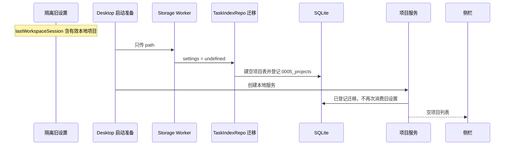
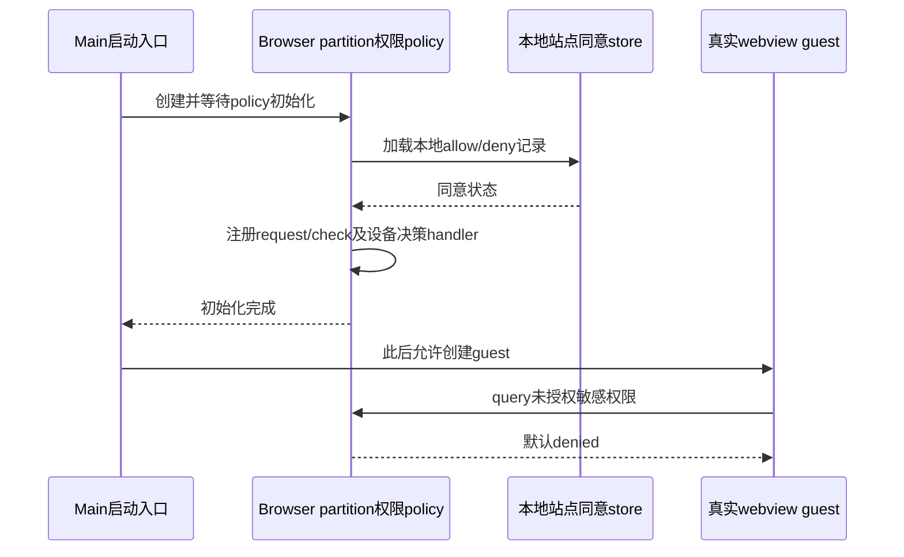
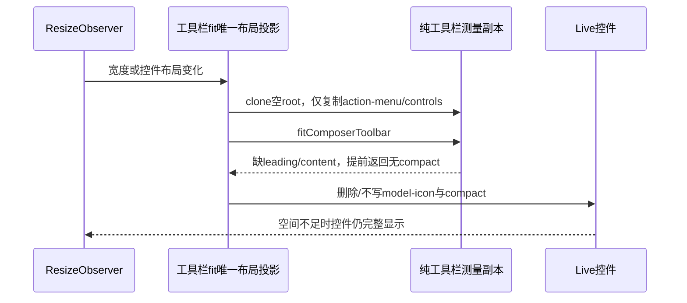
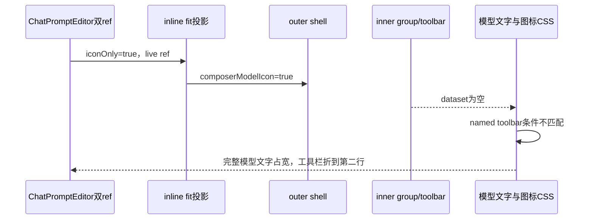
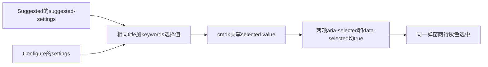

# 菜单与功能专项 Bug 报告

测试日期：2026-11-06至2026-11-07（Asia/Shanghai）；项目版本：3.17.1；工作树：`C:\vibecoding\zcodium`，包含测试前已有未提交修改。本报告保留修复前测试与交接事实；2026-11-07已按用户要求完成 8 项确认问题的本地修复与定向回归，修后证据见 [修复报告](fix-report.md)。已确认问题、历史QA失败、只读归因及未覆盖环境分别保留；本报告不代表全部菜单或跨平台功能已验收。

| 编号 | 级别 | 中文标题 | 分类与确认程度 |
| --- | --- | --- | --- |
| BUG-001 | P1 | macOS 默认开发入口读取未声明变量，启动调度被阻断 | 已确认源码分支缺陷；精确条件 VM 复现；macOS 真机待验证 |
| BUG-002 / VAL-001 | P2 | 遥测审计被旧引导 E2E 夹具空方法阻塞 | 已执行确定性测试，两次稳定失败；测试基础设施缺陷 |
| BUG-003 / VAL-002 | P2 | 工作流审计测试遗漏当前 offeredMode 契约字段 | 已执行确定性测试，两次稳定失败；测试契约缺陷 |
| BUG-004 | P1 | Desktop 初次项目迁移未传旧设置，已有项目入口未生成 | 已确认源码链与运行中合成 E2E 数据库；真实用户升级与 macOS 待验证 |
| BUG-005 | P1 | 内置浏览器权限策略未接线，未授权地理权限查询显示已授予 | 两个独立新run的真实guest query稳定复现；源码装配断链确认，未请求真实位置或设备 |
| BUG-006 | P2 | 工具栏测量副本缺少布局骨架，溢出时不生成压缩状态 | 真实人工240px场景两帧溢出与实际源码内存probe确认；普通真窄窗及React ref归属尚未独立验收 |
| BUG-007 | P2 | 浮窗压缩标记写到外壳，模型样式读取内层导致单行折行 | 真实560px空输入浮窗DOM与PNG、CSS owner源链确认；两份同counter快照为一次实际复现 |
| BUG-008 | P2 | 命令中心不同设置命令使用相同选择值，两行同时选中 | 一个真实打开弹窗内两行均可见、aria-selected同时true，源码选择值碰撞确认；Arrow/Enter执行尚未抵达 |
| CAND-001 | P2 | 部分旧 E2E 夹具仍向 .zcode 准备或断言数据 | 静态候选欠账；未作为本轮真实 UI 失败计数 |
| CAND-002 | P2 | 帮助与关于 E2E 保留旧产品名、Preview 和日志归档约定 | 静态候选欠账；未作为本轮真实 UI 失败计数 |

P1 表示支持平台的默认开发入口被阻断、已有项目入口在升级迁移中不可见，或产品敏感权限决策边界失效；P2 表示布局压缩功能缺陷、现有质量门禁失败或有效覆盖缺失。本批确定性用例为 133 个，131 通过、2 失败；两项失败属于 BUG-002/003，没有确认官方遥测或购买行为重新出现。完整测试明细、命令与边界见 [质量验证报告](validation.md)。

## BUG-001：macOS 默认开发入口读取未声明变量，启动调度被阻断

**影响与环境。** 默认 `dev:desktop`/`dev:desktop:prod`/`dev:desktop:test` 委托 `scripts/dev-desktop-env.mjs`。该脚本在 macOS 条件分支读取未声明变量，会在 `pre-dev`、Agent bundle 与 Electron 调度前抛错。Windows 条件短路，不能从 Windows 启动成功推断 macOS 路径有效。此处执行环境是 Windows、Node 24.18.0；验证使用 synthetic `darwin`，没有运行 macOS 真机、构建、打包或安装。

**前置条件。** 当前脚本第 23 行声明 `hasComputerUseHelperProducer`，第 105 行条件仍使用 `hasComputerUseProducer`；错误标识符无声明或导入。

**步骤与实际执行范围。**

1. 只读检查 `scripts/dev-desktop-env.mjs` 中两个标识符的声明与引用。
2. 将第 105 行精确条件 `process.platform === "darwin" && hasComputerUseProducer` 放入 Node VM，提供脚本实际拥有的 `process.platform` 与 `hasComputerUseHelperProducer` 绑定。
3. 分别设 synthetic platform 为 `darwin` 与 `win32`，记录求值结果。此步骤已执行，见 JSON 证据。
4. macOS 获准工作树中的完整 `corepack pnpm dev:desktop:test` 启动属于修复后待验收，不把它写为本轮已执行。

**预期。** 缺少可用 Helper producer 时跳过对应 producer，继续既有 pre-dev/Agent/Electron 调度；可用时按当前 fork 允许的依赖执行。

**实际。** synthetic `darwin` 得到 `ReferenceError: hasComputerUseProducer is not defined`；synthetic `win32` 得到 `false`。源码外层 catch 会打印错误并退出 1，启动前置步骤不会到达。

**证据。** [声明与引用位置](logs/e2e-preflight-macos-dev-source.txt)、[精确条件与 VM 结果](logs/e2e-preflight-macos-dev-branch.json)、[环境审查](e2e-environment.md)。定位：`scripts/dev-desktop-env.mjs:23,26,105`。

**确认程度与原因。** 已确认命名不一致形成未绑定标识符读取；支持平台启动阻断是按当前顺序推导的运行后果，尚无 macOS 完整启动截图或真机日志。与 Node 24.18.0 对比固定 24.14.0 的差异无直接因果证据。

**后续修复验收。** 统一 producer 探针引用，在 Helper producer 可用/不可用两种条件下验证 mac 分支求值与调度；不得为通过测试恢复本 fork 已删除的 Helper/Linux producer。随后在 macOS 获准工作树隔离 HOME/USERPROFILE/临时目录，运行当前开发入口，确认 pre-dev、Agent 构建与主窗口就绪；Windows 默认入口也回归。修复前先补对应 spec/回归证据，保留中文原因注释。

## BUG-002 / VAL-001：遥测审计被旧引导 E2E 夹具空方法阻塞

**影响与环境。** `no-telemetry.test.mjs` 的源码门禁不能通过，CI 容易把旧测试夹具误判为产品采集。环境为当前 Windows 工作树、Node 24.18.0，HOME/TEMP/缓存均隔离在工作树；两次实际执行没有调用真实模型或外部采集端点。

**前置条件。** `packages/desktop/test/e2e/manual-review/pending/mobile-remote-onboarding.mjs:85` 的内嵌浏览器脚本保留 `reportTelemetryEvent: async () => {}`；文件无 `.test.` 后缀，落入当前源码扫描范围。

**步骤。**

1. 使用 [验证报告](validation.md) 的隔离运行器执行菜单测试批次，其中包含 `scripts/ci/no-telemetry.test.mjs`。
2. 观察 `product code cannot enable official or proprietary telemetry collectors` 失败。
3. 单独执行 `node --test scripts/ci/no-telemetry.test.mjs`（仍经隔离运行器），失败再次出现。
4. 只读定位扫描结果，确认命中的是上述 fixture 空方法。

**预期。** 夹具遵守当前平台契约，生产源码没有采集入口时审计通过；真实禁用边界继续由守卫覆盖。

**实际。** `scripts/ci/no-telemetry.test.mjs:66` 的 `deepEqual` 期待空数组，实际返回该 pending E2E 夹具路径。方法体为空，因此本失败不能当作真实遥测导出或后台采样证据。

**证据。** [首次运行](logs/validation-tests-menu.log)、[独立复跑](logs/validation-tests-reproduce.log)、[完整批次命令](logs/validation-tests-menu.json)。定位：`scripts/ci/no-telemetry.test.mjs:52–66` 与 `mobile-remote-onboarding.mjs:85`。

**确认程度与原因。** 已执行、稳定复现；已确认旧夹具字段与源码扫描规则组合造成失败。没有确认产品运行时恢复官方遥测。

**后续修复验收。** 优先清除夹具中已废弃的平台方法，验证当前引导 fixture 仍能运行；再执行原遥测审计与对应浏览器 fixture。若调整扫描规则，须明确测试目录范围、保留生产代码负例，避免扩大忽略集掩盖真实采集入口。保持官方采集模块已删除的边界，不恢复模块使测试变绿。

## BUG-003 / VAL-002：工作流审计测试遗漏当前 offeredMode 契约字段

**影响与环境。** 官方购买删除回归中的本地工作流配置检查持续失败，后续 forceRefresh 与环境覆盖断言被首条失败遮挡。环境为当前 Windows 工作树、Node 24.18.0，隔离 HOME/TEMP/缓存；旧购买 RPC 禁止与本地统计测试实际通过。

**前置条件。** `packages/shared/src/dynamic-workflow-feature.ts:59` 将 `offeredMode` 声明为必需字段，第 64–72 行生成快照时始终包含它。服务已复用该 resolver；`scripts/ci/no-official-purchase.test.mjs:98` 仍期待旧对象形状。

**步骤。**

1. 使用隔离运行器执行本地功能批次，其中包含 `scripts/ci/no-official-purchase.test.mjs`。
2. 观察第三个测试 `remaining workflow configuration is local-only and never contacts official config` 在默认模式断言处失败。
3. 单独执行该文件，重复得到相同 diff。两次均已实际执行。

**预期。** 按当前快照契约验证默认 disabled 以及 offeredMode，保留禁止凭据与官方配置 IO 的断言，并让后续 forceRefresh/alwaysOn/onDemand 检查抵达。

**实际。** 期待 `{mode:'disabled', enabled:false, source:'default'}`，实际还含 `offeredMode:'disabled'`。首条 `deepEqual` 失败；第三个测试剩余分支未执行到，不能标为通过。

**证据。** [首次运行](logs/validation-tests-local.log)、[独立复跑](logs/validation-tests-reproduce.log)、[完整批次命令](logs/validation-tests-local.json)。定位：`scripts/ci/no-official-purchase.test.mjs:80,98`、`packages/shared/src/dynamic-workflow-feature.ts:59,64–72`、`packages/services/src/coding-plan-subscription/codingPlanSubscriptionService.ts`。

**确认程度与原因。** 已执行、稳定复现；已确认断言落后于共享公开类型。实际差异是合法字段增加；未确认官方购买、账号或配置网络回归。

**后续修复验收。** 更新四组期待：默认 disabled、forceRefresh、alwaysOn、onDemand，含正确 offeredMode；保留 27 个旧 RPC 的拒绝断言、凭据与官方 IO 禁用断言。复跑该文件和共享动态工作流模式/用户选择测试，确认所有分支实际抵达，报告原门禁恢复结果。

## BUG-004：Desktop 初次项目迁移未传旧设置，已有项目入口未生成

**影响与环境。** 已保存本地项目的旧配置在 Desktop 首次执行项目迁移时未生成新的 `projects`/`project_roots` 记录，侧栏依赖的固定项目入口不可见。当前观察对象为 Windows、Node 24.18.0、应用版本 3.17.1 的内部 Electron E2E；数据位于本工作树 `runtime/qa-menu-20261106-features/app-home/.zcodium`。该 profile 为合成夹具，没有读取真实用户数据；没有证据证明用户项目文件或会话内容已丢失，也没有 macOS 迁移运行结果。

**前置条件。** 获准工作树中的隔离 profile 含有效旧 `setting.json`：`lastWorkspaceSession` 至少含一个存在目录的本地项目，`kind:'local'`、`workspacePurpose:'project'`。该索引首次执行 `0005_projects`，不存在已经由新项目服务创建的对应项目记录。没有 legacy 设置的首次安装允许项目集合为空，不属于此缺陷。

**步骤与本轮执行范围。**

1. 内部 runner 在重置合成 HOME 时，经 `wdio.conf.ts` 的 `seedE2EStartupState` 写入旧项目设置并创建 `ZCodeProject` 目录；本轮使用的是当前 `.zcodium` root。
2. 启动 Desktop，让 Host storage Worker 按当前正常启动路径准备索引；不直接注入 `projects` 或 `project_roots`。
3. 在应用运行期间只读读取隔离 `setting.json` 和 `tasks-index.sqlite`，同时观察 E2E 对侧栏 `ZCodeProject` 项目行的前置等待。
4. 保存 JSON 快照，确认旧项目配置仍在、目录存在，但项目表与 roots 表均为空，且 `0005_projects` 已登记。该只读快照已执行；真实用户升级回放属于修复后的待验收。

**预期。** 首次迁移从旧 `lastWorkspaceSession` 保留用户仍保存的本地项目及其 roots；侧栏能展示并选择对应项目。项目身份、顺序、所属 Host 和历史任务归类遵守已有迁移契约；不能通过扫描所有历史任务目录复活用户已移除的项目。

**实际。** live隔离快照含正确的local/project `lastWorkspaceSession`；`projectRows=[]`、`projectRoots=[]`；迁移账本已有 `0005_projects` 至 `0009_session_creation_commands`，local Host也存在。首批侧栏固定项目行前置未满足，依赖该入口的7个功能范围当时标为 **BLOCKED BY migration bug**，不是7个独立bug。随后bootstrap通过正常项目UI创建合成项目恢复前置，core-retry已经实际测试相关项目、设置、侧栏和会话动作；具体最新结果见覆盖矩阵，不再把这些功能一律保留为未测。迁移本身没有修复，bootstrap前各独立新profile仍复现空表。

**证据。** [运行中隔离配置与 SQLite 只读快照](logs/e2e-preflight-project-migration-snapshot.json)、[带精确行号的源码链](logs/e2e-preflight-project-migration-source.txt)。core-retry新Worker再次保存了不可覆盖的独立证据：[创建前PNG](runtime/qa-menu-20261106-core-retry/evidence/qa-project-bootstrap-0-6-001-10316-1793980408042-before.png)、[创建前JSON](runtime/qa-menu-20261106-core-retry/evidence/qa-project-bootstrap-0-6-001-10316-1793980408042-before.json)，2026-11-06 23:53:31（北京时间）项目区为空，数据库 `projects=[]`/`projectRoots=[]`，有效legacy设置与迁移登记同时存在；[正常UI创建后的JSON](runtime/qa-menu-20261106-core-retry/evidence/qa-project-bootstrap-0-6-001-10316-1793980408042-after.json)记录 `createdByBootstrap:true`、1个项目和1个primary root。这是夹具恢复前置，不是迁移修复通过。早期Worker-only名的0-0-before已被后次调用覆盖，不能用于证明初始空表。源码链：`packages/desktop/wdio.conf.ts:1949,2013–2019` → `packages/desktop/src/host/database-startup/contract.ts:8` → `storagePreparationProcesses.ts:40` → `tasksStorageWorker.ts:13` → `packages/services/src/project-storage/startup.ts:110` → `packages/services/src/session/taskIndexRepo.ts:333,406–408` → `packages/services/src/project-storage/migrate-projects.ts:104–110` → `packages/services/src/project-storage/index.ts:44–54`。补充读取 `packages/services/src/node.ts:1243,2179–2184`，区分普通 Desktop local services 与可接收 settings 的独立应用迁移入口。

**确认程度与定位。** 已确认源码断链与合成 profile 的实际数据库结果一致：Worker 的 strict 输入仅 `{path}`；`prepareTasksIndexStorage` 构造 `TaskIndexRepo(undefined, undefined, path, ...)`，项目迁移获得 `settings:undefined`，按空清单提交 `0005_projects`。后续 `createLocalServices` 也构造无 settings 的 `TaskIndexRepo()`；版本化迁移不会因旧配置仍存在而再次应用。不是目录缺失、旧 `.zcode` 夹具或迁移契约废弃旧项目映射。Windows Browser 快捷键 Meta/Ctrl 导致的 timeout 属于独立原因，不能并入本项。

**后续修复验收。** 先补迁移spec，明确Desktop启动迁移的唯一owner、旧设置读取时机与向Worker的严格传递契约。验证fresh legacy local项目及roots、conversation workspace排除、空旧设置、远程Host身份与重复启动幂等；验证旧任务归类与保存项目顺序，同时保留已移除项目不复活的不变量。另为已登记 `0005_projects` 但缺失项目的情况定义可审查的恢复决策与单次迁移验收，不擅自迁移或恢复真实用户数据。用独立隔离profile执行首次升级和再启动，直接断言SQLite与侧栏项目入口一致，再在不经bootstrap补项目的条件下复验历史受阻的功能范围。本轮已恢复前置后的功能通过不能替代迁移修复验收；修复需遵守数据库异步启动契约并保留中文原因注释。

## BUG-005：内置浏览器权限策略未接线，未授权地理权限查询显示已授予

**级别、影响与环境。** P1，产品权限决策边界缺陷。Windows x64内部Electron 44.7.0、Node24.18.0、当前根工作树；两个独立新run都在真实Browser guest中将未授权geolocation状态返回`granted`。当前敏感权限request/check策略存在但没有启动装配调用，可能让未决权限绕过预期产品决策。已确认的是权限状态与接线缺陷，没有实际请求位置、摄像头、麦克风或其它设备，没有认定真实数据泄露；macOS及具体OS数据访问待修复后单独验收。

**前置条件。** 使用本轮工作树隔离runner的新HOME，replay/common且`skipProvider:true`，合成loopback网页；没有真实Provider Key或历史站点同意。Browser的webview和Main均使用`persist:zcode-embedded-browser` partition。只执行当前canonical `browser-permission-site-settings.test.ts`，不替换query结果、不注入权限handler。

**步骤（已真实执行两次）。**

1. 新run `qa-menu-20261106-browser`通过真实UI创建Browser tab并导航spec自建的loopback测试页，等待页面标题就绪。
2. 点击网页结束地址编辑，从可见webview取得真实guest WebContents id。
3. 由Main对该guest执行`navigator.permissions.query({name:'geolocation'})`，检查未授权状态。
4. 在独立新run `qa-menu-20261106-menu-final`的同一canonical case中重复以上步骤；此run重新fresh构建并使用新隔离HOME。

**预期。** 未得到产品用户同意时，敏感权限query按现有policy的默认拒绝合同返回`denied`；只有持久allow或sessionAllow才可返回允许。后续请求应经产品决策，不由Electron无handler默认行为代替。

**实际。** 首次17:37:37.759 UTC和独立复验17:49:11.280 UTC均在第64行得到`granted`，期望`denied`，原case失败。滑杆入口、站点设置页、允许/重置操作均尚未抵达，不能扩认这些动作独立失败。

预期初始化所有者与顺序如下；本轮源码缺少Main向policy的实际装配调用，guest仍被创建。

**证据、确认程度与定位。** [首次实际case](runtime/qa-menu-20261106-browser/evidence/test-results.ndjson)、[第二实际case](runtime/qa-menu-20261106-menu-final/evidence/test-results.ndjson)、[第二summary](runtime/qa-menu-20261106-menu-final/evidence/summary.json)、[完整源链与边界](logs/validation-browser-permission-attribution.md)。`embeddedBrowserPermissionPolicy.ts:128,154,242`有request/check实现，geolocation属于PROMPT_PERMISSIONS；全packages源码只见定义/type/contract，没有实际装配调用。`index.ts:1745–1747`对此partition仅安装恢复协议；代理/证书policy和独立pluginSandbox handler不能保护Browser权限。这是源码接线与两次真实guest状态共同确认，不是单次locator或mock失败。查询状态非视觉数据，以实际NDJSON/技术日志为证；没有提供权限失败专用录屏。

**疑似原因与后续修复验收。** Main启动入口遗漏Browser权限policy、UI bridge及安全本地同意store接线，具体修复尚未实现。在guest可创建之前从唯一Main路径初始化并等待完成，保留无prompt/无同意的fail-closed合同。独立新HOME验证默认query拒绝、请求时决策、session/持久允许与拒绝、设置更改/重置、profile重启、多tab prompt归属及设备chooser取消；真实OS权限和设备访问需目标平台另验。不要恢复官方云账号/配置或放宽全session权限让测试绿。

## BUG-006：工具栏测量副本缺少布局骨架，溢出时不生成压缩状态

**级别、影响与环境。** P2产品布局缺陷。当前工具栏发生空间不足时，需要按既有优先级压缩文字并将合并模型入口收为图标；测量副本缺少算法要求的leading/content/trailing骨架，压缩计算提前返回，live控件得不到对应dataset。真实验证环境为Windows x64、Node24.18.0、Electron44.7.0；canonical人工把工具栏内层设为240px，viewport1200、DPR1.5。普通窗口真正缩小及SPFV浮窗路径尚未独立验收，不据此扩大跨平台或全部窄窗影响。

**前置条件。** 本轮隔离HOME与finite replay，真实会话composer的模型/思考picker已打开。使用当前canonical `keeps the open model picker responsive when the composer shrinks and expands`，外置只读fit observer在原动作前安装，保留原spec/helper/timeout。

**步骤（已执行）。**

1. 在`qa-menu-20261106-local-canonical`运行当前工具栏responsive case；第1077–1081行对模型trigger的trailing.parentElement设置`style.width="240px"`，即人工缩工具栏内层。
2. 读取本轮独占DOM history的首两240px帧，核对实际宽度、溢出、模型文字/图标及两层dataset。
3. 只读加载实际`useComposerToolbarFit.ts`，在内存转译并调用原`createComposerToolbarProbe`；非渲染合成DOM保留当前生产布局骨架，几何取真实两帧，不装载React、Electron或浏览器。
4. 对比原测量副本与完整合成骨架调用`fitComposerToolbar`的输出。此probe是独立源码定位证据，不计133个产品确定性test或新增UI case。

**预期。** 测量副本保留算法所需纯工具栏布局结构与控件，溢出时生成正确compact/model-icon状态并投影到live控件；不复制Lexical输入节点或草稿，不使picker失去节点/焦点。

**实际。** 第一history有24帧，保留2258.9/2268.1ms两帧：内层240px、scrollWidth348px；outer仍782.667px；leading可用宽0而content157.333px、trailing335.948px；模型trigger271.948px，label存在且display:block、icon存在且display:none，两层composerModelIcon为空。canonical于18:08:35.281 UTC失败`open picker failed to fit 240px`。内存probe中测量副本仅1个action-menu子项，缺leading、content、trailing、combined-model四节点；原算法对副本不写flag，而对完整合成骨架写`composerModelIcon:true`。

**证据、确认程度与定位。** [实际case](runtime/qa-menu-20261106-local-canonical/evidence/test-results.ndjson)、[小摘要及原文件SHA](logs/validation-composer-fit-attribution.json)、[完整24帧](runtime/qa-menu-20261106-local-canonical/evidence/qa-composer-fit-0-6-001-30916-1793988522119.json)、[生产源码内存probe](logs/feature-inventory-fit-probe.json)、[完整归因](logs/feature-inventory-local-canonical-attribution.md)。`useComposerToolbarFit.ts:63–68`仅clone空root后复制action-menu/controls；当前UI只有`ChatPromptEditor.tsx:407`的action-menu，未渲染controls owner，leading/content/trailing位于473–485并不进入副本；`fitComposerToolbar:27–29`因此提前返回。问题由源码与独立probe确认，不把人工240px当普通真窄窗复现。

**边界与后续修复验收。** 第二份afterEach JSON仅history missing，是重复采集欠账，不能否定第一份真实history；[PNG](runtime/qa-menu-20261106-local-canonical/evidence/qa-composer-fit-0-6-001-30916-1793988522119.png)仅finally恢复宽度后的cleanup帧，不是失败录屏。DOM没有保存aria-expanded，Tooltip data-state=closed不能推断picker关闭；observer assertionError=null，错误以NDJSON为准。`ChatPromptEditor`同ref挂outer/inner是潜在SPFV关联，尚未证明与本项同因。修复需使纯测量副本保留布局骨架、样式与全部相关控件，明确唯一ref根并保持输入/草稿不复制；分别验证实际outer窄宽/宽度恢复、inline浮窗、中英文/深浅主题、picker节点与slider焦点/键盘更新，确保压缩无重建弹层或测量回环。先修现有结构，不增加超时或恢复已退休官方控件。

## BUG-007：浮窗压缩标记写到外壳，模型样式读取内层导致单行折行

**级别、影响与环境。** P2产品布局缺陷。Windows x64、Node24.18.0、Electron44.7.0、viewport1200×802、DPR1.5；本树隔离HOME的实际完整视图浮窗。无附件、无输入正文、抽屉收起时，560px浮窗仍显示完整模型文字，工具栏换到输入区下一行。它违反当前单行规则，增加浮窗占用高度；不依据旧64px固定高度判断产品合同，也不扩认macOS或所有窄窗。

**前置条件。** 使用当前`SPFV-E2E-001/002`，finite common replay及合成Provider菜单；bootstrap经正常UI补合成项目。打开侧栏新tab并进入完整视图，保持空输入、无附件/权限卡片。原测试/helper/timeout不修改，外置observer只读保存失败后的DOM/PNG。

**步骤（已真实执行）。**

1. 在新隔离run `qa-menu-20261106-menu-reviewed`运行`side-pane-full-view.test.ts`的001与002；001进入/退出且不重新挂载对话通过。
2. 002选择对话tab，确认宿主铺满内容slot、普通stacked composer与项目选择栏；随后选择面板tab，恢复右下角收起浮窗。
3. 等过渡结束，确认宿主/输入区同宽且底边对齐、drawer=false、composer layout=inline、项目选择栏已隐藏。
4. 观察实际空输入浮窗，并读取同一真实DOM中的outer shell、内层`.group/toolbar`、模型label/indicator和几何；没有人为改变工具栏宽度。

**预期。** 当前 [浮窗规范](../../ui/side-pane-full-view.md)第118行要求`[+] [输入区] [控件] [发送]`在同一行，输入区至少占一半；控件按既有顺序收到图标，单行/stacked共用同一DOM。第131行规定收起态同560px宽。压缩投影必须写到模型CSS读取的同一owner。

**实际。** 18:36:07.384 UTC canonical旧`height<=64`等待失败。有效产品证据是18:36:14.199 UTC真实PNG两行，以及DOM：shell宽560px、高81.333px、`composerLayout=inline`、`composerModelIcon=true`；内层named toolbar dataset为`{}`，宽301.948px；模型trigger235.948px、完整label display=block、compact thought-meter display=none。editor top710.667/bottom730.667，toolbar top742.667，明确在输入区下一行。没有运行中finite动画；第二快照18:36:21.593 UTC同样状态，两个快照同worker/counter，不是第二独立run。

**证据、确认程度与定位。** [实际NDJSON](runtime/qa-menu-20261106-menu-reviewed/evidence/test-results.ndjson)、[压缩摘要与原文件/source SHA](logs/validation-spfv-attribution.json)、[真实DOM](runtime/qa-menu-20261106-menu-reviewed/evidence/qa-spfv-observe-0-3-001-5628-1793990174199.json)、[PNG](runtime/qa-menu-20261106-menu-reviewed/evidence/qa-spfv-observe-0-3-001-5628-1793990174199.png)。`prompt-editor/ChatPromptEditor.tsx:181–182`给inline传iconOnly=true；第433/470行把同toolbarRef绑定outer与inner。`useComposerToolbarFit.ts:75,79–81`对live ref直接fit，实际投影落outer；`v4/composer/V4ComposerToolbar.tsx:572–575`的模型label/icon仅消费named `/toolbar`的composer-model-icon，而inner没有标记。源码与真实DOM共同确认owner/CSS断链。BUG-006是普通测量clone缺骨架；本项inline路径绕过clone且确实生成true，属于独立问题。

**后续修复验收。** 明确唯一布局ref与compact投影owner，使生成flag的节点与named group CSS一致，保留编辑器/picker节点与草稿不重新挂载。独立新HOME在560px真实收起浮窗验证空输入同一行、输入至少半宽、模型文字隐藏与图标/meter显示，再覆盖长模型名、中文/英文、深浅主题、slot更窄及宽度恢复；附件/多行输入/权限卡片按规范允许增高，不以强制64px修正。回归对话tab切换、drawer焦点、picker键盘与模型/思考状态，分别在Windows/macOS目标机验收。未修产品，本轮PNG是失败后静态帧，没有标准连续视频。

## BUG-008：命令中心不同设置命令使用相同选择值，两行同时选中

**级别、影响与环境。** P2产品交互缺陷。Windows x64、Node24.18.0、Electron44.7.0、DPR1.5、英语浅色界面，在本树隔离HOME的Command Center操作范围搜索中文“设置”。Suggested和Configure两个Settings同时显示灰色选中背景、`aria-selected=true`，单一活动项状态不明确。已确认的是重复选中标记；实际ArrowDown/ArrowUp、Enter及设置页面动作在首条断言前停止，没有证明重复执行或错误执行命令。

**前置条件。** 正常UI创建合成项目，公开合成归档导入且激活；Command Center保留当前Suggested与Configure分组。Provider请求数为0，clipboard和文件选择出口均用隔离adapter；不需要模型首发。原产品、cmdk包及正式helper没有修改。

**步骤（已真实执行）。**

1. 在新run `qa-menu-20261106-local-supplement`进入 `RLM-04`，打开Command Center并选择Actions范围。
2. 输入“设置”，确认同一弹窗内Suggested和Configure各有一行Settings。
3. 用真实pointer移到匹配的Settings，等待其`aria-selected=true`。
4. 读取该打开弹窗的`[cmdk-item][aria-selected=true]`，保存真实PNG与JSON。

**预期。** 同一Command Center任意时刻只有一个活动选中项。多个分组可提供同一动作，但选择身份必须独立于显示标题及搜索关键词；箭头移动和Enter应指向唯一活动项。

**实际。** 18:57:46.941 UTC截图中两个Settings均可见且同时灰选中；状态JSON为`pickerCount=1`、Actions范围、query为“设置”。真实选中查询返回两个不同元素e.83/e.84，预期长度1、实际2。RLM04随后停止，箭头/Enter未执行。RLM07同run相同源码再次出现2项选中，属于支持证据，不计第二个独立问题或独立新环境复现。

**证据、确认程度与定位。** [小摘要及原文件/source SHA](logs/validation-command-center-selected-attribution.json)、[真实JSON](runtime/qa-menu-20261106-local-supplement/evidence/qa-residual-local-menus-0-3-25872-1793991442433/003-RLM04.json)、[真实PNG](runtime/qa-menu-20261106-local-supplement/evidence/qa-residual-local-menus-0-3-25872-1793991442433/003-RLM04.png)、[实际NDJSON](runtime/qa-menu-20261106-local-supplement/evidence/test-results.ndjson)。`packages/ui/src/quickpick/quickPickCommands.ts:113/190`的`suggested-settings`与`settings`有不同ID，却共用titleId和完整keywords；`CommandCenterDialog.tsx:793`仅以title+keywords构造cmdk `value`，React的`key=command.id`不改变该选择值。安装版cmdk Item按全局选中value与item自身value相等设置aria-selected/data-selected；`components/ui/command.tsx:153`用data-selected着色。源码选择值碰撞与同一真实打开弹窗的两个选中行一致，不按隐藏DOM残留解释。

**后续修复验收。** 使用稳定且唯一的命令身份作为cmdk选择值，保留标题与关键词的搜索能力以及当前分组产品规则，不仅修改React key或忽略第二个选中节点。独立新环境在Actions与All的`>设置`搜索下验证只有一个可见selected，真实pointer与上下箭头逐项切换，再按Enter确认唯一动作一次执行；覆盖中英文、深浅主题、搜索清空/重开及其它同动作跨组入口。保留非法多选状态负例；本轮PNG是失败静态帧，未生成标准连续视频。

## CAND-001：部分旧 E2E 夹具仍向 .zcode 准备或断言数据

**影响与环境。** 候选测试基础设施欠账，可能让索引前置失败、种入数据对 UI 不可见，或在错误文件上读取持久化结果。仅静态审查当前 Windows 源码；本轮没有执行下列 UI 场景，也没有向真实用户目录写入旧 `.zcode`。

**前置与定位。** 当前产品共享常量 `packages/shared/src/appDirNames.ts:9` 为 `.zcodium`。已审查的旧路径包括：

| 文件 | 静态位置 | 待验证影响 |
| --- | --- | --- |
| `test/e2e/ui-shell/command-center-selection.test.ts` | 第 41 行 `HOME/.zcode/v2/tasks-index.sqlite`，另有 HOME basename 前置 | 可能先因隔离目录名称拒绝，或在错误索引准备重名任务；不能据此报告任务选错的产品 bug |
| `test/e2e/settings/settings-language-system-default.test.ts` | 第 24、116 行 `.zcode/v2/setting.json` | 英文准备与最终持久化读取可能观察产品不用的文件 |
| `test/e2e/settings/settings-subagent-create-edit-persistence.test.ts` | 第 88 行 `DEFAULT_WORKSPACE/.zcode/agents` | 用户 root 已用正确 helper，workspace 子场景的写回位置仍可能错误 |

表中路径相对 `packages/desktop/`。`packages/services/src/subagents/subagentStorage.ts` 与 CLI 当前 workspace 主写 `.zcodium/agents`；旧历史 ID 与迁移轨迹不能因同名 `.zcode` 一律删除。

**检查步骤（已静态执行）。** 读取这些 fixture 的数据 root 和目标文件；对比当前共享目录常量、E2E data helper 与产品持久化 owner；记录冲突位置。**待执行 UI 复现**须先完成测试 fixture 路径修复/核对、工作树隔离与前置准备，不以现状前置失败代替 UI 验收。

**预期/实际。** 预期 fixture 与产品使用同一受控 helper/常量派生根；静态实际存在字面量 `.zcode`。没有本轮 UI actual failure、截图或 traceback。

**证据与确认程度。** [E2E 环境与合同漂移审查](e2e-environment.md)。已确认源码路径漂移，分类仍是候选测试欠账，未计入执行失败或产品 bug 数。

**后续修复验收。** 对每个文件明确当前数据 owner/路径，从现有 helper 派生测试目标；保留工作树路径和重解析点防护，HOME 名称前置与实际 runner 一致。分别执行重名任务选中、系统语言默认、用户/workspace subagent 新建编辑重启持久化；检查真正 `.zcodium` 中的记录与 UI，并确保不依赖真实用户数据或未经授权迁移旧目录。

## CAND-002：帮助与关于 E2E 保留旧产品名、Preview 和日志归档约定

**影响与环境。** 候选 fixture 欠账，可能在当前 fork 的正确菜单和导出上误报失败，导致帮助/关于的有效 E2E 覆盖缺失。仅静态审查；本轮没有运行该旧 spec 或触发其日志导出，不是已执行 UI 失败。

**前置与步骤（已静态执行）。**

1. 读取 `packages/desktop/test/e2e/help-menu-about.test.ts` 的 flavor、菜单序列与导出断言。
2. 对比当前英文 locale `titleBar.menu.help.about = "About ZCodium"` 和安全诊断导出路径。
3. 记录第 95–116 行归档名字期待、第 183–202 行 `About ZCode` 序列与 selector，以及默认 Preview/按 production 添加更新项的条件。

**预期。** 帮助/关于用例使用 ZCodium 产品名、实际运行 flavor 和自有更新源资格；诊断导出按当前安全归档契约验证，产物只在本轮隔离数据目录。

**实际（静态）。** Spec 保留 `About ZCode`、旧 `zcode-logs-*.zip` regex 和默认 Preview 约定；当前 fork 为 ZCodium，诊断导出为 `.zcodium/export-log/zcodium-diagnostics-*/diagnostics.zip`。现有生产 flavor 开关不能修复菜单名与归档断言漂移。未提供该 spec 的真实 UI failure。

**证据与确认程度。** [E2E 合同漂移审查](e2e-environment.md)、`packages/ui/src/i18n/locales/en-US.ts:2135`、`packages/desktop/test/e2e/help-menu-about.test.ts:95–116,183–202`。已确认静态契约差异；执行结果待验证，不能作为产品错误品牌或导出失败证据。

**后续修复验收。** 以当前产品名/安全诊断契约更新 fixture，按未配置和已配置自有更新源两个情形验证帮助菜单；分别在中英文、深浅主题、实际 production/preview flavor 运行。确认关于窗口、导出文件结构和净化内容、失败提示与重试；禁止恢复已删除的官方更新源或旧原文日志上传，仅为匹配旧断言而改产品行为。

## 测试欠账（不计入八个确认 BUG 编号）

以下为本轮实际执行暴露的测试前置、断言或证据保存问题。保留原始失败，但不据单次 UI 失败登记独立产品缺陷；后续复验结果在 [测试报告](test-report.md) 追加。

### QA-DEBT-01：Browser helper 把 macOS Meta 组合键固定用于 Windows

**影响与触发。** `browser-empty-state-deferred-guest.test.ts` 尚未抵达空 tab/guest 导航断言，在打开侧面板前置失败。Windows 初始面板收起时，`helpers/browser-side-pane.ts:36–65` 反复派发 `altKey:true, metaKey:true` 的 KeyB；产品 `packages/shared/src/shortcutCommands.ts:74` 绑定为 `CmdOrCtrl+Alt+b`，Windows 应匹配 Ctrl。**预期/实际。** 预期平台正确快捷键或可见 UI 按钮打开面板；实际15s后没有 Open Tab/add trigger。证据为 [features原始case](runtime/qa-menu-20261106-features/evidence/test-results.ndjson)。已确认源码平台前置不匹配，不能把这次失败算 Browser guest 生命周期缺陷，也不能并入 BUG-004。

**复验建议。** 从现有平台快捷键契约派生按键，或先经受控 UI toggle 展开；分别验证 Windows/macOS 初始收起与展开两态，再执行空 tab不建guest、首次导航建单guest及关闭清理。外置 bootstrap 的 OpenSidePane 前置只可作为本轮辅助；快捷键本身仍需平台验收。

**最新结果。** Browser批次的空tab延迟guest原case真实通过；human-viewport在正常冷重启后第86行再次遇到同一launcher helper前置，未完成恢复布局验收。见 [实际NDJSON](runtime/qa-menu-20261106-browser/evidence/test-results.ndjson)；运行前展开只能覆盖启动前置，不能保证冷重启后的收起态可用。

### QA-DEBT-02：视觉用例把 computed border 固定期待为字符串 1px

**影响与触发。** `command-center-focus.test.ts:125,256,323` 对列表分隔线、shell、共享 Input 使用精确 `1px` 期待。**预期/实际。** 首轮 `CC-FOCUS-01` 与 `DIALOG-FOCUS-01` 的 computed border 返回 `0.666667px`，各自在首条差异停止；后续主题/窄屏/键盘视觉分支未完成。证据为 [features case diff](runtime/qa-menu-20261106-features/evidence/test-results.ndjson)。已确认两条视觉期待失败；DPI/浏览器 zoom 与物理像素量化仍需测量，不能仅据这个数值判定产品边框错误。

**复验建议。** 保存实际 devicePixelRatio、Electron zoom、CSS reference probe 与 screenshot，以同一环境的1px参考样式核对视觉和布局合同；按确认的CSS/物理像素语义更新断言，避免容差掩盖重复 outline。分别覆盖中文/英文、深浅主题、1200/390宽度与键盘focus；保留真正焦点/双边框负例。

### QA-DEBT-03：SC13 截图写固定目录且未准备父目录

**影响与触发。** `shortcut-settings-key-search.test.ts:164` 直接 `saveScreenshot('.e2e-artifacts/...png')`，没有使用本 run artifact root 或创建父目录。**预期/实际。** 预期在本轮受控证据目录保存每个主题/宽度截图；实际父目录不存在，WDIO直接抛错，首轮该视觉case未完成。证据为 [SC13原始失败](runtime/qa-menu-20261106-features/evidence/test-results.ndjson)。这是已运行的截图基础设施欠账，不是控件可见性产品fail。

**复验建议。** 从已有E2E artifact helper派生路径，检查工作树/reparse后创建父目录；失败截图也保留唯一case/组合名。再运行 SC13 的全部主题/宽度几何与可见性断言，核对每组完整截图及最后结果；不通过扩大到用户截图/下载目录规避本轮写入规则。

**本轮复验。** 主任务在路径审查后准备工作树内`packages/desktop/.e2e-artifacts`，见 [目录证据](logs/e2e-preflight-sc13-directory-ready.json)，随后filtered于17:25:41.566 UTC真实完成SC13主题/宽度case并通过，见 [实际case](runtime/qa-menu-20261106-filtered/evidence/test-results.ndjson)。正式用例的硬编码路径尚未修；本条的UI复验缺口已解除，后续仍应归属每run证据目录。

### QA-DEBT-04：PLUS05 正向工作流候选前置仍用已退休的 client/configs mock

**影响与触发。** `conversation-session-plus-menu.test.ts:52–58` 等待 `slash:workflow`。`helpers/dynamic-workflow-config-mock-server.ts:58,76–86` 给 plus 配置 alwaysOn 的旧 mock，仅注入旧 client/configs loopback并删除 `ZCODE_DYNAMIC_WORKFLOW_MODE`；`wdio.conf.ts:3220` 沿用它。当前 `codingPlanSubscriptionService.ts:17` 只使用本地 `resolveDynamicWorkflowClientConfig(undefined, env)`；共享 `dynamic-workflow-feature.ts:27,177` 默认disabled并支持本地显式覆盖，不读取旧官方配置网关。

**预期/实际。** 正向用例应先显式启用本地工作流，再等待catalog并验证Goal之后的Workflow与消息开头插入；本轮15:48:31的PLUS05等待候选失败，因为实际默认disabled，隐藏该候选符合当前产品合同。已确认QA启用前置漂移，不是新产品bug；后续Workflow顺序/插入/已选隐藏断言没有到达。证据为 [core-retry实际case](runtime/qa-menu-20261106-core-retry/evidence/test-results.ndjson)、[运行日志](logs/e2e-qa-menu-20261106-core-retry.log)。

**复验建议。** 在隔离设置中明确选择 onDemand/alwaysOn，确认Host快照与CLI catalog收敛后执行完整正向case；另补默认关闭的隐藏负例，以及用户清空偏好/重启持久化。不要恢复旧官方client config/OAuth/套餐模块让mock有效。该项与 BUG-003 的快照期待欠字段不同，独立记录为UI测试前置欠账。

### QA-DEBT-05：SPT 用例保留旧 Logo DOM 与最大化面板像素合同

**影响与触发。** core-retry中 `SPT-E2E-000` 在 `side-pane-tabs-responsive-interactions.test.ts:171` 找不到 `[data-desktop-logo-badge]`，`SPT-E2E-007` 在第845–866行等待四角精确 `5px`、四边精确 `1px` 后超时。当前 `packages/ui/src/DesktopTopOverlay.tsx:150–153` 使用 `[data-desktop-logo-visual]` 包裹 `ZCodeStartupLogoBadge`；面板由 `WorkspaceShellLayout.tsx` 的 `--workspace-panel-radius` 与 `AnimatedSidePanePanel.tsx:1011` 的 `border-[0.5px]` 约束。已确认期待与现有DOM/样式合同漂移；不据这两条单次失败登记Logo显示或窗口控制产品缺陷。

**预期/实际与证据。** 用例应验证当前Logo视觉/hover侧栏按钮与平台面板合同，并继续抵达最小化、关闭事件。实际首条在旧DOM查询停止，第二条在样式等待停止，不能宣称其后最小化/关闭验收完成。见 [core-retry原始case](runtime/qa-menu-20261106-core-retry/evidence/test-results.ndjson)。像素量化与当前缩放还需参考probe，不因过时的5px/1px期待强行改产品。

**复验建议。** 从当前稳定test id和Logo组件派生验证，核对Windows/macOS圆角resolver及参考border实际值；用独立受控case验证放大/恢复、最小化真实事件和阻止退出的close事件。保留深浅主题、窄屏布局和焦点负例，避免只删除失败断言而失去窗口操作覆盖。

### QA-DEBT-06：W89 模型删除仍等待已取消的成功横幅

**影响与触发。** `provider-settings-write-recovery.test.ts:106–111` 的真实Repo验证已完成：personalModelIds移除模型且模型配置为undefined；末步第112–115行等待“已删除/deleted”横幅15s后失败。当前 `settings/model-provider-section/InlineEditableProviderCard.tsx:293–299,319–323` 对delete只展示pending/failure，操作完成后明确由输入值/模型列表/弹窗状态体现成功并dismiss反馈；第663–677行正确传 `operation:'delete'`。`modelDeleteSuccess` 中英文locale键仍存在，但全UI查找仅有定义、该成功路径不消费，不能解释成“缺少成功翻译”。

**预期/实际与证据。** 应按当前自动保存反馈合同核对模型列表与持久状态、pending反馈消失；实际旧测试期待额外成功横幅。见 [core-retry实际case](runtime/qa-menu-20261106-core-retry/evidence/test-results.ndjson)、[独立源码/运行归因](logs/validation-w89-attribution.md)。已确认测试契约漂移，不登记模型删除失败或错误“保存成功”toast产品bug。

**复验建议。** 保留不完整模型修复、开关不覆盖属性、重复添加失败保留草稿及Repo删除断言；末步核对对应模型行消失和pending反馈结束。可在外置QA版本独立Grep W89完成当前反馈合同，不为旧测试恢复成功横幅。

### QA-DEBT-07：SC90 reload退出屏障与F98协议会话前置失败待归因

**影响与实际。** core-retry的SC90-01在配置播种前的正常reload退出屏障失败；F98-03遇到invalid session，尚未完成继承Map布局及取消写入验收。缺失完整Error.cause和超时末刻PID信息，当前不能判定是Windows进程collector误判或产品退出生命周期问题，不能报告为模型配置保存失败。

**证据与复验建议。** [原始case](runtime/qa-menu-20261106-core-retry/evidence/test-results.ndjson)、[SC90进程采样](runtime/qa-menu-20261106-core-retry/evidence/perf/process-samples-0-19.ndjson)、[只读观察计划](test-plan-reload-observation.md)。本轮外置observer仅补进程创建时间/身份与cause链，不改变正式helper、退出屏障、timeout或kill。优先单SC90复跑；Browser保留profile冷重启及subagent/task-group恢复按同一真实屏障独立验收。若证实同一产品进程仍不退出，再登记运行候选并复现；若证实collector错误，只调整外置QA适配并保持owner写入安全，不增加时间掩盖同步。

**最新观察边界。** [Browser human独占reload记录](runtime/qa-menu-20261106-browser/evidence/qa-reload-observe-0-3-2-32284-1793986710714.json)中oldMain18192及13个初始PID全部退出，新Main32720身份匹配，失败发生后续launcher前置。该轮证明正常冷重启完成进程替换，不证明SC90/F98历史失败已修；observer内部第二delete读Main遭WebSocket未连、test.error=null的限制另记，不能补造完整cause。

### QA-DEBT-08：Windows PowerShell 5.1对现有长路径错误报告目录不存在

**影响与触发。** local-actions-final在bootstrap beforeAll的工作树重解析扫描退出1，0case；12个菜单场景均未抵达test body。CLI合成插件的scripts路径长259字符，Windows PowerShell 5.1.26100.9711调用Get-ChildItem报DirectoryNotFound/DirIOError。

**预期/实际与证据。** 扫描必须实际读取现有目录并拒绝越界/重解析点；[同目录真实对照](logs/e2e-preflight-long-path-powershell.json)显示该路径exists=true、是目录且非link，PS5.1枚举稳定失败，已安装PS7.6.9与Node24.18.0均成功读取2项。已确认QA扫描环境能力限制，撤回初始“可能瞬时child消失”的假设；严格guard拒绝存在路径异常符合安全规则，不能扩大catch吞错误。这不是产品菜单case失败，不增加确认BUG计数。

**处理与复验。** 外置QA扫描子进程已改用本机既有PS7，NoProfile/NonInteractive、隐藏窗口、路径经工作树隔离环境传入；产品与正式helper未改。[旧失败HOME完整扫描](logs/e2e-preflight-long-path-integrated-scan.json)成功核对229目录/1169项，保留祖先与后代reparse检查。此项只读集成检查不计UI通过或133产品test；串行local-actions-ps7的12项真实结果仍待追加。旧retry日志含同类路径，但没有当时存在性对照，不扩认其瞬时目录状态。

### QA-DEBT-09：工具栏测试期待退休badge/属性并点击非交互容器

**影响与触发。** filtered工具栏4条原始失败已经结合当前源码归因。第502/876行期待Provider `data-provider-access-badge`及badge间距，但当前`modelSelectionGroups.ts:27–57`的BYOK builder不返回labelBadge，`ComposerProviderMenu`仅在该值存在时渲染badge；876行在实际manage点击前停止。第688行期待`data-highspeed=false`，当前TSX没有该属性写入，只留旧CSS，hover白点断言未到达。第889行调用`startNewV4Draft`，`clickTestIdByDom`直接点击tid所在role=group DIV；当前`NewTaskButtonGroup.tsx:27–36`的创建handler在内部button，DIV没有click handler，返回clicked也不会创建草稿。

**预期/实际与证据。** 测试应使用当前BYOK菜单/思考深度合同，真实点击创建按钮，再验picker互斥、模型管理和draft scope；实际在旧属性或无handler容器处失败。见 [filtered原始case](runtime/qa-menu-20261106-filtered/evidence/test-results.ndjson)、[源码归因与精确位置](logs/feature-inventory-toolbar-attribution.md)。已确认QA合同漂移，不计模型管理入口缺失、hover样式或产品新任务失败。该formal suite afterEach会Escape清菜单，不能凭此失败推断modal污染。

**复验建议。** 在外置QA版本使用实际可交互child button、当前菜单文本/role及思考属性，保留真正scope和交互负例；独立复验完成模型管理点击、hover、completed picker切新draft。240px responsive的测量副本缺结构已另登记BUG-006，不能与上述已归因4条合并。

### QA-DEBT-10：MPS路径selector、TRJ自动记录与TSL08失效项目恢复沿用旧合同

local-canonical的MPS在第38行等待目录row失败，Windows路径未CSS转义；[独立归因](logs/feature-inventory-local-canonical-attribution.md)确认QA selector错误，Markdown选择后续未抵达。TRJ第46/276行期待CLI自动写reasoning model-io，但当前`modelTrajectory.ts:28`及maintenance/CLI local-observability规范已删除自动recorder、只保留安全只读历史；该canonical尝试的viewer投影/80条/33MiB后续未验，不能登记产品自动记录缺失，外置HIST实际复验状态见QA-DEBT-12。TSL08第76行期待自动切换到conversation，与11/05当前规范保留失效项目原活动选择冲突；[真实reload与源链](logs/validation-tsl08-attribution.md)确认本轮完成旧进程退出和新Main替换，未抵达输入/刷新。三项均保留真实失败，不修产品来满足旧断言；复验采用正确路径定位、受控历史fixture、当前只读恢复/统一新建合同，各项实际结果独立记录。

### QA-DEBT-11：menu-reviewed旧页面、locator与只读夹具前置造成误报或级联

QLA08及ARM08/07沿用自动归档开关在Archives页的旧期待，当前开关属于General；ARM07失败后停留General、没有afterEach返回Archives，后ARM01/05/06、02、03的groups/row/search失败均属QA级联，不能据此登记归档数据缺失。SLM06实际菜单为Onboard，旧Onboarding matcher错；SLM08/09目标菜单项真实存在，QA wheel/旧句柄在click之前stale，SLM15 preview前置待复验。SLM13在PTY前错误JSON.parse已返回的结构对象，未启动Terminal；严格shape适配保留全部环境/profile/reparse门禁。

menu-reviewed四项实际skip各保留边界：QLA07 memory switch保存/恢复通过但空catalog scope未测；SLM05/14公开readonly archive没有runtimecopy/Find；SLM07已有AstrBot合成配置，非空guard正确保留。RLM02零新增Markdown clipboard捕获仍未证实原因，不能先归exactly-once过严；RLM03整session超时与后十项未抵达独立记录。详情与原/新QA source SHA见 [只读归因](qa-menu-reviewed-attribution.md)，原结果、截图和Pending均保留。

supplement的SLM13在strict profile probe unknown keys时真实SKIP，PTY没有打开；SLM15 light-DOM正文断言超时但@pierre/diffs File的open shadowRoot实际显示正文，属于QA读取owner边界，后续滚动/Find待复验。见[独立补测归因](logs/validation-supplement-attribution.md)。

修复验收只更新QA到当前页面/菜单与实际对象合同，独立新worker重新建立前置后执行真实UI；runtime复制/Find与任务Markdown复制已由有限replay实际补测通过，历史轨迹以只读合成文件验证的完成范围见QA-DEBT-12。不得为了旧断言改变产品或删除安全边界，静态READY与prefix过滤计数不作为实际UI通过；RLM02旧import-only失败原因不因runtime正向通过而补认。

### QA-DEBT-12：runtime复制owner与历史夹具、虚拟窗口测试契约

**历史失败与原因。** RFC01在 `qa-menu-20261106-local-supplement-retry` 等marker正文row内的copy，但当前`deferActions`将动作移到同turn轮尾；[旧失败JSON](runtime/qa-menu-20261106-local-supplement-retry/evidence/qa-runtime-copy-find-0-0-9812-1793994678142/003-RFC01.json)的clipboard为空，[PNG](runtime/qa-menu-20261106-local-supplement-retry/evidence/qa-runtime-copy-find-0-0-9812-1793994678142/003-RFC01.png)已有轮尾copy。随后 `local-final-targeted` 的整turn前缀查询又包含user copy，[旧失败JSON](runtime/qa-menu-20261106-local-final-targeted/evidence/qa-runtime-copy-find-0-0-32396-1793995858149/003-RFC01.json)仍未点击复制；该轮没有候选数采集，不能补称现场测得2或0。HIST先前的`invalid_archive`为QA使用非public IDs；后续独立单条messages不符合当前累计投影合同；再后六角色查询没有确保record0挂载。公开codec、累计投影及首条窗口的最小QA修订和各轮原FAIL见[历史计划](test-plan-historical-trajectory.md)。未改产品validator、recorder、reader、virtualizer或超时。

**最终真实结果。** `qa-menu-20261106-copy-history-final` 于2026-11-06 20:31:06.809 UTC完整结束，[summary](runtime/qa-menu-20261106-copy-history-final/evidence/summary.json) exit1、[3actual=2PASS/1FAIL](runtime/qa-menu-20261106-copy-history-final/evidence/test-results.ndjson)。RFC01于20:29:11.538 UTC PASS，最终[候选JSON](runtime/qa-menu-20261106-copy-history-final/evidence/qa-runtime-copy-find-0-0-30436-1793996933538/003-RFC01-copy-candidates.json)实际记录隐藏user `v4-copy-2`与可见轮尾 `v4-copy-3`、唯一assistant row3及samePane/sameTurn；按marker助手rowId精确定位并真实hover/click。只捕获1次mock writeText、3930字符，SHA256 `f79b3698c2a748a78ccb2c9623a4685ec1ee66967d262cbf1656cc6dd042d5d6`等于已有fixture完整正文；[Check PNG](runtime/qa-menu-20261106-copy-history-final/evidence/qa-runtime-copy-find-0-0-30436-1793996933538/005-RFC01-copied-check.png)和[恢复Copy PNG](runtime/qa-menu-20261106-copy-history-final/evidence/qa-runtime-copy-find-0-0-30436-1793996933538/006-RFC01.png)均已核对。[passed JSON](runtime/qa-menu-20261106-copy-history-final/evidence/qa-runtime-copy-find-0-0-30436-1793996933538/006-RFC01.json)及case确认main/title各1、loopback complete200、精确fixture与action零请求增量。RFC02会话查找和RMC03 Markdown完整复制/受控拒绝/恢复在此前 `local-supplement-retry` 已实际PASS，最后未重复运行。修前/后SHA与每轮边界见[复制计划](test-plan-runtime-copy-find.md)。

**历史viewer完成与剩余欠账。** HIST01于20:30:24.447 UTC PASS；[首条挂载JSON](runtime/qa-menu-20261106-copy-history-final/evidence/qa-historical-trajectory-0-1-29036-1793996997692/003-HIST01-first-call-mounted.json)确认scrollTop0、record0与六role实际挂载，完整system换行复制、收起/展开及自定义reasoning/tool-result的[passed JSON](runtime/qa-menu-20261106-copy-history-final/evidence/qa-historical-trajectory-0-1-29036-1793996997692/005-HIST01.json)保留；此前19:53:35.569 UTC的HIST01 PASS也保留。HIST02已跨过双marker逻辑counter2/2，20:30:57.333 UTC在第499行Escape后的index42 user row挂载等待失败。最终[007 JSON](runtime/qa-menu-20261106-copy-history-final/evidence/qa-historical-trajectory-0-1-29036-1793996997692/007-HIST02.json)为query/counter/highlight已清、scrollTop69.333、indices0–5。源码链在Escape清query/active/revealKey后让user按自定义状态恢复closed，并重新允许测高与滚动调整；QA只等counter后立即Escape，没有采集42在关闭前已挂载/可见，不能区分异步定位未等完或关闭后的收起/测高影响，不确认产品定位或override Bug。manual user override、虚拟卸载重挂、后续导航/no-match、long55与33MiB尾读均未抵达，作为QA欠账交接。冻结source和脚本不再修改，不追加测试；只读合成历史/finite replay与受控clipboard不等于真实Provider、设备、自动recorder或跨平台验收。这些QA失败不增加8项确认Bug数量。

最终源码链、状态时刻和验收边界见[HIST只读归因](logs/feature-inventory-historical-final-attribution.md)。失败末highlight已清是保存的状态，后段Escape清理断言未执行，不记为该断言通过；后续独立Enter/Shift+Enter循环与长正文/尾读也仍未验。

### QA-DEBT-13：最终根目录Lint把QA runtime生成副本纳入源码扫描

原 `corepack pnpm lint` 于2026-11-06 20:43:58.939 UTC真实exit1：[命令记录](logs/validation-lint-final.json)、[原日志](logs/validation-lint-final.log)为16053文件、38388warnings、76errors。[独立归因](logs/validation-lint-final-attribution.json)完整重建76条error，全部是 `docs/testing/qa-2026-11-06/runtime/**` 内生成插件副本的`max-lines`，未发现该解析结果中的runtime外error；全部warnings未逐条结构化归因。随后仅以命令参数排除该runtime，实际执行 `corepack pnpm lint --ignore-pattern docs/testing/qa-2026-11-06/runtime/**`，20:45:53.318 UTC [exit0](logs/validation-lint-final-source.json)，[补充日志](logs/validation-lint-final-source.log)为5731文件、3warnings、0errors。三条warning均为自有QA logs脚本的`prefer-string-starts-ends-with`：`validation-e2e-counts.mjs:26`、`feature-inventory-update-browser-matrix.cjs:108`、`feature-inventory-matrix-links.cjs:15`。诊断与补充检查已完成；原root lint FAIL不覆盖，补充结果不写成原命令通过。未修改生产Lint配置、测试源或删除生成证据；该扫描范围欠账不增加8项确认问题（6产品、2既有门禁）。

## 新增运行候选（未计确认BUG）

filtered的GRP04/05/06在setTaskPinned与focus返回后，整个旧session的element/screenshot/quit/DELETE均超时；后新worker能继续完成工具栏。原selector仍有当前源码支持，原因未确认。[只读归因](logs/validation-filtered-session-attribution.md)及事后PID快照不能说明超时期间进程资源，按 [独立精确复现计划](test-plan-grp-pin-targeted-repro.md)补同identity CPU/workingSet采样，不改timeout/helper或杀进程。

首个独立GRP run在Agent build写声明map时TS5033 UNKNOWN，onPrepare退出1、0case；[85点sampler](logs/validation-grp-pin-sampler-1793990457431.ndjson)全部main=null、按run结束自然收尾，没有UI挂起现场资源。文件锁根因未确认，未删除/恢复map或跳build；固定新retry的14guard/语法/lint/路径准备均仅是QA静态准入，不计产品test/UI。

### 高优先运行候选：分组任务置顶后自动化会话失去响应

**确认程度。** filtered与第三grouped两个独立隔离run在同一pin后阶段失效；已确认自动化链路症状重复，产品/driver责任和根因仍待区分，不计入8项确认Bug。前两次精确复验分别在build与缺grouped前置停止，不算pin重现。

**复现步骤。** 按[精确计划](test-plan-grp-pin-targeted-repro.md)先启动固定sampler、再fresh wrapper+Bootstrap+GroupedTarget；真实选择按分组，新建分组并在组内用有限replay首发任务，验证member和projects/timeline/grouped三视图任务菜单；调用当前ZCodeTask setTaskPinned并dispatch focus，等待project-pinned-tasks。

**预期/实际。** pinned任务进入置顶区域、原grouped区域不重复，随后取消置顶、归档恢复保持member；实际Host返回19:32:03.197与focus true19:32:03.220后，元素POST19:32:03.221→19:32:33.233超时，截图19:33:03.281超时、quit barrier及DELETE19:33:44.480超时，后续取消pin/归档恢复未执行。summary19:33:56.494 UTC exit1，实际1case FAIL，多条timeout不拆成多个bug。

**证据。** [真实grouped checked PNG](runtime/qa-menu-20261106-grp-pin-grouped/evidence/qa-grouped-precondition-0-0-27764-1793993516412-checked.png)与[JSON](runtime/qa-menu-20261106-grp-pin-grouped/evidence/qa-grouped-precondition-0-0-27764-1793993516412-checked.json)仅证明前置正确；[case](runtime/qa-menu-20261106-grp-pin-grouped/evidence/test-results.ndjson)、[日志](logs/e2e-qa-menu-20261106-grp-pin-grouped.log)、[181点采样](logs/validation-grp-pin-sampler-1793993275811.ndjson)、[资源窗口摘要](logs/validation-grp-pin-grouped-live-attribution-1793993639704.json)。Main32200/Renderer1852/Host30244身份明确，sampler按run结束自然退出，不attach/kill。55点资源与末3点Main退出各保留，CPU均值/峰值不证明死循环。

**后续验收。** 优先定位第一失效请求前的task owner更新、focus refresh、Renderer和driver链，保持timeout与隔离边界；在独立new run完成整条canonical的pin/unpin、archive/unarchive与member断言，同时观察正常退出。

menu-reviewed的RLM03在18:23:36.321 UTC真实点击Mark as unread后，下一任务row element请求及诊断DOM/finally/afterEach在同session连续协议超时；最终第308行finally错误覆盖初始element超时，不能据最终栈解释成clipboard配置缺陷。[独立源链与时刻](logs/validation-menu-reviewed-session-attribution.md)保留完整边界：未读清除/返回未完成、没有挂起期间CPU、不是pin动作，不能强归GRP同因或计为多个产品bug。RLM02更早的零新增clipboard捕获失败仍独立归因，不能先称exactly-once断言过严。

SPFV002在core-retry与filtered均高度失败，filtered观察器只得到`__name2`错误，menu-final又在hook停止；这些历史尝试没有有效布局根因证据。menu-reviewed随后获得真实560px空输入两行DOM/PNG，已独立确认 [BUG-007](#bug-007)的projection/CSS owner断链，不强归BUG-006测量副本同因。多题键盘`setValue`第68行协议超时与SSC切Terminal后mouseup完整选区随后focusin清空仍待归因，未抵达的动作不算多个产品缺陷。

## 交接边界

本报告的已确认问题8项：macOS源码条件分支、合成Desktop项目迁移、Browser权限接线、工具栏测量副本缺结构、浮窗projection/CSS owner断链、命令中心选择值碰撞，共6项产品缺陷；2项为已执行测试门禁缺陷。静态候选欠账2项另计。本轮UI/全功能报告已经按各项实际运行状态附失败截图/可重放步骤及未覆盖环境，不把候选、环境限制或前置失败混入独立产品bug数。
