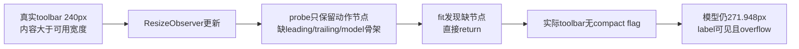

# local-canonical只读归因

本日志只归因已落盘case，不修改产品/原spec，不运行Electron或UI。来源为[本轮NDJSON](../runtime/qa-menu-20261106-local-canonical/evidence/test-results.ndjson)和[完整summary](../runtime/qa-menu-20261106-local-canonical/evidence/summary.json)：2026-11-06T18:11:09.378Z结束，9spec、13case、8通过/5失败、exit1。下面的静态归因不是新E2E或133项确定性用例。

## MPS：Windows路径CSS selector未转义

实际case在`conversation-session-markdown-preview-selection.test.ts:38`等待目录row15s失败，未打开Markdown、未选择正文、未执行加到任务或side chat。spec:22使用`resolveE2ERuntimePath`，Windows实际path含反斜杠；37直接拼`[data-testid="${testId(..., path)}"]`，没有CSS字符串转义。CSS解析反斜杠后的字符会改变属性匹配值，所以即使同path的row存在也不能命中。

[独立静态probe](feature-inventory-mps-selector-probe.json)实际exit0：本地无渲染JSDOM只建立一个合成div/data-testid，`css-what`将原selector解析为不同属性值；原selector不匹配，同值反斜杠转义后匹配。它没有Electron、网络、文件树或UI交互，不加入133确定性或E2E数量；仅证明QA selector缺陷。没有据此改canonical或产品。

不是“点目录默认隐藏”的当前合同：`useWorkspaceFileTreeData.ts:223–227`明确`readdir({includeHidden:true})`；`fileService.ts:431`仅includeHidden不为true才过滤点名称；同批PIA实际file-tree DOM记录包含`.zcode-e2e/image-actions`压缩行。`model.ts:480–485`只在已加载目录仅有一个可压缩子目录时压缩；有多个子目录时必须先展开祖先。MPS没有当刻row列表证据，所以是否同时需要先点`.zcode-e2e`仍未确认，不能宣称产品漏渲染或隐藏该文件夹。

下一最小复验应由外置QA采用当前filetree实际row列表，按path精确dataset或正确CSS转义定位，且兼容压缩与未压缩祖先；再进入真实Markdown选择动作。用户未要求修产品，本调查不修改文件树行为。

## SSC：切到Terminal后选区被清除，原因待证

此case不是首次划词前置失败。NDJSON源行145位于Terminal tab切换后；32–140已完成真实loopback parent首发、选择加到主草稿并保留文字、side child创建/历史隐藏、复用及引用增量、parent第二轮后child草稿不丢、关闭/重建、三child独立identity/标题、active child路由、关闭sibling仍保留另一草稿。这些正常断言可以作为CHAT-05与PANE-01局部交互证据，整个SSC仍失败。

143–145先打开并激活Terminal，再拖选主时间线。实际[selection-events.json](../runtime/qa-menu-20261106-local-canonical/evidence/selection-events.json)记录：mousedown后selectionchange和mouseup时正文均为完整目标marker；约8ms后focusin把selection清空，再selectionchange为空。初始与当前坐标完全一致(293,265)→(564,265)，不支持“拖选坐标选不中”概括。trace只记录data-testid，focus目标为null，不能据此证明是terminal textarea或composer，更不能认定当前产品选择权限/tooltip有缺陷。

后续/side、/btw、child发送和slash多开未执行。下一复验只读观察focus事件target的tag/class/角色、activeElement归属pane、terminal ready/focus时序与selection清空调用；不写焦点/selection或延长断言。只有真实目标/时序和设计规则一致的证据才登记产品原因。

## TRJ：已删除自动model-I/O recorder的旧前置合同

实际TRJ01–09在18:07:38.249Z失败于原spec:46/276，等待真实loopback响应文本及reasoningText自动落`model-io-<taskId>.jsonl`20秒；未执行后续seed80条、真实viewer、复制/虚拟搜索、窄布局或33MiB尾读。不是“尚未显式enable recorder”的产品配置问题：`modelTrajectory.ts:25–29`明确只读历史model-io文件，自动recorder已删除；`maintenance-model.md:167,205`和CLI `local-observability.md:28,34,36`明确不创建模型I/O诊断副本，删除record/live捕获，只读显式历史输入保留。历史design/usage中默认写入的记录不能推翻当前源码和维护审计边界。不恢复writer让测试绿，不登记自动录制产品bug。

后续可用外置pending补历史viewer：公开UI导入一条合成会话→读取实际taskId→检查本树H/.zcodium/cli/debug目录及祖先/子项、以安全文件名规则创建独占`model-io-<safeId>.jsonl`→写入含`type:model_io`且`sessionId===taskId`的合成历史→真实任务菜单打开模型轨迹并检查投影、展开、查找、刷新与受控clipboard输出。文件名规则为`[^a-zA-Z0-9_-]`替换成`-`、trim两端`-`、截取80字符；reader还会尝试rollout和getDataBaseDir，启动前必须证明两root均本树。tool名称仅作历史展示，不执行。另以独占33MiB合成文件验reader最多32MiB及丢首残行。无prompt/真实Key/自动捕获，不用历史seed声称新请求录制通过；禁止复用或覆盖历史用户文件。

## TOOLBAR：测量副本丢失布局骨架，与240px真实overflow一致

独立responsive case在18:08:35.281Z原spec:1084失败`open picker failed to fit 240px`。成功[有界DOM history](../runtime/qa-menu-20261106-local-canonical/evidence/qa-composer-fit-0-6-001-30916-1793988522119.json)保留24帧、drop74帧，其中首两240px帧分别为2258.9/2268.1ms。两帧均为toolbar实际宽240px、scrollWidth348，leading可用0px/内容157px、trailing335.948px，model271.948px、label `display:block`、icon/thought `display:none`，toolbar.dataset为空。外壳仍782.667px、`composerLayout:stacked`；canonical确实只改内toolbar.style.width，不伪称整窗口宽240px或手机验收。正常恢复宽度后flags仍空。

当前`useComposerToolbarFit.ts:63–69`的不可见probe只clone`data-composer-action-menu`与`data-composer-controls`；全UI源码没有controls的实际owner，clone不会保留leading-actions/content/trailing及combined-model。`fitComposerToolbar:27–29`因缺前两节点立即return，后续复制空flags。`ChatPromptEditor.tsx:433,470`还将同toolbarRef挂在shell与inner，但缺骨架对任一owner都成立，不把ref.current具体owner当已采事实。CSS在inner `group/toolbar`消费`composer-model-icon`，真实inner没有flag，模型固定展开宽度不收缩。

[生产函数静态probe](feature-inventory-fit-probe.json)实际exit0：仅在内存transpile原生产源并导出原私有clone函数，无React挂载/Electron/浏览器。合成当前完整DOM骨架配真实两帧几何，原fit对完整root会设`composerModelIcon:true`；原clone缺4个骨架节点，对probe调用保持flags空。它证明结构断链，与真实失败和DOM吻合，不算额外功能通过。open span存在但observer没采aria-expanded；Tooltip `data-state:closed`不能证明model menu关了，menu节点/焦点保持也未抵达原后续断言。

后续修复验收应让测量副本保持纯工具栏的完整布局骨架及同一flags消费owner，同时避免复制Lexical/草稿/附件；明确唯一ref。240px压缩和恢复验证leading不越过trailing、模型icon与绿条保留、展开标签恢复；保持已打开menu/slider节点、键盘焦点、reasoning选择及模型配置，补真实窄窗/中文英文/主题/单行浮窗。用户未要求修产品，本轮只调查并交root决定bug登记。

root随后确认本项登记为BUG-006/P2，validation维护[Bug报告](../bug-report.md)。上图表示源码原因链，不是完整动态调用栈；真正ResizeObserver callback/ref.current owner没有被observer直接采集，不能从本项推断SPFV单行浮窗高度已确认缺陷。

另一次after hook的[缺history记录](../runtime/qa-menu-20261106-local-canonical/evidence/qa-composer-fit-0-6-001-30916-1793988529076.json)是重复采集欠账，不推翻首份成功history。PNG为finally恢复后的cleanup终态，不充当240px失败帧录屏；缺原失败帧视频如实保留。
