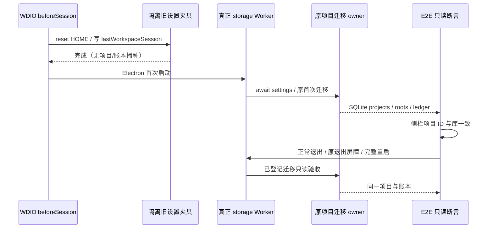

# BUG004 首次旧项目迁移桌面回归

产品接线及真实 Worker 的三项修前/修后回归见 [Worker 脚本](logs/validation-bug004-worker-regression.mjs)、[修前结果](logs/validation-bug004-worker-before-fix.json)、[修后结果](logs/validation-bug004-worker-after-fix.json)。此桌面候选已由 root 在独立 run `qa-fix-bug004-desktop-legacy-project` 实际执行：2 PASS / 0 FAIL / 0 SKIP，exit 0；覆盖首次启动、用户可见项目侧栏与完整冷重开。[逐项结果](runtime/qa-fix-bug004-desktop-legacy-project/evidence/test-results.ndjson)、[运行汇总](runtime/qa-fix-bug004-desktop-legacy-project/evidence/summary.json)。

## 接受的用例与启动所有者

- B4UI01：新隔离 HOME 的旧 `lastWorkspaceSession` 含本地 `ZCodeProject`（purpose=project），无预置项目或迁移账本。真实 Main→storage Worker→SettingService→原迁移 owner 完成后，SQLite 恰有该本地项目、单 primary root，侧栏的项目 ID 与库一致，`0005_projects` 保持已发布 checksum。
- B4UI02：不编辑任何业务文件，正常关闭旧 Electron/Host，并经过现有退出屏障复用同一 profile 完整重启。新 Main PID 不同；项目 ID/名称/位置、roots 与两份迁移账本逐值不变，侧栏仍显示同一项目。

现有 `packages/desktop/wdio.conf.ts` 的 `beforeSession` 等待 `runE2EBeforeSessionSetup`，其 `resetHome` 先重置隔离 HOME，再调用 `seedE2EStartupState` 写 `.zcodium/v2/setting.json`，之后 Electron service 才启动。默认夹具只创建 `ZCodeProject` 目录和旧 settings，不预置 projects/roots/ledger；本 spec 名称不触发旧 `project-upgrade-order` 特殊 SQLite 夹具。无需新增启动写者。CLI 不传 `-Bootstrap`，新 spec 禁止 `QA_BOOTSTRAP_*` 或额外 bootstrap require。



## 执行边界

外置文件为 `manual-review/pending/qa-bug004-desktop-migration-20261107.test.ts`，独占 run 为 `qa-fix-bug004-desktop-legacy-project`。root 是唯一 UI 执行者；启动前必须确认 runtime 尚不存在，继承 env、build/cache/driver 路径已由原 wrapper 审查且无 reparse。单 shard 的 HOME 是 `runtime/<run>/.e2e-home-<run>`，测试再检查 Node/Main 的 HOME、数据根、run marker 和 profile 都在该工作树，使用 PowerShell 7 做祖先/后代 reparse 审查。

测试自身只打开 `DatabaseSync({readOnly:true})`，不调用 Repo/Service setter、SQL DML、provider preparation、新建项目、发送 prompt 或用户数据恢复。唯一写入是该 run evidence 下独占 PNG/JSON。冷重开复用现有 helper；保留原 timeout，若旧进程不退出则抛错，测试不会调用强制杀进程兜底。runner 的既有生命周期收尾仍由 root 负责。

root 已串行执行以下命令（全仓类型检查结束后 fresh build，不复用被 tsc emit 覆盖的 Host）：

```powershell
& 'C:\Program Files\PowerShell\7\pwsh.exe' -NoProfile -NonInteractive -File 'C:\vibecoding\zcodium\docs\testing\qa-2026-11-06\run-menu-tests.ps1' -RunId 'qa-fix-bug004-desktop-legacy-project' -Specs '../../docs/testing/qa-2026-11-06/manual-review/pending/qa-bug004-desktop-migration-20261107.test.ts' -Grep '(?:^| )B4UI0[12]：'
```

仅 common replay，无模型请求需求；默认 renderer preflight 保留。动态 SHA、Node/pnpm、SQLite/DOM/冷重启身份记录在本 run evidence；旧 QA 运行/报告不覆盖。若第一次断言失败，第二条须报告前置未完成，不把未执行的冷重开算通过。

## 实际验收证据

[summary](runtime/qa-fix-bug004-desktop-legacy-project/evidence/summary.json) 记录完成时间 `2026-11-06T21:30:50.157Z`（北京时间 2026-11-07 05:30:50）、exit 0；[NDJSON](runtime/qa-fix-bug004-desktop-legacy-project/evidence/test-results.ndjson) 两条均首次通过，无自动重试。

| 用例 | 实际结果 | 独立证据 |
| --- | --- | --- |
| B4UI01 首次迁移与侧栏 | PASS，`2026-11-06T21:30:21.901Z`；唯一项目及单 primary root，侧栏项目 ID 与库一致，外键错误为空 | [first-start JSON](runtime/qa-fix-bug004-desktop-legacy-project/evidence/bug004-desktop-31216-1794000611324-first-start.json)、[PNG](runtime/qa-fix-bug004-desktop-legacy-project/evidence/bug004-desktop-31216-1794000611324-first-start.png) |
| B4UI02 完整冷重开 | PASS，`2026-11-06T21:30:39.324Z`；同一 profile 的 Main 31836 → 25700，项目、roots、两账本及外键错误逐值不变，侧栏仍可见 | [旧进程退出 JSON](runtime/qa-fix-bug004-desktop-legacy-project/evidence/bug004-desktop-31216-1794000611324-old-process-exited.json)、[cold-reopened JSON](runtime/qa-fix-bug004-desktop-legacy-project/evidence/bug004-desktop-31216-1794000611324-cold-reopened.json)、[PNG](runtime/qa-fix-bug004-desktop-legacy-project/evidence/bug004-desktop-31216-1794000611324-cold-reopened.png) |

两次项目 ID 均为 `bf1ca0b8-c27e-425c-80d4-849884b12152`，`0005_projects` checksum 均为 `ac00a61c7c45a5ceb3814b1487901372c5580eb6eb8d31bde5bcdfbd1ed0f0da`。原 Worker 红/绿回归及静态注册记录保留为历史，不与本次两条 UI 用例重复计数。

## 已知边界

单项目 UI 不代替 Worker 中多项目/去重/conversation/recent-only/task-only 排除、历史任务事实和已登记空 `0005` 不补写的回归。已登记坏账不能安全区分旧迁移遗漏与用户已移除项目，修复仍不自动恢复、不重跑或改 checksum；真实用户恢复需要独立显式方案。候选未转正、未进 CI，不代表安装包、macOS、手机、远端或真实用户数据迁移验收。
