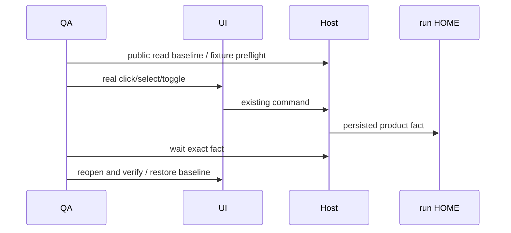

# 剩余本地菜单最小补测计划

状态：七项已实际运行；FLG01/02/03/07 原run PASS，FLG04/05 已在独立新run最小QA修订后实际PASS，FLG06 为安全前置 BLOCKED。仅维护 `manual-review/pending/qa-final-local-gaps-20261106.test.ts`，不修改产品或 canonical。根 agent 串行执行。当前 SLM06 已实际通过两处引导进入/退出，本 suite 不重复该动作。

`qa-menu-20261106-local-final-targeted` 已于20:15:28.484 UTC完整退出。FLG04于20:14:59.050、FLG05于20:15:19.397实际PASS：真实名称键盘草稿→Escape且配置/hash保持、mock精确桥接路径复制；两个owned Memory scope、wx新文件后refresh/count/search/clear以及开关恢复均已抵达。证据见 [FLG04 JSON](runtime/qa-menu-20261106-local-final-targeted/evidence/qa-final-local-gaps-0-3-2912-1793996082456/004-FLG04.json)、[FLG05 JSON](runtime/qa-menu-20261106-local-final-targeted/evidence/qa-final-local-gaps-0-3-2912-1793996082456/009-FLG05.json)。原FAIL保留为QA修前历史，不登记产品缺陷；不再复跑已通过两项，FLG06仍不执行。

`qa-menu-20261106-local-supplement-retry` 于 2026-11-06 20:01:09.916 UTC 整批退出后，允许只修 FLG04/05。原 source SHA256 `673cb61cee52884b4028003aac2daadfd30198393c0b9a97dd1e16ec4f46b933` 与原 FAIL 保留，具体 [归因](logs/qa-final-local-gaps-retry-attribution.md)。FLG04 已进入既有 AstrBot 名称编辑；WebDriver setValue 的 elementClear 成功后 input 卸载，随后 value 命令 stale，取消/复制未达。产品 onBlur 提交并卸载编辑器，QA 改用当前实际聚焦的唯一名称 input 和真实 Ctrl+A/键盘文字输入，等待完整草稿值后 Escape；保留 public 配置、文件 SHA 不变与精确路径 copy 的所有断言，不调用保存或 Bind。

FLG05 两个本树 catalog/path/content 公开服务预检与 scope trigger 可见已通过。MemorySettingsViewer 向 PluginScopeMenu 传 workspaceOptions，明确进入 FlatScopeMenu，当前记忆菜单直接显示 workspace radio，不含设备子菜单。QA 只删除错误的 local-device 子菜单等待，真实点击带精确 owned ID 的 workspace radio，继续原有 scope/search/refresh/恢复断言。FLG06 的独占 `023-FLG06.json` 为 BLOCKED：Unknown inherited Git environment key rejected，在 worker 全部 GIT_* 枚举处，实际 Main/Host gate、git init、diff 与 UI 均未达；没有未知 key 名证据，不放宽 guard，不在本次有限复测中选择 Git。

本次复测只按 fullTitle `(?:^| )FLG0[45]:` 选两项，与 RFC01/HIST01/02/RLM05 合并新唯一 run，finite 三份 replay 保留，不需要 SafeGit/SafeTerminal/OpenSidePane。修后先执行静态模式 `node docs/testing/qa-2026-11-06/logs/e2e-preflight-final-local-gaps-static.cjs --menu-owner-retry`，独占新证据；静态通过仍不计 UI PASS。

2026-11-06 20:05:51 UTC [FLG04/05静态证据](logs/e2e-preflight-final-menu-owner-static.json)已真实exit0：全外置QA noEmit0、六文件targeted lint0警告/0错误、67个callback无闭包、9份raw JS syntax0；三个模块35个实际fullTitle精确只选择FLG04/05两项。修后source SHA256 `edac99520b453037354c81f065dd1987a6dab2a55c8e1660c99bb25455d1f5bb`。canonical fixture checker exit0保留两条既有marker warning；本次只验证QA注册/类型/序列化，尚未执行修后的Bot取消/路径复制或Memory切换刷新。

2026-11-06 19:38:25 UTC 最终 [静态证据](logs/e2e-preflight-final-local-gaps-static.json)：全外置 QA noEmit 0、六文件 targeted lint 0 警告/0 错误；真实导入三份模块注册35个 fullTitle，精确选择 FLG7 + RLM05/06 + SLM15 共10项；62个序列化 callback 无 keepNames 闭包，8份 raw JavaScript syntax 0。FLG source SHA256 `673cb61cee52884b4028003aac2daadfd30198393c0b9a97dd1e16ec4f46b933`。静态导入不执行 before/it，尚未播种51个项目、执行 Git 或写入 Memory catalog；这些 public 输入由每个 case 在本 run 内预检后才进入真实UI，不把类型和源码合同验证称实际 Host 验收。

| ID | 范围和真实动作 | 必须验收 | 限制 |
| --- | --- | --- | --- |
| FLG01 | SET07：General 的 Interaction behavior Select 在 Queue/Guide 间切换 | 先取 Host readSettings 原值；真实 option 点击后等待 Host 持久化事实；离开重开值一致；finally 真实 UI 恢复原值 | 无 prompt，不把保存偏好称 queue/guide 运行行为通过 |
| FLG02 | SET07：自动回答、reasoning、todo、Explore/Terminal/Changes grouping 六个 Switch | 逐项基线→切换→Host事实收敛→重开→恢复；每项 PNG/JSON 与字段值 | 不跑两条含 clearAppData/Bash 的旧 canonical，不启动工具 |
| FLG03 | SET08：当前数据目录 Browse 取消及树内新目录草稿取消 | mock showOpenDialog；取消时 readonly input/保存 disabled/Host dataBaseDir 不变；选择独占树内目录只改草稿，离开重开恢复，目录仍空且无迁移 | 当前 General 没有“打开数据目录”按钮；不编造入口，不点 Save，不迁移或重启；已通过的 SLM06 是引导动作证据 |
| FLG04 | BOT01：当前隔离配置中已有 AstrBot 管理入口、名称编辑 Escape、桥接路径复制 | public getConfig 稳定基线；仅 AstrBot/无平台凭据；进入现有卡片→真实名称输入→Escape 取消，配置与名字未改；copy runtime 相对路径由 mock 捕获；关闭重开仍同一 bot | 不点击 provider、新建、Bind/Unbind/开关/凭据/二维码。若无法证明既有合成 AstrBot 配置或其只读入口安全，则 BLOCKED，不制造其他平台配置 |
| FLG05 | SET18：本 run owned 合成项目记忆 catalog 的 scope/search/refresh | 树内 `.zcodium/cli/memories/projects/<unique>/memory/` 两份合法 Markdown fixture；public Memory.listProjectMemories 精确预检新 workspace/files/path；UI scope 切换后列表一致；再 wx 新文件→refresh→count/search/clear；恢复 memoryEnabled | catalog 只写本例独占目录，wx 不覆写；无 Provider/外部 editor，既有未知目录不修改。公开服务 catalog 不成立则 BLOCKED |
| FLG06 | GIT02：树内独占 repo 以 index 作 baseline，实际未暂存 diff 展开与右键四动作 | `git init`→wx baseline→`git add`→修改本例文件，无 commit；public Git getDiff 预检 before/after/patch，真实项目添加该 root，Review unstaged file 展开；absolute/relative copy、文件管理器出口 mock、Reveal in file tree 精确文件 | GIT_CONFIG_GLOBAL/GIT_CONFIG_SYSTEM/NOSYSTEM/HOME/TEMP/模板/hooks 均隔离；不碰仓库根 `.git`。源码 readUnstagedDiffContents 从 index `ref:""` 读取，若实际 Host/UI 仍硬依 HEAD 则 BLOCKED，不造 commit。不称空 Review 或无 comment callback 为评论功能通过 |
| FLG07 | SET25：ProjectManagement 真实 search/all-unused/三 sort、选择和分页 | 最多51个独占合成虚拟项目通过公开 Projects 创建，不写 DB/store；精确 owned IDs/无根写入/Host预检后搜索该唯一前缀；首50行→真实 show-more→51行；选择后 sort 保留、query/filter 清空，恢复 query/all/lastActive | 不删除/恢复项目，不附真实目录，不改根仓 Git；若无法证明 public seed 合同及隔离持久化则 BLOCKED，不把 show-more absence 称分页已执行 |

状态 owner 仍是产品 Host/Service。QA 只通过真实菜单发送命令，再从 public readSettings、Memory、Bots、Git 合同读事实，不直接写产品 Repo、SQLite 或 Zustand。synthetic Git/Memory fixture 属本例受控外部输入；其目录和每份文件以独占创建且存 SHA 证明。

全部写入限制在当前工作树的新 run HOME/evidence/fixture/cache，运行前核全部 user/cache/temp 环境、同 worker bootstrap DB/project、realpath 与 PS7 窄 reparse guard。新 suite 不导入其他 test module，复用仅 QA DOM/RPC helper 和公开业务入口；每 case 独占 PNG/JSON，交互失败保留 capturePage 帧时间序列，无法编码 WebM 如实标记。所有 native/clipboard 出口完整 mock 后才能操作，无真实系统剪贴板/系统文件选择器/外网/设备行为。Provider mode 只 replay，case 前后 count 不增加。

SafeGit 由 runner 启动前提供：`QA_SAFE_GIT_WORKTREE=C:\vibecoding\zcodium`，`QA_SAFE_GIT_ROOT=<run runtime>/git-isolation`；`GIT_CONFIG_GLOBAL=<root>/global.gitconfig`、`GIT_CONFIG_SYSTEM=<root>/system.gitconfig`、`GIT_CONFIG_NOSYSTEM=1`、`GIT_TEMPLATE_DIR=<root>/templates`。两份 config 与 `<root>/attributes` 必须为空文件，`templates`/`hooks` 为空目录，均独占创建且无重解析。suite 比对实际 Main 继承值与当前 Host/Git 源码继承契约，分别枚举 worker/Main 的全部 GIT_*，未知项拒绝；仅新 repo 的 local `core.hooksPath=<root>/hooks`、`core.attributesFile=<root>/attributes`、`commit.gpgsign=false`，不创建 commit。缺失或无法证明隔离则仅 FLG06 BLOCKED。

FLG07 采用现有公开 `ServiceChannels.Project/saveProject` 串行51次 `{hostId:"local", name:<唯一前缀与两位序号>, roots:[]}`；返回 hostId/UUID/空 roots 后由 readProjects 核51个独占 ID。三个 sort 的验收明确限于全部零任务、无 lastActive 的并列场景及名称 tie-break，不能扩称不同任务数排序通过。fresh 项目受七天宽限，unused空态为预期。数据仅写本 run Host 数据库，没有 Repo/SQLite/store直写、目录附加或删除恢复。

最多七项，实际准入需要 noEmit、targeted lint、真实 describe 栈注册、callback 序列化/raw JS syntax 与 Git/Memory/Projects 公共输入静态核验。Mocha grep 按 fullTitle 使用 `(?:^| )FLG0[1-7]:`，不能用裸 `^FLG` 假定 suite 标题不存在。静态 READY 不计 UI PASS。根在现有应用退出后另起唯一 run；不与其他桌面 worker 并行。
