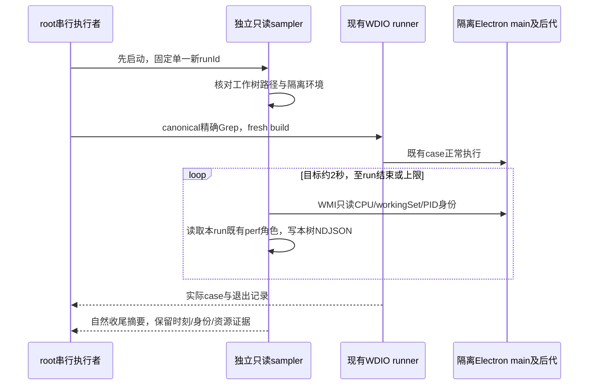

# 分组置顶后协议失效的单用例复现计划

状态：**前两次独立复验均未抵达pin：首次构建前置退出1、0case；第二次1case在缺grouped视图前置停止。第三次grouped唯一run已自然结束1FAIL，重现同pin后自动化链路超时并获得181点资源采样**。本计划复跑当前canonical `GRP04/05/06：组内首发、三视图菜单、置顶/归档和恢复保持成员`，不改产品、正式spec/helper、timeout或同步。该候选尚未计为确认BUG。

## 当前合同与证据

组内任务首发后仍归属原group；切换projects/timeline/grouped视图应能操作任务菜单。置顶后任务应进入grouped视图上方的置顶区；取消置顶、归档/恢复应保留member归属。`project-sidebar/index.tsx:272–279`确实渲染kind=pinned，`ProjectTaskRows.tsx:134`使用`project-pinned-tasks`，不是明显旧selector。

首次filtered尝试在setTaskPinned RPC与focus dispatch返回后，element、screenshot、main退出bridge和session DELETE均超时。随后旧worker进程已结束、新worker继续响应。已有[只读归因](logs/validation-filtered-session-attribution.md)与[事后进程身份](logs/validation-filtered-process-snapshot-1793985716892.json)不包含挂起期间的CPU/内存，无法确认是驱动还是产品事件循环问题。

## 唯一执行所有者与顺序

root是唯一UI执行者，在当前planned批次全部结束后串行执行。sampler仅是独立只读进程；它不向WebDriver/Renderer/Main发请求，也不attach CDP或终止进程。



## 受控sampler合同

[grp-pin-process-sampler.mjs](grp-pin-process-sampler.mjs)当前固定只接受唯一新runId `qa-menu-20261106-grp-pin-grouped`，不接受参数化run名单或前两次run。采样前目标runtime、staged app与旧exit证据必须不存在，避免读旧run；证据写到本报告logs的唯一时间戳文件，不创建目标runtime。由已有隔离validation runner启动，HOME/TEMP/npm/tsx/cache保持在工作树；WMI使用本机PS7、NoProfile/NonInteractive、隐藏子进程。前两次run的85点/121点采样原证据完整保留，不复用其PID或目录。

1. main仅从工作树内Electron executable、确切runId与完整HOME参数、对应staged app的完整`--app=<main/index.js>`参数且无Chromium child type共同确认；多root拒绝。严格Windows token解析支持整token双引号与`--app="value"`/HOME值双引号；先解析原文本，再对完整路径token做Windows大小写/分隔符比较。未闭合quote、重复marker、错误entry/HOME、后缀或旧run均拒绝；完整commandLine只在内存，不能以宽泛includes替代身份。已根据`wdio.conf.ts:503,2998`核对真实entry参数。首次确认后固定PID与创建时间，PID复用不变更root。
2. 后代沿明确main的PPID树收集；main退出后仅继续观察之前确认的PID+创建时间，不扩大到其它run、ChromeDriver、系统进程或新同PID。
3. CPU由WMI累计kernel+user ticks的同创建时间差计算，保存单核百分比及逻辑CPU归一化百分比、workingSet、线程/handle数量。配置间隔默认2000ms、允许1000–2000ms；实际WMI开销与时刻落盘，不能假称超时扫描仍严格等间隔。
4. renderer根据Chromium type识别；Host/scheduler PID角色复用本run已有WDIO perf的serviceName，不额外调用CDP。缺少角色证据的node utility保留unclassified，不猜成Host。
5. 完整系统命令行仅在内存身份解析，不写证据；仅记录目标树PID、创建时间、role、CPU/workingSet和run/home marker布尔值。
6. 发现本run完整exit-code或completed summary后保存末次采样并收尾；默认上限15分钟，允许最大20分钟。超限/只读错误只结束sampler，不清理、杀进程、修改应用或重试UI。

## 精确执行入口

先启动sampler的独立exec session，确认start输出后再启动wrapper；不能先创建此RunId目录或并行执行其它应用测试。

```powershell
node .run-logs/qa-2026-11-06/validation/run-validation.mjs grp-pin-sampler-grouped
```

随后由root执行：

```powershell
& .\docs\testing\qa-2026-11-06\run-menu-tests.ps1 -RunId qa-menu-20261106-grp-pin-grouped -Bootstrap -GroupedTarget -Specs './test/e2e/conversation-session/conversation-session-task-groups.test.ts' -Grep '(?:^| )GRP04/05/06：组内首发、三视图菜单、置顶/归档和恢复保持成员$' -ReplayFixtures './test/e2e/fixtures/upstream/common.json,./test/e2e/fixtures/upstream/conversation-session/conversation-session-task-groups.json'
```

此formal spec显式只用common与task-groups两条本树finite回放，不传pending common-only覆盖，不开启capture；第三轮由已审QA hook准备真实grouped视图，不能依赖同suite前一it；主任务仍须按每次wrapper环境/重解析审查。sampler的上限结束不是本case通过，case timeout也不能单独证明产品死锁。

## 结果与后续验收

只有整条canonical case实际完成置顶、取消置顶、归档/恢复与成员断言且退出记录有效，才称本次用例通过。若再次协议失效，结合当时main/renderer/Host CPU、workingSet、PID创建时间、最后成功操作和技术日志定位；先登记运行候选，独立原因确认后再交接产品修复。后续未抵达动作标受阻/未测，不扩成多个产品Bug。

静态语法、内存身份/CPU负例与targeted lint只验证sampler准备，不计133产品test或UI case；实际sampler证据及此单用例结果待执行后追加。

首个sampler SHA为`60f647800a062a7221c9d7195d0a6d44b64b73dfd0c78ca34066aa00ecc624c7`，当时语法/[9probe](logs/validation-grp-pin-sampler-static.json)/[lint](logs/validation-grp-pin-sampler-lint.json)均exit0。实际 [85点sampler](logs/validation-grp-pin-sampler-1793990457431.ndjson)自18:40:57.431至18:43:46.935 UTC运行并按exit-code1自然收尾；所有main=null。[构建日志](logs/e2e-qa-menu-20261106-grp-pin-repro.log)显示node-repl-host的process-lifecycle.d.ts.map写入TS5033 UNKNOWN，onPrepare失败，尚无UI/worker/case；没有确认锁根因，也没有删除或恢复该map、跳过fresh build。

第二轮的历史准备仅修改QA sampler的唯一run常量并加强旧run、错误HOME、错误entry、树外executable和多root负例；原timeout/CPU逻辑不变。新静态与启动前证据独立保存为`validation-grp-pin-sampler-*-retry.*`，不覆盖旧9probe或85点采样。第二轮随后实际执行，结果如下；该历史READY不能预记通过。

第二轮装载时retry SHA为`b92d49efcd10e38395f121e46f52d109fd4b200383d06912debf9861990cf073`。[14probe](logs/validation-grp-pin-sampler-static-retry.json)、[语法](logs/validation-grp-pin-sampler-syntax-retry.json)、[lint](logs/validation-grp-pin-sampler-lint-retry.json)均exit0、0warning/error；[18:49:19UTC启动前只读检查](logs/validation-grp-pin-sampler-prelaunch-retry-evidence.json)确认runtime/staged app/exit均不存在、祖先无重解析点。该检查不创建目标目录、不扫描进程、不启动UI；真正live入口再次执行相同拒绝规则。

第二轮于19:09:58.714 UTC结束exit1，仅1case在第218行缺`task-group-add`停止，未建组、首发或置顶；精确单it漏了前序grouped设置前置。真实perf已见Main8448/Renderer25532/Host28484，不能把[121点sampler](logs/validation-grp-pin-sampler-1793991958119.ndjson)全部main=null解释为无Main。19:11:53的[固定旧PID事后诊断](logs/validation-grp-pin-retry-identity-diagnostic.json)已经after exit，未获旧commandLine或liveCPU，不能据它确认引号原因。

第三轮唯一grouped源SHA `22ded6f9d2a1914f819ff083aa35d99c05a40c7c0ba60607a8ee46ca7b3b9c64`；[28项完整token正负probe](logs/validation-grp-pin-sampler-static-grouped.json)、[语法](logs/validation-grp-pin-sampler-syntax-grouped.json)均exit0。[定向lint](logs/validation-grp-pin-sampler-lint-grouped.json)exit0，旧事后diagnostic另有2项useless-escape warning、0error，采样器与新prelaunch无诊断。[19:20:42UTC只读准备](logs/validation-grp-pin-sampler-prelaunch-grouped-evidence.json)确认runtime/staged app/exit均不存在及祖先安全；没有启动sampler或UI。旧live aliases已明确停用，新入口再次检查目标不存在；所有前两轮原证据保留。

## 第三轮真实菜单前置与静态准入

`GroupedTarget`默认关闭，只允许`-Bootstrap`、唯一新run、唯一canonical路径和上述完整fullTitle grep；原case/timeout保持。QA root beforeEach顺序为原hooks→reload observer→fit observer→grouped前置。目标前置真实点击`sidebar-view-menu`→唯一`sidebar-view-grouped`，等Portal消失、`task-grouped-view`显示及`task-group-add`可点击，再打开菜单读取`data-state=checked`且`aria-checked=true`，Escape退场。before/checked/after三阶段独占PNG/JSON只观察当前UI，不写localStorage/store、不refresh、不预建group。后续原case仍自行首发、置顶/取消置顶、归档/恢复、移动/脱组。

[当前真实注册与准入](logs/feature-inventory-grp-target-preflight.json)静态READY：describe栈构造fullTitle `任务分组独立视图 GRP04/05/06：组内首发、三视图菜单、置顶/归档和恢复保持成员`，精确选1、排除5；8个source target正负例、7个实际runner前置正负例、5条早退/错误run均0UI。hook语法与原call上下文keepNames回调序列化parse通过，无注入name helper。8个synthetic请求直接执行当前纯fixture matcher，主请求命中`grp06-first-send`、标题命中`conversation-session-task-groups-title-sidecar`；wrong method/marker/已耗maxMatches拒绝。没有启动回放server、UI、Host或构建；静态READY不代表第三轮已执行。首次probe临时把callback赋给新变量产生人工name helper false positive，已改为原execute调用上下文重验，未修改hook。

canonical SHA `cafb1ea9730f997efea88b496fe00bc6aa1ab86c650bbf6ec3a9b8285bb5a2cc`；hook SHA `21216d1a472ad5880ebff67d336cc79339744a03e52d3123b93d2489b5dc6c3c`；runner最终SHA见上述证据sources。common SHA `60f4898eb393afc84f86d9d492af910928658a954b1a777d7d5d5cb537033210`；task-groups SHA `5329045860b91fd2b876210b3c8ba1f1935467accd6d429a03470836225234c5`。本case原首发marker是`E2E_GROUP_TASK`，title旁路要求`Generate a concise title`且status200；common需要只读Read marker并排除title，不抢这两类请求。pending-placement只属未选case，本次不应消费。

首锁路径防护最终源SHA `ad11d09c35475c3859d0acafdc8d9cb880faf694af47bbcf9537d618b0155254`：候选首次锁定前再次核executable/appEntry/HOME物化祖先无重解析。[最终syntax](logs/validation-grp-pin-sampler-syntax-grouped-final.json)、[28probe](logs/validation-grp-pin-sampler-static-grouped-final.json)、[两文件lint](logs/validation-grp-pin-sampler-lint-grouped-final.json)均exit0、0warning/error；[19:27:11UTC最终prelaunch](logs/validation-grp-pin-sampler-prelaunch-grouped-final-evidence.json)目标三路径仍不存在。较早22ded6f9指纹与含旧诊断2warning的lint保持历史，不反写为最终输入。

## 第三轮实际结束

2026-11-06 19:33:56.494 UTC（北京11月7日03:33:56）summary exit1、1case FAIL，sampler19:33:58.254 UTC按run完成自然结束exit0，共181点。[真实菜单checked PNG](runtime/qa-menu-20261106-grp-pin-grouped/evidence/qa-grouped-precondition-0-0-27764-1793993516412-checked.png)已独立查看：[JSON](runtime/qa-menu-20261106-grp-pin-grouped/evidence/qa-grouped-precondition-0-0-27764-1793993516412-checked.json)为groupAddCount1/groupedViewPresenttrue/ariaCheckedtrue；这是前置证明，不是pin后成功截图。随后原case创建分组并首发、检查member、projects/timeline/grouped菜单，setTaskPinned返回19:32:03.197与focus true19:32:03.220之后，257行元素请求19:32:03.221超时19:32:33.233，截图/退出/DELETE连带超时。

[完整181点NDJSON](logs/validation-grp-pin-sampler-1793993275811.ndjson)保留首次锁Main32200及创建时间、Renderer1852、Host30244和scheduler29152角色；[58点失效窗口压缩摘要](logs/validation-grp-pin-grouped-live-attribution-1793993639704.json)仅从既有采样提取，末3点Main已经消失。与filtered独立run的同阶段症状重复，作为高优先运行候选；产品/driver归属及根因仍待查，CPU不证明死循环，8确认Bug数不增加。未抵达取消pin、archive/unarchive与member恢复断言，不能标全case通过。
