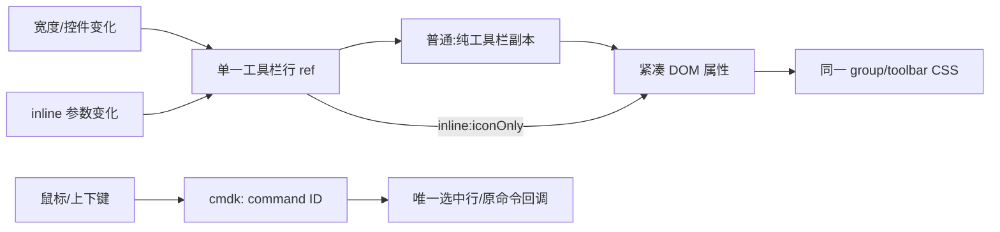

# BUG-006/007/008 UI 修复与回归

本计划只恢复本轮已确认的布局和 cmdk 身份契约，不改变模型、权限、会话、命令执行或持久化状态。产品修前证据和 2026-11-06 的 8 项问题报告保留；新复验结果单独追加。此前同文件未提交的 placeholderContent 等改动保持。

| 问题 | 单一 owner 与最小修复 | 回归前置、动作、断言 |
| --- | --- | --- |
| BUG-006 | 布局 hook 的 ref 只绑定 `group/toolbar` 工具栏行；副本复制该行全部布局骨架与控件，不复制输入/附件/草稿；尺寸与内容观察限于此行 | UIF01：当前隔离空草稿、1280px完整布局，临时把真实输入外壳缩至240px；副本含 leading/content/trailing、按已有顺序压缩；恢复原样式后清紧凑属性，真实模型节点不变、打开菜单/焦点保持。人工240px只证明该回归，普通窄窗另记录 |
| BUG-007 | inline 直接 fit 同一工具栏行，紧凑属性与模型 named group CSS同 owner；布局变化由现有 iconOnly 参数重建观察器 | UIF02：当前项目创建本树合成txt，从文件树打开预览tab，经真实完整视图按钮到 floating；560px空输入时 plus/input/send 中心一致、次序正确、输入至少半宽、模型文字隐藏；宿主高度只观察，不强制旧64px阈值；记录编辑器节点，输入合成草稿，切对话tab后普通布局/草稿/编辑器保持，再退出完整视图 |
| BUG-008 | cmdk 唯一保存 `command:${id}`；title/keywords仍只用于现有匹配，原命令回调不变 | UIF03：操作范围查询 Settings / 设置，分别 hover `suggested-settings`、`settings`；仅一行 selected，真实ArrowDown/ArrowUp与Enter进入设置；恢复工作区，中文再检查身份/执行，不发模型请求 |



边界：Desktop Windows、当前获准工作树 synthetic HOME/data/temp/cache；仅 common 有限 replay、skipProvider/noPrompt。不启动终端，不使用真实文件/clipboard/远端/账号/模型Key，不提交或推送；现有严格 bootstrap/重解析点/环境审查保留。预览txt先验证 DEFAULT_WORKSPACE 对应当前run HOME与 bootstrap，独占 `wx` 创建且不清理历史文件。UI启动与build由root单实例串行执行；本作者只做源/spec和静态准入。

待执行spec：`manual-review/pending/qa-ui-bugfix-20261107.test.ts`，3实际it、grep `(?:^| )UIF0[123]:`，Bootstrap；无OpenSidePane/SafeTerminal/SafeGit。每步保存PNG+JSON，记录 viewport、toolbar/leading/trailing、compact/visibility、cmdk values/selected与编辑器身份。不得用静态noEmit或补充lint当UI通过；失败后保留原错误与未达断言。

## 首次静态准入与冻结（历史）

`logs/feature-inventory-ui-bugfix-preflight-final.json` 已实际退出0：整个外置 QA tsconfig noEmit 为0诊断；真实 Mocha describe 栈构造3个 fullTitle、准确选择3个、排除0；16条 renderer rawJS 语法通过，无需跨闭包函数；目标2文件 lint 为0 warning/0 error。三个源码 owner 守卫通过，只证明源码契约，不代表 UI 已通过。首轮静态的 WDIO 异步 length 类型诊断保留在 `logs/feature-inventory-ui-bugfix-preflight.json`；最窄修正只 await length，没有改断言或超时。

| 冻结输入 | SHA256 |
| --- | --- |
| pending UIF01–03 | `0241aef0bed70384fce102b4eb9a434b91f10a4c7082fea939306797530f8c1e` |
| useComposerToolbarFit.ts | `39196a83946efa8780f73a97aa7965e58d0828d050453171cc71969d36bce226` |
| ChatPromptEditor.tsx（包含保留的用户 placeholderContent 改动） | `cad6793332ec694a37ad188a58dd8242e01c3d6c5734a292d130eccac899f55d` |
| CommandCenterDialog.tsx | `68d997e8c2c891e9d3ed59944b20647380a7a2518912c174e9839a2a771723fa` |
| common.json（唯一 Provider replay 输入；用例不发请求） | `60f4898eb393afc84f86d9d492af910928658a954b1a777d7d5d5cb537033210` |

运行参数在 `logs/feature-inventory-ui-bugfix-parameters.json`，RunId=`qa-ui-20261107-bugfix`。作者没有启动 UI/build；root 在统一类型、lint、架构门禁后单实例执行，完整结束后才能追加 PASS/FAIL 和未达断言。正式生命周期仍为外置 pending，不做人工审核晋升或 CI 准入。

```powershell
& 'C:\Program Files\PowerShell\7\pwsh.exe' -NoProfile -File docs/testing/qa-2026-11-06/run-menu-tests.ps1 -RunId qa-ui-20261107-bugfix -Specs '../../docs/testing/qa-2026-11-06/manual-review/pending/qa-ui-bugfix-20261107.test.ts' -Grep '(?:^| )UIF0[123]:' -ReplayFixtures 'test/e2e/fixtures/upstream/common.json' -Bootstrap
```

## 第二次静态准入：按单行几何验收（历史）

UIF02 删除旧 `height<=64` 硬阈值，保留真实560px宽度、plus/input/send中心差不超过2px、左右次序、输入至少 shell 半宽减16px、模型文字隐藏/图标可见、同一 toolbar owner，以及草稿与编辑器节点保持。`host` 与 shell 的真实高度写入 JSON，仅用于观察。UIF03 的上下循环断言保持：`CommandCenterDialog` 显式传入 `loop`，共享 `Command` 将该 true 值传给 cmdk；不能误用共享包装组件的默认 false 判断这个入口。

新冻结 pending SHA256：`10ac267b006aa47afd301a9c256b649022a6bbaa5d012a8f7972b359106a478f`。产品三个 SHA 与上表一致，未再改产品代码。先前 pending SHA 和静态 JSON 保留为历史，不覆盖。

独立 `logs/feature-inventory-ui-bugfix-preflight-geometry-final.json` 实际 exit0 / accepted=true：全QA noEmit 0诊断、3 fullTitle准确选3/排0、16条 rawJS语法0、跨闭包0、目标2文件 lint 0 warning/0 error、3个源码owner守卫通过。该轮参数使用 `logs/feature-inventory-ui-bugfix-parameters-geometry-final.json`；RunId、grep、common唯一fixture、仅Bootstrap与上述启动命令均保持。该静态时UI尚未执行，后续真实结果见下节。

## 首轮真实 UI 与命令退出同步复验

`runtime/qa-ui-20261107-bugfix/evidence/summary.json` 完整结束于 `2026-11-06T21:51:43.064Z`、exit1：3实际case，UIF01/02 PASS、UIF03 FAIL。工具栏骨架、240px压缩/恢复、菜单/焦点/模型节点，560px浮窗单行几何、模型CSS同owner、草稿和编辑器保持均真实通过。原 FAIL、PNG、JSON和输入 SHA `10ac267b…a478f` 保留，不覆盖。

### UIF01/02 最少可复核证据

以下4组 PNG/JSON 已逐一只读核对。数值为 CSS px，viewport=1280×900、DPR=1.5；240px是人工输入外壳缩窄场景，不代表窗口宽度。

| 已通过动作 | 真实观测 | 最少证据组 |
| --- | --- | --- |
| UIF01 人工缩窄并保持模型菜单 | shell宽240；toolbar宽214.667；leading/content/trailing骨架仍在；toolbar `composerModelIcon=true`，优先级1/3 compact=true；模型宽37.333；focus为composer-provider-trigger，PNG菜单保持可见 | [PNG](runtime/qa-ui-20261107-bugfix/evidence/qa-ui-bugfix-0-0-7180-1794001838742/003-UIF01-narrow.png) / [JSON](runtime/qa-ui-20261107-bugfix/evidence/qa-ui-bugfix-0-0-7180-1794001838742/003-UIF01-narrow.json) |
| UIF01 恢复原样式和节点/菜单/焦点 | shell宽672、toolbar宽646.667、模型宽290.083；toolbarData为空，优先级1/3 compact=null；menuPreserved/focusPreserved/modelNodePreserved=true；focus仍为composer-provider-trigger | [PNG](runtime/qa-ui-20261107-bugfix/evidence/qa-ui-bugfix-0-0-7180-1794001838742/004-UIF01-restored.png) / [JSON](runtime/qa-ui-20261107-bugfix/evidence/qa-ui-bugfix-0-0-7180-1794001838742/004-UIF01-restored.json) |
| UIF02 560px floating空输入同一行 | host/shell宽560；host高度45.531仅观察，shell高度45.333；input宽395.333/高20（大于半宽减16的264）；input和toolbar中心Y均854.656；inline shell未有compact属性，内部toolbarModelIcon=true；模型宽37.333，CSS文字隐藏/图标可见通过真实断言 | [PNG](runtime/qa-ui-20261107-bugfix/evidence/qa-ui-bugfix-0-0-7180-1794001838742/007-UIF02-inline-empty.png) / [JSON](runtime/qa-ui-20261107-bugfix/evidence/qa-ui-bugfix-0-0-7180-1794001838742/007-UIF02-inline-empty.json) |
| UIF02 真实输入草稿再切conversation恢复 | mode=conversation、layout=stacked；shell宽672、toolbar宽646.667；toolbarData为空、优先级1/3 compact=null；editorSame/editorPreserved/draftPreserved=true，PNG显示合成草稿UIF_DRAFT_KEEP_中文；模型宽290.083 | [PNG](runtime/qa-ui-20261107-bugfix/evidence/qa-ui-bugfix-0-0-7180-1794001838742/008-UIF02-conversation.png) / [JSON](runtime/qa-ui-20261107-bugfix/evidence/qa-ui-bugfix-0-0-7180-1794001838742/008-UIF02-conversation.json) |

plus/send与input中心差≤2px及左右次序是原renderer真实断言通过的条件；此快照未单独保存plus/send两个rect，因此不宣称其精确差值为0。模型textContent仍包含隐藏文字，CSS可见性断言和PNG才是图标态证据。空输入PNG中的长placeholder有换行/截断观测，本次仅验控件和编辑器的单行几何，没有把placeholder排版或未覆盖设备作为通过结论。

UIF03 已完成英文两个ID的 hover、ArrowDown/Up、唯一选中与Enter打开设置；英文 suggested-settings 完整关闭断言已通过，英文 settings 在旧portal即时 `isExisting()` 断言失败，因此中文循环未执行。`015-UIF03-en-US-settings-keyboard.json` 记录 `command:suggested-settings=false`、`command:settings=true`。CLI `21:51:28.570Z` 已确认 settings-page可见，`28.583Z` 仍有cmdk输入；随后没有补救交互，`016-UIF03.json`（`28.708Z`）已是 `input:null/items:[]`，PNG只有General设置页。文件均位于 `runtime/qa-ui-20261107-bugfix/evidence/qa-ui-bugfix-0-0-7180-1794001838742/`。

当前 `runCommand` 先 `closeDialog()` 再调用原命令回调；`DialogContent` 保留 `duration-100` / closed animate-out；已安装Radix Presence以 `unmountSuspended` 等待 animationend。因此该错误归为 QA 退场同步缺口，与现有自动消失证据一致，不修改BUG008产品实现。最窄QA修订是在原 `expect(isExisting()).toBe(false)` 前加 `waitForExist({reverse:true,timeout:15000})`，保留原最终断言与所有中英文两ID完整动作，不增加用例timeout、不加固定sleep。

复验只选 UIF03：RunId=`qa-ui-20261107-command-retry`，grep=`(?:^| )UIF03:`，3注册选1/排2，仍仅common+Bootstrap，无OpenSidePane/Terminal/Git；旧已PASS01/02不重复运行。新静态和QA SHA将另存，不用静态检查代替该case实际复验。

当前冻结 QA SHA256=`0a6130286d4e948bb0db0518abd6ea69b81b0a084441257ddcb79ae60e1b99e6`。`logs/feature-inventory-ui-bugfix-preflight-command-retry.json` 实际 exit0 / accepted=true：全QA noEmit0、真实3 fullTitle选1/排2、16rawJS语法0/跨闭包0、目标2文件lint0warning/error、3源码owner守卫通过。三个产品输入SHA不变。新参数 `logs/feature-inventory-ui-bugfix-parameters-command-retry.json`，等待root统一门禁/串行UI，不预记复验PASS。

```powershell
& 'C:\Program Files\PowerShell\7\pwsh.exe' -NoProfile -File docs/testing/qa-2026-11-06/run-menu-tests.ps1 -RunId qa-ui-20261107-command-retry -Specs '../../docs/testing/qa-2026-11-06/manual-review/pending/qa-ui-bugfix-20261107.test.ts' -Grep '(?:^| )UIF03:' -ReplayFixtures 'test/e2e/fixtures/upstream/common.json' -Bootstrap
```

## 影响边界记录

本次分类是 presentation / implementation-handoff。种子是 `ChatPromptEditor`、`useComposerToolbarFit/fitComposerToolbar`、`CommandCenterDialog`。当前 codegraph 工具不可用；以当前公开模块契约和精确 caller 查询补充，`useComposerToolbarFit` 的产品调用仅 `ChatPromptEditor`，`composer-toolbar-layout` 登记既有公开入口。没有新增模块或依赖，也没有更改图谱产品关系。

| 用户入口 | 展示 owner | 业务校验、提交和事实 owner | 必须保留 |
| --- | --- | --- | --- |
| Desktop/Web 普通 ChatPromptEditor | named toolbar 行的 DOM 投影；普通尺寸使用不可见纯工具栏副本 | 现有 V4/模型/权限 hooks；fit 不写 store 或服务 | 正常宽度恢复、节点/菜单/焦点保持；不复制输入/附件/草稿 |
| 完整视图 floating/conversation | 同一工具栏 ref；inline 既有 iconOnly 参数 | 现有完整视图与草稿 owner；本修复不改变 full-view 事件或持久化 | 浮窗单行、返回 stacked、同一编辑器和草稿 |
| 命令中心中英操作范围 | cmdk 选中身份 `command:id`；现有匹配独立读取 title/keywords | 原 quickPickCommands.run 与 openSettings 回调 | 唯一选择、循环上下键、原执行回调；不改变筛选排序或任务身份 |

必须检查共享尺寸、模型菜单和 locale 内容刷新；Web/mobile/粗指针属于共享实现的不变量范围，本轮 Windows pending 不宣称这些设备已验。模型候选来源、自动化/Subagent默认值、权限提交、远端/持久化为 invariant-only，本修复没有触及。接受 UIF01–03；剪枝真实 Provider 请求、真实剪贴板、远端设备、终端/Git、任何数据清理；这些不会为布局/命令身份增加有效证据。

## UIF03 最终真实复验

root 已确认 `qa-ui-20261107-command-retry` wrapper 完整 exit0；[summary](runtime/qa-ui-20261107-command-retry/evidence/summary.json) 完成于 `2026-11-06T22:11:36.535Z`，1实际case、1 PASS、0 FAIL、0 SKIP。[test-results.ndjson](runtime/qa-ui-20261107-command-retry/evidence/test-results.ndjson) 的 UIF03 PASS 时间为 `22:11:21.806Z`，case耗时8321ms。冻结 QA SHA `0a613028…b99e6` 与三个产品输入保持，只有本计划追加结果；首轮UIF03 FAIL和退出动画同步归因均保留。

中英文各两个ID完整执行了真实 hover、ArrowDown移到另一行、ArrowUp返回原行、每步唯一选中、Enter进入设置、等待旧命令弹窗卸载以及原不存在断言。002–013的全部JSON已只读核对，四个keyboard PNG及以下四个executed PNG已逐一查看：同名候选仅有一行灰色选中，执行后分别显示英文General或中文常规设置页，命令弹窗已消失。viewport为1280×900、DPR=1.5。

| locale / command ID | hover及上下键返回后的真实选择 | Enter执行后最少可复核证据 |
| --- | --- | --- |
| en-US / suggested-settings | 两行均显示Settings；`command:suggested-settings=true`、`command:settings=false`，selectedCount=1（002/003） | `22:11:16.058Z`、settingsOpened=true、center input=null/items=[]：[PNG](runtime/qa-ui-20261107-command-retry/evidence/qa-ui-bugfix-0-0-31608-1794003060087/004-UIF03-en-US-suggested-settings-executed.png) / [JSON](runtime/qa-ui-20261107-command-retry/evidence/qa-ui-bugfix-0-0-31608-1794003060087/004-UIF03-en-US-suggested-settings-executed.json) |
| en-US / settings | 两行均显示Settings；`command:suggested-settings=false`、`command:settings=true`，selectedCount=1（005/006） | `22:11:17.588Z`、settingsOpened=true、center input=null/items=[]：[PNG](runtime/qa-ui-20261107-command-retry/evidence/qa-ui-bugfix-0-0-31608-1794003060087/007-UIF03-en-US-settings-executed.png) / [JSON](runtime/qa-ui-20261107-command-retry/evidence/qa-ui-bugfix-0-0-31608-1794003060087/007-UIF03-en-US-settings-executed.json) |
| zh-CN / suggested-settings | 两行均显示设置；`command:suggested-settings=true`、`command:settings=false`，selectedCount=1（008/009） | `22:11:19.884Z`、settingsOpened=true、center input=null/items=[]：[PNG](runtime/qa-ui-20261107-command-retry/evidence/qa-ui-bugfix-0-0-31608-1794003060087/010-UIF03-zh-CN-suggested-settings-executed.png) / [JSON](runtime/qa-ui-20261107-command-retry/evidence/qa-ui-bugfix-0-0-31608-1794003060087/010-UIF03-zh-CN-suggested-settings-executed.json) |
| zh-CN / settings | 两行均显示设置；`command:suggested-settings=false`、`command:settings=true`，selectedCount=1（011/012） | `22:11:21.534Z`、settingsOpened=true、center input=null/items=[]：[PNG](runtime/qa-ui-20261107-command-retry/evidence/qa-ui-bugfix-0-0-31608-1794003060087/013-UIF03-zh-CN-settings-executed.png) / [JSON](runtime/qa-ui-20261107-command-retry/evidence/qa-ui-bugfix-0-0-31608-1794003060087/013-UIF03-zh-CN-settings-executed.json) |

最终 [PNG](runtime/qa-ui-20261107-command-retry/evidence/qa-ui-bugfix-0-0-31608-1794003060087/014-UIF03.png) / [JSON](runtime/qa-ui-20261107-command-retry/evidence/qa-ui-bugfix-0-0-31608-1794003060087/014-UIF03.json) 捕获于 `22:11:21.797Z`，status=passed、center input=null/items=[]。UIF01/02在首轮真实PASS、UIF03在独立复验真实PASS；本轮仅证明上表Windows隔离场景，未晋升外置pending，也不改写此前87组QA历史或扩认Web/mobile/其它命令动作。
