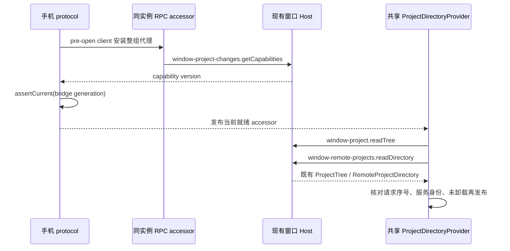

# 宽屏 Web 远控任务列表

## 当前项目目录边界（2026-10-13）

宽屏和窄屏已共用 `ProjectSidebar`。侧栏、项目编辑、输入框项目选择和归档目录必须使用控制桌面窗口的项目目录：本机项目加本机保留的远端项目入口。进入远端任务、创建远端草稿或刷新页面不得将该集合替换成 Source 自己的项目全集，也不得显示未添加的远端项目。

远端 `web-remote-replayable` attachment 在原 RPC 上额外提供整体可选的窗口目录能力：`window-project`、`window-remote-projects`、`window-project-changes`。前两者复用窗口 ProjectService/RemoteProjectService；第三者只提供项目变化通知与就绪校验，不暴露通用广播写入。Host 在确认完整服务组后按 attachment 装配；不修改共享 Source 服务集合。原 `project`、`remote-projects`、`broadcast` 仍属于当前工作区，文件/会话提及、工作流保存、自动化和配置目录调用保持原语义。

bridge-ready 显式声明能力，Web 只在声明支持时创建和校验整组代理。缺能力的旧端沿用原路径，旧行为不计为已修复；声明支持却缺服务必须报错，不静默降级。目录读取、修改和变化订阅必须同时选择同一服务组。bridge 换代重新订阅新代理，迟到结果和卸载后的回包不得提交。任务 pin/archive 继续走窗口 Controller，文件内容仍按 workspace identity 路由。

能力校验中的待就绪 bridge 必须参加传输恢复后的未确认帧重放，不能被旧 active bridge 的降级状态阻断。重放沿用原序号去重和原始等待期限；能力校验成功后才发布服务。

```text
同一 shared-host attachment
  ├─ window-project / window-remote-projects / window-project-changes → 窗口目录 owner
  └─ project / remote-projects / broadcast → 当前 Source owner
```

不新增 attachment、Agent runtime、持久缓存或数据库迁移；不改变账号归属、Root 重挂载、continuous/replayable 或任务队列语义。

回归 MRO02：准备本机项目、置顶、已添加远端项目和未添加远端项目，跨本机/远端打开及刷新后可见集合不变；窗口项目变更同步、读写同 owner、Source 内提及查询隔离。覆盖宽屏与 390px、中英文、深浅主题；RPC 错误能力、订阅释放和迟到响应由定向测试验证，真实远端连接另行取证。

## 目录与实时状态

项目树仍由 Host 的 app 库决定行集合、归属和置顶/归档。Controller 只提供既有行的实时活动，不因切入远端而改变行集合。项目视图、最近更新、输入框项目菜单与归档管理共用 ProjectDirectoryProvider；服务选择不创建第二份树、未读状态或排序偏好。

普通桌面继续读取本机 base 目录；Web 本地 bridge 沿用原服务。远端 scope 的文件 IO、任务正文、提及与配置维持 Source 身份隔离。手机 home/chat 与宽屏布局仅决定展示，不决定目录 owner。

## 2026-11-12 手机入口与目录契约修复

手机 `mobile.html` 的产品入口接入共享 Root，由已有 `ProjectDirectoryProvider` 读取同一个 accessor 的 `windowProjectDirectory` 服务组。移除手机专用的目录快照读取、bootstrap 标签合并和独立目录状态；不同时保留第二套目录呈现路径。项目树和保留远端入口分别沿公开 `projectService.readTree` 与 `remoteProjectService.readDirectory` 返回既有 `ProjectTree` / `RemoteProjectDirectory`。

根因：旧手机调用 `window-project.readDirectory` 后用严格 `WindowProjectDirectorySnapshot` 校验，但该公共方法已是文件系统选目录入口，真实响应为 `{path, entries}`。修复不能把文件项拼成窗口工作区、编造 generation、放宽 schema 或失败后借 Source 目录。Main→Host 仍使用的旧标签页投影 DTO 保留严格校验，不作为项目服务的响应契约。

就绪仍先在 pre-open ChannelClient 安装整组代理，再校验 `window-project-changes.getCapabilities`；Initialize、RPC ACK 与 replay 序号保持原链路。能力缺席不冒充目录可用；声明支持却缺服务或版本错误必须显式失败。能力校验迟到时先检查 bridge generation，provider 的真实目录查询继续用现有请求序号、服务身份和卸载围栏。



回归要求：能力校验不调用文件系统读目录、不改 ChannelClient 或 reader；旧 bridge 的就绪结果不能发布到新 bridge。真实项目读取验证同组 tree/remote owner、Source 隔离和迟到响应；严格旧 tab DTO 继续拒绝文件系统响应。共享手机界面须经现有 shared-host attachment 展示同一任务与目录，参数、趋势和原文入口按原生压缩 spec 验证。源码回归不能代替手机产品结果，整轮产品复测由统一 E2E 执行。

## 验证边界

- 契约和 RPC 测试验证能力组、读写 owner、事件过滤、旧版兼容、就绪失败与订阅释放。
- UI 测试验证同组服务选择、bridge 换代和迟到响应、首发可见性及相邻 Source 调用。
- MRO02 受控 Web 用例使用真实项目服务与隔离 SQLite，覆盖宽窄屏、中英文和深浅主题。
- Electron 与独立 SSH 容器用例经真实 Window Host、Source、bridge 和 relay 运行；只使用项目/草稿，不调用模型。受控桥接结果不能代替该主链证据。
- pending 用例不自动转正，也不计入 formal/Docker 准入。

2026-10-13 验证：MRO02 受控 Web 八组全部通过；真实 Electron + 独立 Linux SSH Source + loopback relay 的宽窄屏往返通过（`r3-server-wrc-directory-20261013-p2d`）。Source 的工作区 project 查询仍只返回其项目全集，窗口目录只显示本机保留入口；账号与引导继续属于 Source。真实手机、Windows/WSL 未由该结果覆盖。
