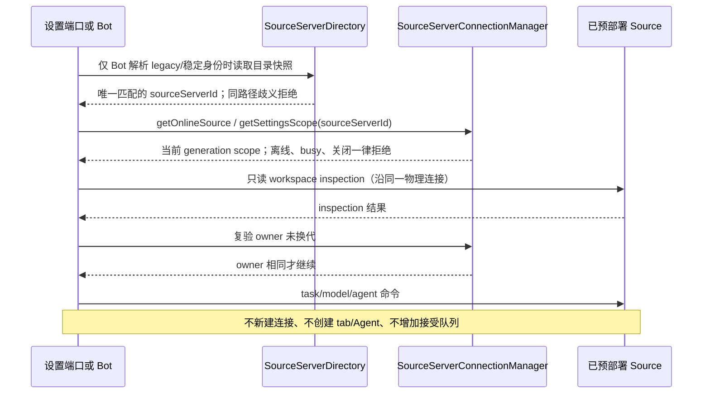

# desktop-source-connection

本目录只承载 `desktop-source-connection` 的契约四件套：`contract.ts` 仅重新导出同模块既有
公开端口，不新增 API、不写实现。物理连接事实的唯一 owner 仍是
`sourceServerConnectionManager.ts`，Source 目录是 `sourceServerDirectory.ts`，
Bot 只读适配是 `botProjectBridge.ts`。

- 唯一物理连接 owner：`SourceServerConnectionManager` 按 `sourceServerId` 独占 transport 与
  RPC 连接；设备设置（`sourceSettingsServiceCollection.ts`）与 Bot 只读取它已在线 scope，
  不另开第二条连接，也不保存第二份连接事实。
- 代际：连接 `generation` 单调递增；换代、离线、显式 stop/restart 与 Host 退出都关闭旧端口，
  迟到回包不得重试旧连接。
- 拒绝：离线、busy（`SourceServerOperationFlights` 持有显式命令与查询 flight）与 manager
  已关闭时，读取返回 `undefined` 或抛错，不为读取新开 transport。
- 预部署-only：只连接用户已部署并启动的兼容 Source；不自动安装、升级、下载或上传运行资源。
- 同一只读 inspection：设置与 Bot 的命令准入都经过当前只读 workspace inspection，
  检查前后 owner 必须相同；断线换代即拒绝。
- 无新状态：不新增 logical tab、Agent 或已接受输入队列；组织态命令仍走窗口 Controller
  admission，普通输入不触发连接。

Main 远控 bridge 的 managerTypes 仅描述窗口目标、平台回调与原 factory 端口，不保存配对、任务或 attachment 事实；runtime、deviceSid 路由、生命周期 symbol 和授权均由原 Main factory 独占。

手机 attachment 的 SettingsSync 仅按方法开放 `getFirstRunPromptState` 与
`markFirstRunPromptHandled`，转发给已登记的同一个 Host 设置 owner。发现、导入、Agents
文件复制、其它同步与未来方法仍返回 `feature_disabled`；source-settings attachment 仍为
Desktop-only。首启 UI 关闭后沿该 owner 持久化，reload 只能重新读取，不能再保存第二份状态。
