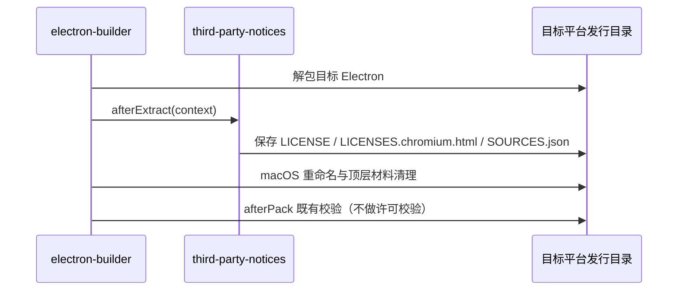

# 第三方许可材料与发行交付

## 产品规则与所有者

第三方复制内容保留各自许可、版权及适用的文件内修改声明。包元数据不能单独替代上游原始材料。没有取得证据的事项保持阻断，不能通过更新哈希、删除记录或编造权利人关闭。第一方代码的对外许可由开源导出覆盖层提供，不在本目录声明。

原生上下文压缩固定使用 `acp-kernel@0.0.195`（billion-context 提交 `dc041dd1ab1a014efa352ba47a6f31fc47f55284`），归档只含内核库入口及其声明。登记 `vendor/acp-kernel-0.0.195.tgz` 的真实 SHA-256/SHA-512 和归档内 LICENSE 原文快照；许可标识保留发布元数据的 MIT，同时明确完整原文另有产品出处标注条款。产品的压缩帮助明确署名，入口指向本仓功能文档的 `acp-kernel` / `billion-context` 章节；文档显著声明本产品使用了两项目，并保留作者及原仓链接。生成清单不能删掉附加条款或把它当作纯 MIT。

本仓归档含一个 CommonJS 加载兼容补丁：tokenizer 的 `createRequire` 在 CommonJS 使用 `__filename`，ESM 使用原有 `import.meta.url`。估算公式、可选依赖 fallback 和 LICENSE 原文均保留。归档、lockfile、provenance 与库存完整性必须同步，不再将其描述成未修改上游。

本轮生成先因当前安装图中七个既有包缺少包内完整原文而停止，未写出半份清单。随后仅补许可来源：`@trycua/cua-driver@0.28.2` 对照官方 tag `cua-driver-rs-v0.28.2` 的固定提交、准确版本的 TypeScript manifest 与仓库 MIT LICENSE.md；`@ubjs/core@0.31.0-3` 与五个 `@ubjs/node*` 包分别对照 npm 发布 gitHead 的原始 MPL notice，并随声明提供 MPL 2.0 全文。登记不会改变依赖、运行资源或许可 allowlist；生成通过也不等价于已完成 MPL 源码提供义务或所有已有 reviewRequired 项的审核。

补齐原文后，生成器发现旧 `@napi-rs/canvas-linux-*@0.1.100` 来源覆盖不在当前可安装生产图。锁文件仍保留 canvas 的可选平台依赖，但这四项的 `os: [linux]` 与当前 Windows/macOS 目标不匹配。仅移除 `x64-gnu`、`x64-musl`、`arm64-gnu`、`arm64-musl` 的过时覆盖元数据；共享的原文快照 `8802fecf9da4367bc23bcf20b21cc143785fc6c92b152f3fa7fbe6ce08d344d6.txt` 及 Windows/macOS 来源记录保留。此收口不改锁文件、不新增许可例外，也不下载或恢复 Linux 包。声明和 inventory 必须由完整生成器重新生成，不能手改哈希伪报新鲜。

2026-11-11 在工作树内隔离 HOME/TEMP/cache，以本机 Node 24.18.0 与离线缓存的 `corepack pnpm@10.33.2` 完整生成成功：当前 1132 个 npm 精确版本、13 个复制组件、18 个原生归档，声明 1,964,916 字节。旧库存 1206 个包版本随当前生产图重新计算；前述四项 Linux canvas 不再纳入库存，`acp-kernel@0.0.195` 的完整原文逐字节保留且声明 SHA-256 对账通过。14 项原有 `reviewRequired` 仍登记，未宣称完成所有许可义务；未构建安装包。生成与前后证据位于 `.run-logs/project-only-validation/native-context-notices-rMxXgr/`。

同轮 `readVerifiedNotices(root)` 的非完整模式核验退出 0，所有登记输入哈希与声明字节一致。`licenses.mjs check` 实际退出 1：4 个 `@trycua/cua-driver-*` Windows/macOS 平台包的 `MIT AND MPL-2.0` 与 6 个 `@ubjs/*` 包的 `MPL-2.0` 尚未登记当前生产依赖的人工复核结论。这与材料生成、新鲜度核验分别记录；未添加 allowlist 或改变许可例外。检查日志位于 `.run-logs/project-only-validation/native-context-notices-lbYERr/logs/notices-generation.log`。

| 所有者                                                                                              | 职责                                                             |
| --------------------------------------------------------------------------------------------------- | ---------------------------------------------------------------- |
| `third-party/*.json`、`third-party/upstream/`、`third-party/native-search/`、`third-party/runtime/` | 材料与待核验事项的唯一登记入口和原文快照                         |
| `scripts/third-party-npm.mjs`                                                                       | 解析锁文件生产图与实际安装图、读取包内原文                       |
| `scripts/generate-third-party-notices.mjs`（`licenses.mjs notices`）                                | 生成 `THIRD-PARTY-NOTICES.md` 与 `inventory.json`                |
| `scripts/licenses.mjs check [--strict]`                                                             | 显式许可标识、新鲜度与材料完整性检查                             |
| `scripts/third-party-notices.mjs`                                                                   | 构建期读取与分发声明；各构建入口只调用这一模块，不另建许可数据库 |

## npm 生产图的范围

- 生产图取所有工作区项目的生产依赖，包括不发布的内部应用；内部应用的构建工具（如 Vite 插件）必须放在 `devDependencies`，否则会把构建工具误算为生产依赖。
- 只登记 pnpm 在当前宿主上会安装的包：锁文件 `packages` 段的 `os`/`cpu`/`libc` 约束与 `pnpm-workspace.yaml` 的 `supportedArchitectures`（`current` 取宿主值）按 pnpm 的可安装规则比对。不可安装的平台包及只经由它们引入的依赖不安装、不分发，不进生产图，也不作为缺失安装报错；不再维护按包名的例外名单。
- 当前 fork 的 `supportedArchitectures.os` 为 `current`、`darwin`、`win32`；在 Windows/macOS 宿主上，Linux 专用包被平台约束排除。pnpm 在这两种宿主上不检查 `libc`，但这不会绕过 `os` 过滤或把 Linux 包纳入分发。生成声明使用当前宿主与同一份安装目标配置，不默认下载其他平台资源。
- 非宽松许可的生产依赖只按包名逐项登记人工复核结论，登记同时绑定许可类别，许可变化后重新阻断：
  - LGPL：只允许以独立、可替换的动态库形式分发的 libvips（sharp 的 `@img/sharp-libvips-*` 与内含 libvips DLL 的 `@img/sharp-win32-*`，只由真实 Computer Use 包引入），声明中附原文。
  - 内部应用独有且不随产品分发的依赖（当前为 `apps/dev-docs` 的 `elkjs`，按 EPL-2.0 使用）。
  - 其余 LGPL/GPL/EPL 等仍按类别阻断。
- 开源导出树的工作区与锁文件不同于闭源，其声明与 inventory 由导出流程在开源依赖树上重新生成，不沿用闭源声明。

## 开发、构建与校验边界

```text
开发 / bootstrap / build → readThirdPartyNotices 等读取已有材料 → 复制或嵌入产物
显式 notices / check     → 核验输入与原文 → 更新清单或报告失败
```

- 构建不更新清单，也不隐式运行许可校验；inventory 过期、待核验项或原生登记不匹配都不阻断开发和打包。
- 声明文件和所需材料仍是打包输入；缺失、无法读取或无法解析时保留原始错误，不生成空声明。
- 原生材料只在显式生成时 `{ verify: true }` 核验输入和原文。
- `readVerifiedNotices(root, { requireComplete: true })` 目前只由显式检查使用；接入 SEA 发布与 SMB 上传前，必须先按本仓库依赖树重新生成声明并关闭已登记缺口，否则两条发布路径会立即失败。

## 交付入口（本仓库已接入）

| 产物                        | 位置                                                                                                                          | 接入点                                                             |
| --------------------------- | ----------------------------------------------------------------------------------------------------------------------------- | ------------------------------------------------------------------ |
| Desktop                     | `Resources/THIRD-PARTY-NOTICES.md`、`Resources/licenses/electron/`                                                            | `electron-builder.config.js` 的 `extraResources` 与 `afterExtract` |
| Web                         | 部署根目录 `THIRD-PARTY-NOTICES.md`，HTML `rel="license"`                                                                     | `packages/web/vite.config.ts` 的 `thirdPartyNoticesVitePlugin`     |
| Server HTTP / remote bundle | `packages/server/dist/`、`dist/remote/`                                                                                       | `tsup.config.ts` 的 `onSuccess`、`build-remote.ts`                 |
| CLI                         | `apps/zcode-cli/packages/cli/dist/THIRD-PARTY-NOTICES.md`                                                                     | `scripts/build.mjs`                                                |
| 搜索工具                    | 每个工具目录的 `THIRD-PARTY-NOTICES.txt`、`SOURCES.json`；SEA 内嵌同名资产                                                    | `prepare-native-search-tools.mjs`、`sea-runtime-tool-assets.mjs`   |
| 远端组件                    | `server/`、`node-pty/<platform>/`、`glm/<platform>/` 的声明，`node/<platform>/LICENSE.node.txt`                               | `prepare-prebuilds.mjs`，在组件哈希计算前复制                      |
| 独立 Server 发行包          | `runtime/THIRD-PARTY-NOTICES.md`、`LICENSE.node.txt`、`NODE-SOURCES.json`、`licenses/{agent,official-plugins}/`、工具目录声明 | `stageCli.ts` 读取后显式传入 `stage.ts`                            |
| 统一分发包                  | `agent/THIRD-PARTY-NOTICES.md`                                                                                                | `scripts/build-zcode.mjs`                                          |

未接入：`zcode --licenses` 入口与 SEA 内嵌 Node 许可（SEA 基底 Node 版本随构建机浮动，`runtime/sources.json` 只登记固定版本）；producer 归档内嵌声明（会改变已固定 SHA-256 的归档字节）。

## Electron 事件顺序



材料从实际目标归档读取，不从宿主 Electron 替代。重复 staging 覆盖同一目标目录；不同目标使用各自 appOutDir。Windows 重命名后的 `LICENSE.electron.txt` 也可读取。

## 验收

1. `node --test scripts/third-party-notices.test.mjs`：缺少 inventory 或哈希过期时构建复制仍成功，显式校验失败；严格校验拒绝待核验项；缺少声明时保留 ENOENT。
2. 独立 Server staging 的组件归档分别包含 npm、Node 与搜索工具声明，工具声明缺失时 staging 失败。
3. 执行 `node scripts/licenses.mjs check`，如实记录在当前依赖树上的结果；不以更新哈希代替重新生成与审核。
4. 最终安装包未实际构建时，不声称完成全平台安装包审计。
